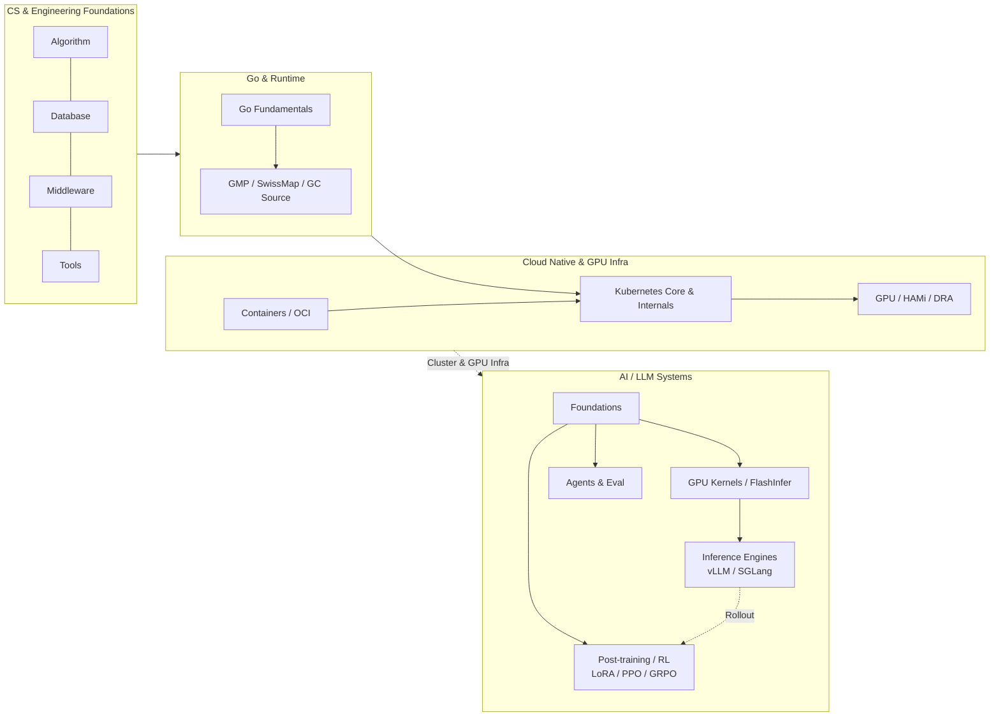

# Learning Notes

这是一个聚焦 **AI Infra & Systems Full-Stack** 的个人技术学习笔记库，兼容 Obsidian 与 GitHub 阅读。顶层收拢为 **AI / Cloud Native / Go / Foundations** 四大支柱；内容以理解底层机制、源码导读和动手实验验证为核心目标，面试题只作为辅助复习视图。

## 快速检索

- **1-hop 全局目录**：[全库知识速查索引](docs/catalog.md) · [全库标签聚合索引](docs/tags.md)
- **SQLite FTS5 秒级 CLI 检索**（纯 Python 3 标准库，自动在 `.traces/notes_fts.sqlite3` 维护全文索引，支持中文双字/英文标识符检索）：

```bash
python3 scripts/search_notes.py "权重吸收"
python3 scripts/search_notes.py paged_kv_t --domain ai --limit 10
python3 scripts/search_notes.py --tag flashinfer
python3 scripts/search_notes.py --rebuild-catalog
```

## 全局知识地图



第一次进入某个领域，先打开对应的 `README.md`；需要跨领域直达具体笔记时，优先查阅 [全库知识速查索引](docs/catalog.md)。根 README 只维护一级入口与核心主线。

## 知识领域

| 支柱领域 | 入口 | 主要内容 |
| --- | --- | --- |
| AI / LLM Systems | [AI 学习索引](ai/README.md) | LLM 基础、[GPU 算子 / FlashInfer](ai/kernels/README.md)、vLLM/SGLang 推理、Post-training / RL、Agent 与离线实验 |
| Cloud Native | [云原生学习索引](cloud-native/README.md) | [容器与 OCI](cloud-native/containers/README.md)、[Kubernetes 体系](cloud-native/kubernetes/README.md)、GPU 调度 / HAMi、源码导读与可运行 Demo |
| Go & Runtime | [Go 学习索引](go/README.md) | [语言核心机制](go/fundamentals/README.md)、并发模型、[Go 1.26 Runtime 源码导读](go/internals/README.md) |
| Engineering Foundations | [工程基石索引](foundations/README.md) | [算法与数据结构](foundations/algorithm/README.md)、[数据库](foundations/database/README.md)、[中间件](foundations/middleware/README.md)、[常用工具](foundations/tools/README.md) |

## 核心学习路线

### AI Infra 与推理系统

LLM 基础数据流 → [GPU 算子与 FlashInfer](ai/kernels/README.md)（CUDA 执行/内存模型、JIT、Paged KV、Split-KV Decode、Ragged Prefill/MLA）→ vLLM / SGLang 推理引擎与分布式路由 → LoRA / Post-training / RL → Agent 与评测。详细入口见 [AI 学习索引](ai/README.md)。

### 云原生与 GPU 调度

[容器基础](cloud-native/containers/README.md) → [Kubernetes 核心架构](cloud-native/kubernetes/core/README.md) → 网络/存储 → 组件拆解 → 源码导读 → GPU 调度 / HAMi 与可运行 Demo。详细入口见 [Kubernetes 学习索引](cloud-native/kubernetes/README.md)。

### Go 语言与 Runtime 深入

Slice/Map/Interface → Context/Channel → GMP/GC → Go 1.26 Runtime 源码 → 新旧实现对比（Swiss Table map、Green Tea GC）。源码层入口见 [Go Runtime 源码索引](go/internals/README.md)。

## 仓库约定

- 顶层采用 `ai/`、`cloud-native/`、`go/`、`foundations/` 四大支柱划分，不再平铺零散目录或跨领域大桶。
- 每个知识文件只有一个 canonical 归属；路线、源码、Demo 和题库通过领域内子目录表达。
- 普通知识笔记使用全局唯一的英文小写 `kebab-case` 文件名，且必须包含一级 `# H1` 标题，保证 `[[wikilink]]` 与大纲唯一解析。
- 所有正式学习题均提供默认折叠的参考答案，便于先主动回忆再展开核对；任务清单不伪装成题目。
- 新增、移动或修改笔记元数据后运行：`python3 scripts/search_notes.py --rebuild-catalog` 与 `python3 scripts/validate_notes.py`。

完整目录职责与写作规范见 [仓库架构](docs/architecture.md)、[全库知识速查索引](docs/catalog.md)、[全库标签聚合索引](docs/tags.md) 和 [AGENTS.md](AGENTS.md)。
