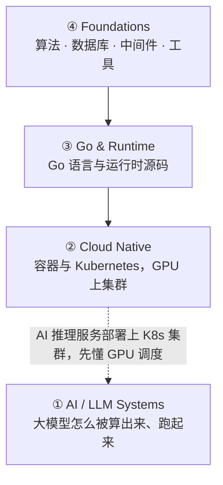
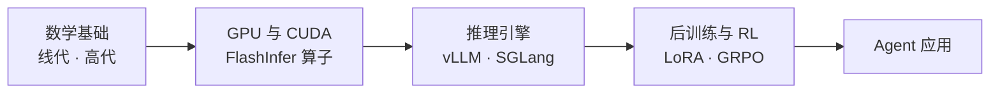

# Learning Notes

这是一个聚焦 **AI Infra & Systems Full-Stack** 的个人技术学习笔记库，兼容 Obsidian 与 GitHub 阅读。内容以理解底层机制、源码导读和动手实验验证为核心，面试题只作为辅助复习视图。

## 快速导航

| 你的情况 | 去这里 |
| --- | --- |
| 想系统学某个领域 | 下面四大支柱的领域索引，每个索引自带推荐阅读顺序 |
| 想查某个概念 / 算子 / 笔记 | [全库知识速查索引](docs/catalog.md) 或文末 SQLite 检索 |
| 读到不懂的名词 | 先查本文的[名词解释](#名词解释)，再回领域索引 |

## 地图：四大支柱怎么连



- **① AI 支柱内部的学习链**（最重要的一条主线）：



- ②③④ 三个支柱相对独立，按需进入；遇到不认识的名词直接查下面的名词解释。

## 四大支柱

| 领域 | 入口 | 内容一句话 | 建议第一步 |
| --- | --- | --- | --- |
| **① AI / LLM Systems** | [AI 学习索引](ai/README.md) | 从数学与 CUDA 算子（FlashInfer）底座，到 vLLM / SGLang 推理引擎，再到后训练与 Agent | 没基础先看 [LLM 零基础学习路线](ai/foundations/llm-learning-path.md)；做 Infra 直接走 [AI 学习索引](ai/README.md) 的路线 A |
| **② Cloud Native** | [云原生学习索引](cloud-native/README.md) | 容器与 OCI、Kubernetes 核心/网络/存储、GPU 调度与可运行 Demo | [容器基础](cloud-native/containers/README.md) |
| **③ Go & Runtime** | [Go 学习索引](go/README.md) | 语言核心机制 + Go 1.26 Runtime 源码导读（GMP / SwissMap / GC） | [语言核心机制](go/fundamentals/README.md) |
| **④ Engineering Foundations** | [工程基石索引](foundations/README.md) | 算法、数据库、中间件与常用工具 | [算法与数据结构](foundations/algorithm/README.md) |

## 名词解释

只解释地图和表格里出现的词，每个词一句话大白话。更系统的定义在对应领域的笔记里。

### ① AI / LLM Systems

| 名词 | 一句话解释 |
| --- | --- |
| 线代 / 高代 | 大学数学课：线性代数管矩阵乘法与向量投影，高等代数管秩、正交旋转、特征值——本库只挑大模型用得上的部分 |
| CUDA | NVIDIA GPU 的编程平台，用它写代码让 GPU 并行干活 |
| SIMD / SIMT | CPU 一条指令同时算 8 个数（SIMD）；GPU 一条指令让 32 个线程同时执行（SIMT） |
| 算子（Kernel） | 一个具体的 GPU 计算函数，比如"做一次 RMSNorm""算一次注意力" |
| FlashInfer | 高性能算子库；vLLM / SGLang 底层用它算注意力、采样、归一化 |
| KV Cache | 生成文本时缓存的"历史记忆"，避免每生成一个字就重算全部历史 |
| Prefill / Decode | Prefill = 一次性读完整个输入；Decode = 一个字一个字往外蹦 |
| Paged KV（分页） | 把 KV Cache 像操作系统管内存一样切成小块页来分配 |
| Prefix Cache（前缀缓存） | 多个请求开头相同时，复用已经算好的那部分 |
| Continuous Batching | 请求随到随插队、不等整批结束，让 GPU 一直吃饱 |
| PD 分离 | Prefill 和 Decode 放到不同机器上跑，互不拖累 |
| vLLM / SGLang | 两个主流推理引擎（服务进程），负责调度请求、管理显存、调用算子 |
| Post-training | 模型预训练完成之后的所有训练：微调、对齐、强化学习 |
| SFT | 监督微调：用示范问答数据教模型按指令行事 |
| LoRA | 只训练一小块低秩矩阵来微调大模型，参数省 100 倍量级 |
| DPO / PPO / GRPO | 三种"按人类偏好调整模型"的训练方法（偏好对齐 / 强化学习） |
| Rollout | RL 训练中"让模型自己生成一批回答"的步骤，速度依赖推理引擎 |
| Agent | 让 LLM 调用工具、多步规划完成任务的系统；RAG = 先检索资料再回答 |

### ② Cloud Native

| 名词 | 一句话解释 |
| --- | --- |
| OCI / 容器 | OCI 是容器镜像的标准格式；容器 = 轻量级、可移植的隔离运行环境 |
| Kubernetes（K8s） | 管理成千上万个容器的"集群操作系统" |
| CNI / CSI | K8s 的网络插件标准 / 存储插件标准 |
| GPU 调度 / HAMi / DRA | 让 K8s 知道每张 GPU 被谁用了多少的机制（HAMi 是社区方案，DRA 是官方新框架） |

### ③ Go & Runtime

| 名词 | 一句话解释 |
| --- | --- |
| Runtime | Go 程序背后自带的运行时系统：管调度、内存、垃圾回收 |
| GMP | Go 并发调度的三层模型：G（协程）、M（系统线程）、P（调度处理器） |
| GC | 垃圾回收：自动释放不再使用的内存 |
| SwissMap | Go 1.24+ 的 map 全新底层实现（基于 Swiss Table，查找更快） |

### ④ Foundations

| 名词 | 一句话解释 |
| --- | --- |
| 中间件 | 独立于业务的基础软件，比如 Kafka（消息队列）、Redis（缓存） |
| 算法与数据结构 / 数据库 / 工具 | 后端工程师的通用基本功 |

## 快速检索

[全库知识速查索引](docs/catalog.md) · [全库标签聚合索引](docs/tags.md) · SQLite FTS5 秒级 CLI 检索（纯 Python 3 标准库，索引维护在 `.traces/notes_fts.sqlite3`）：

```bash
python3 scripts/search_notes.py "权重吸收"          # 中文关键词
python3 scripts/search_notes.py paged_kv_t --domain ai
python3 scripts/search_notes.py --tag flashinfer    # 按标签检索
python3 scripts/search_notes.py --rebuild-catalog   # 新增/移动笔记后重建索引
```

## 仓库约定

- 顶层只有 `ai/`、`cloud-native/`、`go/`、`foundations/` 四大支柱，每个知识文件只有一个 canonical 归属；路线、源码、Demo、题库属于领域内子目录。
- 普通笔记使用全局唯一的英文小写 `kebab-case` 文件名，必须包含一级 `# H1`；所有正式学习题都带默认折叠的参考答案。
- 新增、移动或修改笔记元数据后运行：`python3 scripts/search_notes.py --rebuild-catalog` 与 `python3 scripts/validate_notes.py`。

完整目录职责与写作规范见 [仓库架构](docs/architecture.md) 与 [AGENTS.md](AGENTS.md)。
