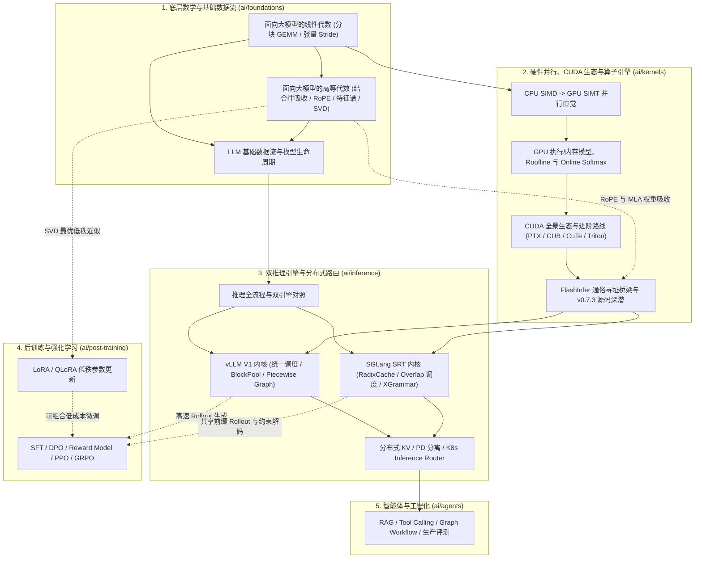

# AI 学习索引

> ⬆ 返回 [知识库首页](../README.md)

本支柱将大模型技术体系按 **“底层数学与数据流 → 并行硬件 / CUDA 生态与 FlashInfer 算子 → vLLM / SGLang 双推理引擎与分布式路由 → Post-training / RL 与 Agent 应用”** 贯通组织。不同组件处于清晰的职责分层：线代/高代与 SIMT 内存模型是底层物理与数学不变量；FlashInfer 是面向 LLM 服务的 GPU 算子与 JIT 运行时底座；vLLM 与 SGLang 是推理调度与显存管理系统（同时在 Online RL 中充当高速 Rollout 生成引擎）；LoRA/QLoRA 是参数高效更新方法；SFT、DPO、PPO 与 GRPO 则是不同阶段的训练目标与对齐闭环。

## 全局关系图

## 目录入口

| 方向 | 入口 | 核心内容 |
| --- | --- | --- |
| 数学与基础 | [LLM Foundations](foundations/README.md) | 面向 LLM 的线性代数与高等代数、零基础学习路线、Token / Transformer / 模型生命周期 |
| 算子与 CUDA 生态 | [GPU 算子与 FlashInfer](kernels/README.md) | CPU SIMD → GPU SIMT、Roofline 与 Online Softmax、CUDA 全景生态（PTX / CCCL / CuTe / Triton）、FlashInfer 通俗桥梁与 v0.7.3 源码导读 |
| 推理引擎与系统 | [LLM Inference](inference/README.md) | FlashInfer × vLLM × SGLang 全栈路线、vLLM V1 架构、SGLang SRT 架构、Prefix Cache 治理、分布式 KV / PD 分离 / K8s Router |
| 后训练与强化学习 | [LLM Post-training](post-training/README.md) | LoRA / QLoRA、SFT、DPO、Reward Model、PPO、GRPO 与训练稳定性 |
| 智能体与应用 | [Agent 学习索引](agents/README.md) | RAG、Tool Calling、ReAct / Planning、Graph Workflow、源码导读与生产级评测监控 |
| 动手机制实验 | [AI Experiments](experiments/README.md) | 零依赖 Python 离线实验（数学与 SIMD、Online Softmax 与 Split-KV、Sampling、Prefix 确定性、LoRA、RL）及推理基准脚本 |

## 分级与分方向阅读路线

### 路线 A（重点主线）：CUDA 生态、GPU 算子与高性能推理系统通关路线

适合立志往 **AI Infra、CUDA 内核研发、FlashInfer / vLLM / SGLang 推理引擎优化** 方向深耕的读者。建议直接以 [[flashinfer-vllm-sglang-learning-path|FlashInfer × vLLM × SGLang 全栈学习路线]] 为总纲，按以下六步推进：

1. **精准补齐大模型专属数学**：阅读 [[linear-algebra-for-llm]]（分块矩阵乘 Tiling、张量 `Stride` 与向量化访存）→ [[advanced-algebra-for-llm]]（结合律 MLA 权重吸收、RoPE 旋转矩阵、SVD 低秩近似），并跑通 [LLM 数学直觉与 SIMD 并行离线实验](experiments/llm-math-and-simd-lab/README.md)。
2. **打通并行硬件与 CUDA 全景软件栈**：阅读 [[simd-and-gpu-simt-foundations]]（从 CPU SIMD 车道跨向 GPU 32 线程 Warp SIMT 与 Tensor Core）→ [[gpu-execution-and-memory-model]]（存储层次、Roofline 算术强度与 Online Softmax 状态归并）→ [[cuda-ecosystem-and-career-roadmap]]（理清 SASS/PTX、cuBLASLt/CCCL、CUDA C++ vs CUTLASS/CuTe vs Triton 选型与 `nsys`/`ncu` 调优闭环）。
3. **先跑通并量化观测双推理引擎**：阅读 [[llm-inference-pipeline]] → [[vllm-and-sglang]]，建立 TTFT、TPOT、ITL 与 Prefix Cache Hit Rate 的黑盒对照体感。
4. **攻克算子桥梁 FlashInfer（从白话手算到 `.cuh` 源码）**：先读零门槛导览 [[flashinfer-intuition-and-engine-bridge]]（手算 Ragged `qo_indptr`、Paged KV 页表与 `Plan-Run` 契约）与双环境工作流 [[flashinfer-learning-roadmap]]，再逐层深入 [[flashinfer-architecture-and-jit]] → [[flashinfer-norm-and-sampling-source]] → [[flashinfer-paged-kv-and-decode-source]] → [[flashinfer-ragged-prefill-and-mla-source]]，配合运行 [Online Softmax 与 Split-KV 离线实验](experiments/online-softmax-and-split-kv/README.md)。
5. **拆解双推理引擎内核**：精读 [[vllm-v1-architecture-and-internals]]（统一 Token 预算调度、`BlockPool` 链式 Hash 缓存、`Piecewise CUDA Graph`）与 [[sglang-srt-radix-and-scheduler]]（三进程流水线、`RadixCache` 压缩前缀树、`Overlap Scheduler` 与 XGrammar 跳跃解码），结合 [[prefill-cache-miss]] 解决生产缓存击穿。
6. **横向拓展至集群级分布式推理**：进入 [[llm-inference-learning-path]] 与 [[llm-inference-progress]]，掌握分布式多级 KV Store（Mooncake / LMCache）、PD 分离与 K8s Inference Router（集群调度底座可联动 [云原生 GPU / HAMi 索引](../cloud-native/kubernetes/README.md)）。

### 路线 B：零基础建立大模型全局观

适合刚接触大模型或希望先建立端到端坐标系、再决定细分方向的读者：

1. 先读 [[llm-learning-path]] 与 [[llm-fundamentals]]，遇到矩阵乘、投影或位置编码困惑时随时翻阅 [[linear-algebra-for-llm]]。
2. 阅读 [[llm-inference-pipeline]] 并运行 [Sampling 离线实验](experiments/sampling/README.md)，搞懂一段文本如何逐 Token 生成。
3. 建立全局分类后，再按兴趣切入 **路线 A（算子与推理）**、**路线 C（微调与强化学习）** 或 **路线 D（Agent 工程）**。

### 路线 C：模型微调、偏好对齐与 Online RL 路线

适合关注如何低成本改变模型行为、构建 SFT / DPO / GRPO 训练与 Rollout 闭环的读者：

1. 阅读 [[advanced-algebra-for-llm]]（重点看特征谱稳定性与 SVD 低秩近似）→ [[lora-and-qlora]]（配合 [LoRA 参数量实验](experiments/lora-parameter-count/README.md)）。
2. 阅读 [[llm-post-training]] → [[llm-rl-fundamentals]]（配合 [Bandit Policy Gradient 实验](experiments/bandit-policy-gradient/README.md)）。
3. 联动阅读 [[vllm-and-sglang]] 与 [[sglang-srt-radix-and-scheduler]]，理解为什么 GRPO 等一题多采 Online RL 训练高度依赖推理引擎的共享前缀 Rollout 吞吐。

### 路线 D：生产级 Agent 与应用工程路线

适合聚焦 RAG、工具调用、图工作流编排与线上稳定性治理的读者：

1. 先掌握 [[llm-fundamentals]] → [[llm-inference-pipeline]] → [[prefill-cache-miss]]（理解多轮 Agent 工具调用中如何保护 Prefix Cache 命中率，配合 [Prefix 输入确定性实验](experiments/prefix-input-determinism/README.md)）。
2. 按序推进 [Agent 学习索引](agents/README.md)：[[agent-development-learning-path]] → [[agent-development-source]] → [[production-agent-development]]。

> 完成标准不是“把文档从头读到尾”，而是能用自己的话解释数据流与系统权衡、在本地跑通对应机制实验并观测关键指标。
