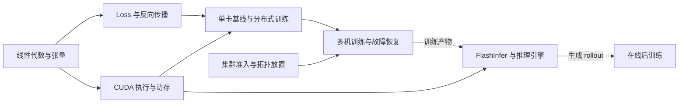

# AI 学习索引

> 返回 [知识库首页](../README.md)

做万卡集群调度和模型训练，从 [万卡集群调度与模型训练路线图](training/README.md) 开始。先弄懂一次参数更新，再看这次更新拆到多张卡后，哪些数据必须在何时到达。做推理优化则从同一份数学和 CUDA 基础分支出去，不必先学完整个训练栈。

## 按目标开始

| 我现在要做什么 | 路线 | 第一份产出 |
| --- | --- | --- |
| 做训练平台、排查多机任务 | [万卡集群调度与模型训练](training/README.md) | 用相同样本验证单份梯度与分片聚合梯度一致，再画一次固定规模作业的 rank 放置图 |
| 做 CUDA、FlashInfer、vLLM、SGLang | [算子与双推理引擎路线](inference/flashinfer-vllm-sglang-learning-path.md) | 手算一条请求的 KV 页表；用同一模型与请求集分别测两个引擎 |
| 刚接触 LLM | [零基础学习路线](foundations/llm-learning-path.md) | 画出 Token 到预测的前向路径，标出训练时引入标签的位置 |
| 微调或对齐模型 | [后训练](post-training/README.md) | 区分 SFT 的训练目标与 LoRA 的可训练参数，设计独立验证集 |
| 构建 Agent | [Agent 学习路线](agents/agent-development-learning-path.md) | 跟踪一条工具调用，能定位失败发生在生成、执行还是状态回写 |

## 按主题查找

| 入口 | 在这里找什么 |
| --- | --- |
| [数学与机器学习](foundations/README.md) | 矩阵乘、张量布局、梯度、交叉熵、训练与验证 |
| [GPU 算子与 CUDA](kernels/README.md) | SIMT、显存访问、性能分析、FlashInfer 的分页与归约实现 |
| [分布式训练](training/README.md) | DDP、FSDP2、DeepSpeed ZeRO、Megatron Core、扩展效率与断点恢复 |
| [推理系统](inference/README.md) | vLLM、SGLang、请求调度、KV Cache、PD 分离与服务基准 |
| [后训练](post-training/README.md) · [Agent](agents/README.md) | 改变模型行为，以及在应用中调用模型 |
| [实验](experiments/README.md) | 可在 CPU 离线复现的数值机制，以及需要真实 GPU 服务的对照实验 |

跨领域入口：[云原生 GPU 调度](../cloud-native/kubernetes/core/README.md)。训练框架决定各 rank **怎么算**，集群调度决定作业**何时取得哪些节点**，推理引擎决定本轮**处理哪些请求和 token**。
