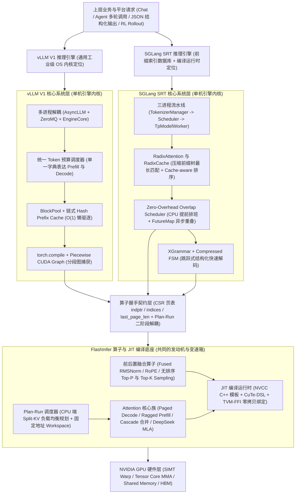
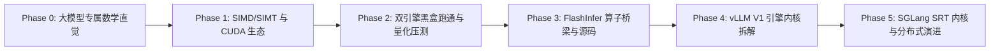

#ai #llm #inference #flashinfer #vllm #sglang #cuda #learning-path

相关笔记：[[llm-inference-pipeline]] | [[vllm-and-sglang]] | [[vllm-v1-architecture-and-internals]] | [[sglang-srt-radix-and-scheduler]] | [[flashinfer-intuition-and-engine-bridge]] | [[flashinfer-learning-roadmap]] | [[llm-inference-learning-path]] | [[linear-algebra-for-llm]] | [[advanced-algebra-for-llm]] | [[simd-and-gpu-simt-foundations]] | [[cuda-ecosystem-and-career-roadmap]]

# FlashInfer × vLLM × SGLang 全栈学习路线：从数学与算子底座到双推理引擎

## 概述：为什么需要一条纵向打通的总路线

很多初学者一头扎进大模型推理系统时，常陷入两类极端困境：

- **只停留在命令行参数调优**：会用 `vllm serve` 或 `sglang.launch_server` 启动服务，但遇到 ITL 抖动、Prefix Cache 命中率骤降、CUDA Graph 内存暴涨或算子报 `NaN` 时，完全看不懂底层页表和 GPU Kernel 在干什么。
- **一上来硬啃晦涩教材与万行模板**：以为不懂全套高等代数证明、没背熟几百页 CUDA 手册就不能碰推理引擎，结果卡在抽象定理和 C++ 模板元编程里半途而废。

本学习路线的核心理念是 **“按需补齐最小完备数学 → 建立硬件并行直觉 → 先做黑盒对照实验 → 穿过算子桥梁 → 拆解双引擎内核”**。它是一条**纵向全栈主线**，把线性代数/高等代数、CPU SIMD / GPU SIMT、FlashInfer 内核库与 vLLM V1 / SGLang SRT 两大主流推理引擎串成一条环环相扣的因果链；完成后可无缝横向衔接到 [[llm-inference-learning-path]] 的分布式 KV Store、PD 分离与 Kubernetes 推理网关层。

## 目标人群、前置条件与全局完成标准

### 目标人群

1. **AI Infra / 推理系统工程师**：希望彻底吃透 vLLM V1 与 SGLang SRT 的调度器、KV Cache 内存池、CUDA Graph 机制及底层算子调用链。
2. **CUDA / GPU 算子方向学习者**：不满足于孤立写单个 `VectorAdd` 或 `GEMM` Demo，希望看懂工业级算子库（FlashInfer）如何服务真实大模型在线流量。
3. **后端 / 云原生架构师与后训练工程师**：正在建设推理平台或 RL（如 GRPO）高并发 Rollout 基础设施，需要从底层原理出发做出准确的引擎选型与性能诊断。

### 前置条件

- **编程基础**：熟悉 Python 基础语法与面向对象结构；能看懂基本的 C/C++ 指针、结构体与数组下标运算。
- **系统基础**：了解进程/线程、HTTP/JSON 接口与常见命令行操作；读过 [[llm-fundamentals]] 对 Token、Transformer 层结构有初步概念更佳。
- **数学基础**：**不需要**提前啃完大学数学系教材——Phase 0 专门提炼了大模型真正用到的 5 个线代/高代核心直觉，配手算小例子即可零障碍起步。
- **硬件环境**：一台日常开发机（Mac 或普通 Linux PC 均可完成全部源码精读与纯 Python 离线数值实验）+ 按需租用云端单卡 NVIDIA GPU（如 RTX 4090 / A100 / H100，用于基准压测与 Kernel 实操）。

### 全局阶段产出与完成标准

- **全局产出**：
  1. 两份本地零依赖机制实验通关记录（数学/SIMD 离线实验 + Online Softmax/Split-KV 离线实验）。
  2. 一份控制变量的 vLLM vs SGLang 基准压测报告（涵盖 TTFT、TPOT、ITL、Throughput 与 Prefix Cache 命中率）。
  3. 两张亲手梳理的全链路数据流图：请求从 `Scheduler` 页表转换到 FlashInfer `plan()/run()` 的内存映射图，以及 vLLM V1 与 SGLang SRT 的 CPU-GPU 协同时间线图。
- **全局完成标准**：
  - 给定一条请求和具体引擎配置，能定位分词、缓存查找、组批和采样的证据。先查实际 attention 后端与 CUDA Graph 是否启用；仅在走 FlashInfer 时，才沿其页表与算子调用继续追踪。
  - 面对生产性能瓶颈（TTFT 高、TPOT 慢、GPU 利用率波谷、显存 OOM），能精准判断瓶颈位于 **CPU 调度层、KV 缓存复用层、HBM 访存带宽层还是 Tensor Core 算力层**。

---

## 一图读懂三剑客真实生态关系

初学者最容易产生的误解是：“vLLM、SGLang 和 FlashInfer 是三个同层级的推理框架，选一个学就行了”。事实上，它们处于**上下游协同的两层生态位**——**vLLM 与 SGLang 是面向业务与分布式系统的全功能推理引擎（Engine / Runtime），而 FlashInfer 是两者在 GPU 算子层共同倚重的底层内核库（Kernel Library）**。

如果把整个大模型在线服务比作一座**高并发现代云餐厅（或现代计算机系统）**：

1. **vLLM 像“通用工业级操作系统内核（Linux Kernel）”**：
   - 它的首要设计目标是**标准化、通用性与极致的生态兼容面**（Day-0 支持百余种主流开源 LLM、VLM 多模态模型与各类量化格式）。
   - 它像 OS 管理虚拟内存一样，用固定大小的物理页池（`BlockPool`）和链式哈希表管理 KV Cache；在 V1 架构中，它用极其干净的单一 Token 预算统一调度器协调所有请求，并用 `torch.compile` 分段捕获 CUDA Graph（Piecewise CUDA Graph）抹平 Python 发射开销。
2. **SGLang 像“带智能前缀索引缓存的数据库引擎 + 查询编译器”**：
   - 它由前端结构化编程 DSL 与后端运行时 **SRT（SGLang Runtime）** 组成，核心哲学是**挖掘跨请求、跨轮次、跨分支之间的结构化共性**。
   - 它把所有历史请求的 KV Cache 组织成一棵动态压缩前缀树（`RadixCache` / RadixAttention），像数据库索引一样自动做最长前缀匹配（多轮 Agent、Few-shot、GRPO 一题多采天然零重算复用）；再用 **Zero-Overhead Overlap Scheduler** 让 CPU 提前排好下一批任务彻底隐藏调度耗时，并配合 **Compressed FSM / XGrammar** 让结构化 JSON 输出甚至比自由生成更快。
3. **FlashInfer 像两家系统引擎机舱里共用的“高性能 V8 发动机与自动变速箱”**：
   - FlashInfer **不管** HTTP 接入、不管哪个请求先跑哪个请求抢占、也不管 LRU 淘汰哪块显存；它只专注一件事——**当上层引擎把当前一步要算的变长 Query 和离散物理页表交下来时，以逼近硬件物理极限的速度在 GPU 上算完 Attention、RMSNorm 和 Sampling**。
   - 无论上层是 vLLM 的固定大小 `BlockTable` 还是 SGLang 的 `RadixTree` 槽位池，只要在引擎适配层翻译成统一的 CSR 稀疏页表（`indptr`、`indices`、`last_page_len`），就能无缝驱动同一套基于 JIT CUDA C++ / CuTe-DSL 编译的 FlashInfer 内核（涵盖 Paged Decode、Ragged Prefill、Cascade 树状前缀合并、DeepSeek MLA 权重吸收算子、融合归一化与无排序拒绝采样）。



---

## 三剑客核心技术矩阵全景对照表

在深入每一篇专章前，先用这张全景表建立准确的工程坐标（切忌把某个组件的名字张冠李戴到另一层）：

| 核心维度 | vLLM (V1 架构主线) | SGLang (SRT 运行时主线) | FlashInfer (v0.7+ 算子库底座) |
| --- | --- | --- | --- |
| **系统职责层级** | 端到端推理服务引擎（API 接入、调度、KV 内存管理、分布式并行） | 端到端推理服务引擎 + 结构化生成前端运行时 | GPU 高性能算子与 JIT 编译库（无 HTTP 服务、无请求队列管理） |
| **KV 物理组织抽象** | 固定大小物理块池 `BlockPool`（常见 `block_size=16` Tokens），逻辑块表映射 | 预分配扁平槽位池 `ReqToTokenPool` + `TokenToKVPool`（支持 `page_size=1` Token 级或页级对齐） | `paged_kv_t` CSR 稀疏页视图（`indptr`、`indices`、`last_page_len`，兼容 `NHD`/`HND` 步长） |
| **跨请求 Prefix 复用结构** | **链式 Hash 表**（`hash(parent_hash, block_tokens)`），按完整满块匹配，$O(1)$ 引用计数懒驱逐 | **Radix Tree 压缩前缀树**（`RadixCache`），动态节点分裂、最长前缀匹配与 LRU 叶子递归驱逐 | 不维护跨请求缓存树，但提供 **Cascade Attention**（`MergeStates`）算子加速共享前缀树归并 |
| **CPU 调度开销隐藏方式** | ZMQ 多进程隔离 + 持久化 `InputBatch` 增量状态差分更新 + 异步输出处理 | **Zero-Overhead Overlap Scheduler**：GPU 算 Batch $N$ 时，CPU 并行排好 Batch $N+1$ 并用 `FutureMap` 传递未决 Token | 将主机侧 SM 占用估算与二分切分抽离到每步仅调 1 次的 `plan()`，令每层 `run()` 零 CPU 调度开销 |
| **CUDA Graph 策略** | **Piecewise CUDA Graph**（`torch.compile` 在 Attention 处切图，兼容变长混合批次）+ 纯 Decode 整图模式 | Decode 阶段按预设 `batch_size` 档位整图捕获（配合固定缓冲区原地刷新）+ 可选 `torch.compile` | 严格遵循 Graph 内存契约：初始化绑定静态 Workspace，`plan()` 在图外刷新页表与 `block_valid_mask`，`run()` 在图内安全重放 |
| **Attention 后端绑定** | 模块化插件 `AttentionBackend`（主力支持 **FlashInfer**、FlashAttention-2/3、Triton、MLA 专用后端） | 将 **FlashInfer** 作为核心一等公民默认后端（同时支持 FA3、Triton、Cutlass MLA 等多后端切换） | 自身即算子提供方；内部进一步按硬件 SM 代际自动路由 CUDA Core、Tensor Core、`cudnn` 或 `cute-dsl` 内核 |
| **结构化输出与采样** | 接入 XGrammar / Outlines 等词表位掩码后端 + 统一采样层 | 深度协同 **XGrammar + Compressed FSM（Jump-Forward 跳跃解码）**，确定性片段单次前向多 Token 推进 | 提供底层 **无排序 GPU 拒绝采样**（AIR Top-P、Radix Top-K、`TopKTopPSamplingFromProb`）算子 |
| **最具优势的典型场景** | 极广模型/多模态新架构首发适配、大规模异构硬件生产集群、标准化高并发在线服务 | 多轮 Agent 工具调用、长 Few-shot 共享前缀、严格 JSON Schema 抽取、RL（GRPO）一题多采树状 Rollout | 所有需要自定义变长/分页 Attention、MLA 权重吸收、低延迟融合 Norm/Sampling 的推理与后训练引擎 |

---

## 六阶段平滑爬坡通关路线

整条路线按“地基 → 硬件 → 黑盒体感 → 算子桥梁 → vLLM 内核 → SGLang 与分布式平台”分为六个阶段，拒绝跳跃断层：



---

### Phase 0：大模型专属数学直觉补齐（预计 2~3 天）

- **要解决的核心困惑**：
  - 为什么 GPU 只有几百 KB 的高速 SRAM，却能分块算完几万长度的矩阵乘且结果分毫不差（分块矩阵乘与列×行外积视角）。
  - 为什么 PyTorch 里 `transpose` 零拷贝却会导致底层 SIMD/CUDA 128-bit 向量化加载崩溃（物理内存 `Stride` 步长直觉）。
  - 为什么 DeepSeek MLA 只改变矩阵相乘的括号顺序 `(AB)x = A(Bx)`，就能省掉巨量 KV Cache 显存带宽（矩阵乘法结合律与权重吸收）。
  - 为什么 RoPE 给 Query 和 Key 乘一个旋转矩阵，点积里就自动只剩相对位置差 `n - m`（正交保内积与旋转矩阵群性质）。
  - 为什么 LoRA 微调与 MLA 低秩压缩丢掉绝大多数维度仍能保留核心能力（SVD 奇异值分解与特征谱直觉）。
- **阅读笔记清单**：
  1. [[linear-algebra-for-llm]]（必读：点积缩放与 RMSNorm、矩阵乘法四种黄金视角与分块 Tiling、高维张量 Shape/Stride 与 `NHD`/`HND` 内存布局）。
  2. [[advanced-algebra-for-llm]]（必读：秩与低维子空间、结合律驱动的 MLA 权重吸收、正交旋转矩阵与 RoPE 手推、特征值谱与残差连接、SVD 最优低秩近似与 LoRA）。
  3. 辅读回顾：[[llm-fundamentals]]、[[lora-and-qlora]]。
- **动手验证任务**：
  在本地电脑（Mac 或任意装有 Python 3 的环境，零第三方依赖）直接运行配套离线数学与并行实验（手册见 [LLM 数学与 SIMD 离线实验](../experiments/llm-math-and-simd-lab/README.md)）：
  ```bash
  python3 ai/experiments/llm-math-and-simd-lab/llm_math_simd_lab.py
  ```
  再用纸笔手算一组 $4 \times 4$ 矩阵按 $2 \times 2$ 子块相乘，以及二维向量经旋转角 $m\theta, n\theta$ 后的内积展开式。
- **阶段产出**：
  一份手算推导草稿 + `llm_math_simd_lab.py` 五项数值等价性实验全部通过（最大绝对误差 `< 1e-12`）的运行记录。
- **完成标准**：
  不翻书能用白话讲清“内存连续性如何由最后维 `stride == 1` 决定”、“MLA 为什么能把 $W_{UK}$ 吸收进 $W_Q$”以及“RoPE 如何把绝对位置编码转化为内积中的相对旋转角”。

---

### Phase 1：硬件并行模型与 CUDA 生态筑基（预计 3~5 天）

- **要解决的核心困惑**：
  - 从 CPU 单指令多数据（SIMD 向量寄存器车道）跨到 GPU 单指令多线程（SIMT 32 线程 Warp），硬件究竟替程序员多管了什么状态，Warp Divergence 分支发散又慢在哪里。
  - 为什么在 SIMT 线程里还要显式写 `float4` / `vec_t`（线程内 128-bit 向量化访存），以及 Warp-level Tensor Core（MMA / WGMMA）如何协同 32 或 128 个线程喂饱矩阵单元。
  - 为什么 Prefill 通常是 Compute-bound 而 Decode 必然撞上 HBM Memory-bound 墙，Online Softmax 又是如何在不看全行的情况下单趟流式算出精确 Softmax 的。
  - 面对 SASS、PTX、CCCL（CUB/Thrust）、cuBLASLt、CUTLASS/CuTe、CuTe-DSL 与 OpenAI Triton，算子工程师在不同场景下到底该选哪把武器。
- **阅读笔记清单**：
  1. [[simd-and-gpu-simt-foundations]]（必读：Flynn 分类白话比喻、AVX/NEON 车道与掩码、SIMT Warp 锁步与活跃掩码、128-bit 合并访存、Warp Shuffle 与 Tensor Core 演进）。
  2. [[gpu-execution-and-memory-model]]（必读：SM/CTA/Warp 硬件映射、Shared Memory Bank Conflict、Roofline 算术强度定量计算、Safe/Online Softmax 与 `state_t` 合并公式推导）。
  3. [[cuda-ecosystem-and-career-roadmap]]（必读：CUDA 软硬件代际全景栈、官方库边界、原生 CUDA C++ vs CuTe Layout 代数 vs Triton 深度对比、`nsys`/`ncu` 性能调优闭环与五阶段职业路线）。
- **动手验证任务**：
  在本地运行纯 Python 离线状态合并实验（手册见 [Online Softmax 与 Split-KV 离线实验](../experiments/online-softmax-and-split-kv/README.md)）：
  ```bash
  python3 ai/experiments/online-softmax-and-split-kv/online_softmax_split_kv_lab.py
  ```
  并选取一张目标显卡（如 H100 SXM：BF16 Tensor Core 约 `989 TFLOPS`，HBM3 带宽约 `3.35 TB/s`，拐点约 `295 FLOPs/Byte`），亲手算出 GQA `group_size=4` 与 `group_size=8` 时 Decode Attention 的算术强度落在 Roofline 哪一侧。
- **阶段产出**：
  一张“CPU SIMD → GPU SIMT → Tensor Core”三层演进对比卡片 + 目标 GPU Roofline 拐点计算单。
- **完成标准**：
  能独立推导出 Online Softmax 两段局部状态 $(o_1, m_1, d_1)$ 与 $(o_2, m_2, d_2)$ 的合并公式；能准确区分 `nsys`（看宏观 CPU 发射与多流时间线）与 `ncu`（看单核带宽/算力 SOL% 与 Stall 原因）的使用时机；能说清何时该用 Triton 快速迭代、何时必须下沉到 CuTe 或原生 CUDA C++。

---

### Phase 2：先跑通并量化观测双引擎黑盒（预计 2~3 天）

- **要解决的核心困惑**：
  - 在一头扎进几万行调度器源码之前，先看清真实推理服务对外暴露什么行为：一条结构化 `messages` JSON 是怎样经过 Chat Template、Tokenizer、Prefill、KV Cache、Decode Loop 与 Sampling 流式吐回客户端的。
  - TTFT、TPOT、ITL、Throughput 与 Prefix Cache Hit Rate 各自衡量什么用户体验或硬件成本；为什么单看“一条请求总耗时”做 Benchmark 毫无工程说服力。
  - 为什么明明两次请求的自然语言意思一模一样，仅仅因为系统提示词里夹了一个动态秒级时间戳或字典键乱序，就导致整段长 Prompt 的 Prefix Cache 100% 失效。
- **阅读笔记清单**：
  1. [[llm-inference-pipeline]]（必读：一次请求的四层完整数据流、Prefill vs Decode、KV Cache vs Prefix Cache、Streaming 与核心指标时间轴）。
  2. [[vllm-and-sglang]]（必读：双引擎公平对照实验控制变量清单、最小启动命令、V1 vs SRT 核心机制全景速查与工程选型指南）。
  3. [[prefill-cache-miss]]（必读：真实工程排障案例——输入确定性如何决定 Prefix Cache 生死）。
  4. 配套实验手册：[OpenAI-Compatible Benchmark 实验](../experiments/openai-compatible-benchmark/README.md)、[Prefix 输入确定性实验](../experiments/prefix-input-determinism/README.md)。
- **动手验证任务**：
  1. 在本地跑通 Prefix 确定性检查实验；
  2. 在单卡 GPU 环境固定同一模型权重（如 `Qwen/Qwen3-0.6B` 或 `Qwen/Qwen2.5-7B-Instruct`）、同一 `max_model_len` 与 `temperature=0`，分别启动 vLLM 与 SGLang：
     - 实验 A（共享前缀效应）：构造一段 2048 Token 固定 System Prompt + 10 个不同短问题，连续发送，记录第 1 次与第 2~10 次请求的 TTFT 断崖式下降幅度。
     - 实验 B（并发水位曲线）：以并发度 `1 -> 4 -> 16 -> 64` 压测，绘制 Throughput 随并发上升而饱和、同时 TTFT/TPOT P99 逐渐抬升的权衡曲线。
- **阶段产出**：
  一份完整的控制变量双引擎对照实验表格（含硬件型号、引擎版本、启动参数、冷/热缓存 TTFT、并发吞吐与 `/metrics` 监控截图）。
- **完成标准**：
  能闭卷画出请求从收到首字节到结束的延迟分解轴（Queue + Prefill = TTFT，后续每步 = ITL/TPOT）；能说出至少 4 种导致 Prefix Cache 意外失效的业务侧反模式并给出修复方案。

---

### Phase 3：攻克算子桥梁 FlashInfer（预计 5~7 天）

- **要解决的核心困惑**：
  - 推理引擎里的非连续物理块（比如请求 A 占第 `7, 2` 号页、请求 B 占第 `9, 0, 4` 号页），在完全不做矩形 Padding 的前提下，究竟靠哪几个一维整数数组就能让 GPU 线程精准算出物理内存偏移。
  - 为什么 FlashInfer 非要把一次 Attention 调用劈成 CPU 端 `plan()` 和 GPU 端 `run()` 两步：长短不齐的请求怎样靠 Split-KV 喂饱所有 SM，录死 Grid 形状的 CUDA Graph 又怎么在每步动态适应新的序列长度。
  - FlashInfer 内部的 JIT 编译缓存（NVCC C++ 模板与 Python CuTe-DSL）、TVM-FFI 零拷贝绑定、无排序拒绝采样、GQA 组打包 Decode、Ragged Prefill 以及 DeepSeek MLA 算子在源码层是如何落地的。
- **阅读笔记清单（严格按由浅入深阶梯阅读）**：
  1. **第一站（零门槛必读导览桥）**：[[flashinfer-intuition-and-engine-bridge]] —— 用 2 条请求的微型数字手算彻底画透 `qo_indptr`、`kv_page_indptr`、`kv_page_indices`、`kv_last_page_len` 与“施工排班表 vs 工人照表干活”的 `Plan-Run` 契约，并预览 vLLM / SGLang 如何对接它。
  2. **第二站（工作流与全局地图）**：[[flashinfer-learning-roadmap]] —— 掌握 Mac 源码阅读 + 云端 GPU 热重载修改 `.cuh` 与 `ncu` 剖析的标准闭环。
  3. **第三站（按需深潜四篇源码导读）**：
     - 架构与 JIT 编译：[[flashinfer-architecture-and-jit]]
     - 融合归一化与无排序采样：[[flashinfer-norm-and-sampling-source]]
     - 分页寻址与 Decode 核心：[[flashinfer-paged-kv-and-decode-source]]
     - 变长 Prefill、Cascade 树合并与 MLA：[[flashinfer-ragged-prefill-and-mla-source]]
- **动手验证任务**：
  1. 拿一张白纸，给定 3 条请求长度分别为 `[5, 12, 3]`、`page_size = 4`，亲手写出它们的 `qo_indptr`、`paged_kv_indptr`、`paged_kv_last_page_len` 以及第 2 条请求第 9 个 Token（0-indexed）落在哪个逻辑页与页内偏移。
  2. 若有云端 GPU，按 [[flashinfer-learning-roadmap]] 运行 `benchmarks/flashinfer_benchmark.py`，实测 `BatchDecodeWithPagedKVCacheWrapper` 在小 Batch 长上下文（如 `batch_size=2, s_kv=32768`）下 Split-KV 带来的数倍加速。
- **阶段产出**：
  一份手算 CSR 分页寻址验算单 + 一张标注了主机锁页内存与设备静态 Workspace 指针流向的 `Plan-Run` 生命周期图。
- **完成标准**：
  能脱离源码解释为什么 `wrapper.plan()` 严禁放进 `torch.cuda.graph` 录制块内而 `wrapper.run()` 可以；能说清 GQA 在 Decode CTA 内如何通过 `bdy = GROUP_SIZE` 把 KV HBM 带宽需求压缩为原来的 $1/\text{GROUP\_SIZE}$。

---

### Phase 4：拆解 vLLM V1 引擎内核（预计 4~6 天）

- **要解决的核心困惑**：
  - 为什么早期 vLLM V0 在高速 GPU 上会被 Python 主进程拖后腿，V1 是如何通过 `AsyncLLM` + ZeroMQ + 独立 `EngineCore` 进程 + `GPUModelRunner` 持久化 `InputBatch` 增量更新彻底把 CPU 开销打下来的。
  - 为什么 V1 调度器能删掉繁琐的 Prefill/Decode 分离状态机，仅凭一个极简字典 `{req_id: num_scheduled_tokens}` 就优雅统一常规 Decode、Chunked Prefill 与 Speculative Decoding。
  - `BlockPool` 如何利用链式前缀哈希与双向空闲链表（`FreeKVCacheBlockQueue`）实现 `ref_cnt: 1 -> 0 -> 1` 零拷贝复活的常开 Prefix Caching。
  - 为什么整网捕获 CUDA Graph 难以应付变长混合批次，V1 如何借助 `torch.compile` 在动态 Attention 边界把计算图切成多段 **Piecewise CUDA Graph**，并与 `FlashInferBackend` 完成 `plan()/run()` 对接。
- **阅读笔记清单**：
  1. [[vllm-v1-architecture-and-internals]]（核心专篇：从三大生产痛点到 V1 多进程隔离、统一调度器、BlockPool 懒驱逐、Piecewise CUDA Graph 与 FlashInfer 源码握手全解析）。
- **动手验证任务**：
  克隆或在线浏览 `vllm-project/vllm` 仓库的 `vllm/v1/` 目录：
  1. 对照阅读 `vllm/v1/core/sched/scheduler.py` 的 `schedule()` 主循环与 `vllm/v1/core/block_pool.py` 的 `get_cached_block()` / `free_blocks()`；
  2. 启动 vLLM 服务时附加日志或 `nsys profile`，观察启动阶段的 `Capturing CUDA graphs (mixed prefill-decode, PIECEWISE)` 与纯 Decode 图捕获过程；
  3. 追踪 `vllm/v1/attention/backends/flashinfer.py` 中 `FlashInferMetadataBuilder.build()` 如何一步到位生成 `qo_indptr` 与 `paged_kv_*` 并调用 `plan()`。
- **阶段产出**：
  一张单步混合批次（1 条 Decode + 1 条投机解码 + 1 条长文档 Chunked Prefill）穿过 `Scheduler` → `BlockPool` → `GPUModelRunner` → `Piecewise CUDA Graph & FlashInfer` 的完整状态变迁图。
- **完成标准**：
  能用具体数字推演 V1 统一 Token 预算调度的分配过程；能解释 `KVCacheBlock` 在 `ref_cnt` 归零后为什么不立即清空哈希表与物理显存；能讲清 `splitting_ops` 切图后静态中间张量地址为何不能动态重分配。

---

### Phase 5：拆解 SGLang SRT 引擎内核与分布式演进（预计 5~7 天）

- **要解决的核心困惑**：
  - 在多轮 Agent、Tree-of-Thought 搜索与强化学习 GRPO 一题采 16 条轨迹的场景下，SGLang SRT 的 `RadixCache` 是如何做压缩前缀树匹配、边中间分叉分裂（Node Split）、引用计数加锁（`lock_ref`）与 LRU 叶子递归驱逐的，它与 vLLM 固定块 Hash 各自的工程取舍是什么。
  - **Zero-Overhead Overlap Scheduler** 究竟施了什么魔法，能在 GPU 还没算完第 $N$ 批、CPU 甚至还不知道第 $N$ 批采样出什么词的时候，就提前在旁路把第 $N+1$ 批的调度与 FlashInfer `plan()` 全部干完（`FutureMap` GPU 端令牌占位映射）。
  - 结构化输出时，**Compressed FSM（Jump-Forward 跳跃解码）** 为什么遇到固定 JSON 键名能一次跳过十几个自回归步，**XGrammar** 又如何把上下文无关文法的词表 Mask 压到微秒级。
  - 当单机 8 卡也装不下超长上下文或超高并发时，单机引擎如何向上接入分布式 KV Store（Mooncake / LMCache）、PD 分离（Prefill/Decode 解耦 + RDMA 传输）与 K8s 智能路由层。
- **阅读笔记清单**：
  1. [[sglang-srt-radix-and-scheduler]]（核心专篇：SRT 三进程流水线、`RadixCache` 四大树操作、Overlap Scheduler `FutureMap` 机制、XGrammar / Jump-Forward 与 FlashInfer / MLA 协同）。
  2. **横向扩展至分布式与云原生平台**：[[llm-inference-learning-path]]（阶段 5~8：多级 KV 缓存、DistServe/Mooncake PD 分离、Gateway API Inference Extension / llm-d / AIBrix / NVIDIA Dynamo）。
  3. **横向扩展至后训练 RL 协同**：[[llm-rl-fundamentals]]（看懂为什么现代 RLHF / GRPO 训练框架普遍内嵌 vLLM 或 SGLang 作为高吞吐 Rollout 采样引擎）。
- **动手验证任务**：
  1. 对照阅读 `sgl-project/sglang` 仓库中 `python/sglang/srt/mem_cache/radix_cache.py` 与 `python/sglang/srt/managers/scheduler.py` 的 `event_loop_overlap`；
  2. 使用复杂的嵌套 Pydantic / JSON Schema 向 SGLang 发送结构化提取请求，对比开启与关闭 Jump-Forward / XGrammar 时的生成步数与端到端延迟。
- **阶段产出**：
  一张 SGLang Overlap Scheduler 双流水线无气泡时间轴图 + 一份面向不同业务负载（在线对话、Agent 工作流、JSON 抽取、RL Rollout、超长文档 RAG）的架构选型与演进方案书。
- **完成标准**：
  能清晰对比 `RadixCache` 与 `BlockPool Hash APC` 在分叉粒度、Cache-aware 调度排序与树维护开销上的权衡；能画出 `FutureMap` 如何消除批间 Host-Device 同步阻塞；明确单机优化到头后何时该引入 PD 分离与 Prefix-aware Router。

---

## 按个人主攻方向的高效裁剪建议

如果你的时间有限或有明确的职业侧重点，可以在保证基石不断裂的前提下按需调整各阶段深浅：

| 主攻方向 | 精读与重度实操阶段 | 通读理解契约阶段 | 后续无缝衔接专题 |
| --- | --- | --- | --- |
| **CUDA 算子与高性能内核研发** | **Phase 0 → Phase 1 → Phase 3（全套 4 篇 `.cuh` 源码导读 + `ncu` 实操）** | Phase 2、Phase 4/5（重点看 `FlashInferBackend` 如何构造元数据调 `plan/run`） | `ai/kernels/` 深入 CuTe-DSL、MLA 与 MoE 融合算子贡献 |
| **推理引擎核心研发 (vLLM / SGLang)** | **Phase 0 → Phase 2 → Phase 3（导览桥 + Paged/Ragged）→ Phase 4 → Phase 5** | Phase 1（掌握 SIMT/Roofline/Online Softmax 即可，不必深究 PTX 细节） | [[llm-inference-learning-path]] 阶段 5~6（KVConnector 与 PD 分离） |
| **云原生 AI 平台 / K8s 推理网关** | **Phase 2 → Phase 4 & 5（吃透调度器指标、Prefix 命中原理与内存边界）** | Phase 0、Phase 1、Phase 3（仅读 [[flashinfer-intuition-and-engine-bridge]] 建立底层直觉） | [[llm-inference-learning-path]] 阶段 6~8（GIE / llm-d / AIBrix / Dynamo） |
| **大模型后训练 / RL Infra 工程师** | **Phase 0 → Phase 2 → Phase 4 & 5（聚焦 Prefix 树分叉复用、权重热更新与吞吐调优）** | Phase 1、Phase 3（理解量化、GQA/MLA 显存账本与采样算子） | [[llm-post-training]]、[[llm-rl-fundamentals]]、[[lora-and-qlora]] |

---

## 自检问题

### Q1：初学时把 FlashInfer 和 vLLM 放在一起对比“上线该部署哪一个”，这种提问错在哪里？

> [!question]- 参考答案（点击展开）
>
> 错在混淆了**系统层级**。vLLM（以及 SGLang）是完整的端到端推理服务引擎，负责 HTTP/OpenAI API 接入、Tokenizer 分词、请求排队与 Continuous Batching 调度、物理 KV Cache 生命周期管理（分配/哈希复用/驱逐）以及多卡张量/流水线并行；而 FlashInfer 是位于它们下层的 **GPU 高性能算子与 JIT 编译库**，提供 Paged/Ragged/Cascade/MLA Attention、Fused RMSNorm 和 GPU 采样等 CUDA/CuTe 内核。生产部署时，你是启动 vLLM 或 SGLang 服务，并在其内部启用 FlashInfer 作为底层算子后端，二者是**上下游协同关系**而非互斥替代关系。

### Q2：为什么本路线把“分块矩阵乘 + 内存 Stride + Online Softmax”放在拆解 vLLM 和 SGLang 之前？

> [!question]- 参考答案（点击展开）
>
> 因为上层推理引擎几乎所有的核心架构设计都是由这三项底层物理与数学规律倒逼出来的：
> 1. **分块矩阵乘（Tiling）与 Online Softmax** 保证了长序列 KV 不必一次性装入片上 SRAM，也不必在物理显存中连续存放——只要每小块（Page/Block）能算出局部加权和与指数统计量并按结合律无损合并，数学结果就与连续大张量完全等价；这直接赋予了 **PagedAttention**、**Split-KV**、**Chunked Prefill** 与 **Cascade Attention** 成立的合法性。
> 2. **物理内存 Stride 与 128-bit 向量化访存** 决定了页内布局（`NHD` vs `HND`）与最小连续粒度，解释了为什么 `block_size` 不能随意乱设以及为什么 Decode 是极度的 HBM 带宽受限操作。理解了它们，后面看引擎页表与调度器才不是死记硬背规则。

### Q3：同样使用 FlashInfer 执行底层 Paged Attention，vLLM V1 和 SGLang SRT 在上层的核心差异究竟体现在哪里？

> [!question]- 参考答案（点击展开）
>
> 既然底层 Kernel 都可以走同一套 FlashInfer `BatchDecode/BatchPrefill` 算子，双引擎的核心差异就集中在 **CPU 控制面、KV 索引组织与流水线编排**：
> - **KV 索引与前缀复用**：vLLM V1 使用固定大小块池 `BlockPool` + 链式哈希做 $O(1)$ 整块匹配与懒驱逐，结构规整、极易兼容混合模态与异构层；SGLang SRT 使用 `RadixCache` 压缩前缀树做任意分叉深度的最长前缀匹配，并支持按共同前缀排序的 Cache-aware 调度。
> - **CPU 开销隐藏与图执行**：vLLM V1 依靠多进程解耦、持久化 `InputBatch` 差分更新和基于 `torch.compile` 切分的 **Piecewise CUDA Graph** 同时加速变长 Prefill 与 Decode；SGLang SRT 则主打 **Zero-Overhead Overlap Scheduler**，利用双流与 `FutureMap` 在 GPU 跑当前批次的同时由 CPU 完全并行重叠掉下一批次的调度与 FlashInfer `plan()`，并在结构化输出上深度集成跳跃式解码（Jump-Forward / XGrammar）。

---

## 面试要点

### Q1：请从一次请求的完整生命周期出发，串联说明 vLLM V1（或 SGLang SRT）与 FlashInfer 是如何分工协作的？

> [!question]- 参考答案（点击展开）
>
> 可以按 **“接入分词 → 调度与缓存匹配 → 页表翻译与 Plan → 逐层前向与 Run → 采样回包”** 五步串联：
> 1. **接入分词（Engine Frontend）**：API 进程将请求 `messages` 按 Chat Template 渲染并通过 Tokenizer 转为 Token ID 序列，经 ZeroMQ 发送给调度进程。
> 2. **调度与前缀缓存匹配（Engine Scheduler & KV Manager）**：vLLM V1 的 `Scheduler` 结合 `BlockPool` 链式哈希（SGLang 则查 `RadixCache` 前缀树）复用已命中的历史前缀块，仅对未命中后缀按全局 Token 预算分配本次需计算的 Token 数及新物理 KV 槽位。
> 3. **页表翻译与单步 `plan()`（Backend Bridge -> FlashInfer CPU Plan）**：模型执行前，引擎的 `FlashInferBackend` 将本批请求的变长计算长度与物理页表翻译为一维紧凑 CSR 数组（`qo_indptr`、`paged_kv_indptr`、`paged_kv_indices`、`paged_kv_last_page_len`），在 CUDA Graph 之外调用**一次** FlashInfer Wrapper 的 `plan()`，完成 Split-KV 切分计算并将调度元数据异步拷入 GPU 固定 Workspace。
> 4. **逐层模型前向与 `run()`（Engine ModelRunner + FlashInfer GPU Kernels）**：遍历各 Transformer 层时，线性投影、融合 `RMSNorm`/激活由 cuBLASLt、FlashInfer Norm 或 `torch.compile` 分段 CUDA Graph 执行；每层新产生的 K/V 写入物理页池后，直接调用零主机开销的 FlashInfer `wrapper.run()` 完成分页注意力计算。
> 5. **采样与流式回包（Sampling -> Detokenize）**：末层 Logits 经 GPU 侧采样内核（如 FlashInfer 无排序 Top-P/Top-K）选出下一个 Token，更新调度状态并由前端增量 Detokenize 推流给用户。

### Q2：为什么说“GPU 算力越强、模型量化越激进，推理引擎的 CPU 调度架构反而越决定生死”？vLLM V1 和 SGLang 各自怎么解决？

> [!question]- 参考答案（点击展开）
>
> 在 H100/B200 配合 FP8/FP4 量化、张量并行与 FlashInfer 极致优化的今天，中型模型跑完一轮 Decode 的纯 GPU Kernel 耗时往往已压缩到 **2~5 ms**。如果像早期架构那样在主循环中串行执行 Python 对象遍历、动态拼接张量、同步等待采样 Token 拷回 CPU 再做下一轮排班，单步 Python CPU 耗时轻易达到 **3~6 ms**，导致 GPU 有近一半时间处于空闲气泡（Launch/Schedule Bubble）中。
> - **vLLM V1 的解法**：① 用 ZeroMQ 将 Tokenizer/HTTP/Detokenize 彻底剥离出 `EngineCore` 进程；② `GPUModelRunner` 维护持久化 `InputBatch`，每步只做增量差分更新而非全量重建张量；③ 用 `torch.compile` + **Piecewise CUDA Graph** 把注意力前后的大量小算子录制成静态子图，将几十次 Python Kernel Launch 压成极少数几次图重放。
> - **SGLang SRT 的解法**：除了三进程解耦与 Decode CUDA Graph 外，核心引入 **Zero-Overhead Overlap Scheduler**——当 GPU 正在计算 Batch $N$ 时，CPU 提前在另一条流上完成 Batch $N+1$ 的队列调度、KV 页分配与 FlashInfer `plan()`，并通过 GPU 端 `FutureMap` 槽位映射直接衔接 Batch $N$ 刚采样出的下一个输入 Token，使稳态下 CPU 调度时间被 GPU 计算时间 100% 掩盖。

### Q3：如果线上业务是“超长共享系统提示词 + 多轮工具调用 + 强制复杂 JSON Schema 输出”的智能体（Agent）工作流，你会重点关注引擎的哪些底层机制？

> [!question]- 参考答案（点击展开）
>
> 这类负载具有三大鲜明特征，直接对应三项底层核心机制：
> 1. **高频树状前缀共享与任意位置分叉**：多轮对话历史不断追加、同一轮可能并发尝试多个工具分支。重点考察引擎的前缀缓存结构（如 SGLang `RadixCache` 的 Token/细粒度页级最长前缀匹配与 Cache-aware 调度，或确保 vLLM V1 开启 APC 且严控 Prompt 模板确定性不发生首部缓存污染，详见 [[prefill-cache-miss]]）。
> 2. **严格 JSON Schema 约束解码开销**：朴素实现每步都要在十余万词表上由 CPU 计算合法 Token 掩码，极易拖垮 TPOT。重点考察引擎是否启用 **XGrammar**（微秒级上下文无关文法位掩码并与 GPU 重叠执行）以及 SGLang 的 **Compressed FSM Jump-Forward**（遇到 JSON 固定结构键名如 `"tool_arguments": {"` 时单步跳跃生成多个确定性 Token）。
> 3. **长短请求剧烈交错下的流式延迟抖动**：工具返回大段网页/文档触发长增量 Prefill，容易卡住其他并发会话的流式吐字。重点考察 **Chunked Prefill** 的 Token 预算配置（如 `max_num_batched_tokens`），并在高规模下评估结合 [[llm-inference-learning-path]] 中的 Prefix-aware Router 与 PD 分离。

---

## 参考与版本边界

- **组件与源码基线**：
  - **FlashInfer**：对齐仓库 `ai/kernels/` 导读基线 **v0.7.3**（commit `82caa5668`，含 CUDA C++ 模板、TVM-FFI 绑定与 CuTe-DSL 路径）。
  - **vLLM**：对齐 **vLLM V1 架构主线**（源码根目录 `vllm/v1/`，vLLM v0.8+ 起逐步成为默认核心引擎架构）。
  - **SGLang**：对齐 **SGLang SRT（SGLang Runtime）主线**（源码根目录 `python/sglang/srt/`，涵盖 RadixCache、Overlap Scheduler 与 XGrammar 集成）。
- **外部权威参考**：
  - FlashInfer 论文与文档：[FlashInfer: Efficient and Customizable Attention Engine for LLM Inference Serving (arXiv:2501.01005)](https://arxiv.org/abs/2501.01005) | [docs.flashinfer.ai](https://docs.flashinfer.ai/)
  - vLLM 论文与 V1 架构演进：[PagedAttention (SOSP'23, arXiv:2309.06180)](https://arxiv.org/abs/2309.06180) | [docs.vllm.ai](https://docs.vllm.ai/)
  - SGLang 论文与文档：[SGLang: Efficient Execution of Structured Language Model Programs (NeurIPS'24, arXiv:2312.07104)](https://arxiv.org/abs/2312.07104) | [docs.sglang.io](https://docs.sglang.io/)
- **边界说明**：三大开源项目迭代极快，命令行开关、环境变量与内部辅助类名会随小版本调整；但本路线串联的**分块矩阵与在线归约数学不变量、SIMT/HBM 硬件约束、CSR 分页寻址、`Plan-Run` 图捕获契约、统一预算/重叠调度以及前缀哈希/基数树复用思想**是长期稳定的核心骨架。
