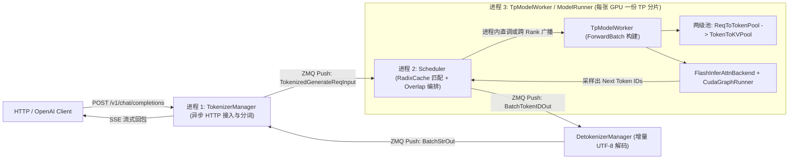
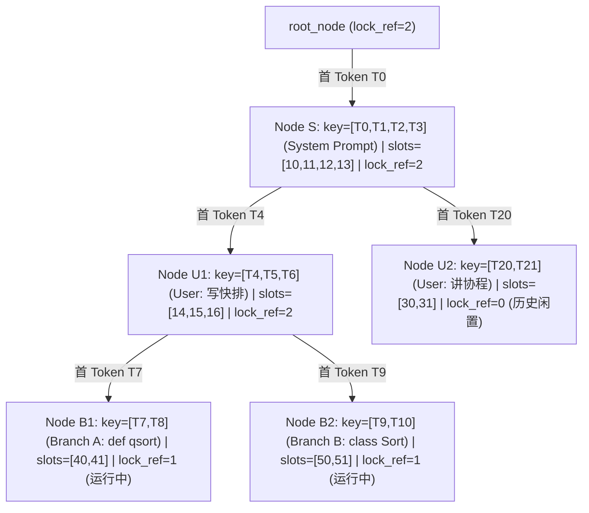
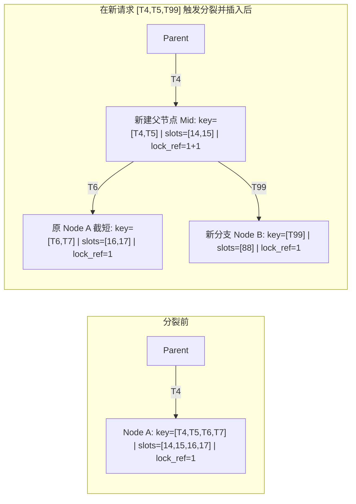
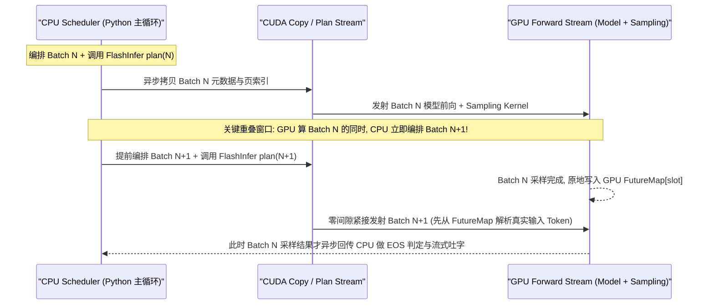

#ai #llm #inference #sglang #radix-attention #scheduler #structured-decoding #源码导读

相关笔记：[[flashinfer-vllm-sglang-learning-path]] | [[vllm-and-sglang]] | [[vllm-v1-architecture-and-internals]] | [[flashinfer-intuition-and-engine-bridge]] | [[flashinfer-paged-kv-and-decode-source]] | [[flashinfer-ragged-prefill-and-mla-source]] | [[advanced-algebra-for-llm]] | [[llm-inference-learning-path]]

# SGLang (SRT) 核心架构深度解析：RadixAttention、零开销重叠调度与结构化解码

## 概述：从单轮问答到复杂 LLM 程序执行引擎

早期大模型推理引擎的核心假设是**“相互独立的单轮一问一答”**：用户发来一段 Prompt，引擎做一次 Prefill 算出 KV Cache，逐 Token 自回归 Decode 吐完回答，随后立刻把这份昂贵的 KV Cache 从显存里彻底销毁。

然而在真实的现代 AI 生产负载中，这种“算完即焚、逐词硬算”的模式会产生惊人的重复计算与硬件空转：

1. **长系统提示词与 Few-shot 模板反复重算**：企业级客服、RAG 与代码助手往往携带 4K~16K Token 的固定 System Prompt 与工具定义（Tool Schemas），成百上千个并发请求把一模一样的前缀一遍遍送进 GPU 重跑 Prefill。
2. **多轮对话与 Agent 循环（ReAct / Tool Use）**：智能体每执行一次外部工具调用，都会把历史对话连同最新观测（Observation）再次拼成更长的上下文发往服务端，上下文呈增量生长甚至回溯重试。
3. **树状推理搜索与强化学习 Rollout（Best-of-N / Tree-of-Thought / GRPO）**：在后训练强化学习（如 DeepSeek-R1 范式的 GRPO 一题多采）或复杂数学代码搜索中，引擎需要对同一道题并发采样 $G = 8 \sim 64$ 条思维链轨迹，甚至在中间推理节点二次分叉（`fork`），请求之间天然构成一棵多级共享前缀树。
4. **强制结构化输出（JSON Schema / Regex / EBNF）**：Agent 要求模型输出严格合法的工具调用 JSON。朴素约束解码每生成一个 Token 都要遍历 12 万~15 万词表求合法掩码（Mask），CPU 掩码计算耗时甚至反超 GPU 前向；更荒谬的是，遇到 `{"user_name": "` 这类完全由语法唯一决定的固定字符片段，模型还要老老实实搬运几十 GB 权重跑好几步单 Token Decode。

**SGLang（Structured Generation Language）** 由前端结构化编程 DSL（`sglang.lang`，提供 `gen`、`select`、`fork` 等原语）与后端高性能推理运行时 **SRT（SGLang Runtime，`python/sglang/srt/`）** 组成。用一句话立住它的系统设计哲学：

> **把跨请求、跨分支的复杂 LLM 调用当成一棵“共享前缀 KV 与确定性语法状态机”的动态计算图，在显存复用、CPU-GPU 流水线重叠与受限解码三个维度上压榨出极致吞吐。**

> **源码版本边界**：本文核心模块路径、类名与关键方法均对照 **SGLang v0.4.x 主干架构（`python/sglang/srt/`，配合 FlashInfer v0.7.x，审查日期 `2026-11-17`）** 梳理论证。为避免随日常提交漂移，文中仅锚定稳定模块文件与核心符号名，不引用脆弱的具体行号。

---

## SRT 三进程解耦流水线与两级显存池

Python 的全局解释器锁（GIL）决定了：如果把高并发 HTTP JSON 解析、几万字文本的分词（Tokenization）、前缀树调度以及 GPU Kernel 发射塞进同一个进程，仅网络收发和分词就会把 GPU 卡出大量气泡。

SRT 将一次请求的生命周期彻底拆解为**三个通过 ZeroMQ（`zmq` IPC 套接字）异步通信的独立系统进程**（外加流式解码子进程 `DetokenizerManager`）：



### 三大核心组件的职责与源码入口

| 组件与进程边界 | 核心源码路径（`python/sglang/srt/`） | 核心职责 |
| :--- | :--- | :--- |
| **`TokenizerManager` & `DetokenizerManager`** | `entrypoints/http_server.py`、`managers/tokenizer_manager.py`、`managers/detokenizer_manager.py` | 主进程运行 FastAPI/Uvicorn 异步事件循环，完成 Chat Template 渲染与异步分词后通过 ZeroMQ 发往调度器；`DetokenizerManager` 独立负责增量 Token 转文本（处理多字节 UTF-8 截断边界），避免阻塞主控制面。 |
| **`Scheduler`** | `managers/scheduler.py`、`managers/schedule_batch.py`、`managers/schedule_policy.py` | 整个引擎的“大脑”。维护 `waiting_queue` 与 `running_batch`，驱动 `RadixCache` 前缀匹配与 LRU 驱逐、计算 Cache-aware 排班顺序，并通过 `event_loop_overlap` 实现 CPU 调度与 GPU 计算的零开销重叠。 |
| **`TpModelWorker` & `ModelRunner`** | `managers/tp_worker.py`、`model_executor/model_runner.py`、`model_executor/cuda_graph_runner.py` | 持有单卡模型权重分片与物理显存池。在单机多卡 Tensor Parallelism（TP）下，SGLang 支持每个 TP Rank 对等运行相同随机种子的确定性 `Scheduler`（直接进程内调用本卡 `TpModelWorker`），消除了每步 Decode 跨进程广播控制元数据的序列化延迟。 |

### 理解 SRT 的基石：两级显存索引池

在深入 `RadixCache` 之前，必须先看懂 `mem_cache/memory_pool.py` 中精巧的**两级显存寻址表**设计——它把“逻辑请求序列”与“物理 KV 显存槽位”干净地解耦开来：

1. **第一级 `ReqToTokenPool`（请求逻辑位置 $\to$ 物理槽位号）**：
   - 形状为 `[max_reqs, max_context_len]` 的 GPU `int32` 二维张量。
   - 若请求 `req_A` 分配到请求槽行号 `req_pool_idx = 3`，那么 `req_to_token[3, 0 : seq_len]` 这一行整数数组，就逐个记录了该请求第 `0, 1, ..., seq_len-1` 个逻辑位置对应的物理 KV 槽位编号（KV Slot Index）。
2. **第二级 `TokenToKVPool`（物理槽位号 $\to$ 真实 K/V 向量）**：
   - 标准 MHA/GQA 模型使用 `MHATokenToKVPool`（每层包含形状为 `[size + page_size, num_kv_heads, head_dim]` 的 `k_buffer` 与 `v_buffer`）；DeepSeek 系列使用 `MLATokenToKVPool`（每槽位仅存压缩后的潜向量与旋转位置编码）。
   - 注意缓冲池专门预留了索引 `0`（或首个 Page）作为**安全哑槽位（Dummy / Padding Slot）**：CUDA Graph 补齐的无效请求或越界防护写入全部指向槽位 `0`，绝不会污染真实业务请求的 KV 数据。

**这套两级设计妙在哪里**：当两个请求共享前 2000 个 Token 的前缀时，物理 `TokenToKVPool` 里只存一份这 2000 个槽位的 K/V 张量；复用的全部动作，仅仅是把这 2000 个 `int32` 槽位整数拷贝到新请求在 `ReqToTokenPool` 对应行的前 2000 列——**零 HBM K/V 向量搬运，一秒完成跨请求显存共享**。

---

## 核心杀手锏一：RadixAttention 与 RadixCache 压缩前缀树

如果直接用普通字典树（Trie，每个节点只存 1 个 Token）在 Python 里管理上下文，一条 32K 长度的请求就会制造 32,000 个 Python 对象与指针跳转，CPU 内存和垃圾回收（GC）会瞬间崩溃。

SGLang 在 `mem_cache/radix_cache.py` 中采用 **Radix Tree（基数树 / 压缩前缀树）**：**将没有发生分叉的连续 Token 序列压缩在同一条树边（`TreeNode`）上**，树的深度只取决于“历史请求真正发生分叉的次数”（通常仅 2~6 层）。

### 多轮对话与分叉采样的压缩前缀树形态

假设服务端依次收到携带相同 System Prompt `[T0, T1, T2, T3]`（对应物理槽位 `[10, 11, 12, 13]`）的多轮对话与 Best-of-2 分叉采样，树中每个 `TreeNode` 核心维护四个字段：

- `key`: 该边对应的 Token ID 序列（当 `page_size > 1` 时按页对齐）。
- `value`: 与 `key` 等长的一维 `int32` 张量，记录每个 Token 在 `TokenToKVPool` 中的物理槽位号。
- `lock_ref`: **活跃引用计数**（当前有多少个正在排队或运行中的请求正依赖该节点）。
- `last_access_time`: 最近一次被匹配命中的时间戳，供 LRU 淘汰使用。



在上图中，`Node U2` 是上一分钟已经回答完毕的老请求留下的分支。在传统推理引擎里它早就被释放了；而在 `RadixCache` 中，只要显存池还没满，`Node U2` 会以 `lock_ref = 0` 的状态静静留在树上——一旦用户发出第二轮追问（携带 `[T0..T3, T20, T21, T22..]`），立刻零计算复活这段历史 KV。

### 深入源码拆解 `RadixCache` 的四大核心动作

#### 1. 前缀最长匹配（`match_prefix`）

当新请求携带序列 `input_ids` 进入 `Scheduler` 时，调用 `radix_cache.match_prefix(key)`：

- 从 `root_node` 出发，用待查切片的首个元素（`page_size == 1` 时即 `key[0]`；`page_size > 1` 时为首个整页的元组）在 `node.children` 哈希字典中做 $O(1)$ 查找。
- 找到候选子节点 `child` 后，逐元素（或逐页）比对 `child.key` 与剩余输入序列的最长公共前缀长度 $L_{\text{match}}$，同时刷新 `child.last_access_time = time.monotonic()`。
- 若 $L_{\text{match}} == |\text{child.key}|$，说明整条边完全命中，将 `child.value` 加入返回槽位列表，继续向下一层深入；若 $0 < L_{\text{match}} < |\text{child.key}|$（在半路分叉），立即触发**节点分裂（`_split_node`）**后终止搜索。
- 最终返回拼接好的物理 KV 槽位数组与最深命中节点 `last_node`。调度器只需将这批槽位拷入 `ReqToTokenPool`，并对剩余未命中的后缀 `input_ids[prefix_len:]` 发起增量 **Extend（增量 Prefill）**。

#### 2. 节点分裂（`_split_node`：新请求在历史路径半途分叉）

很多初学者会问：如果树上原本存着一整条长边 `Node A: key=[T4, T5, T6, T7], slots=[14, 15, 16, 17]`，现在来了一个新请求 `[T4, T5, T99]`，在第 3 个 Token 处分叉了，难道要在 GPU 上搬运 KV 显存吗？

**完全不需要触碰 GPU 显存**。`_split_node(child, split_len=2)` 纯粹在 CPU 指针与一维索引切片上完成原地手术：



这里藏着一个极易写错的**源码级不变量**：新建的中间父节点 `Mid` 在诞生瞬间，它的 `lock_ref` **必须直接初始化为原节点 `Node A` 当前的 `lock_ref`**（而不是 `0`）。原因在于：所有原本锁住 `Node A` 的在途请求，实质上锁住的是从根到 `Node A` 的整条路径，因此切出来的上半截 `Mid` 依然正被那些活跃请求使用，绝不能因为分裂而意外失去引用保护。

#### 3. 引用计数保护（`inc_lock_ref` / `dec_lock_ref`）

- 请求一旦在调度阶段绑定了前缀节点 `last_node`，立即调用 `inc_lock_ref(last_node)`：顺着 `node.parent` 指针一路回溯到 `root_node`，把整条祖先链上每个节点的 `lock_ref` 全部 `+1`。
- 当请求完成全部生成（或中途取消）并把新生成的后缀 Token 插入 `RadixCache` 后，再调用 `dec_lock_ref` 将祖先链减 `1`。
- **绝对安全边界**：任何 `lock_ref > 0` 的节点代表正有 GPU Kernel 在本轮或下一轮读写这段物理槽位，驱逐器遇到它一律跳过，彻底杜绝“边跑边被踢导致回答乱码”的并发事故。

#### 4. 基于最小堆的 LRU 叶子递归驱逐（`evict`）

当新请求或正在 Decode 的请求向 `TokenToKVPoolAllocator` 申请新槽位而空闲池不足时，调度器调用 `radix_cache.evict(num_tokens)`：

- **为什么只能从叶子节点（`len(node.children) == 0`）开始删**：树中内部节点的 KV 是其下方所有子分支共同依赖的上文；如果先删父节点保留子节点，子节点的后缀 KV 缺少前文就成了废数据，且破坏了前缀连续性。
- **最小堆级联回收流程**：
  1. 扫描收集当前树中所有满足 `len(node.children) == 0` 且 `lock_ref == 0` 的可淘汰叶子，按 `last_access_time` 建最小堆（`heapq`）。
  2. 每次弹出时间戳最老的叶子 `leaf`，调用 `token_to_kv_pool_allocator.free(leaf.value)` 归还物理 KV 槽位，并将 `leaf` 从 `leaf.parent.children` 中移除。
  3. **级联向上冒泡**：删掉 `leaf` 后，立刻检查 `leaf.parent`——如果此时父节点名下的所有孩子都已被删光（`len(parent.children) == 0`，父节点退化成了新叶子）且 `parent.lock_ref == 0`，当场把 `parent` 压入最小堆继续参与淘汰，直到累计释放出 `num_tokens` 个槽位为止。

### 深度对比：SGLang `RadixCache` vs vLLM `Hash-based Block Prefix Cache`

vLLM V1（详见 [[vllm-v1-architecture-and-internals]]）采用链式块哈希 `hash(parent_block_hash, current_block_tokens)` 管理固定大小（常见 `block_size = 16`）的物理块；而 SGLang 采用显式压缩前缀树（支持 `page_size = 1` 逐 Token 粒度或 `page_size = 16/64` 页对齐粒度）。两者的架构取舍对比如下：

| 对比维度 | SGLang `RadixCache`（压缩前缀树） | vLLM V1 `BlockPool` APC（链式块哈希表） |
| :--- | :--- | :--- |
| **核心索引结构** | 显式树拓扑（`TreeNode` 父子边 + 变长切片 `value`） | 扁平哈希字典（`BlockHash -> KVCacheBlock`）+ 空闲双向链表 |
| **匹配与分叉粒度** | 极细：当 `page_size=1` 时支持**任意单 Token 位置零浪费分叉与复用**；当 `page_size>1` 时按页对齐 | 固定按整块（如 `16` Token）计算 Hash：块内哪怕最后 1 个 Token 不同，整个尾块也无法命中 |
| **缓存感知排班（Cache-aware Schedule）** | **天然原生支持**：树直接暴露了哪些排队请求共享同一深层子树，调度器可按最长前缀匹配（LPM / DFS 序）聚类同批请求 | 扁平哈希表丢失了前缀包含关系的树形拓扑，仅靠哈希表本身难以对排队队列做子树聚类排序 |
| **Cascade 树状注意力亲和度** | 树的层级结构天然契合 FlashInfer `MultiLevelCascadeAttentionWrapper` 多级共享前缀归约 | 需要额外根据共享块前缀重建层级分组后才能启用 Cascade Attention |
| **CPU 数据结构开销** | 较高：需在 Python/C++ 侧维护树节点分裂、祖先链锁增减与最小堆叶子遍历 | 极低：分配与释放均为 $O(1)$ 哈希查找与链表摘挂，无节点分裂开销 |
| **最擅长的业务负载** | 多轮 Agent、长模板动态拼接、Best-of-N、Tree-of-Thought、GRPO 一题多采 Rollout | 高并发通用在线对话、标准 RAG 与大规模标准块对齐吞吐场景 |

> **为什么 Cache-aware Schedule 很关键**：假设显存总共只能容纳 2 个长模板的 KV，而排队队列里交替站着 `[模板A-请求1, 模板B-请求1, 模板C-请求1, 模板A-请求2, ...]`。如果按先来后到（FCFS）调度，模板 A 刚算完还没等请求 2 用上就被模板 C 挤出了显存（缓存颠簸 Cache Thrashing）；SGLang 的 `SchedulePolicy`（`schedule_policy.py` 中的 `LPM` 策略）利用 `RadixCache` 树深度把共享 `模板A` 的请求优先聚拢到相邻批次执行，在显存受限时能显著抬升真实命中率。

---

## 核心杀手锏二：Zero-Overhead Overlap Scheduler 零开销重叠调度

当底层算子换上 FlashInfer、模型开启 FP8 与 Tensor Parallelism 后，H100/B200 跑完一步 Decode 的全网 GPU 耗时往往被压缩到 **4~8 ms**（小模型甚至仅 **2 ms**）。此时一个尴尬的现实出现了：**Python 侧的 CPU 调度器成了最大的性能拖油瓶**。

每一轮迭代，`Scheduler` 都要查 `RadixCache`、分配 KV 槽位、切片 `ReqToTokenPool`、构造 CSR 页索引并执行 FlashInfer `plan()`，哪怕代码再精简也要花掉 **2~3 ms**。

### 串行调度 vs 重叠流水线的时间轴对比

- **传统串行调度（`event_loop_normal`）**：CPU 排班 3 ms（GPU 干等）$\to$ GPU 前向与采样 7 ms（CPU 阻塞等待 `.item()` 拷回采样 Token）$\to$ CPU 处理结束状态再排下一班 3 ms（GPU 干等）。**GPU 有近 $30\%$ 的时间在空转晒太阳**。
- **SGLang 零开销重叠调度（`event_loop_overlap` in `managers/scheduler.py`）**：利用 CUDA 异步流特性，**当 GPU 正在 `forward_stream` 上埋头计算 Batch $N$ 时，CPU 不等 Batch $N$ 出结果，直接超前一步把 Batch $N+1$ 的请求排班、KV 槽位分配、H2D 索引拷贝与 FlashInfer `plan()` 全部干完**！



看到这张图，系统工程师脑海里一定会立刻蹦出**两个致命的因果律悖论**——这正是 SGLang `overlap_utils.py` 设计的精髓所在。

### 破解悖论一：Batch $N$ 还没算完，CPU 怎么填 Batch $N+1$ 的输入 Token

假设请求 `req_A` 正在做连续自回归生成：Batch $N$ 负责生成它的第 10 个 Token，紧接着 Batch $N+1$ 需要拿第 10 个 Token 当输入去生成第 11 个 Token。可当 CPU 提前编排 Batch $N+1$ 时，Batch $N$ 还在 GPU 上算到一半，第 10 个 Token 根本还没诞生！如果调用 `.cpu()` 等它出来，重叠流水线瞬间退化回串行。

**SGLang 的解法：`FutureMap`（GPU 端未来占位符映射表，`managers/overlap_utils.py`）**

1. **签发负数“期权支票”**：GPU 显存中预开辟一块一维缓冲数组 `FutureMap`（`token_ids_buf`）。CPU 编排完 Batch $N$ 后，知道 `req_A` 本轮采出的新 Token 将存放在槽位 `k`（例如 `k = 105`），于是给 `req_A` 记下一个**负数占位符 `-105`**。
2. **CPU 拿着负数占位符照常排 Batch $N+1$**：CPU 编排 Batch $N+1$ 时，直接把 `-105` 填进 Batch $N+1$ 的 `input_ids` 数组并异步拷上 GPU，全程不读任何 GPU 计算结果。
3. **GPU 端闭环交割（零 PCIe 往返）**：
   - 在 `forward_stream` 上，Batch $N$ 的 Sampling Kernel 一跑完，立刻将采出的真实 Token ID（比如 `29871`）原地写入显存 `FutureMap[105] = 29871`。
   - 紧接着 `forward_stream` 开始跑 Batch $N+1$：在进入第一层 `Embedding` 查表之前，先跑一个仅耗时几微秒的轻量级 Kernel `resolve_future_token_ids`——逐元素检查 `input_ids`，凡是发现值 `< 0`（如 `-105`），就原地替换为 `FutureMap[- (-105)]`（即 `29871`）。
   - 因为两个 Batch 严格按序排在同一个 `forward_stream` 中，CUDA 硬件流序保证：**Batch $N+1$ 读取 `FutureMap[105]` 时，Batch $N$ 必定已经把 `29871` 写进去了**。

### 破解悖论二：如果请求在 Batch $N$ 已经抽中 `EOS` 结束，Batch $N+1$ 岂不是多算了一步

没错！因为 CPU 编排 Batch $N+1$ 时无法未卜先知 `req_A` 会在 Batch $N$ 遇到 `EOS` 停止符，乐观编排会让 `req_A` 在 Batch $N+1$ 中**多陪跑一步（Over-step by 1 token）**。SGLang 通过严谨的事后裁剪保证 **100% 语义等价与缓存洁净**：

1. **输出截断**：当 GPU 开始执行 Batch $N+1$ 时，CPU 异步收到了 Batch $N$ 的真实采样数组并执行 `process_batch_result`。一旦检测到 `req_A` 在 Batch $N$ 已命中 `EOS` 或达到 `max_new_tokens`，当场标记 `req_A.finished()`，只把截至 Batch $N$ 的合法 Token 发往 `DetokenizerManager`，Batch $N+1$ 正在多算的那个冗余结果稍后直接丢弃，客户端绝不会多收到半个字符。
2. **KV 缓存精准回退**：将 `req_A` 归档进 `RadixCache` 时，严格截断到 Batch $N$ 结束时的有效序列长度；为 Batch $N+1` 预分配的那 1 个多余物理 KV 槽位直接调用 `allocator.free()` 回收，绝不写入前缀树。
3. **极划算的工程账**：对一条生成 200 个 Token 的普通请求，只在结尾多算 1 个冗余 Token（不到 $0.5\%$ 的边际开销），却换来了前面 200 步 **彻底抹平每步 2~3 ms 的 CPU 调度气泡**，端到端吞吐常见提升 $1.2\times \sim 1.5\times$。

---

## 核心杀手锏三：结构化解码加速（Compressed FSM 与 XGrammar）

在 Function Calling、JSON Schema 抽取与结构化 Agent 工作流中，推理引擎必须保证模型生成的每一个字符都严格落在给定的形式语言（正则表达式 Regex 或上下文无关文法 CFG/EBNF）内。

朴素做法是在每一步 Decode 拿到词表 Logits `[batch_size, vocab_size]`（如 Qwen/Llama 词表大小 $|V| \approx 128,256 \sim 151,936$）后，在 CPU 上逐个测试 15 万个 Token 拼上去合不合法，把不合法位置的 Logit 置为 $-\infty$。这带来了两大性能灾难：**每步扫描 15 万词太慢**，以及**在确定性语法片段上浪费昂贵的逐词 Decode**。SGLang 用两项核心技术彻底终结了这两个痛点。

### 1. Compressed FSM 与跳跃解码（Jump-Forward Decoding）

观察一段要求输出 `{"user_name": "Alice", "score": 95}` 的 JSON Schema。当模型刚刚输出完 `"Alice"` 的右引号 `"` 后，根据 Schema 语法，接下来要出现的字符串**毫无悬念地唯一确定为 ` , "score": `**（没有任何分支选择余地）。

- **传统约束解码的笨办法**：即便结果早已注定，引擎依然要跑 4~5 轮完整的 GPU Decode Step——每一轮都把几十 GB 的模型权重从 HBM 读进 Tensor Core 算一遍，然后把 151,935 个词全部 Mask 成 $-\infty$，只留唯一合法的那个 Token 让模型“被迫选中”。
- **SGLang Compressed FSM（压缩有限状态机）的跳跃解码**：
  1. 将正则表达式或 JSON Schema 编译为字节/字符级有限状态机（FSM），并将所有**只有唯一出边的连续状态链压缩成一条超长确定性转移边（Compressed Edge）**。
  2. 一旦解码器踏入某条压缩边，SGLang **直接跳过逐 Token 自回归 Decode**，在 CPU 上把整段确定性字符串（如 `, "score": `）直接拼接到已生成文本末尾。
  3. **安全重分词（Retokenization）与单次 Extend 追平**：由于 BPE 分词器具有合并特性（例如单独的 `:` 和空格合起来可能对应另一个更紧凑的 Token ID），SGLang 会谨慎重切边界处的 Token IDs，然后把跳过的这批确定性新 Token **打包进下一轮的一次增量 Extend（Prefill）前向中一次性补齐 KV Cache**，并直接预测下一个真正需要模型思考的变量位置（`95`）。

```mermaid
flowchart LR
    S0["生成完字符串值: Alice"] --> EDGE["进入 Compressed FSM 单出边确定性路径"]
    EDGE -->|"直接追加固定串 ', \"score\": ' (跳过 4 次独立 Decode!)"| EXT["单次并行 Extend 补算这 4 个 Token 的 KV"]
    EXT --> S1["直接采样下一个非确定性数值 Token: 95"]
```

在字段名繁多的复杂工具调用 JSON 场景中，Jump-Forward 能直接砍掉 $20\% \sim 50\%$ 的自回归步数。

### 2. XGrammar：微秒级下推自动机（PDA）掩码与重叠隐藏

正则表达式（FSM）无法表达任意层级的递归嵌套结构（如嵌套 JSON 对象、SQL 语句或代码语法树），完整的 JSON Schema 与 EBNF 必须依赖**上下文无关文法（CFG）**与带栈的**下推自动机（Pushdown Automaton, PDA）**。SGLang 在 `srt/constrained/` 中默认深度集成了 **XGrammar** 引擎，把每步 15 万词表的 Mask 生成开销从毫秒级硬生生压到了 **10~40 微秒（$\mu\text{s}$）**：

1. **词表离线分类与自适应掩码缓存（Adaptive Token Mask Cache）**：
   - XGrammar 洞察到一个关键事实：对于 PDA 中的绝大多数状态节点，超过 $99\%$ 的词表 Token 能否合法接续，**只取决于当前所处的自动机节点，而与解析栈底压了多少层历史括号无关（Context-Independent Tokens）**。
   - 因此在首次加载 Schema 的编译预处理期，XGrammar 就为每个状态把这 $99\%$ 的上下文无关 Token 预先算好紧凑位图（Bitmask）存入缓存；推理运行时每走一步，只需查表取出预计算位图，再对极少数（往往仅几十个）涉及出栈归约的**上下文相关 Token（Context-Dependent Tokens）**动态检查当前栈顶即可。
2. **紧凑位图传输 + Overlap Scheduler 完美遮蔽**：
   - 掩码以位压缩 `int32` 张量表示（1 个 `int32` 编码 32 个词，128K 词表每条请求仅需 $16\text{ KB}$ 传输量），在 GPU 端由专用融合 Kernel `apply_token_bitmask_inplace` 原地修改 Logits。
   - 更妙的是，XGrammar 采用 C++ 实现释放了 GIL，直接嵌进前文讲的 **Overlap Scheduler** 流水线中——当 GPU 正在算 Batch $N$ 时，CPU 顺手用几十微秒就把 Batch $N+1$ 的语法掩码备好了，结构化约束的端到端额外延迟趋近于零。

---

## 与 FlashInfer、DeepSeek MLA 及 PD 分离的深度协同

SGLang SRT 是 FlashInfer 最早也是结合最紧密的上游核心用户。前面介绍的上层调度与前缀树机制，最终都要落到 `layers/attention/flashinfer_backend.py` 与 `flashinfer_mla_backend.py` 的 GPU 算子契约上执行。

### 1. `FlashInferAttnBackend`：两级池到 CSR 页表的桥接与整图捕获

对照 [[flashinfer-intuition-and-engine-bridge]] 与 [[flashinfer-paged-kv-and-decode-source]]，我们来看 SRT 是如何将 `ReqToTokenPool` 喂给 FlashInfer `Plan-Run` 接口的：

- **索引转换**：
  - 当 `page_size == 1` 时，`ReqToTokenPool` 中每个请求对应的槽位切片直接就是 FlashInfer `paged_kv_t` 所需的物理索引数组 `kv_indices`，而各请求长度前缀和直接构成 `kv_indptr`，`kv_last_page_len` 全为 `1`。
  - 当 `page_size > 1` 时，按步长截取每页首槽位换算为物理页号 `kv_indices = token_indices[::page_size] // page_size`，尾页余数填入 `kv_last_page_len`。
- **Extend 与 Decode 双 Wrapper 分工**：
  - **`ForwardMode.EXTEND`（首轮 Prefill / Chunked Prefill / Jump-Forward）**：调用 `BatchPrefillWithPagedKVCacheWrapper`。未命中的新增后缀拼成紧凑的 Ragged Query（由 `qo_indptr` 切分边界），而完整上下文（`RadixCache` 命中的历史槽位 + 刚分配的后缀槽位）全部通过 Paged KV 统一寻址（源码机制详见 [[flashinfer-ragged-prefill-and-mla-source]]）。当同批存在高度重合的长公共前缀时，还可进一步联动 FlashInfer `MultiLevelCascadeAttentionWrapper` 合并共享层读取。
  - **`ForwardMode.DECODE` + `CudaGraphRunner` 多档位预捕获**：服务启动时，`CudaGraphRunner`（`model_executor/cuda_graph_runner.py`）会针对预设的一系列离散批次档位（如 `batch_size in [1, 2, 4, 8, 16, 24, 32, ..., max_bs]`）预先录制完整的整网 CUDA Graph。每个档位绑定固定设备地址的 `input_ids`、`kv_indptr`、`kv_indices` 缓冲区与专属的 `BatchDecodeWithPagedKVCacheWrapper`。运行时若实际 Decode 批大小为 `13`，自动向上对齐到 `16` 档位：Overlap 线程在 CPU 端调用 `16` 档 Wrapper 的 `plan()` 把最新页表拷入固定缓冲区，GPU 端仅调用一次 `graph.replay()` 便一口气发射全模型所有层的 GEMM、FlashInfer Attention 与融合 `rmsnorm`（见 [[flashinfer-norm-and-sampling-source]]）。

### 2. DeepSeek V2/V3/R1 MLA 权重吸收与 DP Attention

在服务 DeepSeek-V3/R1 等采用 **MLA（Multi-head Latent Attention）** 架构的超大 MoE 模型时，SGLang 展现了极强的架构定制深度：

1. **压缩潜向量池 `MLATokenToKVPool`**：不再为每个 Token 存储 128 个头的完整 K 和 V，每个物理槽位仅存储 **576 维向量**（`kv_lora_rank = 512` 的共享低秩潜向量 $c_t^{KV}$ + `qk_rope_head_dim = 64` 的共享旋转位置向量 $k_t^R$），使单 Token KV 显存占用骤降约一个数量级。
2. **Extend 非吸收 vs Decode 权重吸收自动切换**：
   - 在计算密集的 **Extend（Prefill）** 阶段，通过投影矩阵 $W^{UK}, W^{UV}$ 将 $c_t^{KV}$ 临时还原为标准多头 K/V，喂给高算术强度的 Tensor Core Prefill Kernel。
   - 在显存带宽受限的 **Decode** 阶段，启用**矩阵乘法结合律权重吸收（Weight Absorption）**——将解压矩阵 $W^{UK}$ 吸收进 Query 侧得到 512 维 $\tilde{q}_{\text{nope}}$，将 $W^{UV}$ 推迟到 Attention 加权求和之后再乘（线性代数与结合律手算推导见 [[advanced-algebra-for-llm]]，持久协同核实现见 [[flashinfer-ragged-prefill-and-mla-source]]），直接调用 FlashInfer `BatchMLAPagedAttentionWrapper`（或 FlashMLA）在压缩态 `512 + 64` 缓存上一步算完。
3. **DP Attention（注意力数据并行 + MoE 专家并行）**：传统 Tensor Parallelism（TP=8）虽然能切分普通 GQA 的 KV 头，但 MLA 只有 **1 个共享潜向量头**，若全走 TP 则 8 张卡必须重复存 8 份一模一样的 MLA KV Cache。SGLang 率先在生产中落地 **DP Attention**：8 张卡在 Attention 层拆成独立的 Data Parallel 分组（各自处理不同请求的序列、存互不重复的 KV Cache），进入 MoE FFN 层前再通过 All-to-All / AllGather 汇合走 Expert Parallelism（EP），把集群总可用 KV 容量直接翻倍。

### 3. 向上衔接分布式：PD 分离与 `sglang-router`

当负载进一步扩大到多机集群时，SGLang 在 `srt/disaggregation/` 中原生实现了 **Prefill-Decode 分离（PD Disaggregation）**：

- **异步逐层 KV 推送**：接入 **Mooncake Transfer Engine** 或 **NVIDIA NIXL**，Prefill 实例每算完一层 Extend，就通过 RDMA / NVLink 将 `TokenToKVPool` 中对应的物理页零拷贝异步推送到远端 Decode 实例预留的槽位中，实现计算与跨机传输重叠。
- **树感知路由（`sglang-router`）**：基于 Rust 编写的高性能网关路由器在集群层维护各实例的近似前缀树视图，将携带相同前缀的请求精准导流至已持有对应 `RadixCache` 子树的实例，与 Kubernetes 推理平台架构（详见 [[llm-inference-learning-path]]）无缝合流。

---

## 实践与源码走读指南

### 可控对比观测命令

在具备 NVIDIA GPU 的实验环境中（安装方式以 SGLang 官方文档为准），可通过以下启动参数开启详细日志并做 A/B 对照实验（注意：在无 GPU 的纯本地阅读环境下仅作机制与日志字段对照，不要把未实际跑通的服务写成已完成压测）：

```bash
# 1. 标准启动（默认开启 RadixCache、Overlap Scheduler、FlashInfer 与 XGrammar）
python3 -m sglang.launch_server \
  --model-path Qwen/Qwen2.5-7B-Instruct \
  --port 30000 \
  --log-level info

# 2. 对照组 A：关闭 Overlap Scheduler，在相同并发下对比 Decode TPOT 与总吞吐下降幅度
python3 -m sglang.launch_server \
  --model-path Qwen/Qwen2.5-7B-Instruct \
  --port 30001 \
  --disable-overlap-schedule

# 3. 对照组 B：关闭 RadixCache，发送共享 4K System Prompt 的多轮/多分支请求对比 TTFT
python3 -m sglang.launch_server \
  --model-path Qwen/Qwen2.5-7B-Instruct \
  --port 30002 \
  --disable-radix-cache
```

观察服务端周期性打印的核心批次日志（形如 `Prefill batch. #new-seq: ..., #new-token: ..., #cached-token: ...` 与 `Decode batch. #running-req: ..., #token: ..., token usage: ..., gen throughput (token/s): ...`）：

- **`#cached-token` 与 `#new-token`**：发送两条共享 2000 Token 系统提示词的请求，第二条请求的 `#cached-token` 会接近 `2000`，而实际送进 GPU 算 Extend 的 `#new-token` 仅剩用户新提问的几十个 Token。
- **结构化 JSON 跳跃解码观测**：在 `/v1/chat/completions` 请求体中传入严格的 `response_format: {"type": "json_schema", "json_schema": ...}`，观察复杂固定键名场景下实际完成耗时与输出合法性。

### 推荐源码阅读调用链（5 步吃透 SRT）

1. **进程拉起与 ZeroMQ 拓扑**：从 `entrypoints/engine.py` 的 `_launch_subprocesses` 入门，看清 `TokenizerManager`、`Scheduler`、`DetokenizerManager` 三个进程的启动顺序与 `zmq` 端口绑定。
2. **重叠调度主循环**：打开 `managers/scheduler.py`，并排对比 `event_loop_normal()` 与 `event_loop_overlap()`，重点跟踪 `get_next_batch_to_run()` $\to$ `run_batch()` $\to$ `process_batch_result()`，再去 `managers/overlap_utils.py` 看 `FutureMap` 如何存取负数占位索引。
3. **压缩前缀树四连招**：打开 `mem_cache/radix_cache.py`，顺次精读 `match_prefix()`、`_split_node()`、`insert()`、`inc_lock_ref()` / `dec_lock_ref()` 与 `evict()`，对照 `mem_cache/memory_pool.py` 的 `ReqToTokenPool` 和 `MHATokenToKVPool`。
4. **Attention 后端与 CUDA Graph**：阅读 `layers/attention/flashinfer_backend.py` 的 `init_forward_metadata()`（对应 `plan()`）与 `forward_extend()` / `forward_decode()`（对应 `run()`），结合 `model_executor/cuda_graph_runner.py` 理解静态张量地址录制与 Replay。
5. **语法约束引擎对接**：阅读 `constrained/base_grammar_backend.py` 与 `constrained/xgrammar_backend.py`，看语法对象如何在异步线程编译并在每步填充词表 Bitmask。

---

## 自检问题

### Q1：在 `RadixCache` 中，当新请求在某条已有树边的中间位置分叉触发 `_split_node` 时，为什么无需在 GPU 上拷贝任何 KV 数据，且新建中间父节点的 `lock_ref` 必须继承原节点的 `lock_ref`？

> [!question]- 参考答案（点击展开）
>
> 1. **零 GPU 拷贝原因**：SGLang 通过 `ReqToTokenPool` 与 `TokenToKVPool` 两级表解耦逻辑位置与物理显存。树节点 `TreeNode.value` 只是一段指向物理槽位编号的一维 `int32` 数组，分裂节点只需在 CPU 上把原节点的 `key` 和 `value` 按分叉偏移 `split_len` 一分为二（前半截给新父节点 `Mid`，后半截留给原节点），物理 HBM 中的 K/V 向量原地不动。
> 2. **`lock_ref` 继承不变量**：原节点的 `lock_ref > 0` 说明当前正有排队或运行中的请求沿着从根到原节点的整条路径读写 KV。分裂出来的上半截父节点 `Mid` 依然属于这些在途请求共同依赖的前缀段；若误将 `Mid.lock_ref` 设为 `0`，一旦原节点结束减锁或发生并发淘汰，`Mid` 引用计数会出现错乱甚至被提前驱逐，破坏正在运行请求的上文状态。

### Q2：为什么 `RadixCache.evict()` 必须严格从 `len(children) == 0` 且 `lock_ref == 0` 的叶子节点开始基于最小堆递归驱逐，而不能直接按全局最老访问时间淘汰内部节点？

> [!question]- 参考答案（点击展开）
>
> 前缀树中的内部节点保存的是其所有后代子节点共同依赖的前文 KV Cache。如果跳过叶子先淘汰某个内部父节点，其下方所有子节点的后缀 KV 就会丢失前文注意力上下文，变成无法单独复用的孤立残片。因此必须只把 `lock_ref == 0` 的叶子放入按 `last_access_time` 排序的最小堆；每当删掉一个叶子使其父节点失去最后一个孩子（`len(parent.children) == 0`）且 `parent.lock_ref == 0` 时，该父节点才退化为新叶子并入堆参与级联回收，从而既保证树前缀完整性又满足 LRU 局部性。

### Q3：SGLang 的 Zero-Overhead Overlap Scheduler 在编排 Batch $N+1$ 时，Batch $N$ 的 Sampling Kernel 尚未执行完毕，它是如何避免 CPU-GPU 同步阻塞并正确传入上一轮生成的 Token ID 的？

> [!question]- 参考答案（点击展开）
>
> 核心机制是 GPU 显存驻留的 **`FutureMap` 负数占位符重定向**：
>
> 1. CPU 编排完 Batch $N$ 后，为每个运行请求分配一个 `FutureMap` 槽位号 `idx`，并在下一轮输入中填入负数占位符 `-idx`。
> 2. CPU 无需等待 GPU 完成 Batch $N$，直接带着含 `-idx` 的 `input_ids` 完成 Batch $N+1$ 的元数据构建、H2D 异步拷贝与 FlashInfer `plan()`。
> 3. 在同一个 GPU `forward_stream` 上，Batch $N$ 采样结束后原地将真实 Token ID 写入 `FutureMap[idx]`；紧接着 Batch $N+1$ 启动时先运行极轻量的解析 Kernel，将 `input_ids` 中所有负数 `-idx` 原地替换为 `FutureMap[idx]` 中的真实 Token ID，依靠同一 CUDA Stream 的硬件顺序性实现零 CPU 同步的数据交接。

### Q4：如果在 Overlap Scheduler 下，某条请求在 Batch $N$ 实际已经采样出 `EOS` 停止符，但 CPU 已经提前把它排进了 Batch $N+1$，这会导致客户端收到多余乱码或污染 `RadixCache` 吗？

> [!question]- 参考答案（点击展开）
>
> 均不会：
>
> 1. **客户端输出安全**：当 GPU 正在跑 Batch $N+1$ 时，CPU 会在 `process_batch_result` 中处理异步回传的 Batch $N$ 采样结果，立刻识别出该请求已在 Batch $N$ 命中 `EOS` 并标记完结，仅将截至 Batch $N$ 的合法 Token 推送给 `DetokenizerManager`；Batch $N+1$ 多算的那一步结果返回后直接丢弃。
> 2. **前缀树缓存洁净**：写回 `RadixCache` 时严格截断到 Batch $N$ 对应的有效序列位置，并为 Batch $N+1` 临时多分配的 1 个冗余物理 KV 槽位直接执行 `free` 释放，仅付出每条请求收尾时最多多算 1 个 Token 的微小算力代价。

---

## 面试要点

### Q：请对比 SGLang（SRT）与 vLLM V1 在核心架构上的三大代表性差异及各自适用场景？

> [!question]- 参考答案（点击展开）
>
> 1. **前缀缓存索引结构**：SGLang 采用 **RadixCache（压缩前缀树）**，支持逐 Token（`page_size=1`）或页对齐粒度的任意位置分叉复用，并天然支持基于子树深度的 Cache-aware 请求重排；vLLM V1 采用 **链式块哈希（Hash-based BlockPool）**，按固定块（如 16 Token）做 $O(1)$ 哈希复用与惰性回收，CPU 维护开销极低但分叉粒度受限于块边界。
> 2. **CPU 调度隐藏与图捕获**：SGLang 默认通过 **Zero-Overhead Overlap Scheduler + `FutureMap`** 在独立流水线中提前一拍编排下一批请求，并对 Decode 批次做整网多档位 CUDA Graph 捕获；vLLM V1 采用 **统一 Token 预算调度器（`{req_id: num_tokens}`）** 混跑 Chunked Prefill 与 Decode，并借助 `torch.compile` 实现 **Piecewise CUDA Graph（分段图捕获）**。
> 3. **结构化解码与场景选型**：SGLang 深度整合 **Compressed FSM 跳跃解码（Jump-Forward）与 XGrammar**，在复杂多轮 Agent、长模板分支、强制 JSON Schema 工具调用以及 RL（GRPO）一题多采 Rollout 中优势突出；vLLM 拥有极其广泛的模型与硬件后端兼容生态，是通用在线推理服务与标准云原生部署的稳健底座。

### Q：什么是结构化生成中的 Jump-Forward Decoding（跳跃解码），它为什么能减少大模型前向次数？

> [!question]- 参考答案（点击展开）
>
> 在给定 JSON Schema 或正则约束时，输出序列中往往存在大量由语法唯一决定的固定文本片段（例如键值分隔符 `", "next_field": "`）。Jump-Forward Decoding 将状态机中没有分支的单出边路径压缩为确定性长边：一旦进入该状态，引擎无需每步读取全部模型权重做单 Token Decode，而是直接在 CPU 上拼接整段固定文本并妥善处理 BPE 分词边界，随后通过单次并行增量 Prefill（Extend）一次性补齐这批确定性 Token 的 KV Cache，直接跳到下一个存在分支选择的自由 Token 位置继续采样。

### Q：为什么 XGrammar 能把 15 万词表上的上下文无关文法（CFG）掩码生成压缩到微秒级？

> [!question]- 参考答案（点击展开）
>
> 核心在于**将下推自动机（PDA）的词表合法性拆分为离线预计算与极少量运行时栈检查**：对于绝大多数自动机状态，超过 $99\%$ 的 Token 是否合法只取决于当前节点而与解析栈深度无关（Context-Independent），可在 Schema 编译期一次性预计算出紧凑的 `int32` 位图缓存；每步推理时只需查表复制预计算位图，并仅对极少数依赖栈顶归约的上下文相关 Token（Context-Dependent）做动态判定，最后配合 Overlap Scheduler 在 GPU 计算上一轮的同时由 C++ 线程并行生成位图。

### Q：SGLang 在部署 DeepSeek-V3/R1 等 MLA 架构模型时，为什么要区分 Extend 与 Decode 两种注意力计算形态并引入 DP Attention？

> [!question]- 参考答案（点击展开）
>
> 1. **Extend 与 Decode 形态切换**：MLA 在物理池 `MLATokenToKVPool` 中每槽位仅存 512 维压缩潜向量 $c_t^{KV}$ 与 64 维位置向量 $k_t^R$。Extend（Prefill）属算力受限，先将潜向量解压为标准 128 头 K/V 跑高吞吐 Prefill Kernel FLOPs 更省；Decode 属显存带宽受限，利用矩阵结合律把解压矩阵 $W^{UK}$ 吸收到 Query、把 $W^{UV}$ 吸收到注意力输出之后，直接调 FlashInfer MLA Kernel 在 576 维压缩缓存上计算，避免将 KV 读出体积放大数十倍。
> 2. **DP Attention 消除跨卡冗余**：MLA 的压缩潜向量只有 1 个共享头，传统 Tensor Parallelism 无法沿 KV Head 维切分，会导致每张 TP 卡重复存储完全相同的 KV 缓存。DP Attention 让各 GPU 在 Attention 阶段按请求分片独立存算不同序列的 KV Cache，进入 MoE 层再汇合走专家并行（EP），大幅提升总并发上下文容量。

---

## 参考与版本边界

- **核心论文**：
  - Zheng et al., [*SGLang: Efficient Execution of Structured Language Model Programs*](https://arxiv.org/abs/2312.07104) (NeurIPS 2024，提出前端原语、RadixAttention 与 Compressed FSM Jump-Forward)
  - Dong et al., [*XGrammar: Flexible and Efficient Structured Generation Engine for Large Language Models*](https://arxiv.org/abs/2411.15100) (2024，自适应 Token 掩码缓存与字节级 PDA)
  - Ye et al., [*FlashInfer: Efficient and Customizable Attention Engine for LLM Inference Serving*](https://arxiv.org/abs/2501.01005) (2025)
  - DeepSeek-AI, [*DeepSeek-V2*](https://arxiv.org/abs/2405.04434) & [*DeepSeek-V3 Technical Report*](https://arxiv.org/abs/2412.19437) (MLA 低秩潜注意力与矩阵吸收)
- **官方源码仓库与文档**：
  - SGLang GitHub：https://github.com/sgl-project/sglang（核心运行时位于 `python/sglang/srt/`，路由器位于 `sgl-router/`）
  - SGLang 官方文档与技术博客（Zero-Overhead Batch Scheduler / DeepSeek-V3 Optimization）：https://docs.sglang.io/
- **版本边界说明**：
  - 本文对照 **SGLang v0.4.x 架构主线（审查日期 `2026-11-17`）** 撰写。SGLang 社区迭代极快（如 `FlashAttention-3` / `FlashMLA` / `Cutlass` 算子后端选型、Speculative Decoding EAGLE-2/MTP 接入以及 HiCache 多级 CPU 卸载持续演进），在做性能调优或二次开发时，请以所检出 Release Tag 下的 `server_args.py` 与对应模块实现为准。
