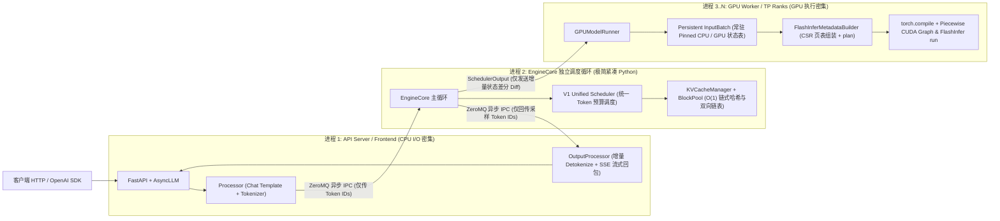
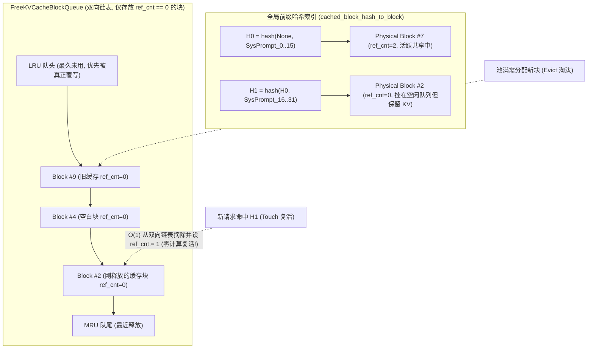
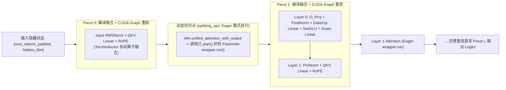
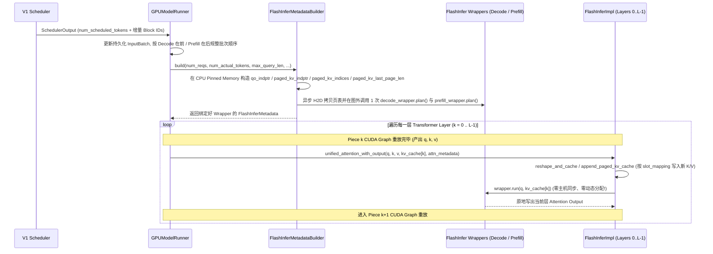

#ai #llm #inference #vllm #paged-attention #cuda-graph #flashinfer #源码导读

相关笔记：[[flashinfer-vllm-sglang-learning-path]] | [[vllm-and-sglang]] | [[llm-inference-pipeline]] | [[sglang-srt-radix-and-scheduler]] | [[flashinfer-intuition-and-engine-bridge]] | [[flashinfer-paged-kv-and-decode-source]] | [[flashinfer-ragged-prefill-and-mla-source]] | [[llm-inference-learning-path]]

# vLLM 架构演进与 V1 核心机制深度解析：统一调度、BlockPool 与 Piecewise CUDA Graph

> **源码与版本边界**：本文基于 **vLLM V1 核心架构主线**（源码根目录 `vllm/v1/`，自 vLLM v0.8+ 起成为新一代默认架构）与 **FlashInfer v0.7.3**（审查日期 `2026-11-17`）梳理。因 vLLM 社区演进极快，文中聚焦长期稳定的核心模块路径、数据结构与状态机契约，不绑定易漂移的具体行号，并在文末提供源码检索锚点与实验验证方式。

## 概述

vLLM 之所以能成为开源大模型推理的事实标准之一，经历了两次决定性的系统跃迁：

1. **第一次跃迁（SOSP'23 PagedAttention）**：借鉴操作系统虚拟内存分页机制，将连续预留的 KV Cache 拆解为固定大小的物理块（Block），彻底消灭外部显存碎片，使单卡并发吞吐提升数倍。
2. **第二次跃迁（V0 → V1 架构重写）**：随着 GPU 硬件（Hopper/Blackwell）、低比特量化（FP8/FP4）和算子库（FlashInfer / FlashAttention-3）飞速进化，单步 GPU 计算耗时缩短至几毫秒，早期 V0 架构沉重的 Python 主线程调度、Prefill/Decode 二元割裂状态机与全量张量重建反而成了卡住 GPU 的最大瓶颈。**vLLM V1** 通过**多进程 ZeroMQ 隔离、单一 Token 预算统一调度器、$O(1)$ 引用计数懒驱逐 `BlockPool`、持久化差分 `InputBatch` 以及基于 `torch.compile` 的 Piecewise CUDA Graph**，对引擎内核完成了一次脱胎换骨的现代化重构。

---

## 从三大生产痛点看懂 vLLM 的演进逻辑

在切入源码目录前，先通过三个真实的线上服务账本，理解每一项复杂机制到底在解决什么真问题。

### 拦路虎一：按最大长度连续预留显存，60% 以上空间沦为死碎片

假设你部署了一个支持 `max_model_len = 8192` 的 7B 模型。在未引入分页的朴素实现中，由于事先不知道用户到底会生成 50 个字还是 8000 个字，系统一旦接收请求，就必须在显存中为它划出一整块**物理连续**、长度为 `8192` 的 KV 张量槽位。这会同时制造三类浪费：

- **预留浪费（Reservation Waste）**：用户只问了一句“你好”，实际总共只用 64 个 Token，剩下 `8128` 个槽位在请求结束前谁也不能碰。
- **内部碎片（Internal Fragmentation）**：固定切分大块连续缓冲区时，尾部永远装不满。
- **外部碎片（External Fragmentation）**：请求 A（占 2K）、请求 B（占 4K）、请求 C（占 2K）先后结束释放了 A 和 C，虽然总空闲显存有 4K，但被中间还在跑的 B 劈成了两段不相邻的 2K 空洞，新来一条 3K 请求照样报 OOM！在早期论文实测中，真实有效存储 Token 的 KV 显存占比往往**不到 20%~40%**。

**PagedAttention 的破局直觉（像 OS 虚拟内存一样管显存）**：
把整块 KV 显存池预先切成上万个固定大小的小页框（Physical KV Block，常见 `block_size = 16` 个 Token）。每条请求在逻辑上觉得自己的 Token 是连续增长的（`0, 1, 2, ..., 34`），但底层通过一张轻量级的 **Block Table（页表）** 按需指向任意空闲物理块（例如第 `7` 号块、第 `2` 号块、第 `9` 号块）。写满 16 个 Token 才申请下一块——**外部碎片直接归零，每条请求的尾部浪费严格封顶在最后不到 1 个 Block（最多 15 个 Token）**，显存有效利用率跃升至 **96% 以上**。

### 拦路虎二：短请求干等长请求，长文档 Prefill 把流式吐字卡成幻灯片

显存利用率解决后，紧接着就是调度时延灾难：

1. **Static Batching（静态批处理）之痛**：4 条请求绑成一车发往 GPU，请求 1 只生成 20 个 Token 就遇到了 `<eos>`，却必须干等请求 4 慢吞吞生成完 1000 个 Token 才能一起下车返回。
2. **无切片 Continuous Batching 的“长请求插队卡顿”**：Orca 提出的迭代级调度（Continuous Batching）允许请求 1 生成完立刻下车、新请求随时上车。但假设老用户 A、B 正在以 `15 ms/token` 的丝滑速度看流式输出，此时用户 C 突然上传了一篇 **16,384 Token** 的长财报请求总结。如果调度器暂停 Decode、优先把这 16K Token 一次性做完整 Prefill，GPU 会被这一个大矩阵乘独占 **300~500 ms**——屏幕前的用户 A 和 B 会明显看到文字突然“卡死”半秒（**ITL P99 剧烈毛刺**）！反之，如果只做 Decode，小 Batch 算术强度极低，昂贵的 GPU Tensor Core 又严重吃不饱。

**Chunked Prefill（分块预填充）的破局直觉**：
给每一个推理 Step 设定一个**固定的全局计算预算**（例如每步最多算 `512` 个 Token）。老请求 A、B 各需要算 `1` 个新 Decode Token（共消耗 2 个预算），剩下的 `510` 个预算切给长文档 C 算它的前 `510` 个 Prompt Token（下几步再接着算 `510~1020`……）。这样一来，**老请求的 Decode 一步都没停（保住了极低且平稳的 ITL），长请求的矩阵块又顺带把这一步的 Tensor Core 算力喂饱了（拉满了吞吐）**！

### 拦路虎三：GPU 算得越来越快，Python 主线程反而成了最大拖油瓶

到了 H100 / B200 配合 FP8 量化、张量并行（TP）与 FlashInfer 内核的时代，一个惊人的性能倒挂出现了：**GPU 执行完一整轮 32 层模型 Decode 前向往往只需要 `3~4 ms`，但 CPU 上的 Python 代码为了准备这一步的输入和后处理输出，居然要花 `4~6 ms`！**

在 vLLM V0 架构中，以下高开销操作全都挤在耦合的控制路径里：
- HTTP 请求解析、Chat Template 字符串拼接与 Tokenizer 分词；
- 繁琐的 `SequenceGroup` 嵌套对象遍历，以及把 Prefill 与 Decode 拆成两套完全不同分支的复杂调度器；
- **每一步都从零重新构建 Python 列表并 `torch.tensor(..., device="cuda")` 拷贝整批页表和位置索引**；
- 每层几十个细碎 PyTorch 算子的逐一 Python Kernel Launch，以及同步把采样结果拉回 CPU 做增量 Detokenize。

用 `Nsight Systems (nsys)` 抓一条时间线就会看到：GPU 计算条带之间密密麻麻全是几毫秒宽的空白气泡——**昂贵的 GPU 在等单核 Python 排班**。这正是 **vLLM V1 推倒重来**的直接导火索。

---

## vLLM V0 → V1 全景架构重构：多进程零干扰隔离与增量状态

vLLM V1 的第一刀，就是用清晰的进程边界与持久化状态表，把一切不该挡在 GPU 发射关键路径上的 Python 负载全部剥离出去。



### 核心隔离与减负设计（对应 `vllm/v1/` 源码目录）

1. **Frontend 与 `EngineCore` 通过 ZeroMQ 彻底解耦**（`vllm/v1/engine/async_llm.py`、`core.py`、`core_client.py`）：
   - **Frontend 进程**专门抗高并发网络 I/O、Tokenizer 分词（`Processor`）和流式字符串解码（`OutputProcessor`）。即使瞬间涌入上百条长文本分词把该进程 CPU 打满，也**绝对抢不到 `EngineCore` 进程的 Python GIL**。
   - 跨进程 ZeroMQ 管道里传输的载荷被压到了极致：请求进去时只传数字化后的 `EngineCoreRequest`（Prompt Token ID 数组与采样配置），每步出来时只传极小的 `EngineCoreOutputs`（新生成的 Token ID 与完成标志），不再跨进程搬运庞大臃肿的文本与张量对象。
2. **持久化 `InputBatch` 与增量状态差分（Stateful Diff）**（`vllm/v1/worker/gpu_model_runner.py`、`gpu_input_batch.py`）：
   - 在 V0 中，哪怕某一步有 256 条老请求继续 Decode，调度器也会把这 256 条请求的全部历史 Token 和完整页表重新打包发给 Worker。
   - 在 V1 中，`GPUModelRunner` 在本地常驻维护一张预分配好的 **`InputBatch` 状态大表**（包含预申请的 CPU 锁页内存 `pin_memory` 与对应 GPU 缓冲）。`SchedulerOutput` 每步只汇报**“跟上一步相比变了什么”**：
     - `scheduled_new_reqs`：只有**本轮首次入列**的新请求才携带完整初始 Token IDs 与分配到的 Block IDs；
     - `scheduled_cached_reqs`：已经在跑的老请求，只传本轮**新追加**的少量 Block IDs 与已计算进度；
     - 已完成的请求直接从 `InputBatch` 对应行摘除或尾部交换填补。
   - 这一设计将多卡 TP 广播与每步主机侧内存拷贝量直接削减了一个数量级以上。

### vLLM V0 与 V1 核心架构对比总表

| 架构维度 | vLLM V0（传统架构） | vLLM V1（新一代默认架构） |
| --- | --- | --- |
| **进程与 GIL 隔离** | API / Tokenizer / Engine 常混跑或浅层解耦，易受 GIL 互相干扰 | Frontend、独立 `EngineCore` 进程与多卡 `Worker` 通过 ZeroMQ 严格隔离 |
| **调度器状态模型** | 显式区分 Prefill / Decode 多套队列分支与繁重的 `SequenceGroup` | **完全统一为 Token 级进度游标**，核心输出仅为 `{req_id: num_scheduled_tokens}` |
| **Chunked Prefill** | 后期补丁式加入，与部分特性（如投机解码、Prefix Cache）组合受限 | **原生一等公民默认开启**，一切请求皆为受预算约束的 Token 切片 |
| **Prefix Caching (APC)** | 独立分配器分支，开启后有一定 Python 字典与对象管理额外开销 | **零额外开销 `BlockPool` 原生内建并默认常开**，全链路 $O(1)$ 操作 |
| **Worker 输入准备** | 每步无状态全量重建张量元数据并重新拷贝至 GPU | 常驻 **`InputBatch` 增量状态差分更新** + CPU Pinned Memory 异步 DMA |
| **图编译与 CUDA Graph** | 仅纯 Decode 阶段整图捕获，遇到含 Prefill 的混合批次即退回慢速 Eager | 深度集成 `torch.compile` + **Piecewise CUDA Graph**，混合批次照样享受图重放 |

---

## 抛弃 Prefill/Decode 二元割裂：彻底统一的 V1 Scheduler

打开 `vllm/v1/core/sched/scheduler.py`，你会发现 V1 调度器的代码量比 V0 缩减了大半，可读性却高出数倍。它背后的第一性原理洞察极其干净：

> **对 Transformer 前向计算而言，世上本没有“Prefill 请求”和“Decode 请求”的本质区别——任何请求在任何一步，都只是“账面上已经算好了 $C$ 个历史 Token 的 KV，本轮再送入 $S$ 个新 Token 去推进状态”！**

- 首轮完整短 Prompt（长度 120）：$C = 0,\ S = 120$；
- 长 Prompt 分块预填充第 2 块（前 512 已算完）：$C = 512,\ S = 512$；
- 常规自回归生成第 1 个新词：$C = 1024,\ S = 1$；
- 投机解码（Speculative Decoding，带 1 个上步采样词 + 3 个草稿词并行验证）：$C = 64,\ S = 4$。

因此，V1 为每条 `Request` 只维护两个最核心的进度整数：
1. `num_computed_tokens`：已经在物理 KV Cache 中准备就绪的 Token 数（无论是前几步自己算出来的，还是刚进门时直接命中 Prefix Cache 白捡的）；
2. `num_tokens_with_spec`：当前已知需要送入模型的总目标 Token 数（原始 Prompt + 已生成输出 Token + 可选投机草稿 Token）。

两者的差值 `num_new_tokens = req.num_tokens_with_spec - req.num_computed_tokens`，就是这条请求眼下渴望被调度的 Token 数！

### 具体数字推演：同一个 Step 如何丝滑混跑三类异构请求

假设配置全局单步预算 `max_num_batched_tokens = 520`（在调度器内部初始化 `token_budget = 520`），物理块大小 `block_size = 16`。当前引擎正处于第 $t$ 步，`running` 队列里有老请求 `Req_A` 和 `Req_B`，`waiting` 队列队头刚到一条长文档新请求 `Req_C`：

1. **先遍历 `running` 队列（优先保障已在途请求的连续流式体验）**：
   - **`Req_A`（常规流式 Decode 老请求）**：
     历史已算 `num_computed_tokens = 128`，上一步刚采样出 1 个新词，故 `num_tokens_with_spec = 129`。待算差额 `129 - 128 = 1`。向 `KVCacheManager` 申请第 129 个槽位（开启第 9 个物理块的第 1 槽）成功 → 记入 `num_scheduled_tokens["Req_A"] = 1`，剩余 `token_budget = 520 - 1 = 519`。
   - **`Req_B`（开启投机解码的老请求，含 3 个草稿 Token）**：
     历史已算 `num_computed_tokens = 64`，携带 1 个上步确认词 + 3 个草稿词，`num_tokens_with_spec = 68`。待算差额 `68 - 64 = 4`。申请 4 个新 KV 槽位成功 → 记入 `num_scheduled_tokens["Req_B"] = 4`，剩余 `token_budget = 519 - 4 = 515`。
2. **再从 `waiting` 队列准入新请求（利用剩余预算吃满 GPU 算力）**：
   - **`Req_C`（总长 2048 Token 的新长文档请求）**：
     首先调用 `kv_cache_manager.get_computed_blocks(Req_C)` 查链式前缀哈希——发现开头的 256 个 Token（16 个完整 Block）恰好是共享 System Prompt，瞬间命中缓存！于是 `Req_C` 起步直接拥有 `num_computed_tokens = 256`，真正还需计算的差额降为 `2048 - 256 = 1792` 个 Token。
     接着看当前剩余预算 `token_budget = 515`（若开启块对齐或直接截断，比如分配 `512` 个 Token），`KVCacheManager` 为 `256 ~ 768` 这 512 个新位置分配 `32` 个空闲物理块成功 → 将 `Req_C` 移入 `running`，记入 `num_scheduled_tokens["Req_C"] = 512`，剩余预算 `3`（停止准入下一条请求）。

最终，V1 调度器对这一步复杂混合场景给出的核心决策，浓缩成了一个干净到极致的字典：

```python
# SchedulerOutput 核心调度分配结果（总计 1 + 4 + 512 = 517 <= 520 预算）
num_scheduled_tokens = {
    "Req_A": 1,    # 普通 Decode
    "Req_B": 4,    # Speculative Decode (1 target + 3 draft)
    "Req_C": 512,  # 命中 256 前缀后的首段 Chunked Prefill
}
```

到了下游模型侧，这三段输入被无缝拼成一条总长 `517` 的一维紧凑张量 `input_ids`（形状 `[517]`），附带切片边界 `query_start_loc / qo_indptr = [0, 1, 5, 517]`，一趟前向推理同时推进了全部三条请求！等到下一步（第 $t+1$ 步），`Req_C` 的 `num_computed_tokens` 更新为 `256 + 512 = 768`，继续消费剩余的 `1280` 个 Prompt Token，直到全部算完自然衔接进入每步调度 `1` 个 Token 的自回归阶段——**全程没有任何队列搬迁或模式切换**。

> **关于显存不足时的抢占（Preemption）**：如果在步骤 1 为 `running` 中的某条请求追加新 KV 槽位时发现 `BlockPool` 已空，调度器会从 `running` 队尾（最低优先级/最晚到达的请求）循环执行抢占：释放其占用的物理块（`ref_cnt -= 1`），将其 `num_computed_tokens` 重置为 `0` 并退回 `waiting` 队头等待后续重算（Recompute）。V1 默认去除了 V0 中维护成本极高的隐式 CPU Swap-out 分支，将跨介质多级缓存统一抽象为可插拔的 `KVConnector`（对接 LMCache / Mooncake 等）。

---

## BlockPool 与零开销 Hash-based Prefix Caching（APC）

在 `vllm/v1/core/block_pool.py` 与 `kv_cache_utils.py` 中，vLLM V1 实现了一套所有核心操作均为严格 **$O(1)$ 时间复杂度** 的物理块池与自动前缀缓存（Automatic Prefix Caching）。

### 1. 为什么必须用“链式前缀哈希（Chained Block Hash）”

每个物理块代表固定 `block_size`（如 16）个连续 Token 的 K/V 状态。一个初学者常犯的直觉错误是：“只要两个 Block 里的 16 个 Token ID 一模一样，它们的 KV Cache 就能共享吧？”

**绝对不能！** 因为在因果自注意力（Causal Self-Attention）和旋转位置编码（RoPE）下，第 2 个块里每个 Token 算出来的 Hidden State 与 K/V，既取决于它在序列中的绝对位置偏移，也取决于它前面第 0 块、第 1 块里的每一个历史 Token！同一句 `"请给出三条修改建议"` 接在代码后面和接在周报后面，内部激活天差地别。

因此，vLLM 必须采用类似区块链的**前缀链式哈希（Merkle Chain）**：

$$
H_0 = \operatorname{Hash}\big(\text{None},\ T_{0:B},\ \text{extra\_keys}\big), \qquad H_k = \operatorname{Hash}\big(H_{k-1},\ T_{kB:(k+1)B},\ \text{extra\_keys}\big)
$$

- 只有当第 $0, 1, \dots, k-1$ 块的 Token 序列分毫不差时，$H_{k-1}$ 才会相同，进而第 $k$ 块的 $H_k$ 才可能命中（若中间改了哪怕 1 个标点符号，从该块起往后的所有 Hash 全部雪崩失效，详见 [[prefill-cache-miss]]）。
- `extra_keys` 用于混入 `lora_int_id`、多模态图片内容哈希或租户隔离 `cache_salt`，防止不同 LoRA Adapter 或不同隐私租户之间发生越权复用或张冠李戴。
- **满块注册原则**：只有写满全部 $B$ 个 Token 的**完整块（Full Block）** 才会计算 `block_hash` 并登记到全局哈希表 `cached_block_hash_to_block`；正在逐词生成的未满尾块属于请求私有可变区，填满第 16 个词的那一刻才会封存归档入表。

### 2. 引用计数 `ref_cnt` 与双向空闲链表 `FreeKVCacheBlockQueue` 的懒驱逐艺术

为什么说 V1 的 Prefix Caching 是“零额外开销（Zero-Overhead）”？秘诀在于**释放时绝不擦除数据（Lazy Eviction）**。



跟踪一个物理块 `KVCacheBlock` 的完整一生，就能瞬间领悟这套设计的精妙：

1. **预分配与常驻**：引擎启动测量完可用显存后，一次性实例化全部 `num_gpu_blocks` 个 `KVCacheBlock` 对象，每个对象只有 `block_id`、`ref_cnt`、`block_hash` 以及指向前后空闲块的指针 `prev_free_block` / `next_free_block`。初始全部串进双向链表 `FreeKVCacheBlockQueue`。
2. **请求结束释放（`free_blocks`）—— 只挂链表、不抹缓存**：
   当使用 `Block #2` 的最后一条请求生成结束时，`Block #2.ref_cnt` 从 `1` 减为 `0`。此时 `BlockPool` **既不清零 GPU 显存里第 2 号块的 K/V 浮点数，也不去 `cached_block_hash_to_block` 里删除 `H1 -> Block #2` 的映射**，仅仅用两行指针赋值把 `Block #2` 挂到 `FreeKVCacheBlockQueue` 的**队尾（MRU 端）**！耗时是常数级几纳秒。
3. **同前缀新请求到来（`touch`）—— `ref_cnt: 0 -> 1` 原地满血复活**：
   只要显存池还没挤爆到轮流淘汰队尾，`Block #2` 就静静躺在空闲队列里保留着有效数据。下一秒新请求带着相同的 `SysPrompt_16..31` 查哈希表命中 `Block #2`：发现其 `ref_cnt == 0`，直接用双向链表 $O(1)$ 节点摘除操作把它从 `FreeKVCacheBlockQueue` 拿出来，令 `ref_cnt = 1`！**没拷一个字节，没跑一个 CUDA Kernel，16 个 Token 的多层 KV Cache 直接原地复活。**
4. **显存真正吃紧分配新块（`popleft` 懒驱逐）**：
   只有当某条新请求需要写全新内容时，`BlockPool` 才会从 `FreeKVCacheBlockQueue` 的**队头（LRU 最久未用端）** 弹出一个 `ref_cnt == 0` 的块（如 `Block #9`）：检查若它身上还挂着老的 `block_hash`，此刻才顺手从 `cached_block_hash_to_block` 注销该旧键并调用 `reset_hash()`，随后把 `Block #9` 交给新请求覆写。

---

## Piecewise CUDA Graph：破解动态混合批次的图捕获死结

前面解决了 Python 调度器开销，但到了 GPU 模型前向执行层，还有一头性能怪兽：**PyTorch 算子逐个发射开销（Kernel Launch Overhead）**。一个 32 层的 Transformer 每跑一步包含数百个细碎操作（RMSNorm、QKV Linear、RoPE、Attention、O_Proj、残差相加、SwiGLU MLP……）。在小 Batch 或高速卡上，CPU 通过驱动往 CUDA Stream 里塞一个 Kernel 就要花几微秒，几百个算子累加起来又是好几毫秒的空隙。

### 为什么传统的“整网捕获（Full CUDA Graph）”在混合批次下失灵

在纯 Decode 时代，大家习惯把整个模型从头到尾录制成一张完整的 CUDA Graph，重放时一次驱动调用发射整网。但 CUDA Graph 有一条铁律：**图内所有张量的虚拟内存地址、静态形状以及 Kernel 网格分支必须在录制那一刻彻底固定死**。

在 vLLM V1 全面拥抱 **Chunked Prefill 统一调度** 后，同一个批次里既有 1-Token Decode、又有 512-Token Prefill 切片，且每条请求的历史块表长度千差万别：
- Attention 层高度依赖每步动态变化的序列结构（如 `qo_indptr`、`paged_kv_indptr` 以及 CPU 侧 `plan()` 决定的 Split-KV 任务划分）；
- 如果强行整网录制，要么因为 Attention 算子内部包含动态元数据准备而录制报错，要么不得不按 `(batch_size, seq_len_combination)` 组合录制海量计算图把显存直接撑爆。

### vLLM V1 的手术刀：`torch.compile` + `splitting_ops` 分段图捕获

vLLM V1 给出了一个极具洞察力的解法——既然整张网里**只有 Attention 是跟序列长度耦合的“异类”**，而其余占算子个数 90% 以上的 `RMSNorm`、`Linear`、`RoPE`、`SwiGLU` 全都是**只认总 Token 行数 `[num_tokens, hidden_dim]` 的纯逐 Token 算子（Token-wise Ops）**，为什么不在 Attention 边界把整张图切开呢！



这套 **Piecewise CUDA Graph（分段 CUDA 图，代码位于 `vllm/compilation/`）** 的完整工作流如下：

1. **FX 图追踪与定点切割**：启动阶段，`torch._dynamo` 将整个模型追踪为一张完整的 PyTorch FX 计算图（无 Graph Break）。随后 vLLM 编译后端扫描图中所有注册在 `splitting_ops` 列表里的自定义注意力算子（如 `vllm.unified_attention_with_output`），像切香肠一样把 $L$ 层模型切成 $L+1$ 段纯确定性的 Token-wise 子图（`Piece 0` 到 `Piece L`）。
2. **TorchInductor 融合 + 按总 Token 数分档录制**：每一个子图先经由 `TorchInductor` 自动把相邻的 `RMSNorm + RoPE + 残差相加 + 量化` 融合成极少数高效 Triton/CUDA 内核；接着仅为一组离散的 **`num_tokens` 总量档位**（如 `[8, 16, 32, 64, ..., 512, 1024, 2048]`，只跟总 Token 数这一维有关，彻底与请求条数和上下文长度解耦！）分别捕获 CUDA Graph 并共享同一显存池（Graph Memory Pool）。
3. **运行时混合批次丝滑交错**：
   比如前文例子算出本步总调度 Token 数为 `517`，`GPUModelRunner` 只需将其向上 Padding 到最近的捕获档位（如 `528`），然后按顺序循环：
   - 一次极低开销 `graph.replay()` 跑完 `Piece k` 里所有融合好的矩阵乘与归一化；
   - 回到 Python 极轻量调用一次已经提前 `plan()` 好的 `FlashInferImpl.forward()`（原地将结果写入预分配静态输出缓冲，严防动态分配新张量导致下一段 CUDA Graph 引用悬空旧地址！）；
   - 紧接着重放 `Piece k+1`。
4. **进阶双模自适应（`FULL_AND_PIECEWISE`）**：在较新的 V1 编译流水线中，vLLM 甚至支持同时维护两套图——当某一步存在 Prefill 切片时走上述 **Piecewise CUDA Graph**；当某一步恰好全是纯 Decode 请求且后端支持图内执行 `run()` 时，自动切换到连同 Attention 一起打包的 **Full CUDA Graph**，把端到端 CPU 发射开销压榨到理论极限。

---

## 与 FlashInfer 的源码级握手契约

理解了 V1 的统一调度器、BlockPool 和分段 CUDA Graph，最后一块拼图就是：**`GPUModelRunner` 如何把 V1 的调度结果精准喂给底层的 FlashInfer 内核**（核心源码位于 `vllm/v1/attention/backends/flashinfer.py`，关联算子细节见 [[flashinfer-intuition-and-engine-bridge]] 与 [[flashinfer-paged-kv-and-decode-source]]）。

### 为什么每步只需 `plan()` 一次，32 层全部零 CPU 介入 `run()`

同一轮前向里，第 0 层到第 31 层的标准自注意力层面对的请求集合、每条请求本轮算几个 Token、以及每条请求占用哪几个逻辑块偏移是**完全一致**的（仅各层指向的物理 `kv_cache[layer_idx]` 起始地址不同；若模型含 Sliding Window 局部注意力混合层，则按 `KVCacheGroup` 分组各建一份元数据）。因此，vLLM V1 严格遵循 FlashInfer 的 **`Plan-Run` 二阶段契约**：



### 四大核心张量映射与源码骨架拆解

在 `FlashInferMetadataBuilder.build()` 中，引擎将 `InputBatch` 的二维页表压缩翻译为 FlashInfer 要求的 4 个一维紧凑数组，并考虑批次重排（Batch Reordering：常将单 Token Decode 请求排在批次前段 `[0 : num_decodes]` 以走带宽极优的 `BatchDecodeWithPagedKVCacheWrapper`，将多 Token Chunked Prefill 排在后段 `[num_decodes : num_reqs]` 以走 Tensor Core 极优的 `BatchPrefillWithPagedKVCacheWrapper`）：

1. **`qo_indptr`（形状 `[num_reqs + 1]`，`int32`）**：
   对每条请求本步调度的 `num_scheduled_tokens` 求前缀和。以前文混合批次为例（排序后 `Req_A: 1`, `Req_B: 4`, `Req_C: 512`），`qo_indptr = [0, 1, 5, 517]`，直接告诉 FlashInfer 在紧凑一维张量 `q` 中哪几行属于哪条请求。
2. **`paged_kv_indptr`（形状 `[num_reqs + 1]`，`int32`）**：
   每条请求当前有效总长度 `seq_len = num_computed_tokens + num_scheduled_tokens` 所占物理块个数 $\lceil \text{seq\_len} / \text{block\_size} \rceil$ 的前缀和。例如 `Req_A`（总长 129，占 9 块）、`Req_B`（总长 68，占 5 块）、`Req_C`（本步总长 $256+512=768$，占 48 块），则 `paged_kv_indptr = [0, 9, 14, 62]`。
3. **`paged_kv_indices`（形状 `[total_num_blocks]`，`int32`）**：
   按请求顺序把各自 `block_table` 中的有效物理 `block_id` 紧凑拼接成一维数组（总长度等于 `paged_kv_indptr[-1] = 62`），彻底消除矩形二维页表的 Padding 空洞。
4. **`paged_kv_last_page_len`（形状 `[num_reqs]`，`int32`）**：
   每条请求最后一个物理块里实际装了多少个有效 Token，计算式为 `(seq_len - 1) % block_size + 1`（上例中分别为 `(129-1)%16+1 = 1`、`(68-1)%16+1 = 4`、`(768-1)%16+1 = 16`）。

用精炼的 Python 伪代码还原 `vllm/v1/attention/backends/flashinfer.py` 的核心生命周期如下：

```python
# 概念化浓缩伪代码（对应 vllm/v1/attention/backends/flashinfer.py 核心契约）
class FlashInferMetadataBuilder:
    def build(self, common_attn_metadata) -> FlashInferMetadata:
        # 1. 从常驻锁页缓冲构造 CSR 元数据并异步拷往 GPU
        # qo_indptr: [0, 1, 5, 517], paged_kv_indptr: [0, 9, 14, 62] ...
        qo_indptr_cpu, paged_kv_indptr_cpu, paged_kv_indices_gpu, last_page_len_cpu = (
            self._prepare_csr_tables(common_attn_metadata)
        )

        # 2. 在进入模型层循环前（且在 CUDA Graph 之外）仅调用 1 次 plan()!
        if num_decodes > 0:
            self.decode_wrapper.plan(
                indptr=paged_kv_indptr_cpu[: num_decodes + 1],
                indices=paged_kv_indices_gpu[:num_decode_pages],
                last_page_len=last_page_len_cpu[:num_decodes],
                num_qo_heads=self.num_qo_heads,
                num_kv_heads=self.num_kv_heads,
                head_dim=self.head_dim,
                page_size=self.block_size,
                q_data_type=self.q_dtype,
                kv_data_type=self.kv_dtype,
            )
        if num_prefills > 0:
            self.prefill_wrapper.plan(
                qo_indptr=qo_indptr_prefill_cpu,
                paged_kv_indptr=paged_kv_indptr_prefill_cpu,
                paged_kv_indices=paged_kv_indices_gpu[num_decode_pages:],
                paged_kv_last_page_len=last_page_len_cpu[num_decodes:],
                causal=True,
                # ... 头数、维度与数据类型参数
            )
        return FlashInferMetadata(
            decode_wrapper=self.decode_wrapper,
            prefill_wrapper=self.prefill_wrapper,
            slot_mapping=common_attn_metadata.slot_mapping,
            num_decode_tokens=num_decode_tokens,
        )


class FlashInferImpl:
    def forward(self, layer, query, key, value, kv_cache, attn_metadata, output):
        # 3. 逐层前向：先把本步新算的 K/V 填入物理块池对应槽位
        append_kv_to_paged_cache(key, value, kv_cache, attn_metadata.slot_mapping)

        # 4. 零 CPU 调度开销直接 run()，结果原地写入预分配的 output 缓冲
        if attn_metadata.num_decode_tokens > 0:
            d_toks = attn_metadata.num_decode_tokens
            output[:d_toks] = attn_metadata.decode_wrapper.run(query[:d_toks], kv_cache)
        if query.shape[0] > attn_metadata.num_decode_tokens:
            d_toks = attn_metadata.num_decode_tokens
            output[d_toks:] = attn_metadata.prefill_wrapper.run(query[d_toks:], kv_cache)
        return output
```

---

## 动手验证与源码追踪指南

1. **在本地（Mac/Linux）快速定位核心源码符号**：
   克隆 `https://github.com/vllm-project/vllm` 后，用 `rg`（ripgrep）按如下稳定符号链阅读，平均半天即可串通全脉络：
   ```bash
   # 1. 多进程入口与 EngineCore 主循环
   rg "class EngineCore" vllm/v1/engine/
   # 2. 统一 Token 预算调度器主逻辑
   rg "def schedule\(" vllm/v1/core/sched/scheduler.py
   # 3. BlockPool 链式哈希、touch 复活与懒驱逐双向链表
   rg "class BlockPool|class FreeKVCacheBlockQueue" vllm/v1/core/
   # 4. Piecewise CUDA Graph 切图算子配置
   rg "splitting_ops" vllm/compilation/ vllm/config/
   # 5. FlashInfer 后端元数据构建与 plan/run 调用点
   rg "class FlashInferMetadataBuilder|def forward\(" vllm/v1/attention/backends/flashinfer.py
   ```
2. **在云端 GPU 验证 V1 行为**：
   启动 `vllm serve Qwen/Qwen2.5-7B-Instruct` 时观察终端初始化日志：
   - 确认 `Initializing a V1 LLM engine`、后端打印 `Using FlashInfer backend on V1 engine`（或通过环境变量/配置指定 `--attention-backend FLASHINFER`）；
   - 观察 `Capturing CUDA graphs (mixed prefill-decode, PIECEWISE)` 的档位进度条，再用长短交错并发请求压测观察 `/metrics` 中 `vllm:prefix_cache_queries`、`vllm:prefix_cache_hits` 与平稳的 `vllm:inter_token_latency_seconds`。

---

## 自检问题

### Q1：vLLM V1 调度器为什么不需要像早期系统那样单独维护一套“Prefill 阶段调度器”和一套“Decode 阶段调度器”？

> [!question]- 参考答案（点击展开）
>
> 因为在启用 **Chunked Prefill** 与 **Paged KV Cache** 后，任何处于任意生命周期的请求在数学与物理执行上都收敛为同一个抽象：**已知前 `num_computed_tokens` 个位置的 KV 缓存已在物理池中就绪，本步再将紧随其后的 `num_scheduled_tokens` 个新 Token 送入网络计算并写入新槽位**。
> - 首轮短 Prompt、长文档的第 $k$ 个分块、常规自回归的 `1` 个新 Token、乃至投机解码一次验证 `1 + K` 个草稿 Token，区别仅仅是字典 `{req_id: num_scheduled_tokens}` 里的整数大小不同。
> - 统一受单一 `max_num_batched_tokens` 预算约束后，系统不仅彻底消除了两套调度分支的状态同步与饥饿死锁 Bug，还能自然实现同一个 Step 内“老请求保流式低延迟 + 新请求切片喂满算力”的最优混跑。

### Q2：在 `BlockPool` 中，当某条请求结束并调用 `free_blocks()` 使某个物理块的 `ref_cnt` 降为 `0` 时，为什么不顺手清空它的 `block_hash`？

> [!question]- 参考答案（点击展开）
>
> 这是 **Lazy Eviction（懒驱逐 / 零开销自动前缀缓存 APC）** 的核心设计：
> 1. 只要还没有新请求急需这块物理显存去装别的数据，这块 GPU 显存里原本算好的 K/V 浮点数依然完好无损。
> 2. 释放时只做 $O(1)$ 指针操作把该 `KVCacheBlock` 追加到 `FreeKVCacheBlockQueue` 双向链表的**队尾（MRU 端）**，而保留它在全局 `cached_block_hash_to_block` 中的哈希映射。
> 3. 若后续到达的新请求携带相同前缀查表命中该块，只需 $O(1)$ 将其从空闲链表摘除并把 `ref_cnt` 从 `0` 改回 `1`（即 `touch` 操作），即可实现**零 FLOPs 重算、零内存拷贝的原地缓存复活**；只有当空闲块耗尽、该块滑到链表**队头（LRU 端）**被真正分配给其他请求覆写时，才注销其旧哈希。

### Q3：为什么 `BlockPool` 的前缀哈希必须把 `parent_hash` 算进去，而且只对写满 `block_size` 的完整块注册哈希？

> [!question]- 参考答案（点击展开）
>
> 1. **为什么必须链入 `parent_hash`**：Causal Attention 中每个 Token 会关注前面所有历史位置，且 RoPE 旋转角严格依赖绝对位置下标。哪怕当前块内的 16 个 Token ID 完全一样，只要前面的上文少了一个字或换了一个词，当前块算出的 Key 和 Value 张量数值就完全不同。链式哈希 `hash(parent_hash, block_tokens, extra_keys)` 保证了只有从第 0 个 Token 起完全一致的前缀链才会命中同一个物理块。
> 2. **为什么只注册完整满块**：未写满 `block_size` 的尾块正处于请求动态追加写入的过程中（下一步 Decode 还要往同一个物理块的剩余槽位写新 K/V）。如果让多条走向不同分支的请求共享一个未写满的可变物理块，它们下一步各自生成的不同新 Token 就会争抢覆盖同一个物理槽位造成数据污染；等写满封存为只读满块后再注册共享则天然线程/请求安全。

### Q4：为什么 Piecewise CUDA Graph 要求中间被切开的 Attention 算子必须使用类似 `unified_attention_with_output` 的原地写出接口，而不能每次 `return torch.empty_like(q)`？

> [!question]- 参考答案（点击展开）
>
> 因为跟在 Attention 后面的下一段子图（`Piece k+1`）是一张**已经录制固化的静态 CUDA Graph**！在录制那一刻，`Piece k+1` 第一个算子（如 `O_Proj` 线性层）读取的输入张量设备指针地址已经被硬编码写死在图节点里了。如果夹在中间以 Eager 模式运行的 Attention 每次动态调用分配器 `torch.empty(...)` 返回一块新地址的显存，`Piece k+1` 重放时根本不会去读这块新内存，而是继续去读录制时的旧地址（已被回收或装满脏数据），从而引发静默精度错乱或 `CUDA illegal memory access`。使用预分配静态输出缓冲原地写出，才能严丝合缝地拼接前后两段静态图。

---

## 面试要点

### Q1：请概括 vLLM 从 V0 升级到 V1 解决了哪些核心架构瓶颈，带来了什么实质收益？

> [!question]- 参考答案（点击展开）
>
> V0 在高速 GPU（如 H100 FP8）和高并发场景下的头号瓶颈是 **CPU Python 控制面开销反超 GPU 计算耗时** 以及 **功能特性间的强耦合冲突**。V1 通过五大核心重构彻底破局：
> 1. **多进程 ZeroMQ 解耦**：将 HTTP、Tokenizer、增量 Detokenize 移入 Frontend 进程，使独立 `EngineCore` 调度循环免受 I/O 与分词 GIL 阻塞。
> 2. **持久化 `InputBatch` 增量状态差分**：Worker 常驻维护请求状态表，每步仅传输与更新增量变化（Diff），消除了每步全量构造张量与重复 H2D 拷贝。
> 3. **彻底统一的 Token 预算调度器**：摒弃 Prefill/Decode 割裂队列，用 `{req_id: num_scheduled_tokens}` 原生统一 Chunked Prefill、Decode 与 Speculative Decoding。
> 4. **零开销常开 Prefix Caching（`BlockPool`）**：用链式哈希 + 引用计数双向链表实现全 $O(1)$ 懒驱逐与原地复活。
> 5. **`torch.compile` + Piecewise CUDA Graph**：在动态 Attention 处切分 FX 图，使包含变长 Chunked Prefill 的混合批次也能享受算子融合与 CUDA Graph 极低发射开销。

### Q2：Chunked Prefill 的 `max_num_batched_tokens` 调得过大或过小，分别会对 TTFT、ITL 和系统吞吐产生什么影响？

> [!question]- 参考答案（点击展开）
>
> `max_num_batched_tokens` 是控制单步计算量上限的核心旋钮，直接决定了延迟与吞吐的权衡点：
> - **调得过大（如 8192 或 16384）**：长 Prompt 可以在极少数 Step 内一口气算完，单次矩阵乘极度饱满，**总吞吐（Throughput）和长请求自身的 TTFT 更好**；但单步 GPU 执行时间被显著拉长（达数十至上百毫秒），同批次混跑的所有流式老请求都必须等这一大步算完才能吐出下一个词，导致 **ITL / TPOT P99 明显恶化（流式卡顿）**，同时激活峰值显存更高。
> - **调得过小（如 256）**：单步耗时极短，流式 Decode 请求的 **ITL 极其丝滑稳定**；但一条 16K 的长 Prompt 被切碎成 60 多步才能算完，每步还要反复读取历史 KV Cache 且难以打满大卡 Tensor Core，导致 **长请求 TTFT 变慢、系统整体吞吐下降**。生产中常根据硬件算力与业务 SLO 在 `512 ~ 2048` 区间压测寻优（若仍无法兼顾极端长短混合负载，则升级至 [[llm-inference-learning-path]] 的 **PD 分离** 架构）。

### Q3：vLLM V1 的 `BlockPool`（基于固定块大小 Hash）与 SGLang 的 `RadixCache`（基于压缩前缀树）各有什么优劣？

> [!question]- 参考答案（点击展开）
>
> 两者都实现了跨请求 KV 复用与引用计数 LRU 懒驱逐，核心差异在于**索引数据结构与匹配粒度**：
> - **vLLM V1 `BlockPool`（链式块哈希）**：
>   - **优势**：结构极其扁平规整，哈希查表、双向链表摘挂全部是严格常数极小的 $O(1)$ 操作，几乎零树节点维护开销；固定 `block_size` 与底层分页 Kernel、多模态块对齐、异构混合注意力层（如 Full + Sliding Window）配合非常干净。
>   - **局限**：缓存复用的最小粒度锁死为 `block_size`（如 16 Token）——如果两条请求在第 25 个 Token 处分叉，只能复用第 1 个满块（0~15），第 2 个块（16~24 共 9 个相同 Token）无法作为满块命中，需要重算。
> - **SGLang `RadixCache`（压缩前缀树）**：
>   - **优势**：支持 `page_size=1`（Token 级精确分叉）或细粒度页对齐的最长前缀匹配；更重要的是**树结构显式保留了请求之间的前缀亲缘拓扑**，使调度器能做 **Cache-aware 排序**（把共享同一棵子树前缀的请求凑进同一批提高缓存局部性），非常适合多轮 Agent 与树状分叉采样（详见 [[sglang-srt-radix-and-scheduler]]）。
>   - **局限**：需要维护动态节点分裂（Split）、父子指针遍历与叶子递归驱逐，控制面数据结构复杂度高于扁平哈希表。

### Q4：在 vLLM V1 对接 FlashInfer 时，为什么要把请求重排成“Decode 在前、Prefill 在后”并分别调用 Wrapper？

> [!question]- 参考答案（点击展开）
>
> 因为在混合批次（Hybrid Batch）中，单 Token Decode 请求与多 Token Chunked Prefill 请求的硬件瓶颈截然不同：
> - **单 Token Decode（`q_len == 1`）** 算术强度极低，属于典型的 HBM 带宽受限操作，使用专门针对 GQA 组内共享与细粒度 Split-KV 调优的 `BatchDecodeWithPagedKVCacheWrapper` 带宽效率最高；
> - **多 Token Chunked Prefill（`q_len > 1`）** 同一请求有多行 Query 可复用同一份历史 KV，算术强度高，必须走基于 Tensor Core MMA 的 `BatchPrefillWithPagedKVCacheWrapper` 才能跑满算力。
> 将 `InputBatch` 规整为前段 `[0 : num_decodes]` 全是单 Token Decode、后段 `[num_decodes : num_reqs]` 全是多 Token Prefill 后，两者在紧凑一维 `query` 张量中自然形成两个连续切片 `query[:d_toks]` 和 `query[d_toks:]`，无需额外拷贝重排张量，即可在图外各 `plan()` 一次、每层连续 `run()` 两次，各自榨干最匹配的硬件单元。

---

## 参考与版本边界

- **核心源码锚点（基于 `vllm-project/vllm` 主干 `vllm/v1/`）**：
  - 引擎前端与多进程核心：`vllm/v1/engine/async_llm.py`、`vllm/v1/engine/processor.py`、`vllm/v1/engine/core.py`
  - 统一调度器：`vllm/v1/core/sched/scheduler.py`、`vllm/v1/core/sched/output.py`
  - KV 块池与链式前缀缓存：`vllm/v1/core/kv_cache_manager.py`、`vllm/v1/core/block_pool.py`、`vllm/v1/core/kv_cache_utils.py`
  - GPU 执行器与持久化批次：`vllm/v1/worker/gpu_worker.py`、`vllm/v1/worker/gpu_model_runner.py`、`vllm/v1/worker/gpu_input_batch.py`
  - 编译与分段 CUDA Graph：`vllm/compilation/backends.py`、`vllm/compilation/cuda_piecewise_backend.py`（注：随 PyTorch 2.7~2.9+ 演进，编译后端子模块命名偶有微调，以检索 `splitting_ops` 与 `CUDAGraphMode` 为准）
  - FlashInfer 注意力后端：`vllm/v1/attention/backends/flashinfer.py`
- **延伸文献与官方博客**：
  - Kwon et al., *Efficient Memory Management for Large Language Model Serving with PagedAttention*, SOSP 2023.
  - Agrawal et al., *Taming Throughput-Latency Tradeoff in LLM Inference with Sarathi-Serve* (Chunked Prefill), OSDI 2024.
  - vLLM Blog: *vLLM V1: A Major Upgrade to vLLM's Core Architecture* (2025) & [vLLM V1 Developer Docs](https://docs.vllm.ai/).
