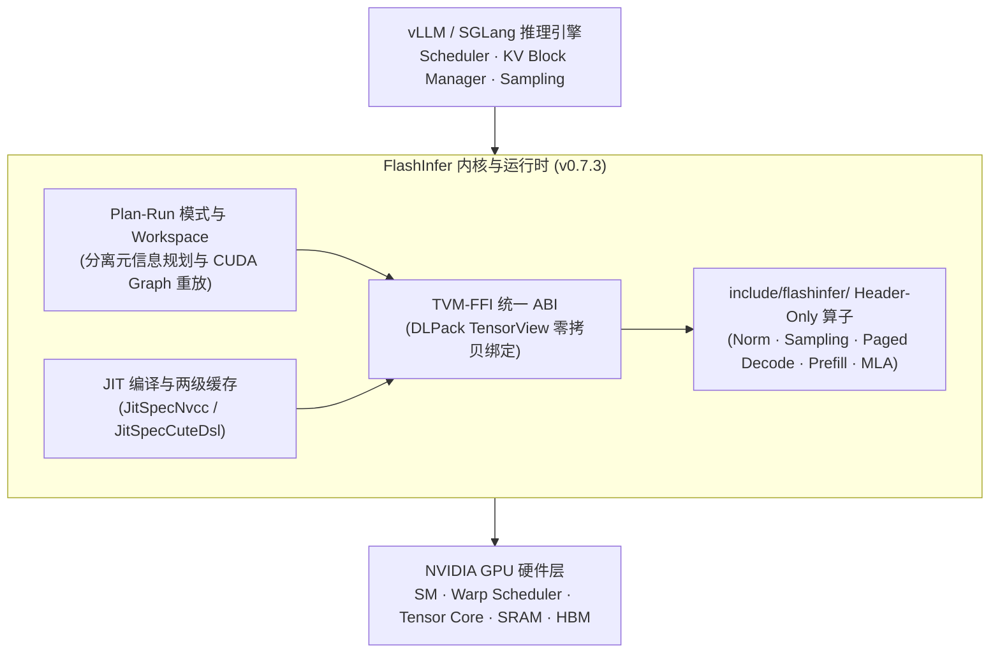

# GPU 算子与 FlashInfer 学习索引

> 返回 [AI 学习索引](../README.md)

本专题把 LLM 推理系统（[LLM Inference](../inference/README.md)）向下打通到 GPU 硬件执行与 CUDA 内核实现：从 SM / Warp / SRAM / HBM 与 Roofline 模型出发，推导 Online Softmax 与状态合并公式，再结合 FlashInfer 源码拆解其三层解耦架构、JIT 编译系统、Norm/Sampling、Paged KV Decode、Ragged Prefill、Cascade 与 MLA。

> 源码边界：本文档组基于 **FlashInfer v0.7.3（commit `82caa5668`，本地源码 `/Users/hsn/github/flashinfer`，审查日期 `2026-11-17`）** 撰写，只引用实际核验过的文件路径、结构体、类与函数名，避免记录易漂移的行号。

## 系统定位

## 推荐阅读顺序

初学 CUDA 先读 [从 SIMD 到 SIMT](simd-and-gpu-simt-foundations.md) 与 [CUDA 工具链](cuda-ecosystem-and-career-roadmap.md)。训练侧先完成[单卡训练计时](gpu-execution-and-memory-model.md#训练侧练习区分提交时间与设备时间)，再回[训练路线](../training/README.md)；推理侧从 [FlashInfer 的页表与 Plan/Run](flashinfer-intuition-and-engine-bridge.md) 进入下表源码。

| 顺序 | 文档 | 核心内容 | 定位 |
| --- | --- | --- | --- |
| 1 | [GPU 执行、内存模型与 Online Softmax](gpu-execution-and-memory-model.md) | Grid/CTA/Warp/Thread 硬件映射、128-bit 合并访存与 Bank Conflict、Prefill/Decode Roofline 定量分析、Safe/Online Softmax 与 `state_t` 合并推导 | 概念与数学基石 |
| 2 | [FlashInfer 学习路线与实验工作流](flashinfer-learning-roadmap.md) | Mac（源码精读 + JIT 检查 + CPU 实验）与云端 GPU（`pytest`、`flashinfer_benchmark.py` CUPTI、`ncu` Roofline）四阶段路线 | 学习路线 |
| 3 | [FlashInfer 三层架构与 JIT 编译体系源码导读](flashinfer-architecture-and-jit.md) | `include/` / `csrc/` / `flashinfer/` 框架解耦、`env.py` / `core.py` / `cpp_ext.py` / `cute_dsl_core.py`、`@flashinfer_api` 日志体系 | 架构与工程基座 |
| 4 | [FlashInfer Norm 与 Sampling 源码导读](flashinfer-norm-and-sampling-source.md) | 路径 A（无 Jinja 基线 `norm`、`vec_t` 访存、Warp/Block 归约与 CuTe-DSL 调度）与路径 B（无排序 GPU 拒绝采样、AIR Top-P 与 Radix Top-K） | 入门算子源码 |
| 5 | [FlashInfer Paged KV 与 Decode 源码导读](flashinfer-paged-kv-and-decode-source.md) | `paged_kv_t` 寻址、`state_t` 状态合并、Plan-Run 与 CUDA Graph 生命周期、Split-KV Decode 与 `MergeStates` | 核心 Decode 源码 |
| 6 | [FlashInfer Ragged Prefill、Cascade 与 MLA 源码导读](flashinfer-ragged-prefill-and-mla-source.md) | Ragged `indptr`、Chunked Prefill、Cascade Attention 多级合并与 DeepSeek MLA 权重吸收 | Prefill 与 MLA 源码 |
| 7 | [Online Softmax 与 Split-KV 离线实验](../experiments/online-softmax-and-split-kv/README.md) | 零 GPU 依赖的 Python 标准库实验，复现 `paged_kv_t` 寻址、base-2 `state_t` 缩放与 Split-KV / Cascade 合并 | 离线机制验证 |

## 关联导航

- 上游系统层：[LLM Inference 学习索引](../inference/README.md)（理解 Continuous Batching、PagedAttention 与 RadixAttention 如何调用底层算子）
- 机制实验区：[AI Experiments](../experiments/README.md)（在无 NVIDIA GPU 的 Mac 环境验证算子核心数值不变量）
