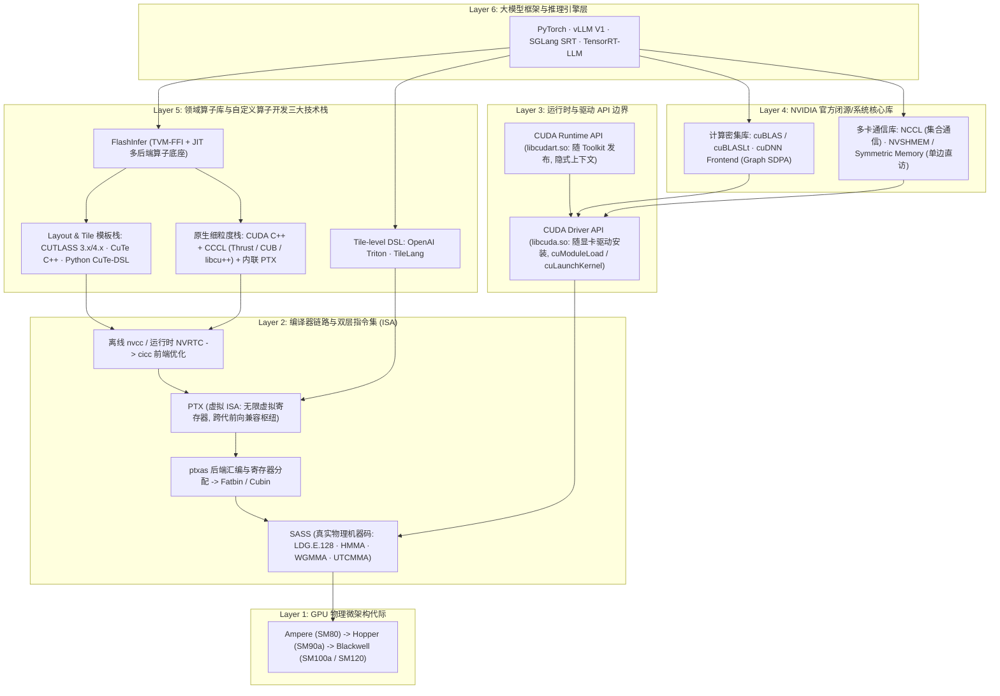
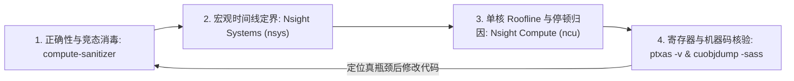
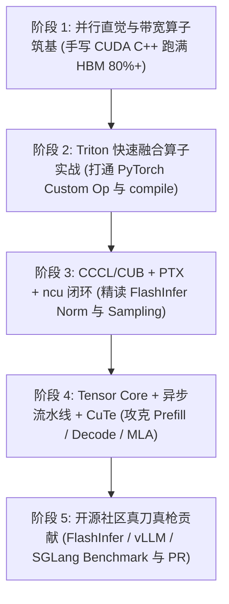

#ai #llm #gpu #cuda #ptx #cutlass #cute #triton #学习路线

相关笔记：[[linear-algebra-for-llm]] | [[simd-and-gpu-simt-foundations]] | [[gpu-execution-and-memory-model]] | [[flashinfer-intuition-and-engine-bridge]] | [[flashinfer-architecture-and-jit]] | [[flashinfer-norm-and-sampling-source]] | [[flashinfer-learning-roadmap]] | [[flashinfer-vllm-sglang-learning-path]]

# CUDA 全景生态与算子工程师进阶路线：从 PTX 到 CUTLASS、CuTe 与 Triton

## 概述

很多立志往 **CUDA 算子开发 / AI Infra / 推理引擎** 方向深耕的学习者，一打开开源仓库（如 FlashInfer、vLLM、SGLang、DeepGEMM、DeepEP）就会迎面撞上一堵“生态名词墙”：`PTX`、`SASS`、`nvcc`、`NVRTC`、`libcuda.so`、`cuBLASLt`、`CCCL`、`CUB`、`NCCL`、`NVSHMEM`、`CUTLASS 3.x`、`CuTe`、`CuTe-DSL`、`Triton`、`TileLang`、`nsys`、`ncu`……不知道谁在谁的下层、谁是谁的替代品、现在学原生 CUDA C++ 会不会被 Triton 或 CuTe-DSL 淘汰。

本文用一张**自底向上的全景架构地图**彻底扫清这些概念的层级与选型边界，用手算小例子拆解最让人头疼的 **CuTe `Layout = (Shape, Stride)` 代数** 与 **Triton Tile 级抽象**，并给出一份经过工业界检验、可直接落地的**算子工程师五阶段实战进阶路线**。

---

## 一图看清 CUDA 全景软件栈与硬件代际演进

把整个 NVIDIA GPU 软硬件生态想象成一栋六层大厦：**越往下越贴近物理硅片与极致控制力，越往上越追求开发效率与工程复用**。优秀的算子工程师从不迷信单一层，而是清楚每一层的抽象代价与逃生通道：



### 1. 硬件微架构三代核心跃迁（Ampere → Hopper → Blackwell）

为什么算子仓库里到处都是 `sm_80`、`sm_90a`、`sm_100a` 的编译分支？因为最近三代数据中心 GPU 每一代都改变了**异步搬运**与**矩阵乘法**的底层硬件游戏规则：

| 微架构代际 | 计算能力（SM 版本） | 代表芯片 | 关键新硬件原语与大模型算子意义 |
| --- | --- | --- | --- |
| **Ampere / Ada** | `SM80` / `SM86` / `SM89` | A100、RTX 3090、L40S、RTX 4090 | ① **`cp.async`**：首次支持 HBM → Shared Memory 绕过通用寄存器的异步直接拷贝，奠定双缓冲/多级软件流水线（FlashAttention-2 标配）；② **`mma.sync`**（1 Warp = 32 线程协同 Tensor Core，支持 TF32/BF16/FP16，`SM89` 引入 FP8）。 |
| **Hopper** | **`SM90` / `SM90a`** | H100、H200、H800 | ① **TMA（Tensor Memory Accelerator）**：专用硬件单元接管多维张量块地址计算、边界越界填零与 HBM ↔ SMEM 异步传输；② **WGMMA**：128 线程（Warpgroup）异步大矩阵乘，支持直接从 SMEM 读操作数及原生 **FP8**；③ **Thread Block Cluster & DSMEM**：同一簇内跨 SM 共享内存直连（FlashInfer SM90 采样与 MLA 使用）；④ **PDL**：前后相邻 Kernel 头尾重叠执行。 |
| **Blackwell** | **`SM100` / `SM100a` / `SM120`** | B200、GB200、RTX 5090（`SM120`） | ① **`tcgen05`**：第五代 Tensor Core，支持单线程异步发射及 **2-CTA Pair 跨块协同**；② **TMEM（Tensor Memory）**：每 SM 新增 256 KB 专用片上累加器内存，彻底把巨型矩阵累加结果请出通用寄存器堆；③ 原生硬件 **NVFP4 / MXFP4 / MXFP8** 块缩放低比特矩阵乘。 |

> 必懂工程细节——为什么 Hopper 和 Blackwell 编译标志带字母 **`a` 或 `f`**（如 `-gencode arch=compute_90a,code=sm_90a`）：普通 `sm_90` 生成的指令遵守跨代兼容契约；而像 `wgmma`（Hopper 专属）或 `tcgen05`（Blackwell 数据中心专属）这类极度耦合当前微架构硬件通路的指令，**不保证在下一代 GPU 上二进制或 PTX 兼容**，必须显式开启 **Architecture-accelerated（`a` 后缀）** 或同族兼容（CUDA 12.9+ 的 `f` family-specific 后缀，见 [[flashinfer-architecture-and-jit]] 的 `CompilationContext`）编译器才允许发射！

### 2. PTX vs SASS 与编译链全拆解（`nvcc` / NVRTC / `cicc` / `ptxas`）

写完一段 `.cu` 代码，它是怎么一步步变成硅片电信号的？中间为什么要隔一层 **PTX**？

1. **源码分流与 `cicc`（C++/CUDA → PTX）**：
   - `nvcc` 是编译驱动器：它先把 `.cu` 里跑在 CPU 上的宿主代码剥离交给 `gcc`/`clang`，再把 `__global__` / `__device__` 设备代码送入基于 LLVM 的前端编译器 **`cicc`**，执行内联展开、循环优化后输出 **PTX（Parallel Thread Execution）汇编文本**。
   - **PTX 的定位**：它是 **虚拟指令集（Virtual ISA）**，采用类似 SSA 的**无限虚拟寄存器**假设（如 `%f1` ~ `%f999`，尚未映射到真实的物理 255 个寄存器上限）。它承担两大核心使命：
     - **跨代前向兼容枢纽**：发布二进制库时将 PTX 嵌入 Fatbin，未来用户插上尚未面世的新架构显卡时，显卡驱动内置的 JIT 编译器可在运行期实时把旧 PTX 翻译成新显卡机器码。
     - **底层硬件能力逃生舱**：当高级 C++ 语法表达不出特殊硬件指令（如 `ex2.approx.ftz.f32`、`cp.async`、`ldmatrix`、`griddepcontrol.wait`）时，算子工程师直接在 C++ 中写 `asm volatile("...")` 内联 PTX。
2. **`ptxas` 后端汇编器（PTX → SASS）**：
   - **`ptxas`** 是真正决定生死的一关！它读取虚拟 PTX，结合目标架构（如 `sm_90a`）执行**指令调度重排**与**物理寄存器分配**，输出真正的硬件二进制机器码 **SASS（Streaming ASSembler，打包在 `.cubin` 中）**。
   - **黄金编译诊断参数 `--ptxas-options=-v`**：编译时加上它，`ptxas` 会直接打印每个 Kernel 到底占用了多少个物理寄存器（`Used 64 registers`）以及是否发生了致命的 **`spill stores / spill loads`（寄存器不够用，被迫溢出到慢速 HBM 本地内存！）**。
3. **离线 `nvcc` vs 运行时 `NVRTC`**：
   - `nvcc` 适合完整 C++ 工程（支持 Host+Device 混合编译，FlashInfer 的 `JitSpecNvcc` 用 Ninja 驱动 `nvcc` 增量编译 `.so`）；
   - **`NVRTC`（NVIDIA Runtime Compilation）** 是纯内存级库函数（输入 C++ 字符串，在内存中直接吐出 PTX，再配 `nvJitLink` 链接），无需调起外部 shell 编译器进程，常用于轻量动态算子融合。

### 3. Runtime API（`libcudart.so`）vs Driver API（`libcuda.so`）

- **CUDA Runtime API（`cuda*` 前缀，位于 `libcudart.so`）**：随你安装的 **CUDA Toolkit**（如 `/usr/local/cuda-12.8` 或 conda 环境）分发。提供 `<<<grid, block, smem, stream>>>` 语法糖、`cudaMalloc`、`cudaMemcpyAsync`，会自动在后台懒初始化并绑定当前线程的设备上下文。
- **CUDA Driver API（`cu*` 前缀，位于 `libcuda.so`）**：随宿主机操作系统的 **NVIDIA 内核显卡驱动**一起安装！它是 Runtime API 的底层地基，暴露更底层的句柄控制：例如**动态从内存/磁盘直接加载编译好的 `.cubin`/PTX 模块（`cuModuleLoadData` + `cuLaunchKernel`）**、细粒度虚拟显存物理页动态映射（`cuMemCreate` / `cuMemMap`，vLLM/SGLang 睡眠唤醒释放显存池利器）。因此，Triton、CuTe-DSL 和 TVM 运行时在发射 JIT 编译出的二进制机器码时，底层清一色直接调用 **Driver API**。

---

## NVIDIA 官方核心库版图与选型边界

动手写算子前的第一条工程铁律：**先弄清官方库已经把什么做到了硬件极限，把好钢用在官方库覆盖不到的融合与定制痛点上**。

### 1. 计算密集层：`cuBLAS` / `cuBLASLt` 与 `cuDNN`

- **`cuBLAS` 与 `cuBLASLt`（矩阵乘法天花板）**：
  - 对于标准的稠密大矩阵乘法（Linear 投影层 $XW_Q, XW_{\text{up}}$ 等），NVIDIA 工程师针对每一代显卡的 L2 分区、寄存器排布与指令双发射做了极致 SASS 级调优。
  - 现代工程一律优先调用更轻量的 **`cuBLASLt`**（而非传统 `cublasGemmEx`）：它不仅支持显式传入固定大小的 Workspace（完美兼容 CUDA Graph）、支持 `FP8` / `NVFP4` 缩放因子，还能通过启发式搜索（Heuristic Search）自动挑选最佳 Tile 算法，并在矩阵乘写回 HBM 前顺手在寄存器里做完 **Epilogue Fusion（尾声融合，如 `+ Bias`、GELU/ReLU 激活、量化缩放统计）**。
- **`cuDNN`（v9+ Frontend Graph API）**：
  - 早已不再是早期只跑 CNN 卷积的旧印象。现代 `cuDNN Frontend` 采用声明式计算图 API，其内置的 **Hopper / Blackwell SDPA（Scaled Dot-Product Attention）** 是地表最快的闭源注意力实现之一——正因如此，FlashInfer 在 `flashinfer/prefill.py` 与 `decode.py` 中直接集成了 `backend="cudnn"` 路由，在合适形状下自动借力。

### 2. C++ 内核构建积木：CCCL（Thrust + CUB + libcu++）

如果你决定用 CUDA C++ 写自定义 Kernel，**千万不要每次都从零手搓归约、前缀和与基数排序**！NVIDIA 已将三大官方开源 C++ 头文件库统一整合为 **CCCL（CUDA Core Compute Libraries）**（FlashInfer 在 `3rdparty/` 与 `FLASHINFER_CCCL_INCLUDE_DIRS` 中专门内置了新版 CCCL）：

| CCCL 子库 | 抽象层级 | 核心定位与代表组件 | 在 FlashInfer 源码中的真实用法示例 |
| --- | --- | --- | --- |
| **`Thrust`** | Host 端算法级 | 类似 C++ STL 的高层并行算法（`thrust::sort`、`thrust::transform_reduce`），一行代码自动发射 Kernel | 快速基准原型、离线索引预处理 |
| **`CUB`** | **Kernel 内部积木级** | 提供 **Warp / Block / Device 三级可组合 C++ 模板**（`cub::BlockReduce`、`cub::BlockScan`、`cub::BlockRadixSort`），编译期展开为零开销最优硬件指令 | `include/flashinfer/sampling.cuh` 直接在自定义采样核内调用 **`cub::BlockReduce`** 统计枢轴概率质量、调用 **`cub::BlockScan::InclusiveSum`** 计算 CDF 前缀和！ |
| **`libcu++`** | 异构标准库原语级 | 可在 `__device__` 内直接使用的 C++ 标准库与异步并发原语（`cuda::std::span`、`cuda::atomic`、`cuda::pipeline`、`cuda::barrier`） | Hopper/Blackwell 生产者-消费者异步屏障同步、跨线程安全原子操作 |

> 理解 `CUB` 的战略价值：`Thrust` 每次调用都会单独启动一个全网格 Kernel 并读写一次 HBM，破坏算子融合；而 **`CUB` 是镶嵌在你自己的 `__global__` Kernel 内部的积木**——你负责前后自定义融合逻辑，中间把 Shared Memory 的 `TempStorage` 传给 `cub::BlockScan`，立刻白嫖最顶级的无 Bank Conflict 并行扫描！

### 3. 多卡通信与系统层：`NCCL` vs `NVSHMEM` / Symmetric Memory

当单卡装不下 70B / 671B 大模型，进入 Tensor Parallelism（TP）与 Expert Parallelism（EP）多卡协同领域时，两套通信底座分工明确：

- **`NCCL`（NVIDIA Collective Communications Library）**：
  - 多机多卡集合通信标准（基于 Ring 或 Tree 拓扑执行 `AllReduce`、`AllGather`、`ReduceScatter`）。适合 **TP 大块稠密激活同步**（几 MB 到几百 MB）。
  - 局限：**双边协作模型**——所有参与 GPU 必须同时启动专门的通信 Kernel（占用宝贵的若干个 SM），在小数据包、低延迟 Decode 或极度动态不规则的 MoE Token 分发下，Kernel 启动同步与打包拷贝开销明显。
- **`NVSHMEM` 与 PyTorch `Symmetric Memory`（对称内存）**：
  - 基于 PGAS（分区全局地址空间）的**单边细粒度直访模型**。多张卡的显存被映射到统一虚拟地址空间，你的计算 Kernel 在算到一半时，**直接在核内发一条 NVLink 远端 Load/Store 指令或 IBGDA（GPU 直驱 InfiniBand RDMA）指令把几百字节数据推进隔壁卡的显存**，无需对方 CPU 介入或单独起通信核！这是 **DeepSeek DeepEP、FlashInfer `moe_ep` 分布式 MoE 专家路由与超低延迟融合 AllReduce** 的核心杀手锏。

---

## 算子开发三大技术栈深度对比与选型决策

今天在工业界写自定义 GPU 算子，99% 的工作落在以下三大技术栈中。先看全局选型对照表，再逐一拆透内核原理：

| 对比维度 | 1. 原生 CUDA C++（+ CCCL + PTX） | 2. CUTLASS 3.x/4.x & CuTe（C++ / `CuTe-DSL`） | 3. OpenAI Triton（及 `TileLang`） |
| --- | --- | --- | --- |
| **编程基本单位** | **Thread（单个标量线程）** + Warp 原语 | **Layout 代数映射** + `TiledCopy` / `TiledMMA` | **Tile（整个分块张量，无显式线程概念）** |
| **开发效率与代码量** | 低（几百~上千行 C++，需手管共享内存与同步） | C++ 模板偏重；**Python `CuTe-DSL` 显著提效** | **极高**（100~200 行 Python 搞定复杂融合算子） |
| **编译速度** | 中等（`nvcc` 数秒~十余秒） | C++ CUTLASS 慢（数十秒~数分钟）；**`CuTe-DSL` 快（秒级）** | **极快**（MLIR 直接生成 PTX/cubin，秒级） |
| **硬件压榨天花板** | **100%**（完全掌控每条指令与每个寄存器） | **98% ~ 100%**（紧跟 Hopper/Blackwell 最新硬件原语） | **85% ~ 95%**（受限于编译器自动流水线与寄存器分配） |
| **最擅长的最佳战场** | **不规则控制流、采样、分页寻址、极致低延迟小算子** | **稠密/低比特 GEMM、FlashAttention-3/4、MLA、FP8/FP4 峰值核** | **中高层算子融合（Norm+Act+Quant、Loss、RoPE、快速科研迭代）** |

### 技术栈 1：原生 CUDA C++ + PTX 内联——精细逻辑与带宽算子的定海神针

不要误以为有了 Triton 就不需要学原生 CUDA C++。凡是遇到以下三类场景，原生 CUDA C++ 依然无可替代：
1. **数据依赖的动态多轮控制流**：例如 [[flashinfer-norm-and-sampling-source]] 中拆解的 `TopKTopPSamplingFromProbKernel`——每个 Warp/CTA 要根据当前随机抽出的枢轴概率动态决定是否接受样本、收缩 `[low, high]` 区间并提前 `break`，甚至要用内联 PTX `.rn` 精确绕开 `-use_fast_math` 的 FTZ 刷零陷阱。
2. **复杂间接寻址与细粒度位操作**：如 Paged KV 的 `protective_get_kv_offset` 越界谓词保护、2D Bit-packed 自定义掩码解析、11-bit / 8-bit 多 CTA Radix Top-K 桶计数。
3. **跨块硬件级微操**：如手动插入 Hopper `griddepcontrol.wait / launch_dependents`（PDL）或 Cooperative Kernel `grid.sync()`。

### 技术栈 2：CUTLASS 3.x & CuTe（含 Python `CuTe-DSL`）——驯服 Tensor Core 的布局代数

到了 CUTLASS 3.x 时代，NVIDIA 彻底重构了抽象核心，推出了 **CuTe（CUDA Templates）**。初学者看 CUTLASS 源码最怵满屏的 `Layout<Shape<...>, Stride<...>>`，其实它的核心灵魂用 **2 分钟手算**就能彻底顿悟！

#### 用 2×4 小矩阵手算看懂 CuTe 的灵魂：`Layout = (Shape, Stride)`

回想以前写 CUDA C++ 最痛苦的事：把一块全局内存里的矩阵搬进 Shared Memory，为了避开 32-Bank Conflict 要加 XOR Swizzle，然后再用 `ldmatrix` 拆进 32 个线程各自的寄存器喂给 `mma.sync`——每一步都要在草稿纸上狂推 `int offset = ((tid / 4) * 16 + (tid % 4) * 2) ^ ...`，写错一个括号全盘皆输。

CuTe 提出了一个天才的数学统一观：**无论你是数据张量的内存排布、32 个线程的逻辑队形，还是 Tensor Core 指令要求的棋盘分布，本质上全都是同一个东西——一个把“逻辑坐标（或一维序号）”映射到“一维物理偏移量”的函数 `Layout = (Shape, Stride)`**！

它的点积求值公式简单到极致：给定逻辑坐标 $(i_0, i_1)$，物理偏移就是**坐标与步长的内积**：

$$\text{offset}(i_0, i_1) = i_0 \cdot s_0 + i_1 \cdot s_1$$

拿一个 **2 行 4 列（`Shape = (2, 4)`）** 的小矩阵手算对比（注意 CuTe 默认一维序号按列优先展开，但 `Stride` 可以任意指定）：

```text
矩阵逻辑坐标 (row, col), Shape = (2, 4):
  (0,0)  (0,1)  (0,2)  (0,3)
  (1,0)  (1,1)  (1,2)  (1,3)

情况 A: 行主序 (Row-major) -> Layout = ((2, 4), (4, 1))  [往下走 1 行跨 4 格, 往右走 1 列跨 1 格]
  offset(1, 2) = 1 * 4 + 2 * 1 = 6
  物理偏移表:
    [ 0,  1,  2,  3 ]
    [ 4,  5,  6,  7 ]

情况 B: 列主序 (Col-major) -> Layout = ((2, 4), (1, 2))  [往下走 1 行跨 1 格, 往右走 1 列跨 2 格]
  offset(1, 2) = 1 * 1 + 2 * 2 = 5
  物理偏移表:
    [ 0,  2,  4,  6 ]
    [ 1,  3,  5,  7 ]
```

一旦把一切都表达成了 `Layout` 对象，CuTe 就能在编译期对它们做**严格的代数运算**：
- **`logical_divide(Tensor, Tile)`（逻辑切块）**：一行代码把大矩阵切成 `(Tile内坐标, 第几个Tile)` 的嵌套分层 Layout，零运行时拷贝。
- **`composition(Swizzle<B, M, S>{}, smem_layout)`（函数复合 $f \circ g$）**：把异或打散函数 `Swizzle` 直接复合在共享内存 Layout 外面！你后续调用 `cute::copy(tiled_copy, gmem_tensor, smem_tensor)`（`TiledCopy`）和 `cute::gemm(tiled_mma, fragA, fragB, fragC)`（`TiledMMA`）时，CuTe 自动在编译期帮你把线程号、Swizzle 后的无冲突 Bank 地址和 Tensor Core Fragment 对得严丝合缝，**你一行下标公式都不用手推**！

#### 为什么 FlashInfer v0.7+ 大力引入 Python `CuTe-DSL`

C++ 版 CuTe 唯一的痛点是重度依赖 C++17/20 模板元编程：`nvcc` 编译一个复杂 Hopper/Blackwell 内核动辄耗时几十秒甚至几分钟，模板报错长达几百行。

为此 NVIDIA 推出了官方 Python 前端 **`CuTe-DSL`（`nvidia-cutlass-dsl`）**，而 FlashInfer v0.7+ 迅速将其纳入主力技术栈（如默认的 `flashinfer/norm/kernels/` RMSNorm 系列、Blackwell `nvfp4_quantize` 与新一代 MLA 内核）：
1. **原汁原味的底层控制力 + Python 级可读性**：保留完整的 `Layout`、`TiledCopy`、`TiledMMA`、TMA 与 `tcgen05` 能力，但代码用清晰的 Python AST 编写。
2. **编译速度提升一个数量级**：绕开臃肿的 `nvcc` C++ 模板实例化，直接通过基于 MLIR 的编译器栈在 1~2 秒内生成目标文件 `.o`，再配合 FlashInfer 的 `JitSpecCuteDsl`（持久化 `.o` + `meta.json` 缓存，详见 [[flashinfer-architecture-and-jit]]）实现毫秒级冷启动加载。

### 技术栈 3：OpenAI Triton（及 `TileLang`）——以 Tile 为单位的生产力革命

如果说 CUDA C++ 是“指挥每一个士兵（Thread）迈左脚还是右脚”，CuTe 是“用数学公式编排方阵队形”，那么 **OpenAI Triton** 的哲学就是：**程序员只需要指挥整个连队（Block / Program）去攻占哪座山头（Tile），连队内部 128 个士兵怎么排队、怎么分步枪（寄存器）、怎么喊号子（同步）全由编译器包办！**

在 Triton 中，你写的最小变量直接就是一个一维或二维的**块张量（Tile）**：

```python
@triton.jit
def rmsnorm_triton_kernel(X_ptr, W_ptr, Y_ptr, stride_x, N, eps, BLOCK_SIZE: tl.constexpr):
    row = tl.program_id(0)                  # 当前 Program (对应 1 个 CUDA CTA) 负责第 row 行
    cols = tl.arange(0, BLOCK_SIZE)         # 直接生成一整排偏移向量 [0, 1, ..., BLOCK_SIZE-1]
    mask = cols < N                         # 声明式边界掩码

    # 编译器自动生成合并的 LDG.E.128 向量加载与谓词掩码保护！
    x = tl.load(X_ptr + row * stride_x + cols, mask=mask, other=0.0).to(tl.float32)
    w = tl.load(W_ptr + cols, mask=mask, other=0.0).to(tl.float32)

    # 编译器自动生成 Warp Shuffle + Shared Memory 两级归约与 PTX rsqrt！
    rms_rcp = tl.math.rsqrt(tl.sum(x * x, axis=0) / N + eps)
    y = x * rms_rcp * w
    tl.store(Y_ptr + row * stride_x + cols, y, mask=mask)
```

短短十几行 Python，Triton 的 MLIR 编译器自动帮你完成了 **128-bit 合并加载、Warp Shuffle 归约、Shared Memory 分配与 Swizzle（在 `tl.dot` 矩阵乘中）以及 `cp.async` / TMA 多级流水线**，轻松拿到手写 CUDA **85% ~ 95%** 的性能！

**既然 Triton 这么香，它的能力边界在哪里（什么时候必须下沉到 CuTe 或 CUDA C++）**：
1. **极致 Hopper / Blackwell 异构 Warp 特化（Warp Specialization）**：在顶尖的 FlashAttention-3 或 FlashInfer Hopper MLA（`mla_hopper.cuh`）中，为了榨干最后 15% 的硬件潜力，需要让同一个 CTA 里的 `Warpgroup 0` 专职发 TMA 搬运指令并释放多余寄存器给计算组，让 `Warpgroup 1` 和 `Warpgroup 2` 用 `NamedBarriers` 乒乓交错执行 `WGMMA` 与 `SFU exp2`。Triton 的统一 SPMD Tile 模型很难手动微操这种非对称线程分工与极致寄存器配额（注：新兴的 **TileLang** 与 Triton 底层的实验性方言正试图在 Tile 简洁性与显式 Layout/Pipeline 控制之间架桥）。
2. **线程内/跨线程极度不规则的状态机与动态分页**：如无排序多轮拒绝采样、细粒度稀疏动态跳转或复杂的单核 Cooperative Grid 两阶段归并，用 Tile 向量原语强行表达反而别扭且低效。

---

## 性能剖析与调优闭环工具链

写算子最忌讳“凭感觉盲猜性能瓶颈”。工业界标准的 **“消毒 → 宏观定界 → 微观归因 → 汇编验尸”** 四步闭环工具链如下：



### 1. `compute-sanitizer`：先保命，再谈快

当 Kernel 偶发算出 `NaN`、乱码或报 `CUDA error: an illegal memory access was encountered` 时，由于 GPU 异步执行，报错栈往往停在几百行之后的 `cpu()` 拷贝上。直接套上官方消毒器瞬间抓现行：

```bash
# 1. 抓全局/共享内存越界读写与空指针（替代已废弃的 cuda-memcheck）
compute-sanitizer --tool memcheck pytest tests/utils/test_norm.py

# 2. 抓 Shared Memory 多线程读写数据竞争（忘加 __syncthreads / __syncwarp）
compute-sanitizer --tool racecheck python my_kernel_repro.py

# 3. 抓非法分支内同步导致的硬件死锁
compute-sanitizer --tool synccheck python my_kernel_repro.py
```

### 2. `Nsight Systems (nsys)`：宏观系统时间线（先看森林）

在死磕单个算子前，先用 `nsys` 抓一段端到端推理时间轴（开销极低，不会严重扭曲真实时序）：

```bash
nsys profile --trace=cuda,nvtx,osrt -o timeline_report python bench_serving.py
```

打开 GUI 重点看三件事：
- **GPU 行是不是密密麻麻不留缝隙**：如果两个 5 微秒的小 Kernel 之间隔着 **15 微秒的空白气泡**，说明你根本不是 GPU 算得慢，而是 **CPU/Python Kernel Launch Overhead 瓶颈**！此时优化单核毫无意义，正解是上 **CUDA Graph**、**算子融合**或 SGLang 式的 **Overlap Scheduler**。
- **是否存在隐式同步刺客**：搜 `cudaStreamSynchronize` / `cudaMemcpy`（同步拷贝），揪出代码里不经意的 `.item()`、`.cpu()` 或动态布尔判断把整个异步流水线卡停的凶手。
- **多卡通信与计算重叠度**：观察 `NCCL` Stream 与主流计算 Stream 是否按设计并行重叠。

### 3. `Nsight Compute (ncu)`：单核硬件显微镜（再看细胞）

确认某一个具体 Kernel 耗时占比高之后，开启 `-lineinfo`（FlashInfer 中设 `export FLASHINFER_JIT_LINEINFO=1`，保留 `-O3` 全速优化的同时嵌入源码行号映射）运行 `ncu`：

```bash
FLASHINFER_JIT_LINEINFO=1 ncu --set full --target-processes all -o kernel_profile python bench_op.py
```

打开报告按固定顺序读四个核心指标，3 分钟就能给任何算子开出精准处方：

| `ncu` 观测面板与关键指标 | 现象特征 | 背后物理根因与优化处方 |
| --- | --- | --- |
| **GPU Speed Of Light (SOL%)** | `Memory % > 80%` 且 `Compute % < 30%` | 健康的 **Memory-bound** 算子（如 RMSNorm / Decode 已接近硬件带宽极限，再改只能靠算子融合少读写一次 HBM）。 |
| **GPU Speed Of Light (SOL%)** | `Compute %` 与 `Memory %` **双双低于 40%** | **Latency-bound / 发射或占用率受限**！Grid 太小没喂饱全部 SM（需做 Split-KV），或同步屏障/长延迟停顿卡死了流水线。 |
| **Warp State: `Stall Long Scoreboard`** | 线程绝大部分周期停在等待全局内存/L2 返回 | HBM 访存延迟未藏住：改用 `vec_t`（`LDG.E.128`）展开循环提 ILP、引入 `cp.async`/TMA 多级预取、或减少每线程寄存器提高 Occupancy。 |
| **Warp State: `Stall MIO Throttle` / Memory Analysis** | MIO 队列拥塞，`Shared Load/Store Bank Conflicts` 飙高 | **严重的 Shared Memory Bank Conflict** 或高频特殊指令拥堵：为 SMEM 加上 Padding 偏移或 CuTe `Swizzle<3,3,3>`。 |

### 4. `cuobjdump` 与 `nvdisasm`：眼见为实的 SASS 验尸

编译器有时比你想象的“固执”。当你怀疑自己写的 `vec_t<half, 8>` 没对齐被拆成了 8 条单元素读取时，直接反汇编 `.so` 或 `.o` 一眼定乾坤：

```bash
# 查看嵌入的 PTX 虚拟汇编与真实物理 SASS 机器码
cuobjdump --dump-ptx  ~/.cache/flashinfer/.../norm.so | less
cuobjdump --dump-sass ~/.cache/flashinfer/.../norm.so | grep -E "LDG|HMMA|SHFL"
```

看到实打实的 `LDG.E.128`、`HFMA2`、`SHFL.BFLY` 出现在 SASS 里，优化才算真正落地。

---

## 未来向 CUDA 与算子方向发展的五阶段实战成长路线

如果你想系统建立硬核竞争力（无论是进头部大模型团队做推理引擎/训练加速，还是独立贡献顶级开源项目），切忌一上来就硬啃几千行的 Hopper WGMMA 模板。按照下面**由浅入深、每阶段都有量化验收标准**的五步阶梯稳步推进：



### 阶段 1：SIMD 思维 + CUDA 执行/访存基础（建议周期：2~3 周）

- **核心阅读**：[[linear-algebra-for-llm]] → [[simd-and-gpu-simt-foundations]] → [[gpu-execution-and-memory-model]]。
- **动手实战任务**：不调任何第三方库，纯手写 4 个经典基础 Kernel 并与 PyTorch 对齐误差（`< 1e-3` for FP16/BF16）：
  1. `VectorAdd`（对比标量 `float` vs `float4` 128-bit 向量化加载的带宽差距）；
  2. `Row-wise Safe Softmax` 与 `1-Pass Online Softmax`（练习 `__shfl_xor_sync` 蝴蝶归约 + Shared Memory 两级归约）；
  3. `Fused Add + RMSNorm`；
  4. `Naive GEMM` → `Shared Memory Tiled GEMM`（亲手体会分块复用如何把算术强度拉高 `TILE_SIZE` 倍）。
- **通关标准**：你写的 `RMSNorm` 在云端任意一张 GPU（哪怕是最便宜的 T4 / RTX 4090 / A10）上，用 `ncu` 测出 `Memory Throughput` 达到硬件理论峰值带宽的 **80% 以上**。

### 阶段 2：Triton 快速融合算子实战与 PyTorch 集成（建议周期：2 周）

- **目标**：先拥有“一天之内把论文新结构变成工业可用融合算子”的高效生产力。
- **动手实战任务**：
  1. 用 Triton 重写 `Fused Add + RMSNorm`、`SwiGLU`、`RoPE` 以及简化版 `FlashAttention-2` 前向；
  2. 掌握 `@triton.autotune` 搜索 `BLOCK_M / BLOCK_N / num_warps / num_stages`；
  3. 将算子用 `torch.library.custom_op`（含 `register_fake` 形状推导）封装进 PyTorch，确保能无缝通过 `torch.compile(fullgraph=True)` 与 CUDA Graph 捕获。
- **通关标准**：能定量对比同一算子在 PyTorch Eager、`torch.compile` 自动融合、手写 Triton 与手写 CUDA C++ 四种形态下的延迟与显存占用。

### 阶段 3：深入 CCCL/CUB + PTX + `ncu` 调优，啃下 FlashInfer 入门源码（建议周期：2~3 周）

- **核心阅读**：[[flashinfer-architecture-and-jit]] → [[flashinfer-norm-and-sampling-source]] → [[flashinfer-learning-roadmap]]（Phase 1 & Phase 4）。
- **动手实战任务**：
  1. 精读 FlashInfer 的 `include/flashinfer/vec_dtypes.cuh`、`math.cuh`、`norm.cuh` 与 `sampling.cuh`；
  2. 学会在自己的 Kernel 中引入 `cub::BlockReduce` / `cub::BlockScan`，读懂 PTX `ex2.approx`、`rsqrt.approx` 以及 TVM-FFI + Ninja JIT 零拷贝绑定链路；
  3. 在云端 GPU 上执行可编辑安装（`pip install --no-build-isolation -e .`），亲手改一行 `.cuh` 观察自动增量编译并用 CUPTI `bench_gpu_time` 测出微秒级变化。
- **通关标准**：能独立画出无排序枢轴拒绝采样与 `QKRMSNorm` Warp-per-Head 的完整执行图，能用 `ncu` 解释一次真实的 `Stall Long Scoreboard` 或 Bank Conflict 优化前后对比。

### 阶段 4：攻克 Tensor Core、异步拷贝流水线与 CuTe 代数（建议周期：4~5 周）

- **核心阅读**：[[advanced-algebra-for-llm]] → [[flashinfer-intuition-and-engine-bridge]] → [[flashinfer-paged-kv-and-decode-source]] → [[flashinfer-ragged-prefill-and-mla-source]]。
- **动手实战任务**：
  1. 跑通官方 CUTLASS `cute/tutorial` 示例（亲手打印 `print_layout` 验证 `Shape/Stride`、逻辑分块与 `Swizzle` 布局）；
  2. 精读 `decode.cuh`（`cp.async` 多级流水线 + GQA Group Packing + Split-KV `VariableLengthMergeStates`）与 `prefill.cuh`（`ldmatrix` + `mma.sync`）；
  3. 对比阅读 `flashinfer/norm/kernels/rmsnorm.py`（Python `CuTe-DSL`）与 `include/flashinfer/norm.cuh`（CUDA C++），理解新一代算子写法。
- **通关标准**：不看代码能手推 `paged_kv_t` 物理偏移与 `state_t` base-2 合并公式，看懂 Hopper `TMA + WGMMA` 生产者-消费者异步流水线的工作机制。

### 阶段 5：参与开源社区实战与全栈引擎打通（长期深耕）

- **核心阅读**：[[flashinfer-vllm-sglang-learning-path]] → [[vllm-v1-architecture-and-internals]] → [[sglang-srt-radix-and-scheduler]]。
- **高性价比“Mac 本地 + 按需云端 GPU”开发工作流**：
  - 90% 的源码阅读、调用链追踪、方案设计与纯 Python 寻址/数值原型验证（如[分块与索引实验](online-softmax-and-split-kv/README.md)）全部在本地 Mac 上零成本完成；
  - 攒好明确验证清单后，按小时租用云端 Ampere/Hopper 实例（1~2 小时即可跑完 `pytest`、`compute-sanitizer`、`flashinfer_benchmark.py --refcheck` 与 `ncu` 截图），成本极低却极具工程纪律。
- **如何在 FlashInfer / vLLM / SGLang 找到第一个高质量 PR 切入点**：
  1. **Good First Issues & 边界 Bug 修复**：搜索标签 `good first issue`、`bug` 或非典型形状边界问题（如特殊 `head_dim`、空 Batch / 零长度切片下的 `NaN`、CUDA Graph 捕获泄漏、混卡架构校验）；
  2. **算子尾声融合（Epilogue Fusion）与新模型小算子适配**：每当新一代开源模型发布新的 Norm 变体（如 QK-Norm + RoPE 融合、门控残差、FP8/FP4 块量化融合），推理引擎与 FlashInfer 都有大量真实需求；
  3. **提交工业级 PR 的黄金三要素**：① 附带覆盖极端边界（如非对齐维度、`batch=1`、大长序列）的 `pytest` 单元测试与 `--refcheck` 数值误差报告；② 附带基于 `bench_gpu_time(enable_cupti=True)` 的修改前后延迟/带宽对比表格；③ 遵守仓库架构红线（如 FlashInfer `include/` 严禁引入 `torch` 头文件）。

---

## 自检问题

### Q1：同样是编译期或运行期生成代码，`PTX` 与 `SASS` 的本质区别是什么？如果编译 Hopper `wgmma` 内核时只写了 `-arch=sm_90` 而漏掉了字母 `a`（`sm_90a`），会发生什么？

> [!question]- 参考答案（点击展开）
>
> - **PTX vs SASS**：**PTX** 是面向无限虚拟寄存器的跨代**虚拟指令集（Virtual ISA）**，既可作为内联汇编入口，也可嵌入二进制包供未来新架构显卡驱动在运行期 JIT 翻译，保证前向兼容；**SASS** 是经 `ptxas` 完成物理寄存器分配与指令重排后生成的**特定硬件架构真实机器码**（如 `HMMA`、`HGMMA`），不同代 GPU 之间通常二进制不兼容。
> - **漏写 `a` 后缀的后果**：编译器会直接报错拒绝编译 `wgmma` 等架构专属加速指令！因为无后缀的 `compute_90 / sm_90` 承诺向未来架构保持 PTX 前向兼容，而 Hopper 的 `wgmma` / TMA 多播及 Blackwell 的 `tcgen05` 属于特定微架构加速指令（不保证跨大代延续），必须显式指定 **`compute_90a,code=sm_90a`** 才能解锁。

### Q2：给定一个 `Shape = (3, 4)` 的矩阵，请分别写出它在 CuTe 中行主序（Row-major）和列主序（Column-major）下的 `Stride`，并手算逻辑坐标 `(2, 1)` 在两种布局下的一维物理偏移量。

> [!question]- 参考答案（点击展开）
>
> 根据 CuTe 布局映射公式 $\text{offset}(i_0, i_1) = i_0 \cdot s_0 + i_1 \cdot s_1$：
> - **行主序（Row-major）**：每行有 4 个元素，往下跨 1 行需跳过 4 个元素，往右跨 1 列跳过 1 个元素，因此 **`Stride = (4, 1)`**（即 `Layout = ((3, 4), (4, 1))`）。坐标 $(2, 1)$ 的物理偏移为 $2 \times 4 + 1 \times 1 = \mathbf{9}$。
> - **列主序（Column-major）**：每列有 3 个元素，往下跨 1 行跳过 1 个元素，往右跨 1 列需跳过 3 个元素，因此 **`Stride = (1, 3)`**（即 `Layout = ((3, 4), (1, 3))`）。坐标 $(2, 1)$ 的物理偏移为 $2 \times 1 + 1 \times 3 = \mathbf{5}$。

### Q3：为什么在编写自定义 CUDA C++ 融合算子时，推荐使用 CCCL 中的 `CUB`（如 `cub::BlockReduce`）而不是 `Thrust`（如 `thrust::reduce`）？

> [!question]- 参考答案（点击展开）
>
> 因为两者的调用边界与显存访问代价完全不同：**`Thrust`** 是 Host 端驱动的高层算法接口，每次调用都会单独发射整个 GPU Kernel 并将输入输出落地到 HBM 全局显存，无法嵌入你正在编写的融合算子内部；而 **`CUB`** 提供的是 `__device__` 端 **Block 级和 Warp 级可组合 C++ 模板原语**，可以直接嵌在你自己的 `__global__` 融合 Kernel 内部对寄存器和 Shared Memory 里的数据做最优硬件归约/前缀和，全程零额外 Kernel Launch、零多余 HBM 往返读写。

### Q4：当你用 `Nsight Compute (ncu)` 剖析一个自定义算子时，发现 `Compute Throughput` 只有 `12%`、`Memory Throughput` 也只有 `18%`，这说明算子卡在哪里？下一步还应该结合哪个工具确认？

> [!question]- 参考答案（点击展开）
>
> - **瓶颈判定**：计算和显存带宽利用率双双极低（远未触及 Roofline 屋顶或斜坡），说明该算子既不是 Compute-bound 也不是纯粹的 HBM Bandwidth-bound，而是处于 **Latency-bound（延迟/占用率/同步受限）**！常见原因包括：① 启动的 Grid 总 CTA 数太少（如小 Batch 未做 Split-KV），绝大部分 SM 处于空闲围观状态；② 频繁的 `__syncthreads()` 屏障等待或严重未隐藏的串行依赖链；③ 寄存器溢出（Spilling）或核内控制流串行化。
> - **工具联动**：在 `ncu` 内继续查看 `Launch Statistics`（检查 Grid Size 与 SM 数量比值、Achieved Occupancy）和 `Warp State Statistics`（看具体停顿在哪类 Stall）；同时退回宏观层跑 **`Nsight Systems (nsys)`** 检查是否是大量碎片化微秒级小 Kernel 被 CPU Launch 间隙拖垮。

---

## 面试要点

### Q：在实际工程中，面对一个新算子需求，你如何在 `cuBLASLt/cuDNN`、`Triton`、`CuTe / CuTe-DSL` 和 `原生 CUDA C++` 之间做技术选型？

> [!question]- 参考答案（点击展开）
>
> 按“**先复用闭源极限库 → 再用高生产力编译器验证收益 → 最后针对极致瓶颈下沉微操**”的三级决策漏斗选型：
> 1. **标准计算密集型主干（GEMM / 常规 SDPA）**：直接优先调用 **`cuBLASLt`**（配 Epilogue Fusion）或 **`cuDNN Frontend Graph`**，研发成本最低且直接享受官方架构级极限调优。
> 2. **规则分块的中高层算子融合（如自定义 Norm + 激活 + 量化、Cross-Entropy、新型 Attention 变体原型）**：首选 **`OpenAI Triton`**（或 `TileLang`），用百行 Python 快速拿到 85%~95% 硬件峰值性能并无缝接入 PyTorch，先在端到端服务上验证该融合是否真的带来显著吞吐收益。
> 3. **核心热路径压榨最后 10%~15% 算力或适配最新硬件特性（如 Hopper TMA+WGMMA、Blackwell `tcgen05`+NVFP4、MLA）**：采用 **`CUTLASS 3.x / Python CuTe-DSL`**，利用 `Layout` 代数与异步 Warp Specialization 逼近硬件物理上限，同时借力 `CuTe-DSL` 规避传统 C++ 模板慢编译痛点。
> 4. **强动态分支、不规则稀疏寻址与精细状态机算子（如无排序拒绝采样、Radix Top-K、复杂动态分页重排）**：使用 **`原生 CUDA C++ + CCCL (CUB) + 内联 PTX`**，精确掌控每个线程与寄存器的行为。

### Q：为什么分布式大模型推理（特别是 DeepSeek MoE 专家并行与超低延迟 Decode）越来越青睐 `NVSHMEM` / Symmetric Memory，而不是全部使用传统的 `NCCL`？

> [!question]- 参考答案（点击展开）
>
> 核心在于**双边集合通信与单边细粒度直访的开销结构差异**：
> - **`NCCL`** 采用双边协作式集合通信，每次通信要求所有 Rank 同步启动专门的通信 Kernel（抢占一部分计算 SM），适合数据量大且规整的稠密张量同步（如大 Batch TP `AllReduce`）；但在小 Batch Decode（每次只传几 KB）或动态 MoE 专家路由（每个 Token 去哪张卡事先不确定、包极碎）中，Kernel 启动同步、主机协调与打包拷贝延迟甚至超过传输本身。
> - **`NVSHMEM` / Symmetric Memory** 将跨卡显存映射为统一的对称地址空间，允许计算 Kernel 在执行过程中直接通过单边 NVLink Load/Store 或 GPU 直驱 RDMA（IBGDA）把细粒度 Token 写入目标卡显存并做原子通知，既实现了**计算与细粒度通信的核内融合**，又释放了被独立通信核长期霸占的 SM 资源。

### Q：`CUDA Runtime API` 和 `CUDA Driver API` 有什么关系？为什么像 Triton、FlashInfer（CuTe-DSL）这类 JIT 算子系统在底层加载执行内核时更偏爱 Driver API？

> [!question]- 参考答案（点击展开）
>
> - **层级关系**：`Driver API`（`libcuda.so`，函数以 `cu` 开头）随显卡内核驱动安装，直接与 GPU 驱动打交道，显式管理设备上下文 `CUcontext`、模块 `CUmodule` 与函数句柄 `CUfunction`；`Runtime API`（`libcudart.so`，函数以 `cuda` 开头）随 CUDA Toolkit 分发，是对 Driver API 的高层易用封装（自动管理隐式上下文并支持 `<<<...>>>` 语法）。两者可在同一进程中通过 `cudaGetExportTable` / Primary Context 互操作。
> - **JIT 系统偏爱 Driver API 的原因**：JIT 编译器在运行期动态产出内存字节流或磁盘上的 `.cubin` / PTX 文件，并没有编译期链接好的 C++ 宿主桩函数（Host Stub）；使用 Driver API 的 `cuModuleLoadDataEx` + `cuModuleGetFunction` + `cuLaunchKernel` 可以在不依赖外部 C++ 链接器的情况下，直接将任意动态生成的机器码块按句柄零开销加载到当前 PyTorch 所在的活跃 CUDA Context 中发射执行。

### Q：什么是 Register Spilling（寄存器溢出）？如何发现它，又有哪些实用的工程消除手段？

> [!question]- 参考答案（点击展开）
>
> - **定义与危害**：每个线程最多只能使用硬件上限（当代架构通常为 255 个）或编译器根据 Occupancy 目标分配的 32-bit 物理寄存器。当内核中活跃局部变量、展开后的大数组或矩阵 Fragment 超出可用物理寄存器数时，`ptxas` 被迫将多余变量溢出暂存到 **Local Memory**——注意 Local Memory 名字虽叫“本地”，物理上却位于慢速的 **HBM 全局显存**（仅经 L1/L2 缓存），一旦在内层循环发生溢出读写，算子性能往往断崖式下跌。
> - **发现方法**：① 编译时加 `--ptxas-options=-v`，观察输出中 `spill stores` 和 `spill loads` 是否非零；② 在 `ncu` 的 `Memory Workload Analysis` 中观察 `Local` 内存流量是否异常。
> - **工程消除手段**：① 检查局部小数组下标是否全部为编译期常量（若用运行期动态变量索引局部数组，寄存器无法寻址，必然退化到 Local Memory！）；② 适度收敛循环展开因子（如 `#pragma unroll 4` 而非全展开）；③ 将只读或跨阶段共享的数据挪入 **Shared Memory**（如 FlashInfer 在 SMEM 缓存残差或复用 K/V 缓冲区）；④ 使用 `__launch_bounds__(maxThreadsPerBlock, minBlocksPerMultiprocessor)` 合理权衡每线程寄存器配额与驻留块数，或在 Hopper/Blackwell 上利用 SMEM 直读 WGMMA / TMEM 卸载寄存器压力。

---

## 参考与版本边界

- **官方文档与工具链参考**：
  - NVIDIA CUDA Toolkit Documentation（`nvcc`、PTX ISA、CUDA Driver & Runtime API、`compute-sanitizer`、Nsight Systems、Nsight Compute Profiling Guide）。
  - NVIDIA CCCL（`github.com/NVIDIA/cccl`：Thrust、CUB、libcu++）与 CUTLASS / CuTe 官方文档（`github.com/NVIDIA/cutlass`，含 CuTe Layout Algebra 教程与 Python `CuTe-DSL`）。
  - OpenAI Triton 官方文档与教程（`triton-lang.org`）。
- **本仓库关联边界**：
  - 文中引用的 FlashInfer JIT 架构、CCCL 头文件集成、`CuTe-DSL` 双后端路由及 `sampling.cuh` / `mla_hopper.cuh` 实例均对照 **FlashInfer v0.7.3（commit `82caa5668`，审查日期 `2026-11-17`）** 核验。
