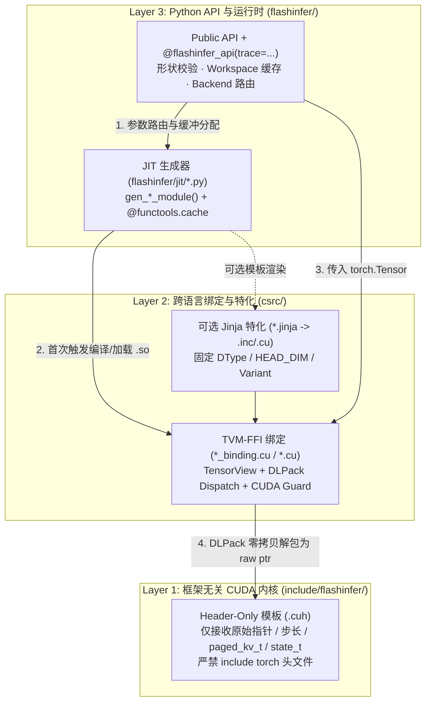
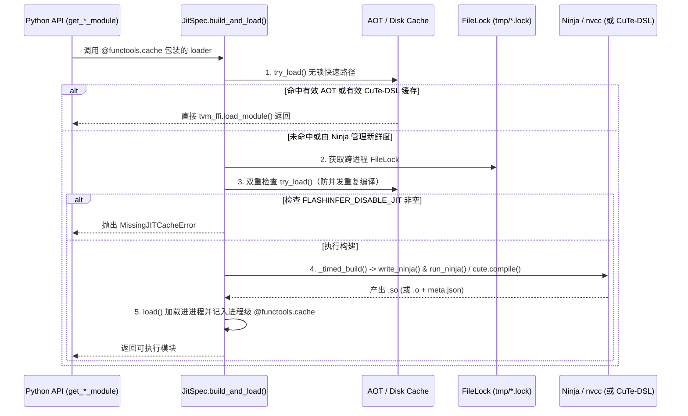

#ai #llm #flashinfer #jit #tvm-ffi #cutlass #cute-dsl #源码导读

相关笔记：[[gpu-execution-and-memory-model]] | [[flashinfer-learning-roadmap]] | [[flashinfer-norm-and-sampling-source]] | [[flashinfer-paged-kv-and-decode-source]] | [[flashinfer-ragged-prefill-and-mla-source]]

# FlashInfer 三层架构与 JIT 编译体系源码导读

## 概述

FlashInfer 能够在单个算子参数组合爆炸（dtype、head_dim、layout、attention variant、SM 架构）的前提下同时保持**可热重载的研发体验**与**跨框架复用能力**，核心依靠两套正交设计：

1. **框架无关的三层软件架构**：`include/`（纯 CUDA 原始指针内核）→ `csrc/`（TVM-FFI 统一 ABI 绑定与可选 Jinja 特化）→ `flashinfer/`（Python 分发、Plan-Run 与日志观测）。
2. **三层 JIT 编译与多级缓存系统**：同时驱动 `nvcc`/`ninja` C++ 模板链路（`JitSpecNvcc`）与 Python `nvidia-cutlass-dsl` 链路（`JitSpecCuteDsl`）。

> 源码与版本边界：本文基于 **FlashInfer v0.7.3（commit `82caa5668`，本地仓库 `/Users/hsn/github/flashinfer`，审查日期 `2026-11-17`）** 核验撰写，不依赖易漂移的行号。

---

## 框架无关的三层软件架构

### Layer 1：`include/flashinfer/`（严禁 Torch 依赖的 Header-Only 内核）

`CLAUDE.md` 中最重要的一条架构铁律是：**`include/` 目录下绝对禁止包含 PyTorch 头文件**。所有核心算子（如 `norm.cuh`、`sampling.cuh`、`vec_dtypes.cuh`、`math.cuh`、`attention/state.cuh`、`page.cuh`）均为纯 CUDA C++ Header-Only 模板：

- 函数签名只接受**原始设备指针**（如 `T* input`）、整型维度/步长（`stride_input`、`d`）或轻量 POD 结构体（如 `paged_kv_t`、`state_t`），完全不知道 `torch::Tensor` 或 `ATen` 的存在。
- 编译期常量通过模板参数（`VEC_SIZE`、`BLOCK_THREADS`、`DETERMINISTIC`）或渲染出的 `.inc` 配置注入，避免运行时分支开销。

### Layer 2：`csrc/`（TVM-FFI 统一 ABI 绑定与可选 Jinja 模板）

`csrc/` 负责把动态框架张量安全地翻译为 Layer 1 所需的原始指针和 `cudaStream_t`：

1. **TVM-FFI 与 DLPack 零拷贝适配（`csrc/tvm_ffi_utils.h`）**：
   - FlashInfer 采用 **Apache TVM-FFI**（`tvm::ffi::TensorView`、`tvm::ffi::Optional`），底层通过 DLPack 协议直接读取张量 `data_ptr()`、`dtype`、`ndim`、`size`、`stride` 和 `device`，不绑死 PyTorch C++ ABI（同一份 `.so` 理论上可被 PyTorch、C++ 或其他支持 DLPack/TVM-FFI 的前端调用）。
   - `csrc/*.cu` 内完成张量校验（如 `CHECK_LAST_DIM_CONTIGUOUS_INPUT`、`CHECK_DEVICE`、`TVM_FFI_ICHECK_EQ`）、通过 `ffi::CUDADeviceGuard` 切换设备并由 `get_stream()` 获取当前流，再用 `DISPATCH_DLPACK_DTYPE_TO_CTYPE_FP16` 等宏把运行期 DLPack 类型码分发到对应 C++ 模板实例。
   - `csrc/*_binding.cu` 使用 `TVM_FFI_DLL_EXPORT_TYPED_FUNC(export_name, cpp_func)` 导出强类型符号。
2. **可选的 `.jinja` 参数特化**：
   - 当参数空间较小（如 `norm.cu`、`sampling.cu`），直接用 C++ `DISPATCH_*` 宏在单个编译单元内展开即可，无需 `.jinja`。
   - 当参数空间呈组合爆炸且包含自定义逻辑（如 Attention 的 `DTypeQ`、`DTypeKV`、`HEAD_DIM_QK`、`POS_ENCODING_MODE`、`USE_SLIDING_WINDOW`、`AttentionVariant` 结构体），`csrc/*_customize_config.jinja` 与 `csrc/*_kernel_inst.jinja`（例如 `single_decode_customize_config.jinja`）会将单次调用真正需要的具体类型与常量渲染成独立的 `*.inc` / `*.cu`，按需只编译这一组特化实例。

### Layer 3：`flashinfer/`（Python API、Workspace 管理与 `@flashinfer_api`）

Python 层（如 `flashinfer/norm/__init__.py`、`flashinfer/sampling.py`、`flashinfer/decode.py`）负责：

- **可编辑安装路径映射**：`build_backend.py` 在开发安装时将仓库根目录 `3rdparty/cutlass`、`csrc`、`include` 符号链接到 `flashinfer/data/` 下，使源码读取与运行时打包保持一致的路径结构。
- **输入检查与 Workspace 复用**：用 `_get_cache_buf()` 等辅助函数管理临时显存，避免在热路径频繁分配释放；注意 `flashinfer/utils.py` 中的 `register_custom_op` / `register_fake_op` 在 v0.7.3 中保留了装饰器接口但默认退化为直通 `lambda x: x`（源码注释指出 `torch.library.custom_op` 在热路径存在明显调度开销）。
- **可观测性集成**：所有公开算子均挂载 `@flashinfer_api(trace=...)`（`flashinfer/api_logging.py`），统一承接崩溃前安全日志、张量 dump 以及 `fi_trace` 基准定义导出（模板位于 `flashinfer/trace/templates/`）。

---

## 三层 JIT 编译系统源码拆解

### 目录隔离规范（`flashinfer/jit/env.py`）

为了适应 pip 只读安装目录与多版本/多架构共存，`env.py` 严格区分**只读源码目录**与**可写缓存目录**：

| 环境变量 / 模块常量 | 是否可写 | 默认路径与用途 |
| --- | --- | --- |
| `FLASHINFER_CSRC_DIR` | 只读 | `<pkg>/data/csrc`，存放 `.cu` 与 `.jinja` 模板，运行时绝不可写入 |
| `FLASHINFER_INCLUDE_DIR` | 只读 | `<pkg>/data/include`，存放 `include/flashinfer/*.cuh` |
| `FLASHINFER_AOT_DIR` | 只读 | `<pkg>/data/aot`（以及已安装的 `flashinfer-jit-cache` Provider 轮子路径） |
| `CUTLASS_INCLUDE_DIRS` / `CCCL_INCLUDE_DIRS` / `SPDLOG_INCLUDE_DIR` | 只读 | `<pkg>/data/{cutlass,cccl,spdlog}` 第三方头文件 |
| `FLASHINFER_WORKSPACE_BASE` | 可写根 | 默认 `~`（用户主目录），决定 `.cache/flashinfer` 根目录 |
| `FLASHINFER_WORKSPACE_DIR` | 可写 | `<base>/.cache/flashinfer/<version>/<sorted_archs>`（`sorted()` 避免多卡架构排列不同导致缓存碎片化） |
| `FLASHINFER_GEN_SRC_DIR` | 可写 | `<workspace>/generated/<uri>/`，存放 Jinja 渲染的 `.inc` 和拷贝后的 `.cu` |
| `FLASHINFER_JIT_DIR` | 可写 | `<workspace>/cached_ops/<uri>/`，存放 `build.ninja`、`.o`、`.so`（以及 CuTe-DSL 的 `.o` 与 `meta.json`） |
| `FLASHINFER_CUBIN_DIR` | 可写/只读 | 优先读取环境变量，其次读版本匹配的 `flashinfer_cubin` 包，否则回退 `<cache>/cubins` |

### Layer 1：`JitSpec` 抽象与 `CompilationContext`（`core.py` & `compilation_context.py`）

1. **`JitSpec` 模板方法生命周期（`flashinfer/jit/core.py`）**：
   - `JitSpec` 定义了统一抽象接口：`try_load()`（快速路径，命中且已知有效才返回，否则保守返回 `None`）、`build()`（幂等且增量生成磁盘产物）、`load()`（加载为可调用对象）。
   - 具体模板方法 `build_and_load()` 固化了并发安全协议：**无锁 `try_load()` → 跨进程 `FileLock(self.lock_path, thread_local=False)` → 二次 `try_load()` → 拦截 `FLASHINFER_DISABLE_JIT`（抛出 `MissingJITCacheError`）→ `_timed_build()`（若设置了 `FLASHINFER_JIT_BUILD_LOG` 则以 `O_APPEND` 追加一行 JSONL 编译耗时）→ `load()`**。
   - 全局 `jit_spec_registry`（`JitSpecRegistry`）登记所有创建的 `JitSpec`，供 CLI 查询编译状态（`JitSpecStatus`）或 `flashinfer/aot.py` 批量预编译。
2. **`JitSpecNvcc`（`gen_jit_spec()` 返回）**：
   - 负责 C++/CUDA 模块生命周期，通过 `write_ninja()` 生成 `build.ninja`，通过 `run_ninja()` 调用 `ninja` 增量编译并由 `tvm_ffi.load_module()` 加载 `.so`。
   - **AOT 与异构多卡支持**：`try_load()` 优先检查 `aot_artifacts`（来自 `flashinfer-jit-cache` 及各架构 provider 轮子）。若宿主机同时存在多种 GPU 架构且单个 AOT provider 未覆盖全部目标，则返回 `_HeterogeneousAOTModule` 按每次调用张量所在设备实时路由，必要时回退 `_build_and_load_jit_fallback()`。
   - **批量预构建**：`build_jit_specs()` 将多个 `JitSpecNvcc` 的 `build.ninja` 通过 `subninja` 聚合到 `tmp/flashinfer_jit.ninja` 一次并行调度（并发度受 `FLASHINFER_JIT_PREBUILD_MAX_JOBS` 控制）。
3. **`CompilationContext`（`flashinfer/compilation_context.py`）**：
   - 初始化时若设置了 `FLASHINFER_CUDA_ARCH_LIST`（如 `"8.0 9.0a"`）则按空格解析；否则遍历 `torch.cuda.device_count()` 采集设备 Compute Capability。
   - `_normalize_cuda_arch()` 自动补全指令集后缀：SM 9.x 规范化为 `a`（`compute_90a`）；SM 12.0 在 CUDA >= 12.9 使用 `f` 后缀（`12.0f`）、CUDA 12.8 使用 `0a`；SM 12.1+ 与 SM 10.x 使用 `a` 后缀；`get_nvcc_flags_list()` 还支持按 `supported_major_versions` 过滤并在 CUTLASS/nvcc 尚未原生支持时把 SM107 映射为 `sm_100f`（`map_sm107_to_100f`）。
   - `check_cuda_arch()` 强制最低架构要求为 `sm75`（Turing 及以上），未检测到符合条件的架构时直接抛出 `RuntimeError`。

### Layer 2：代码生成（`flashinfer/jit/*.py` 与 `jit/utils.py`）

每个 `gen_*_module()` 遵循标准五步范式：

1. 根据算子参数拼接确定性 `uri`（包含 dtype、head_dim、variant、标志位等，确保不同特化不会互相覆盖）。
2. 目标生成目录为 `gen_directory = jit_env.FLASHINFER_GEN_SRC_DIR / uri`。
3. （可选）读取 `FLASHINFER_CSRC_DIR/*.jinja` 渲染配置头文件 `.inc` 或实例化 `.cu`（使用 `jit/utils.py` 的 `dtype_map` / `dtype_map_kv` 等映射表）。
4. 调用 **`write_if_different(path, content)`** 落盘——只有内容真正变化时才重写文件，**保留未变化文件的 mtime**，防止无意义触发 Ninja 重编。
5. 将只读模板下的 `.cu` 源文件拷贝（如 `shutil.copy2` 保留 mtime）或引用传入 `gen_jit_spec(uri, sources, ...)`。

### Layer 3：Ninja 构建生成与编译器调优（`flashinfer/jit/cpp_ext.py`）

`generate_ninja_build_for_op()` 绕开 CMake 开销，直接生成原生 `build.ninja`：

- **构建规则**：
  - `compile`（C++）：`$cxx_launcher $cxx -MMD -MF $out.d $cflags -c $in -o $out`
  - `cuda_compile`（CUDA）：`$nvcc_launcher $nvcc --generate-dependencies-with-compile -MF $out.d $cuda_cflags -c $in -o $out`
  - `embed_cubin`（可选）：调用 `python -m tvm_ffi.utils.embed_cubin` 把离线 cubin 嵌入目标文件
  - `link` / `nvcc_link`：当 `needs_device_linking=True`（需要设备端符号链接）时使用 `$nvcc -shared $cuda_arch_flags`，否则使用 `$cxx -shared`。
- **头文件优先级与 ABI 对齐**：
  - `build_common_cflags()` 将仓库随附的 `CCCL_INCLUDE_DIRS` 用 `-I` 置于最前（确保覆盖 CUDA Toolkit 自带 CCCL），其余系统、Python、TVM-FFI、CUTLASS、spdlog、FlashInfer 头路径均使用 `-isystem`。
  - 自动对齐 `_GLIBCXX_USE_CXX11_ABI`（读取 `torch._C._GLIBCXX_USE_CXX11_ABI`），非 free-threaded Python 默认加 `-DPy_LIMITED_API=0x03090000`。
  - `build_cuda_cflags()` 启用 `--expt-relaxed-constexpr`；CUDA >= 12.8 时追加 `-static-global-template-stub=false`；默认开启 `-use_fast_math`（除非 `gen_jit_spec(..., use_fast_math=False)` 或个别源文件覆盖）。
- **并发与缓存加速**：
  - 支持 `FLASHINFER_NVCC_LAUNCHER` / `FLASHINFER_CXX_LAUNCHER`（devcontainer 默认配置为 `sccache`）。
  - 总编译内存近似为 `MAX_JOBS`（`ninja -j` 并行进程数）× `FLASHINFER_NVCC_THREADS`（单个 `nvcc --threads=N` 并行线程数），内存受限机器需注意乘积上限。

### 第二套 JIT 工具链：`JitSpecCuteDsl`（`cute_dsl_core.py` & `_cute_dsl_source.py`）

对于基于 Python `nvidia-cutlass-dsl` 编写的算子（如 `flashinfer/norm/kernels/`、`flashinfer/quantization/kernels/nvfp4_quantize.py`），`cutlass.cute.compile()` 本身不带持久化磁盘缓存，每次重启进程都要重新编译。`JitSpecCuteDsl`（包装入口 `build_and_load_cute_dsl_kernel()`）为此补齐了磁盘缓存：

- **产物结构**：不同于 nvcc 按 module 输出 `.so`，`JitSpecCuteDsl` 按算子家族与单卡目标架构建目录 `cached_ops/<module>_<arch>_cute_dsl/`（例如 `nvfp4_quantize_sm100a_cute_dsl/`），里面存放同一套 `meta.json` 和每个特化内核各自的 `<kernel_name>.o`（通过 `export_to_c()` 导出）。
- **版本与源码指纹**：`meta.json` 记录三项校验键：
  1. `arch`：来自 `CUTE_DSL_ARCH` 或当前 CUDA 设备能力；
  2. `cute_dsl_version`：`_get_cute_dsl_version()` 对 Python ABI（`cache_tag`/`SOABI`）以及 `torch`、`apache-tvm-ffi`、所有 `nvidia-cutlass-dsl*` 已安装包的 `RECORD` 与 `direct_url.json` 取 SHA-256；
  3. `source_sha256`：`_hash_source_files()` 计算 `extra_key_files` 的内容哈希；若开启 `FLASHINFER_CUTE_DSL_STRICT_CACHE_KEY=1`，`_cute_dsl_source.py` 会用 Python `ast` 静态解析包内依赖闭包（自动排除 `version.py` 与 `_build_meta.py`，使同一套缓存可跨 Git commit 复用）。
- **原子提交与 TVM-FFI 重载**：`meta.json` 总是等 `.o` 原子 `os.replace` 落盘之后才写入，避免崩溃留下损坏缓存；命中或构建后统一调用 `cute.runtime.load_module(str(object_path), enable_tvm_ffi=True)` 加载，确保命中路径与冷编译路径拿到一致的可执行对象。

---

## 两级缓存、失效机制与 AOT 优先级

FlashInfer 在运行期按如下优先级解析算子模块：

1. **Level 0（可选预编译 AOT 包）**：安装 `flashinfer-jit-cache`（+ 对应架构 provider 轮子）后，`JitSpecNvcc.try_load()` 直接加载预编译 `.so`（可通过 `FLASHINFER_DISABLE_VERSION_CHECK=1` 绕过版本匹配检查）。
2. **Level 1（Python 进程内存缓存）**：`get_norm_module()`、`get_sampling_module()` 等加载器均装饰 `@functools.cache`，首调之后直接返回内存对象，零文件 IO 与锁开销。
3. **Level 2（磁盘 JIT 缓存）**：`~/.cache/flashinfer/<version>/<arch>/cached_ops/<uri>/`（nvcc 的 `.so` + `.d` 依赖文件；CuTe-DSL 的 `.o` + `meta.json`）。

**自动失效触发条件**：

| 变更原因 | `JitSpecNvcc` 如何感知 | `JitSpecCuteDsl` 如何感知 |
| --- | --- | --- |
| 修改 `include/**/*.cuh` 或 `csrc/*.cu` | Ninja 读取 `--generate-dependencies-with-compile` 生成的 `.d` 头文件依赖，增量重编译受影响翻译单元 | 修改内核 `.py`（或 strict 模式下修改依赖 helper）导致 `source_sha256` 变化，整目录重建 |
| 修改算子参数（dtype / head_dim 等） | 生成不同的 `uri` 目录，独立缓存 | 生成同模块下不同 `<kernel_name>.o` |
| 切换 `FLASHINFER_JIT_DEBUG` / `sccache` 等编译选项 | `build.ninja` 命令行字符串变化，Ninja 自动判定 command mismatch 并重编 | N/A（不走 nvcc） |
| 升级 FlashInfer 版本或切换 GPU 架构 | `<version>/<arch>` 路径直接隔离 | `meta.json` 中 `arch` 或 `cute_dsl_version` 不匹配，触发目录清理与重编 |

> 清理缓存：`rm -rf ~/.cache/flashinfer/`（或在 Python 中调用 `flashinfer.jit.clear_cache_dir()`）。

---

## API 日志、调试与常用环境变量

### `@flashinfer_api` 崩溃安全日志（`flashinfer/api_logging.py`）

`flashinfer_api` 在装饰函数时直接判断 `_API_LOG_LEVEL`（模块导入时读取）：

- `FLASHINFER_LOGLEVEL=0`（默认）：装饰器直接返回原函数（仅挂载 `fi_trace` 钩子），**运行期零开销**。
- `FLASHINFER_LOGLEVEL=1`：在 Kernel 执行**之前**打印 API 名称，即使后续发生 CUDA illegal memory access 崩溃也能留存现场。
- `FLASHINFER_LOGLEVEL=3`：执行前记录输入张量形状/dtype/stride/设备，执行后记录输出元信息。
- `FLASHINFER_LOGLEVEL=5`：额外统计 min/max/mean/NaN/Inf；在 CUDA Graph Capture 期间支持小内核在重放时通过设备端 `printf` 输出 `[flashinfer stats] id=N ...` 与主机关联 ID 对应。
- `FLASHINFER_LOGLEVEL=10`：在 Level 5 基础上将输入输出张量保存到 `FLASHINFER_DUMP_DIR`（默认 `flashinfer_dumps`，受 `FLASHINFER_DUMP_MAX_COUNT`、`FLASHINFER_DUMP_MAX_SIZE_GB`、`FLASHINFER_DUMP_INCLUDE`/`EXCLUDE` 过滤）。
- `FLASHINFER_LOGDEST`：可设为 `stdout`、`stderr` 或带 `%i` 进程 ID 占位符的文件路径（如 `debug_%i.log`）。

### 高频 JIT 与调试环境变量速查

| 环境变量 | 默认值 | 作用说明 |
| --- | --- | --- |
| `FLASHINFER_JIT_VERBOSE` | `"0"` | 设为 `"1"` 打印 `ninja -v` 完整编译命令；若未显式设置 `FLASHINFER_JIT_DEBUG`，还会同时启用 `-O0 -g --device-debug` |
| `FLASHINFER_JIT_DEBUG` | 未设置 | 设为 `"1"` 为 host/nvcc 添加 `-O0 -g --device-debug -lineinfo --ptxas-options=-v`；设为 `"0"` 可在保留 `VERBOSE=1` 打印的同时保持 `-O3` |
| `FLASHINFER_JIT_LINEINFO` | `"0"` | 设为 `"1"` 在 `-O3` 构建下仅追加 `-lineinfo`，用于 `ncu` / `cuda-gdb` 源码级热点映射而不损失优化 |
| `FLASHINFER_DISABLE_JIT` | 未设置 | 非空时禁止运行时编译，未命中 AOT/缓存时直接抛出 `MissingJITCacheError`（生产只读容器常用） |
| `FLASHINFER_WORKSPACE_BASE` | `~` | 重定向 `.cache/flashinfer` 根目录（如挂载到本地 NVMe `/scratch`） |
| `FLASHINFER_CUDA_ARCH_LIST` | 自动探测 | 手动指定编译目标架构，如 `"8.0 9.0a"` |
| `MAX_JOBS` / `FLASHINFER_NVCC_THREADS` | 未设 / `1` | 分别控制 Ninja 并行进程数与每个 `nvcc` 进程内部 `--threads` 线程数 |
| `FLASHINFER_NVCC_LAUNCHER` | `""` | 指定 `nvcc` 缓存包装器（devcontainer 中默认为 `sccache`） |
| `FLASHINFER_USE_CUDA_NORM` | `"0"` | 设为 `"1"` 强制 Norm 算子跳过默认 CuTe-DSL 路径，改走 `csrc/norm.cu` CUDA JIT 基线 |
| `FLASHINFER_CUTE_DSL_DISABLE_CACHE` | `"0"` | 设为 `"1"` 禁用 CuTe-DSL 磁盘缓存，每次进程启动现编 |
| `FLASHINFER_CUTE_DSL_STRICT_CACHE_KEY` | `"0"` | 设为 `"1"` 启用 AST 导入闭包哈希，使持久化 CI 缓存在修改被导入 helper 时自动失效 |
| `FLASHINFER_LOGGING_LEVEL` | `"info"` | 控制 `FlashInferJITLogger`（输出到终端与 `flashinfer_jit.log`）和 artifacts 下载器的 Python 日志级别（区别于 `FLASHINFER_LOGLEVEL`） |

---

## 面试要点

### Q：FlashInfer 为什么不直接在 `include/` 里写 `torch::Tensor` 接口，而要拆成 `include/` + `csrc/` + TVM-FFI？

> [!question]- 参考答案（点击展开）
>
> 这是框架解耦与编译隔离的结果。`include/` 只依赖纯 CUDA C++ 和原始指针，不引入庞大的 PyTorch/ATen 头文件，既加快了每个特化内核的编译速度、避免了 PyTorch 版本/C++ ABI 耦合，也让同一份 CUDA 模板可以被 C++ 或其他推理框架直接复用；`csrc/` 通过 Apache TVM-FFI 和 DLPack `TensorView` 完成零拷贝元信息校验与流切换，把动态框架对象翻译成原始指针，同时一个 `.so` 就能跨语言暴露统一 ABI。

### Q：为什么同样是 JIT 编译，Attention/GEMM 大量使用 `.jinja` 模板而 `norm`/`sampling` 没有使用？

> [!question]- 参考答案（点击展开）
>
> 因为两类算子的编译期参数空间维度不同。`norm` 和 `sampling` 只需要对少数几个 dtype（FP16/BF16/FP8/FP32）和向量宽度（1/2/4/8/16）做分发，直接用 C++ `DISPATCH_*` 宏在单个 `.so` 中展开即可，省去重复编译整套宿主胶水代码的开销；而 Attention 和 GEMM 涉及 `dtype_q`/`dtype_kv`/`dtype_o`、多种 `head_dim`、滑窗、soft-cap 以及用户自定义的 `AttentionVariant` 结构体，全量写在一个 `.cu` 里会导致组合爆炸与极长的编译时间，因此用 `.jinja` 在 `FLASHINFER_GEN_SRC_DIR` 按每次调用的 `uri` 仅渲染并编译当前需要的单个实例。

### Q：修改 `include/flashinfer/*.cuh` 后，FlashInfer 不需要重新 `pip install` 就能自动重编译的原理是什么？

> [!question]- 参考答案（点击展开）
>
> 开发安装（`pip install --no-build-isolation -e .`）将仓库内的 `include/`、`csrc/` 符号链接到 `flashinfer/data/`。在 `JitSpecNvcc` 生成 `build.ninja` 时，`cpp_ext.py` 为 `nvcc` 传入 `--generate-dependencies-with-compile -MF $out.d`，为每个目标文件记录下它递归包含的所有 `.cuh` 头文件依赖。当重新运行程序时，`JitSpecNvcc.try_load()` 保守返回 `None`，进入 `build_and_load()` 并由 `write_if_different()`（不改变未改动生成文件 mtime）配合 `ninja` 检查 `.d` 依赖时间戳：一旦检测到某个 `.cuh` 比 `.so` 更新，Ninja 就自动增量重编并重新由 `tvm_ffi.load_module()` 加载。

### Q：CuTe-DSL 内核已经可以用 `cute.compile()` 即时编译了，为什么 FlashInfer 还要专门设计 `JitSpecCuteDsl`？

> [!question]- 参考答案（点击展开）
>
> 因为 `cute.compile()` 默认只保留在进程内存中、没有跨进程的持久化磁盘缓存，每次服务冷启动或新开测试进程都会重新经历编译延迟。`JitSpecCuteDsl` 通过 `export_to_c()` 将编译好的内核导出为可重定位目标文件 `<kernel>.o`，与记录了编译目标架构 `arch`、完整 Python/Torch/TVM-FFI/CuTe-DSL 版本指纹 `cute_dsl_version` 以及源码 SHA-256（可选含 AST 导入闭包）的 `meta.json` 一起原子落盘到 `cached_ops/<module>_<arch>_cute_dsl/`，并在下次启动时通过 `cute.runtime.load_module(..., enable_tvm_ffi=True)` 直接加载。
