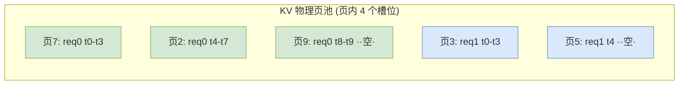
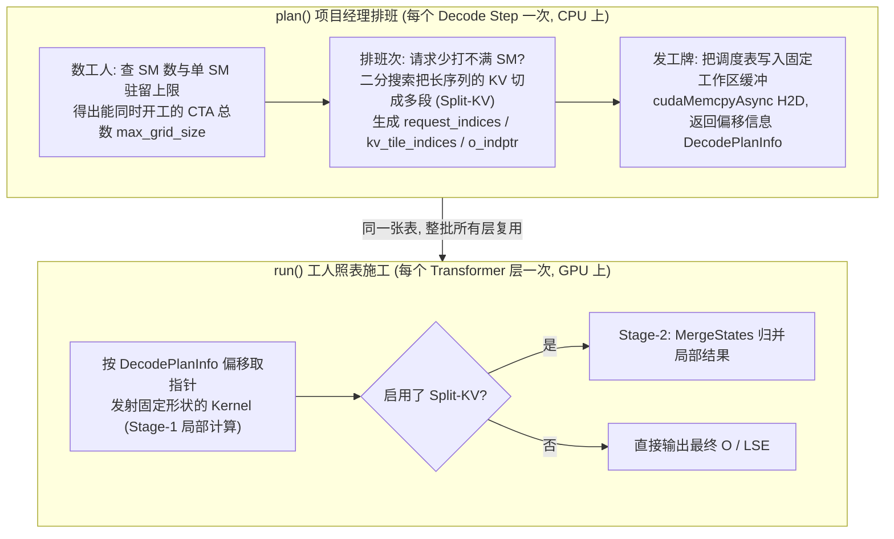

#ai #llm #flashinfer #cuda #paged-kv #入门导览

相关笔记：[[flashinfer-learning-roadmap]] | [[flashinfer-architecture-and-jit]] | [[flashinfer-paged-kv-and-decode-source]] | [[flashinfer-ragged-prefill-and-mla-source]] | [[gpu-execution-and-memory-model]] | [[vllm-v1-architecture-and-internals]] | [[sglang-srt-radix-and-scheduler]] | [[cuda-ecosystem-and-career-roadmap]] | [Online Softmax 与 Split-KV 离线实验](../experiments/online-softmax-and-split-kv/README.md)

# FlashInfer 零门槛导览：白话手算页表与 Plan-Run 契约

## 概述

这是进入 FlashInfer 源码世界前的**最后一篇零门槛导览**：不需要 CUDA、不需要懂 C++ 模板、不需要 GPU，一支笔一张纸就能读完。读完后你将能回答三个问题：

1. 推理引擎（vLLM / SGLang）和算子库（FlashInfer）的**分工边界**在哪里？
2. FlashInfer 那一堆 `qo_indptr` / `kv_page_indptr` / `kv_page_indices` / `kv_last_page_len` 参数，**到底在描述什么**？
3. 为什么每个算子都要先 `plan()` 再 `run()`，两段式到底保护了什么？

先用一句话定分工：**推理引擎是"工地总包"，负责显存分页、请求调度与缓存淘汰；FlashInfer 是"专业包工队"，拿着总包给的三张表（页表与长度表）把注意力算准、算快**。FlashInfer 从不决定"下一个 Token 存到哪个物理页"，它只照表施工。

---

## 场景设定：2 条请求的小批

设页大小 `page_size = 4`（真实引擎常用 16 或 1，这里取小便于手算）。KV Cache 物理页池里散落着编号 0–9 的页，2 条请求当前状态：

| 请求 | Query 长度 | 历史 KV 长度 | 占用的物理页（乱序分配） | 页数 | 尾页有效 Token |
| --- | --- | --- | --- | --- | --- |
| req0 | 8 | 10 | `[7, 2, 9]` | 3 | 2（10 = 2×4 + 2） |
| req1 | 5 | 5 | `[3, 5]` | 2 | 1（5 = 1×4 + 1） |



注意三点，它们就是后面所有表格存在的理由：

- **物理页不连续**：req0 的三页是 7→2→9，逻辑上第 5 个 Token 的数据在物理页 2 里。引擎按需分配、随时释放，所以必须有一张"逻辑页槽 → 物理页号"的映射表。
- **尾页未满**：req0 只用了尾页 9 的前 2 个槽，req1 只用了尾页 5 的前 1 个槽。Kernel 必须知道"最后一页有几个是真的"，否则会把垃圾数据当 Token 算。
- **请求长度参差**：8 和 5 不相等。要么补齐（padding），要么记录边界。

---

## 手算 1：Ragged Prefill 的 `qo_indptr`

先把 2 条请求的 Query 行（8 + 5 = 13 行）拼成一条扁排行带：

```text
扁排行号:  0 1 2 3 4 5 6 7 | 8 9 10 11 12
          └──── req0 ────┘ └─── req1 ───┘
```

`qo_indptr = [0, 8, 13]` 就是这条行带的"刻度尺"：第 $b$ 条请求占用扁排行号区间 `[qo_indptr[b], qo_indptr[b+1])`。它长 `batch_size + 1 = 3`，首元素恒为 0。

对比 padding 方案：把 req1 补 3 行空行凑成 8+8，Kernel 虽然简单了，但白算 3 行无效 Query、白占显存；批内长短差异越大（生产中常见 5 vs 5000），浪费越离谱。Ragged（锯齿）布局 + indptr 刻度尺让**一个字节都不浪费**：Kernel 拿到全局行号后用 `qo_indptr` 一查就知道自己服务哪条请求的哪一行。

Prefill 的 KV 侧同样用刻度尺表达"每条请求的历史从哪个页开始"：

```text
kv_page_indptr   = [0, 3, 5]      # req0 占 3 页, req1 占 2 页, 前缀和
kv_page_indices  = [7, 2, 9, 3, 5] # 按请求顺序展开的物理页号列表
kv_last_page_len = [2, 1]          # 各请求尾页的有效 Token 数
```

`kv_page_indices` 的切片 `indices[kv_page_indptr[b] : kv_page_indptr[b+1]]` 就是请求 $b$ 的乱序页表：req0 → `[7, 2, 9]`，req1 → `[3, 5]`。

> **边界纪律**：FlashInfer 对这三张表只读不写。页的分配、淘汰、追加都由上层引擎负责——这正是 vLLM `BlockPool`（[[vllm-v1-architecture-and-internals]]）与 SGLang `ReqToTokenPool`（[[sglang-srt-radix-and-scheduler]]）存在的意义。

---

## 手算 2：一个 Token 的寻址之旅

Kernel 要算 req0 的第 $t = 5$ 个历史 Token（逻辑位置，从 0 数）。两步除法搞定：

```text
page_iter = 5 // 4 = 1        # 第 5 个 Token 在逻辑第 1 个页槽
entry_idx = 5 %  4 = 1        # 该页内第 1 个槽位
phys_page = indices[indptr[0] + page_iter] = indices[1] = 2   # 逻辑槽 1 → 物理页 2
```

于是数据躺在**物理页 2 的第 1 个槽位**。再叠加布局步长（NHD / HND，见 [[linear-algebra-for-llm]] 的 Stride 一节与 [[flashinfer-paged-kv-and-decode-source]] 的 `paged_kv_t` 表格）就得到最终显存地址。全程只有乘法、加法、除法——没有任何查找树或指针跳转，这就是 GPU 友好的 CSR（压缩稀疏行）式分页抽象。

顺手验证长度公式（Kernel 不需要额外 `seq_lens` 数组就能反推长度）：

$$\text{len}(b) = (\text{indptr}[b{+}1] - \text{indptr}[b] - 1) \times P + \text{last\_page\_len}[b]$$

- req0：$(3-1) \times 4 + 2 = 10$ ✓
- req1：$(2-1) \times 4 + 1 = 5$ ✓

---

## 手算 3：Plan-Run 契约——排班表 vs 照表施工

FlashInfer 把每个批处理算子的调用拆成两段，比喻成工地流程：



### 两段式拆分的原因

推理服务的一个 Decode Step 内，**几十层 Transformer 共享完全相同的批构成、序列长度与页表**。如果每层都重新数 SM、重新二分搜索切分、重新拷贝调度表，CPU 开销与主机-设备同步就会淹没 Kernel 本身。于是：

- **有主机逻辑、有 H2D 拷贝、有分配的事情全部塞进 `plan()`**——每个 Step 只做一次；
- **`run()` 零分配、零同步、固定 Grid**——每层照同一张表施工，还能被 CUDA Graph 一次性录制、之后逐 Step `replay()`。

### CUDA Graph 的录制边界（最容易被忽略）

CUDA Graph 录制后 Grid 形状不能变，所以 `plan()` **必须在 Graph 捕获之外**执行：每个 Step 先在普通流上调 `plan()` 刷新工作区里的页表与调度偏移，再 `replay()` 录好的图。Graph 模式下即使批很小也会固定开启 Split-KV、把 Grid 铺满上限，多出来的 CTA 用 `block_valid_mask` 标记为空转——**用"固定形状 + 有效位掩码"兼容变长负载**。

### 微型例子：小批量也需要排班

我们的场景里 `batch_size × num_kv_heads` 很小，打不满 SM，于是二分搜索会把 req0 的 10 个 KV Token 切成多段，多个 CTA 并行扫描，各自产出局部状态 $(m, d, o)$，Stage-2 再归并。**为什么切了还能算对？** 因为 Online Softmax 的状态合并满足结合律——手推见 [[gpu-execution-and-memory-model]]，离线验证见 [Online Softmax 与 Split-KV 离线实验](../experiments/online-softmax-and-split-kv/README.md)。

---

## 引擎如何对接：一张分工表

| 职责 | vLLM V1 | SGLang SRT | FlashInfer |
| --- | --- | --- | --- |
| 页分配 / 淘汰 | `BlockPool` 链式 Hash 页表 | `RadixCache` + `TokenToKVPool` | 不参与 |
| 批调度 / Token 预算 | 统一调度器（Step 内 Token 预算） | 三进程流水线 + Overlap Scheduler | 不参与 |
| 请求槽 → 物理页映射 | 页表张量 | `ReqToTokenPool` | 只消费（三张表） |
| Plan / Run 调用 | 每 Step 一次 `plan()`，每层 `run()`（`vllm/v1/attention/backends/flashinfer.py`） | 每 Batch 一次 `begin_forward`（plan），每层 `run` | 提供两段式接口 |
| 数值正确性 | — | — | Online Softmax / Split-KV / MLA 内核 |

两边对接的完整源码级细节（vLLM 的 `GPUModelRunner` 喂参、SGLang 的 `ReqToTokenPool` 填表）见 [[vllm-v1-architecture-and-internals]] 与 [[sglang-srt-radix-and-scheduler]]。

---

## 读完这篇去哪里

| 你想… | 下一篇 |
| --- | --- |
| 建立 GPU 硬件直觉（SM/Warp/SRAM、Roofline、为什么 Decode 是带宽受限） | [[gpu-execution-and-memory-model]] |
| 拿到 Mac + 云端 GPU 的完整学习工作流 | [[flashinfer-learning-roadmap]] |
| 看懂 Python 入口 → JIT 编译 → CUDA 内核的三层架构 | [[flashinfer-architecture-and-jit]] |
| 逐行读懂 `paged_kv_t` / `state_t` / Decode 源码 | [[flashinfer-paged-kv-and-decode-source]] |
| 搞懂 Ragged Prefill、Cascade 与 MLA 权重吸收的内核实现 | [[flashinfer-ragged-prefill-and-mla-source]] |
| 回到引擎侧看调度与显存管理 | [[vllm-v1-architecture-and-internals]] / [[sglang-srt-radix-and-scheduler]] |

## 自检清单

- [ ] 能不看笔记画出本文 2 条请求场景的完整表格：`qo_indptr`、`kv_page_indptr`、`kv_page_indices`、`kv_last_page_len` 的每一个元素。
- [ ] 能手算"req0 第 5 个历史 Token 在物理页 2 的第 1 槽"的寻址过程。
- [ ] 能用 `(indptr[b+1]-indptr[b]-1)*P + last_page_len[b]` 反推两条请求的 KV 长度。
- [ ] 能解释 plan() 为什么每 Step 一次、run() 为什么每层一次，以及 `plan()` 为什么不能进 CUDA Graph 捕获。
- [ ] 能说出引擎与 FlashInfer 的分工边界：谁管页分配，谁只照表施工。

## 面试要点

### Q：FlashInfer 的 Paged KV 接口为什么用 `indptr + indices + last_page_len` 的 CSR 形式，而不是直接传二维稠密页表？

> [!question]- 参考答案（点击展开）
>
> 稠密页表必须按批内最长请求补齐到矩形，短请求会留下大量无效槽位；CSR 形式按实际页数紧凑存储，且 `(页数-1)*page_size + last_page_len` 可直接反推每条请求的真实长度，无需额外的 `seq_lens` 读取。批内长短差异越大（几 Token 到几万 Token 混批），节省越明显。代价是 Kernel 需要多做一次 `indptr` 定位，但那只是常数开销的整数运算。（细节见 [[flashinfer-paged-kv-and-decode-source]]。）

### Q：`plan()` 与 `run()` 的边界具体怎么划？为什么这样划？

> [!question]- 参考答案（点击展开）
>
> 凡是涉及主机控制流、内存分配、H2D 拷贝或设备属性查询的步骤——数 SM 与驻留上限、二分搜索 Split-KV 切分、生成 `request_indices` / `kv_tile_indices` / `o_indptr`、拷贝调度表——都归 `plan()`，且每个 Decode Step 只执行一次（整批所有层共享同一批元信息）。`run()` 只按已固化的偏移取指针、发射固定形状 Kernel，零分配零同步，因此可被 CUDA Graph 录制并逐 Step replay。划分标准本质是：**CUDA Graph 录不进去的东西，一律前置到 plan()**。

### Q：引擎侧（如 vLLM BlockPool / SGLang RadixCache）与 FlashInfer 的职责如何划分？如果越界会发生什么？

> [!question]- 参考答案（点击展开）
>
> 引擎负责页的分配、复用、淘汰与请求生命周期（vLLM 用链式 Hash 的 `BlockPool` 实现 Prefix 复用，SGLang 用 `RadixCache` 前缀树管理共享前缀），并在每个 Step 把最终页表整理成 FlashInfer 消费的三张表；FlashInfer 只负责照表完成数值计算（Paged Attention、Split-KV、MLA 等）。若算子库越界去管理页分配，就无法与引擎的缓存/调度策略解耦，也无法同时服务多个引擎；若引擎把未整理好的页表（如未同步 `last_page_len`）传下去，Kernel 会把垃圾数据当 Token 计算，产生静默数值错误。

## 参考与版本边界

- 接口语义与内部机制（`DecodePlanImpl` 二分搜索、`request_indices` 等调度元信息、CUDA Graph 约束）以 [[flashinfer-paged-kv-and-decode-source]] 与 [[flashinfer-learning-roadmap]] 记载为准：**FlashInfer v0.7.3（commit `82caa5668`，审查日期 `2026-11-17`）**；文中数字为教学用微型手算，非真实引擎参数。
- 延伸阅读：Prefill 侧的 Ragged `qo_indptr` / Chunked Prefill 与 Cascade / MLA 见 [[flashinfer-ragged-prefill-and-mla-source]]；Split-KV 数值结合律的 CPU 离线验证见 [Online Softmax 与 Split-KV 离线实验](../experiments/online-softmax-and-split-kv/README.md)。
