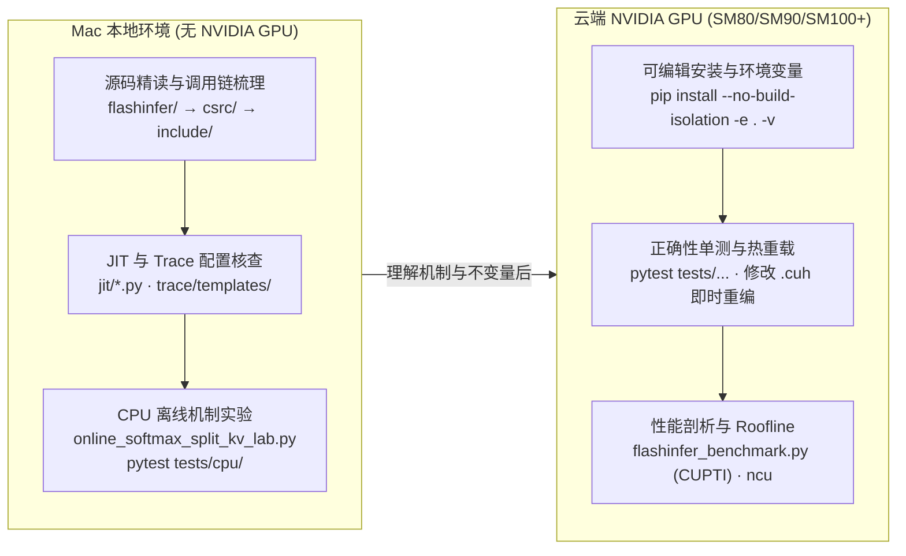

#ai #llm #flashinfer #cuda #learning-path #学习路线

相关笔记：[[gpu-execution-and-memory-model]] | [[flashinfer-architecture-and-jit]] | [[flashinfer-norm-and-sampling-source]] | [[flashinfer-paged-kv-and-decode-source]] | [[flashinfer-ragged-prefill-and-mla-source]] | [[llm-inference-learning-path]] | [Online Softmax 与 Split-KV 离线实验](../experiments/online-softmax-and-split-kv/README.md)

# FlashInfer 系统学习路线与实验工作流

## 概述

FlashInfer 是面向 LLM 服务的高性能 GPU 内核库，也是 vLLM、SGLang 等现代推理引擎的重要算子底座。它的工程复杂性横跨三层：**Python 运行时与 Plan-Run 调度**、**默认基于 Ninja / CuTe-DSL 的 JIT 编译体系**，以及 **`include/flashinfer/` 下的高性能 CUDA C++ 模板**。

本路线针对 **Mac 本地学习 + 云端 GPU 实操** 的双环境设计，避免在无 GPU 的机器上空等环境，也避免一上来就迷失在庞大的模板细节中。

> 源码与版本边界：本路线及所有命令均基于 **FlashInfer v0.7.3（commit `82caa5668`，源码 `/Users/hsn/github/flashinfer`，审查日期 `2026-11-17`）** 核对。使用其他版本时，请结合仓库根目录 `CLAUDE.md` 与 `flashinfer/__init__.py` 确认 API 与环境变量是否变更。

## 目标人群与前置条件

- **目标人群**：已经理解 LLM 推理宏观流程，希望向下看懂 PagedAttention / Ragged Prefill / MLA / Sampling / MoE 等 CUDA 算子与 JIT 工程实现的 AI Infra 工程师。
- **前置条件**：
  1. 已掌握 Prefill、Decode、KV Cache、Continuous Batching 与 Prefix Cache 概念（见 [[llm-inference-pipeline]] 与 [[llm-inference-learning-path]]）。
  2. 已读完 [[gpu-execution-and-memory-model]]，能独立推导 Online Softmax 状态重缩放与 Decode Roofline 算术强度。
  3. 具备基础 C++ 模板与 Python 工程阅读能力，了解 PyTorch 张量内存布局（shape / stride / contiguous）。

## 双环境工作流总览



### Mac 本地环境能做什么、不能做什么

- **能做**：完整精读全部 Python 调度、JIT 模板生成、TVM-FFI 绑定与 CUDA C++ `.cuh` 内核代码；运行不依赖 CUDA 驱动的纯 Python 机制实验（如 [Online Softmax 与 Split-KV 离线实验](../experiments/online-softmax-and-split-kv/README.md)）以及纯 CPU 协调/缓存逻辑测试（如 `pytest --confcutdir=tests/test_sharding tests/test_sharding/` 或 `tests/cpu/` 中不触发 CUDA 设备探测的纯 Python 测试）。
- **不能做**：Mac 没有 NVIDIA GPU 与 `nvcc`/CUDA Driver，无法编译 `.cu` 为 `.so` 或执行任何 GPU Kernel，切勿把 Mac 上“Python 文件语法检查通过”当作算子可执行或通过验证。

### 云端 GPU 环境准备要点

在云端容器或主机（Ampere SM80、Hopper SM90a 或 Blackwell SM100+）执行源码安装与编译加速：

```bash
# 1. 初始化 3rdparty 子模块（cutlass、spdlog 等）
git submodule update --init --recursive

# 2. 开发模式可编辑安装（禁止 build isolation，复用环境中的 PyTorch/CUDA）
pip install --no-build-isolation -e . -v

# 3. 可选：安装 CUPTI 以启用硬件级 Kernel 精确计时（需 CUDA 13+）
pip install -U cupti-python
```

可编辑安装会自动创建 `flashinfer/data/{include,csrc,cutlass}` 符号链接（由 `build_backend.py` 管理），之后**直接修改 `include/flashinfer/*.cuh` 无需重新 `pip install`**，下次调用算子时 Ninja 会根据 `.d` 依赖文件自动增量重编译。

---

## 四阶段学习路线

### Phase 1：三层解耦架构、JIT 编译体系与基础算子（Norm / Sampling）

- **目标**：先摸清“Python 张量如何穿过 TVM-FFI 变成 CUDA Kernel”，再用最干净的 `norm` 与 `sampling` 算子走通全链路。
- **核心阅读**：
  1. [[flashinfer-architecture-and-jit]]：精读 `flashinfer/jit/env.py`、`core.py`、`cpp_ext.py`、`cute_dsl_core.py`、`compilation_context.py` 与 `api_logging.py`。
  2. [[flashinfer-norm-and-sampling-source]]：精读 `flashinfer/norm/__init__.py`、`flashinfer/jit/norm.py`、`csrc/norm.cu`、`include/flashinfer/norm.cuh`，以及 `flashinfer/sampling.py`、`flashinfer/jit/sampling.py`、`csrc/sampling.cu`、`csrc/renorm.cu`、`include/flashinfer/sampling.cuh`、`include/flashinfer/air_top_p.cuh`。
- **Mac 阶段产出**：
  - 画出 `include/` → `csrc/` → `flashinfer/` 三层解耦与 `JitSpec.build_and_load()` 生命周期图。
  - 梳理 `RMSNormKernel` 的 128-bit `vec_t` 向量化访存、两级归约和 `TopPSamplingFromProbKernel` 无排序拒绝采样的每轮收敛条件。
- **云端 GPU 实操**：
  ```bash
  export FLASHINFER_JIT_VERBOSE=1
  # 分别测试默认 CuTe-DSL 路径与 CUDA JIT 基线路径
  pytest tests/utils/test_norm.py -v
  FLASHINFER_USE_CUDA_NORM=1 pytest tests/utils/test_norm.py -v
  pytest tests/utils/test_sampling.py -v
  ```
- **完成标准**：能不看笔记说出 `FLASHINFER_GEN_SRC_DIR` 与 `FLASHINFER_JIT_DIR` 的职责边界，能解释为什么 `RMSNorm` 不需要 `.jinja` 而 Attention 需要，以及无排序 Top-P 拒绝采样如何保证分布无偏。

---

### Phase 2：Paged KV、Split-KV Decode、Ragged/Chunked Prefill 与 CUDA Graph

- **目标**：攻克 FlashInfer 最核心的注意力算子设计，看懂推理引擎如何把变长请求与非连续显存页映射到固定形状的 CUDA Graph。
- **核心阅读**：
  1. [[flashinfer-paged-kv-and-decode-source]]：精读 `include/flashinfer/page.cuh`（`paged_kv_t`）、`include/flashinfer/attention/state.cuh`（`state_t`）、`scheduler.cuh`、`decode.cuh`、`csrc/batch_decode.cu`、`flashinfer/decode.py`（`BatchDecodeWithPagedKVCacheWrapper`）。
  2. [[flashinfer-ragged-prefill-and-mla-source]]（前半部分）：精读 `flashinfer/prefill.py`（`BatchPrefillWithRaggedKVCacheWrapper` 与 `BatchPrefillWithPagedKVCacheWrapper`）、`csrc/batch_prefill.cu`、`include/flashinfer/attention/prefill.cuh`、`mask.cuh`、`variants.cuh`。
- **Mac 阶段产出**：
  - 运行离线验证脚本，核对 `paged_kv_t` NHD 寻址与 Split-KV 任意切分归并的最大误差 `< 1e-12`：
    ```bash
    python3 ai/experiments/online-softmax-and-split-kv/online_softmax_split_kv_lab.py
    ```
  - 写出 `plan()` 阶段 CPU 调度元信息生成与 `run()` 阶段 CUDA Graph 缓冲区生命周期的边界说明（参考 `CLAUDE.md` 中“Attention plan and CUDA Graph lifetime”约束）。
- **云端 GPU 实操**：
  ```bash
  pytest tests/attention/test_batch_decode_kernels.py -v
  pytest tests/attention/test_batch_prefill_kernels.py -v

  # 使用统一基准框架对比 fa2 与 cudnn 后端并开启参考核对
  python benchmarks/flashinfer_benchmark.py \
      --routine BatchDecodeWithPagedKVCacheWrapper \
      --backends fa2 cudnn \
      --batch_size 32 --s_kv 2048 \
      --num_qo_heads 32 --num_kv_heads 8 \
      --head_dim_qk 128 --head_dim_vo 128 \
      --page_size 16 --refcheck -vv
  ```
- **完成标准**：能手算 `paged_kv_t` 的 `(page_idx, entry_idx)` 物理偏移；能解释为什么 `plan()` 必须在 `CUDAGraph` 捕获之前完成且 `use_cuda_graph=True` 时必须固定预分配元信息与 `block_tables` 上界；能在 `flashinfer_benchmark.py` 输出中解读不同后端在各 Batch/序列长度下的拐点。

---

### Phase 3：Cascade Attention、DeepSeek MLA、Fused MoE、低比特量化与 CuTe-DSL

- **目标**：掌握服务超大模型与长前缀系统的进阶内核，并理解 FlashInfer 如何从手工 CUDA C++ 演进到 CuTe-DSL。
- **核心阅读**：
  1. **Cascade Attention**：`flashinfer/cascade.py`（`MultiLevelCascadeAttentionWrapper`、`merge_states`、`merge_state`）与 `include/flashinfer/attention/cascade.cuh`（`MergeStatesKernel`、`PersistentVariableLengthMergeStatesKernel`）。
  2. **DeepSeek MLA**：`flashinfer/mla/`（`BatchMLAPagedAttentionWrapper`）、`include/flashinfer/attention/mla.cuh` 与设计文档 `docs/design_docs/batch_mla_backend_architecture.md`。
  3. **Fused MoE / MegaMoE 与量化**：`flashinfer/fused_moe/`、`flashinfer/moe_ep/`（含 SM90/SM100/SM107 MegaMoE 内核）、`flashinfer/quantization/`（`fp8_quantization.py`、`fp4_quantization.py`、`kernels/nvfp4_quantize.py`）。
  4. **CuTe-DSL 写法范式**：对比 `flashinfer/norm/kernels/rmsnorm.py`（`RMSNormKernel`）与 `include/flashinfer/norm.cuh`（CUDA C++）。
- **云端 GPU 实操**：
  ```bash
  # 按架构能力自动门控运行的测试示例（Hopper SM90a / Blackwell SM100a）
  pytest tests/attention/test_shared_prefix_kernels.py -v
  pytest tests/attention/test_deepseek_mla.py -v
  pytest tests/utils/test_fp4_quantize.py -v
  pytest tests/norm/test_rmsnorm_fp4_quant_cute_dsl.py -v
  ```
- **完成标准**：能解释 Cascade 多级前缀树与 RadixAttention 在算子层的配合方式；能写出 MLA Decode 中 `ckv` / `kpe` 拆分与权重吸收的形状变化；能对比 `JitSpecNvcc` 与 `JitSpecCuteDsl` 的产物缓存结构（`.so` vs `<kernel>.o` + `meta.json`）。

---

### Phase 4：可观测性、Benchmark 闭环、NCU Roofline 与 Live `.cuh` 调优

- **目标**：建立生产排障与内核调优闭环——能够定位精度/NaN/崩溃问题、导出可复现 Trace、并用 Nsight Compute（`ncu`）验证内核优化前后在 Roofline 上的移动。
- **核心工具链**：
  1. **Crash-safe API 日志与 Dump**：
     ```bash
     export FLASHINFER_LOGLEVEL=3          # 1=调用名, 3=形状/dtype, 5=统计/NaN检查, 10=dump张量
     export FLASHINFER_LOGDEST=debug_%i.log
     ```
  2. **Trace 捕获与独立回放**：使用 `flashinfer.fi_trace`（或 `FLASHINFER_TRACE_DUMP=1`）导出符合 `flashinfer/trace/templates/` 定义的 benchmark JSON，参考 `tests/trace/example.py`。
  3. **环境与缓存排查**：运行 `python -m flashinfer.collect_env` 或 `flashinfer show-config` 查看架构、工具链版本与缓存目录。
  4. **Python 级精确计时（`flashinfer.testing.bench_gpu_time`）与 `ncu` Roofline**：
     ```bash
     # 开启 -lineinfo 让 ncu 把 PTX/SASS 瓶颈映射回 CUDA 源码行
     export FLASHINFER_JIT_LINEINFO=1
     ncu --set full -o profile_decode \
         python benchmarks/flashinfer_benchmark.py --routine BatchDecodeWithPagedKVCacheWrapper ...
     ```
  5. **Live `.cuh` 修改验证闭环**：在 `include/flashinfer/norm.cuh` 或测试算子中调整参数（如调整 Block 线程数或向量化策略），直接再次运行 `pytest tests/utils/test_norm.py` 观察 Ninja 自动检测变更并重编，随后对比 `bench_gpu_time(..., enable_cupti=True)` 中位数耗时与 `ncu` 的 Memory / Compute Throughput 百分比。
- **完成标准**：能够仅凭 `FLASHINFER_LOGLEVEL=5/10` 复现一次错误张量输入；能够在 `ncu` SpeedOfLight 报告中读出某个算子的 HBM 带宽利用率与 Tensor Core 利用率，并判断其处于 Memory-bound、Compute-bound 还是 Latency-bound（Launch/Occupancy 受限）。

---

## 阶段总览对照表

| 阶段 | 重点能力 | Mac 本地产出 | 云端 GPU 产出 |
| --- | --- | --- | --- |
| Phase 1 | 3 层框架解耦、JIT 生命周期、Norm/Sampling | 架构与 JIT 流程图、CPU 逻辑梳理 | `test_norm.py` / `test_sampling.py` 全过、观察 `cached_ops/` |
| Phase 2 | `paged_kv_t`、Online Softmax、Plan-Run、Split-KV | 离线 Python 实验 `SELF-CHECK: PASS` | Decode/Prefill 单测 + `flashinfer_benchmark.py` 对比 |
| Phase 3 | Cascade、MLA 吸收、MoE/FP4、CuTe-DSL | 阅读 MLA 设计文档与 CuTe-DSL 差异笔记 | 对应 SM 架构门控单测、检查 CuTe-DSL `.o` 缓存 |
| Phase 4 | 日志、Trace、CUPTI 基准、NCU Roofline 热改 | 整理标准源码阅读模板 | `FLASHINFER_JIT_LINEINFO=1` + `ncu` 报告 + live `.cuh` 优化对比 |

---

## 标准算子源码阅读清单（Kernel Study Checklist）

每次阅读 FlashInfer 的一个新算子时，按以下 8 项固定顺序核对（避免只见模板不见调度）：

- [ ] **1. 入口契约与边界检查**：在 `flashinfer/*.py` 查看参数校验、workspace 分配、`@flashinfer_api(trace=...)` 与 `backend` 分发条件。
- [ ] **2. JIT 规格与特化方式**：在 `flashinfer/jit/*.py` 查看 URI 命名因子、是否渲染 `.jinja` 模板、编译宏与 `supported_major_versions` 架构门控。
- [ ] **3. TVM-FFI 绑定签名**：在 `csrc/*_binding.cu` 与 `csrc/*.cu` 查看 `TVM_FFI_DLL_EXPORT_TYPED_FUNC`、`TensorView` 维度/连续性/dtype 校验与 `DISPATCH_*` 宏展开范围。
- [ ] **4. Grid / CTA / Warp 并行切分**：在 `include/flashinfer/**/*.cuh` 确认 `gridDim` 与 `blockDim` 各自映射的数据维度（batch / head / tile / split-kv），是否有 SM 数量感知与尾波优化。
- [ ] **5. 访存路径与布局对齐**：确认向量化宽度（`vec_t` / 128-bit）、全局内存合并方向、`cp.async` 或 TMA 流水线、以及 Shared Memory 容量与 Bank Conflict 规避。
- [ ] **6. 归约、同步与数值稳定性**：确认 Warp shuffle / `BlockReduce` / `BlockScan`、FP32 累加精度、base-2 指数缩放与空状态或极端输入（`-inf` / subnormal / FTZ）保护。
- [ ] **7. 确定性与 CUDA Graph 兼容性**：确认原子加顺序或固定点归约开关（`deterministic`）、RNG seed/offset 张量传入、以及是否存在主机同步或动态分配破坏 Graph Capture。
- [ ] **8. 验证与性能边界**：找到对应的 `tests/` 单测与 `benchmarks/` 例程，核对参考实现与适用 SM 架构上限。

---

## 面试要点

### Q：在本地只有 Mac（无 NVIDIA GPU）时，如何系统有效地学习 FlashInfer 而不流于表面？

> [!question]- 参考答案（点击展开）
>
> 把学习拆成“可离线验证的逻辑与数学”和“必须上卡的编译与性能剖析”两部分：在 Mac 上先完成三层解耦源码追踪（`flashinfer/` → `csrc/` → `include/`）、JIT 缓存键与依赖逻辑分析（`env.py` / `core.py` / `cpp_ext.py`），并运行纯 Python 标准库机制实验（如验证 `paged_kv_t` 寻址与 `state_t` base-2 Online Softmax/Split-KV 归并）建立数值直觉；等拿到云端 GPU 后，再用 `pytest`、`FLASHINFER_JIT_VERBOSE=1`、`flashinfer_benchmark.py`（CUPTI）和 `ncu` 集中完成实测与 `.cuh` 热重载调优。

### Q：为什么 FlashInfer 开发模式推荐使用 `pip install --no-build-isolation -e . -v` 且不需要预编译包？

> [!question]- 参考答案（点击展开）
>
> `--no-build-isolation` 会复用当前环境已安装的 PyTorch 和 CUDA Toolkit，避免 pip 在隔离环境重新拉取不兼容版本的 PyTorch；`-e`（editable）配合 `build_backend.py` 把 `include/`、`csrc/` 和 `3rdparty/cutlass` 链接到包目录内。由于 FlashInfer 默认启用 JIT，每次修改 `include/flashinfer/*.cuh` 后，Ninja 会根据 `.d` 依赖文件自动探测头文件变化并在下次调用时增量重编对应 `.so`，省去漫长的全量重新打包安装。

### Q：为什么测试和基准分别强调 `is_sm90a_supported()` 等架构检查和 CUPTI 计时？

> [!question]- 参考答案（点击展开）
>
> Hopper WGMMA/TMA 或 Blackwell `tcgen05`/NVFP4 等高阶内核依赖特定架构指令集，跨架构运行会触发编译或硬件执行错误，因此 FlashInfer 在 `flashinfer/utils.py` 和 `CompilationContext` 中用细粒度 SM 版本（含 `a`/`f` 后缀区分）门控内核与测试。计时方面，短小 GPU 内核若仅用 Python `time` 或普通 CUDA Event 易受 CPU Launch 开销与异步重叠干扰，而 `flashinfer.testing.bench_gpu_time(..., enable_cupti=True)` 借助 CUPTI 直接读取硬件层 Kernel 执行区间，更能真实反映单算子延迟改进。
