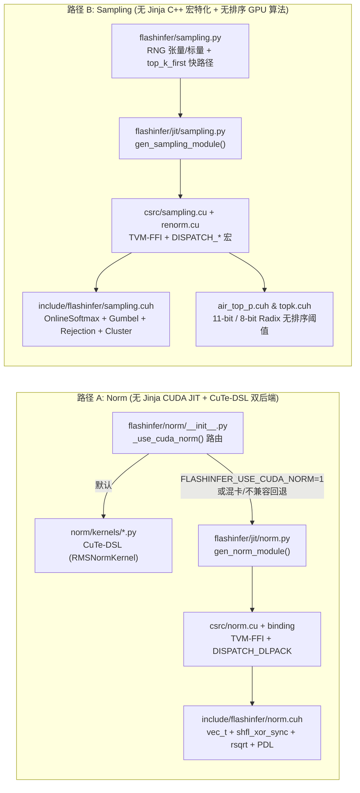

#ai #llm #flashinfer #cuda #rmsnorm #sampling #源码导读

相关笔记：[[gpu-execution-and-memory-model]] | [[flashinfer-learning-roadmap]] | [[flashinfer-architecture-and-jit]] | [[flashinfer-paged-kv-and-decode-source]]

# FlashInfer Norm 与 Sampling 源码导读

## 概述

Norm 与 Sampling 是进入 FlashInfer 内核代码最理想的两条切入路径——它们没有复杂的 Paged KV 间接寻址，却完整覆盖了 FlashInfer 最常用的 GPU 工程技巧：

- **路径 A（Norm 模块）**：最干净的**无 `.jinja` CUDA JIT 基线**（以及默认 CuTe-DSL 双后端路由），展示 `vec_t` 128-bit 向量化访存、两级 Warp/Block 归约、PTX `rsqrt`、SM90+ PDL 流水线与多步融合量化。
- **路径 B（Sampling 模块）**：展示多算子 **C++ `DISPATCH_*` 宏特化**、CUDA Graph 兼容的 Philox RNG 状态传递、2-Pass/Vocab-Split Online Softmax，以及 FlashInfer 最具代表性的**无排序 GPU 拒绝采样**、**AIR Top-P** 与 **Multi-CTA Radix Top-K** 算法。

> 源码与版本边界：本文基于 **FlashInfer v0.7.3（commit `82caa5668`，本地仓库 `/Users/hsn/github/flashinfer`，审查日期 `2026-11-17`）** 核验撰写，不依赖易漂移的行号。



---

## 路径 A：Norm（无 Jinja 基线与 CuTe-DSL 双后端）

### 1. Python 入口与双后端分发（`flashinfer/norm/__init__.py`）

FlashInfer v0.7.3 的基础归一化 API（`rmsnorm`、`rmsnorm_quant`、`fused_add_rmsnorm`、`fused_add_rmsnorm_quant`、`gemma_rmsnorm`、`gemma_fused_add_rmsnorm`、`layernorm`、`layernorm_quant`）同时维护两套实现：

- **默认 CuTe-DSL 路径**：调用 `flashinfer/norm/kernels/`（如 `rmsnorm_cute`、`qk_rmsnorm_cute`、`fused_add_rmsnorm_cute`）。
- **CUDA JIT 基线路径**：通过 `@functools.cache` 包装的 `get_norm_module()` 调用 `gen_norm_module().build_and_load()`，在以下情况触发：
  1. 显式设置 `FLASHINFER_USE_CUDA_NORM=1`；
  2. 未安装兼容版本的 `nvidia-cutlass-dsl` 或当前 SM 架构不被 CuTe-DSL 支持（`_cute_dsl_supports_arch()` 返回 `False`）；
  3. 混卡异构主机中，CuTe-DSL 在导入时从 device 0 捕获的目标架构 `_dsl_captured_arch()` 与目标张量设备不兼容（`_is_arch_compatible()` 严格遵循 CUDA 二进制兼容规则：带 `a` 后缀如 `sm_100a` 必须 minor 精确匹配，普通或 `f` 目标支持同主架构向前兼容）。
- **纯 CUDA JIT 专属接口**：`fused_add_rmsnorm_fp8_block_quant` 以及 DiT 融合接口（`fused_dit_gate_residual_layernorm_gamma_beta` 等，底层调用 `get_norm_module().fused_dit_layernorm`）无条件走 `get_norm_module()`，`fused_qk_rmsnorm_rope` 也通过 `_get_fused_qk_rmsnorm_rope_module()` 编译加载同一个 `norm` JIT 模块；而 `fused_rmsnorm_silu` 使用独立的 `flashinfer/jit/rmsnorm_silu.py` 按调优查找表生成 `rmsnorm_silu_config.inc`（无 `.jinja`，由 Python 直接生成 C++ 头文件）。

对于支持 PDL 的架构（Hopper+），Python 层在 `enable_pdl is None or enable_pdl` 时调用 `device_support_pdl(input.device)` 自动开启 PDL。

### 2. 最简无 Jinja 模块生成器（`flashinfer/jit/norm.py`）

`gen_norm_module()` 是阅读 FlashInfer JIT 最简洁的参考模板——**没有任何 Jinja 渲染或源文件拷贝**，直接把只读目录下的 `csrc/norm.cu` 和 `csrc/flashinfer_norm_binding.cu` 交给 `gen_jit_spec()`：

```python
# flashinfer/jit/norm.py (FlashInfer v0.7.3)
def gen_norm_module() -> JitSpec:
    nvcc_flags = ["-DENABLE_BF16", "-DENABLE_FP8"]
    return gen_jit_spec(
        "norm",
        [
            jit_env.FLASHINFER_CSRC_DIR / "norm.cu",
            jit_env.FLASHINFER_CSRC_DIR / "flashinfer_norm_binding.cu",
        ],
        extra_cuda_cflags=nvcc_flags,
    )
```

### 3. TVM-FFI 绑定与形状分发（`csrc/norm.cu` & `csrc/flashinfer_norm_binding.cu`）

- `csrc/flashinfer_norm_binding.cu` 通过 `TVM_FFI_DLL_EXPORT_TYPED_FUNC` 导出 11 个类型安全函数（含 `rmsnorm`、`rmsnorm_quant`、`fused_add_rmsnorm`、`fused_add_rmsnorm_fp8_block_quant`、`gemma_rmsnorm`、`layernorm`、`fused_dit_layernorm` 等）。
- `csrc/norm.cu` 在 C++ 侧执行：
  1. 校验最后一维连续（`CHECK_LAST_DIM_CONTIGUOUS_INPUT`）、设备一致（`CHECK_DEVICE`）和形状匹配；
  2. 设置 `ffi::CUDADeviceGuard` 与 `get_stream(input.device())`；
  3. 通过 `DISPATCH_DLPACK_DTYPE_TO_CTYPE_FP16`（及量化场景的 `DISPATCH_DLPACK_DTYPE_TO_CTYPE_FP8`）展开 `half` / `nv_bfloat16` 与 `__nv_fp8_e4m3` / `__nv_fp8_e5m2`；
  4. **按维度路由内核形态**：`rmsnorm` 若输入为 2D `[batch_size, hidden_size]`，调用 `norm::RMSNorm`（1 CTA 处理一行）；若输入为 3D `[batch_size, num_heads, head_dim]`（典型为 Attention 之前的 QK Norm），调用 `norm::QKRMSNorm`（1 Warp 处理一个 Head）。

### 4. 核心 CUDA 内核拆解（`include/flashinfer/norm.cuh`）

#### (1) `RMSNormKernel`：128-bit 向量化、两级归约与 PTX `rsqrt`

Host 端 `norm::RMSNorm` 根据元素字节数计算对齐向量长度：

```cpp
const uint32_t vec_size = std::gcd(16 / sizeof(T), d);
const uint32_t block_size = std::min<uint32_t>(1024, d / vec_size);
const uint32_t num_warps = ceil_div(block_size, 32);
dim3 nblks(batch_size);
dim3 nthrs(32, num_warps);
const uint32_t smem_size = num_warps * sizeof(float);
```

然后通过 `DISPATCH_ALIGNED_VEC_SIZE(vec_size, VEC_SIZE, ...)`（定义于 `include/flashinfer/utils.cuh`，支持 16/8/4/2/1）实例化 `RMSNormKernel<VEC_SIZE, T>` 并用 `cudaLaunchKernelEx` 启动（附带 `cudaLaunchAttributeProgrammaticStreamSerialization` 控制 PDL）。

Device 端执行分为四步：

1. **PDL 等待（SM90+）**：在读取输入前执行 `asm volatile("griddepcontrol.wait;");`，确保前序 GEMM/Add 写回已经对本 Kernel 可见。
2. **Pass 1 向量化加载与 FP32 平方和**：每个线程循环 `rounds = ceil_div(d, VEC_SIZE * num_threads)` 次，使用 `vec_t<T, VEC_SIZE>::load(...)`（`include/flashinfer/vec_dtypes.cuh`，当 `VEC_SIZE = 8` for FP16/BF16 时直接映射为单条 128-bit `int4` 内存读），转为 `float` 后累加 `sum_sq`。
3. **Warp → Shared Memory 两级归约与 `math::rsqrt`**：
   - 第一级：每个 Warp 内用 `math::shfl_xor_sync(sum_sq, offset)`（`offset = 16, 8, 4, 2, 1`）做 5 步蝴蝶归约；
   - 第二级：`tx == 0` 将本 Warp 局部和写入 `smem[ty]` → `__syncthreads()` → 仅第一个 Warp（`ty == 0`）读取前 `num_warps` 个槽位再次 `shfl_xor_sync`，由 `tx == 0` 写入 `smem[0]` → `__syncthreads()`；
   - 计算倒数均方根：`float rms_rcp = math::rsqrt(smem[0] / float(d) + eps);`，其中 `math::rsqrt`（`include/flashinfer/math.cuh`）直接执行单条 PTX `rsqrt.approx.ftz.f32`。
4. **Pass 2 缩放与 Gemma 统一复用**：重新加载输入向量与 `weight_vec`，计算 `float(input_vec[j]) * rms_rcp * (weight_bias + float(weight_vec[j]))` 并写回，最后在 SM90+ 发出 `griddepcontrol.launch_dependents;`。其中 **`GemmaRMSNorm` 复用了完全相同的 `RMSNormKernel`**，只是把 `weight_bias` 从 `0.f` 改为 `1.f`！

#### (2) `QKRMSNormKernel`：零共享内存的 Warp-per-Head 持久调度

对于 `[batch_size, num_heads, head_dim]`，由于 `head_dim` 通常只有 64 或 128，若 1 个 CTA 只处理 1 个 Head 会造成严重的线程浪费与同步开销。因此 `QKRMSNorm`：

- 固定 `num_warps = 4`（每 CTA 128 线程）、`smem_size = 0`；
- 通过 `cudaOccupancyMaxActiveBlocksPerMultiprocessor` 与 SM 数计算满载 CTA 上限 `std::min(num_blocks_per_sm * num_sms, ceil_div(batch_size * num_heads, num_warps))`；
- 每个 Warp 独立领取一个 `(batch_idx, head_idx)` 任务，仅用单次 Warp 内 `shfl_xor_sync` 完成归约，**零共享内存、零 `__syncthreads()`**。

#### (3) Fused 变体：SMEM 缓存残差、延迟倒数与 1×128 块量化

- **`FusedAddRMSNormKernel` & `FusedAddRMSNormQuantKernel`**：将 `residual += input` 原地更新与 RMSNorm 融为一体。为了不在 Pass 2 再次从 HBM 回读刚刚写出的 `residual`，Pass 1 在把 `(T)x` 写回全局 `residual` 的同时，把 **FP32 精度的中间和 `x` 缓存到动态 Shared Memory** `smem_x`（位于 `smem + ceil_div(num_warps, 4) * 4`，保证 16 字节对齐）。在 Quant 版本中，kernel 特意先把 `scale[0]` 读入寄存器，等到归约与 `__syncthreads()` 完成之后再计算 `const float scale_inv = 1.0f / scale_val;`，注释明确解释这样做是为了**避免 `1.0f / scale` 的倒数计算阻塞初始输入加载流水线**，随后用 `vec_t<float, VEC_SIZE>::cast_store()`（调用 `__nv_cvt_float2_to_fp8x2` 硬件指令）截断并写出 FP8。
- **`FusedAddRMSNormFP8BlockQuantKernel`**：专为 DeepGEMM / FP8 Block-Scaled GEMM 服务的单波次融合算子。当 `d <= 16384` 且满足整 Warp 向量对齐时，每 `kLanesPerBlock = 128 / VEC_SIZE` 个连续 Warp 内线程恰好负责一个 `1×128` 量化块，因此只需一次局部子组 `shfl_xor_sync` 最大值归约就能求出块内 `amax`，零 SMEM 额外交互即写出 FP8 激活、BF16 `normed_out` 与列主序 TMA 对齐的 FP32 `block_scale`。
- **`generalLayerNorm`**：支持标准两遍法（先算 `mean` 再算 `(x - mean)^2`）或单遍方差恒等式 `USE_DIFF_OF_SQUARES`（$E[x^2] - E[x]^2$），以及可选 `USE_SHMEM` 缓存（当请求 SMEM >= 48 KiB 且 `cudaFuncSetAttribute` 失败时优雅清除错误并回退 `USE_SHMEM = false` 重新读取全局内存）。

---

## 路径 B：Sampling（C++ 宏特化与无排序 GPU 采样）

### 1. 先核实真相：Sampling 在 v0.7.3 中如何使用特化

检查 `flashinfer/jit/sampling.py` 可以发现，在 FlashInfer v0.7.3 中，`gen_sampling_module()` **并没有使用 `.jinja` 模板**，而是与 `norm` 一样直接编译三个固定源文件：

```python
# flashinfer/jit/sampling.py (FlashInfer v0.7.3)
def gen_sampling_module() -> JitSpec:
    return gen_jit_spec(
        "sampling",
        [
            jit_env.FLASHINFER_CSRC_DIR / "sampling.cu",
            jit_env.FLASHINFER_CSRC_DIR / "renorm.cu",
            jit_env.FLASHINFER_CSRC_DIR / "flashinfer_sampling_binding.cu",
        ],
    )
```

它采用的是 **C++ `DISPATCH_*` 宏编译期特化**（`csrc/tvm_ffi_utils.h` 与 `include/flashinfer/sampling.cuh`）：
- `DISPATCH_DLPACK_IDTYPE_TO_CTYPE`（分发 `int32_t` / `int64_t` 索引输出类型）
- `DISPATCH_DLPACK_DTYPE_TO_CTYPE_FP32_FP16`（在 `renorm.cu` 分发 `float` / `half` / `nv_bfloat16`）
- `DISPATCH_COMPUTE_CAP_NUM_THREADS`（SM80+ 用 1024 线程，旧架构用 512 线程）
- `DISPATCH_ALIGNED_VEC_SIZE`（16/8/4/2/1）
- `DISPATCH_DETERMINISTIC`（`true`/`false` 切换可复现归约路径）
- `DISPATCH_SOFTMAX_CACHE_INPUT`（`true`/`false` 决定是否把 logits 缓存在 SMEM）

对比来看：**Norm/Sampling 的参数空间只有几个离散布尔与类型轴，用 C++ 宏在一个 `.so` 里展开性价比最高**；而需要实例化大量 `head_dim`、位置编码、用户自定义 `AttentionVariant` 或激活函数代码的算子（如 `single_decode_customize_config.jinja`、`batch_prefill_customize_config.jinja`、`flashinfer/jit/activation.py` 的 `activation_templ`）才需要用 `.jinja` 在 `generated/` 下为每个 `uri` 单独编译 `.so`。

### 2. Python API、CUDA Graph RNG 与分流策略（`flashinfer/sampling.py`）

- **CUDA Graph 友好的 Philox RNG 契约**：`get_seed_and_offset()` 从 PyTorch `Generator` 读取并步进 `(seed, offset)`；`_validate_and_convert_seed_offset()` 允许调用方直接传入 1D `int64`/`uint64` 的 **GPU Tensor**（长度 `1` 广播或 `batch_size` 逐行指定）。这样在 CUDA Graph 重放时只需就地更新 GPU 上的 seed/offset 张量，无需重新捕获图。注意 `indices` 参数允许多个输出行共享同一行概率分布（例如并行采样/Speculative 候选），而输出行索引 `bx` 会进入 Philox subsequence 保证不同样本各自独立。
- **Blackwell Softmax 自动路由**：`softmax()` 在 SM100/SM103/SM107 上自动走 `get_blackwell_softmax_op()`（`cake_blackwell_softmax`），其余架构走 `get_sampling_module().softmax`（复用 1 MiB 缓存的 `softmax_workspace`）。
- **`top_k_top_p_sampling_from_logits` / `top_k_top_p_sampling_from_probs` 的 `"top_k_first"` 快路径**：当 `filter_apply_order="top_k_first"` 且满足 `_top_k_first_fast_path_applicable()`（`0 < k <= 256` 且 `vocab_size >= 65536`）时，`_top_k_first_fast_path()` 先调用 `flashinfer.topk.top_k(..., sorted=True)` 用并行 Radix/Cluster Top-K 从大词表中筛出仅 `k` 个候选，再只对这 `k` 个元素做 Softmax/重归一化与 `top_p_sampling_from_probs`，最后映射回原词表 ID——把全词表开销压缩到 `k` 级。

### 3. Fused Online Softmax（`include/flashinfer/sampling.cuh`）

`sampling::OnlineSoftmax` 针对词表尺寸 $d$（即 `vocab_size`）和 `batch_size` 分成两条路径：

- **Path A（小 Batch 大词表：`batch_size <= 128 && d >= 24576`）——两阶段 Vocab-Splitting**：
  - `OnlineSoftmaxMapKernel`：沿 `blockIdx.y` 把词表切成 `ceil_div(d, 8192)` 个片，多个 CTA 并行扫描同一行并把各片的 `PartialSoftmaxResult{max_val, denominator}` 暂存到互不重叠的 `output` 缓冲区前缀区域（节省额外显存分配）。
  - `OnlineSoftmaxReduceKernel`：用 `Float2SoftmaxReduceOp` 对所有分片的 `(max, denom)` 做 Online Softmax 状态归并，再按最终 `final_max` 与 `1.0f / denominator` 写回概率。
- **Path B（通用路径）——单 CTA 融合 `OnlineSoftmaxFusedKernel`**：
  - 若行长 `d <= cache_threshold`（如 `batch_size <= 16` 时 `<= 4096`），`CACHE_INPUT=true` 将经温度缩放的 logits 缓存在动态 SMEM 中，**全局内存只读一次、只写一次**；否则 `CACHE_INPUT=false` 流式两次读取。
  - **精度细节**：内核中使用 `__fmul_rn(static_cast<float>(logits_vec[j]), inv_temp)` 而非普通 `*`，源码注释明确指出若编译器将其收缩为 FMA，在极低 temperature 下可能导致归一化后概率略微超过 `1.0`。

### 4. 无排序 GPU 采样核心算法（`include/flashinfer/sampling.cuh`）

传统 LLM 采样（如 PyTorch `torch.sort` + `cumsum` + `multinomial`）要对每个请求的 32K–256K 词表做全量排序，产生多次全局内存读写与高额排序临时显存。FlashInfer 在单个 Kernel 内通过三种无排序方法彻底消除全词表排序：

#### (1) Gumbel-Max Trick（`SamplingFromLogitsKernel`）

不需要显式计算 Softmax！根据 Gumbel-Max 恒等式，$\arg\max_i (\text{logit}_i + G_i)$（其中 $G_i = -\ln(-\ln U_i),\ U_i \sim \text{Uniform}(0,1)$）严格等价于从 $\text{softmax}(\text{logits})$ 采样：

- `GenerateGumbelNoise()` 使用 `curand_uniform4` 与单指令 PTX `log2f`（`-kLOG2 * log2f(-log2f(x * kSCALE))`，其中 `kSCALE = 1.0f - epsilon` 避免 `log(1)=0` 导致无穷大）。
- 全行只需 **1-Pass**：各线程边读 logits 边加上 Gumbel 噪声并维护局部最大值，最后一次 `BlockReduce<Candidate, ...>`（`LogitsArgMaxOp` 在相等时固定取较大索引保证确定性）直接输出采样 Token ID。

#### (2) Inverse-CDF 采样与 Blelloch 确定性前缀和（`SamplingFromProbKernel` & `DeviceSamplingFromProb`）

从已归一化的 `probs` 采样等价于抽取 $u \sim \text{Uniform}(0,1)$ 并寻找首个满足累计概率和 $\text{CDF}(i) > u$ 的下标：

- **Tile 级早退**：按 `BLOCK_THREADS * VEC_SIZE` 分块流式读取；每块先用 `BlockReduce::Sum` 求当前块总质量 `aggregate_local`。只有当 `aggregate + aggregate_local > u` 时，才需要在这个块内做 Block 前缀和定位命中位置并直接 `break` 退出后续 Tile！
- **确定性前缀和**：`deterministic=False` 调用速度更快的 `cub::BlockScan::InclusiveSum`；`deterministic=True` 调用内置的 `DeterministicInclusiveSum`（固定树结构的两级 Warp + Shared Memory Blelloch 扫描），然后用 `BlockAdjacentDifference(..., BoolDiffOp())` 配合 `atomicMin(&temp_storage->sampled_id, ...)` 精确捕捉 `false -> true` 跳变的第一个位置。
- **浮点舍入兜底**：当 $u$ 极接近 1 而概率和因浮点舍入略小于 $u$ 时，回退到记录好的最后一个有效非零概率下标 `last_valid_id`。

#### (3) 基于枢轴的无排序拒绝采样（`TopKSamplingFromProbKernel` / `TopPSamplingFromProbKernel` / `TopKTopPSamplingFromProbKernel`）

核心思想是把“按概率排序再截断”转化为**在阈值区间 `[low, high]` 内做随机二分/三分拒绝采样**：

1. 初始令概率阈值下界 `low = 0`、上界 `high = 1.0`、当前存活概率总和 `q = 1.0`。
2. **每一轮（Round）**：
   - 在概率严格大于 `low` 的候选集合 $\{i : p_i > \text{low}\}$ 上，抽取缩放随机数 $u \sim \text{Uniform}(0, q)$，直接调用 `DeviceSamplingFromProb` 以与目标分布完全成正比的概率抽中一个候选下标 `sampled_id`，记其概率为枢轴 $\text{pivot}_0 = p_{\text{sampled\_id}}$。
   - 同时构造中点枢轴 $\text{pivot}_1 = (\text{pivot}_0 + \text{high}) / 2$（此处特意使用内联 PTX `.rn` 指令 `ieee_mul` / `ieee_add` 绕开 `-use_fast_math` 的 FTZ 刷零，防止极小概率下 `pivot_1` 刷成 0 导致二分死循环——对应源码中的 `#769 / #774` 修复）。
   - 用单次 `BlockReduce<ValueCount<float>>` 统计全行严格大于 $\text{pivot}_0$ 和 $\text{pivot}_1$ 的概率质量总和（`value`）与元素个数（`count`）：
     - **Case 1**：若 $\text{pivot}_0$ 满足条件（Top-P 要求 `agg0 < top_p`，Top-K 要求 `agg0.count < k`，Joint 要求同时满足），说明 `sampled_id` 一定属于目标 Top-P / Top-K 保留集，**直接接受并返回 `sampled_id`**！
     - **Case 2**：若 $\text{pivot}_0$ 被拒绝而 $\text{pivot}_1$ 满足，说明目标阈值落在 $(\text{pivot}_0, \text{pivot}_1]$，收缩搜索区间为 `[low = pivot_0, high = pivot_1]`，并更新剩余概率和 `q = agg0`。
     - **Case 3**：若两者均被拒绝，说明阈值更高，收缩 `low = pivot_1`，`q = agg1`。
3. **无偏性与收敛速度**：由于每轮是在未落选的高概率区间内按精确条件概率重抽样，数学上可严格证明输出分布与“先排序截断再采样”**完全一致（零近似误差）**；期望只需常数级（通常 2–4 轮）扫描即可收敛，完全不需要排序或词表级辅助空间。

#### (4) SM90 Thread Block Cluster Split-Row 拒绝采样

当运行在 Hopper（SM90）且 Batch 很小、词表很大时，单个 CTA 仅占用 1 个 SM，且每轮拒绝采样都要重读 HBM。`SplitRowRejectionSamplingFromProbKernel` 利用 Hopper **Thread Block Cluster**（由 `GetSplitRowSamplingClusterSize` 选择 2/4/8 个 CTA）：

- 每个 CTA 仅负责词表的 $1 / \text{cluster\_size}$ 切片，在启动时通过 `cp.async.cg.shared.global` 把切片一次性缓存进各自 SMEM（此后所有轮次均从 SMEM 读取，每线程段长故意取奇数避免 Bank Conflict）；
- 每轮中每个 CTA 统计本切片内大于 `thr0` / `thr1` 的 `ValueCount`，通过 `cluster.map_shared_rank()` 写入集群内其他 CTA 的分布式共享内存（DSMEM）并执行 `cluster.sync()`；
- 逆 CDF 查找依次通过 `WarpSelectLane` 选出目标 Rank（CTA）→ 目标 Warp → CTA 内 `BlockScan` 选出目标线程与 Token，再用 DSMEM 广播结果。

---

## AIR Top-P 与 Multi-CTA Radix Top-K 重归一化（`air_top_p.cuh`、`topk.cuh`、`csrc/renorm.cu`）

当业务需要输出完整的重归一化概率分布（`top_p_renorm_probs`、`top_k_renorm_probs`）或 Masked Logits（`top_k_mask_logits`）而非单个采样 ID 时，FlashInfer 使用**基于基数直方图（Radix Histogram）的无排序阈值搜索**，同样不需要对整个词表排序：

### 1. AIR Top-P（`include/flashinfer/air_top_p.cuh`）

`AirTopPRenormProb` 移植自 TensorRT-LLM 的自适应迭代基数（AIR）Top-P 算法（当 `vocab_size < NUM_BUCKETS = 2048` 时，`csrc/renorm.cu` 会退回三搜索 `TopPRenormProbKernel` 以保证精度）：

- **11-bit 基数桶与浮点保序变换**：每轮提取概率值 IEEE-754 编码的 11 个 bit（`BITS_PER_PASS = 11`，共 `NUM_BUCKETS = 2048` 个桶）。通过 `cub::Traits<T>::TwiddleIn` 及按位取反（`~bits`）把浮点数单调映射为降序无符号整数，使大概率排在低编号桶里。对于 32-bit `float`，最多只需 $\lceil 32 / 11 \rceil = 3$ 轮 Pass！
- **多 CTA 协同与双缓冲过滤**：每轮用多个 CTA（`CalcAirTopPBlockNum` 基于 SM 占用率与 `< 15%` 尾波惩罚自动估算）以 `float4`（`WideT`）向量化读取概率，在 SMEM 累加 2048 个桶的质量和与计数后归并到全局直方图；从第 2 轮起，只把前缀精确匹配上一轮目标桶 `kthValueBits` 的元素过滤写入乒乓缓冲区 `buf1`/`buf2`，数据量指数级骤降。
- **Last-CTA 归约定位桶**：通过 `atomicInc(&counter->finishedBlockCnt, gridDim.x - 1)` 选出最后一个完成的 CTA，它在 SMEM 内对 2048 个桶做 Warp 级归约并顺序扫描定位累积概率和刚超过 `top_p` 的那个桶 `targetIdx`，更新剩余目标和 `counter->sum`。
- **确定性 64-bit 尾数整数累加（`is_deterministic=True`）**：非确定性模式直接在桶上做浮点 `atomicAdd`，顺序不可控；确定性模式下，同一桶内所有元素的高位前缀（指数和前几位尾数）已由 Pass 决定，因此 `histAtomicAdd` 只把每个概率的低 23-bit 尾数（`calcMantissa`）以 `uint64_t` 整数原子加到直方图，最后用 `calcFloatValue()`（利用 `__clzll` 重新规格化指数与尾数）还原精确浮点桶和——**原子整数加法满足交换律与结合律，从而做到 100% 位级可复现**！
- **最后一步 `AirTopPRenormApplyKernel`**：用找到的阈值 `twiddleOut(kthValueBits)` 过滤并归一化写回 `renormedProbs`。

### 2. Multi-CTA Radix Top-K（`include/flashinfer/topk.cuh` & `csrc/renorm.cu`）

`RadixTopKRenormProbMultiCTA` 与 `RadixTopKMaskLogitsMultiCTA` 针对超大词表提供了 **8-bit/轮（256 桶）多 CTA 协作基数选择**：

- 每个 Group 共享一个全局 `RadixRowState`（由 Python 层 `_get_row_states_buffer` 提供 1 MiB 缓存并在 CUDA Graph 捕获期每图独立分配）：包含三缓冲直方图 `histogram[3][256]`（让每轮只需一次跨 CTA 软件栅栏，避免相邻轮读写竞争）、`remaining_k`、`prefix` 与 `arrival_counter`。
- **硬件级跨 CTA 软件栅栏**：由于普通 CUDA Grid 内没有硬件全局 CTA 屏障，`AdvanceRadixGroupBarrier` 通过内联 PTX `fence.acq_rel.gpu` + `red.relaxed.gpu.global.add.s32` 上报到达，并由 `tx == 0` 线程用 `ld.global.acquire.gpu.b32` 自旋等待计数器达标；注意这要求 GPU SM 数量足以让同一组的所有 CTA 同时驻留，否则在 <=16 SM 的卡上可能死锁，因此 `csrc/renorm.cu` 会检测 `cudaErrorNotSupported` 并给出明确提示。
- **Last-CTA 安全清零（Issue #3610 修复）**：`RadixGroupResetStateLastCTA` 让最后一个退出的 CTA 才重置三缓冲直方图与 `arrival_counter`，防止领跑 CTA 提前清零计数器导致还在自旋等待的同伴 CTA 永久卡死。
- **固定点确定性重归一化**：`is_deterministic=True` 时，Top-K 重归一化求和采用 `kRenormDeterministicScale = 2^44` 的定点整数 `unsigned long long sum_topk_fixed` 跨 CTA 原子累加，彻底消除浮点原子加的顺序漂移。

### 3. 投机采样验证（`ChainSpeculativeSampling`）

`sampling.cuh` 还内置了用于 Speculative Decoding 的 `ChainSpeculativeSampling`：在单 Kernel 内先并行抽取 `num_speculative_tokens` 步的随机数判定是否接受草稿 Token（$u \cdot p_{\text{draft}} < p_{\text{target}}$，接受则直接写入输出，首个拒绝位置为 `pos`，注意为保证后续修正分支 RNG 序列对齐，被跳过位置仍会消耗对应抽样步），再针对 `pos` 位置从残差分布 $\max(q - p, 0)$ 用 `DeviceSamplingFromProb` 采样修正 Token 并把剩余槽位填为 `-1`。

---

## 自检清单

- [ ] 能说出 `flashinfer/norm/__init__.py` 在默认 CuTe-DSL 与 CUDA JIT 之间切换的三个条件（`FLASHINFER_USE_CUDA_NORM`、架构支持度、混卡二进制兼容性）。
- [ ] 能写出 `RMSNormKernel` 从 `vec_t` 128-bit 读入、Warp `shfl_xor_sync` + SMEM 两级归约到 `math::rsqrt` 的完整流程，并解释为何 `GemmaRMSNorm` 可以共用同一内核。
- [ ] 能解释 `gen_sampling_module()` 在 v0.7.3 中如何通过 C++ `DISPATCH_*` 宏特化，以及它与 Attention `.jinja` 模板的适用边界。
- [ ] 能分三步描述 `TopPSamplingFromProbKernel` 无排序拒绝采样的两枢轴收缩机制与无偏性保证。
- [ ] 能解释 `air_top_p.cuh` 如何用 64-bit 尾数整数原子加实现确定性 Top-P 阈值统计，以及 `topk.cuh` 为何必须由最后一个 CTA 重置 `RadixRowState`。

## 面试要点

### Q：FlashInfer 中 `RMSNormKernel` 与 `FusedAddRMSNormKernel` 在访存设计上有哪些针对性的优化？

> [!question]- 参考答案（点击展开）
>
> 第一，两者都用 `std::gcd(16 / sizeof(T), d)` 配合 `DISPATCH_ALIGNED_VEC_SIZE` 选择最大 128-bit 对齐宽度实例化 `vec_t`，将全局加载/存储合并为单条 `int4` 事务；第二，归约先在 Warp 内用 `math::shfl_xor_sync` 寄存器级蝴蝶归约，只把每 Warp 一个浮点数写进 SMEM 再用首个 Warp 完成二次洗牌，极小化 Shared Memory 与同步开销，并用单条 PTX `rsqrt.approx.ftz.f32` 计算倒数均方根；第三，`FusedAddRMSNormKernel` 在 Pass 1 把 `input + residual` 的 FP32 结果同时缓存到动态 SMEM（`smem_x`），避免 Pass 2 再次从 HBM 回读残差张量；第四，在 SM90+ 上通过 `cudaLaunchKernelEx` 开启 PDL（`griddepcontrol.wait` / `launch_dependents`）隐藏前后 Kernel 的启动间隙。

### Q：为什么大模型词表采样（Top-K / Top-P）直接排序很慢，FlashInfer 的无排序拒绝采样是如何做到既快又无偏的？

> [!question]- 参考答案（点击展开）
>
> 词表大小通常在 32K–256K 之间，全词表排序需要 $O(V \log V)$ 比较或多轮全局基数排序与额外显存，每次迭代都要把整行反复写入和读出 HBM。FlashInfer 的 `TopPSamplingFromProbKernel` / `TopKSamplingFromProbKernel` 采用基于枢轴的拒绝采样：每轮在尚未被淘汰的候选区间 $\{p_i > \text{low}\}$ 内用精确比例 $u \sim U(0, q)$ 的逆 CDF 抽取一个候选 Token，并以该 Token 概率 $\text{pivot}_0$ 及中点 $\text{pivot}_1$ 单遍统计上方质量和与计数；只要 $\text{pivot}_0$ 落入目标 Top-P/Top-K 保留集就直接接受并返回，否则大幅收缩 `[low, high]` 区间。因为每轮始终在合法后缀集内按精确条件概率重抽样，数学分布与“先排序再截断”完全等价，且期望仅需 2–4 次流式扫描即可收敛、零显存排序空间。

### Q：FlashInfer 在采样与 Top-K / Top-P 重归一化中如何解决浮点归约和原子加的非确定性？

> [!question]- 参考答案（点击展开）
>
> GPU 上非确定性主要来自两个环节：Block 前缀和顺序与跨 CTA 浮点 `atomicAdd` 到达顺序。FlashInfer 分别采取了三类确定性机制：第一，在逆 CDF 采样中，打开 `deterministic=True` 会把 `cub::BlockScan` 切换为固定树形顺序的 Blelloch 扫描 `DeterministicInclusiveSum`；第二，在 `air_top_p.cuh` 中，利用同一基数桶内元素已对齐高位的特性，把 23-bit 尾数转为 `uint64_t` 整数原子加再还原为浮点数，利用整数加法的结合律保证位级一致；第三，在 `topk.cuh` 的多 CTA Top-K 重归一化中，使用 `2^44` 比例因子的 `unsigned long long sum_topk_fixed` 做定点整数跨 CTA 累加，并在需要保持索引顺序时使用 `DeterministicContiguousCollect`。

### Q：在 `TopPSamplingFromProbKernel` 中为什么专门用内联 PTX `ieee_mul` / `ieee_add` 计算 `pivot_1`，而不用普通浮点乘加？

> [!question]- 参考答案（点击展开）
>
> FlashInfer 的 nvcc JIT 默认开启 `-use_fast_math`，这会让编译器在计算浮点运算时发射带 `.ftz`（Flush-To-Zero）的指令，把极小的次正规数（subnormal）直接刷成 `0`。如果概率分布中存在大量次正规值，普通 `(pivot_0 + high) * 0.5f` 可能被刷零并破坏 `[low, high]` 严格收缩不变式，导致拒绝采样或三分搜索死循环。`sampling.cuh` 通过内联 PTX `mul.rn.f32` 和 `add.rn.f32`（`ieee_mul` / `ieee_add`，无 `.ftz` 修饰）保留严格 IEEE-754 行为，消除收敛停滞 bug。
