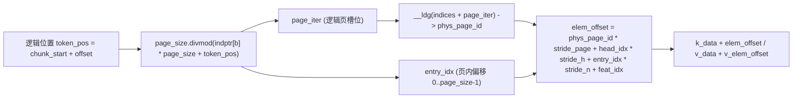
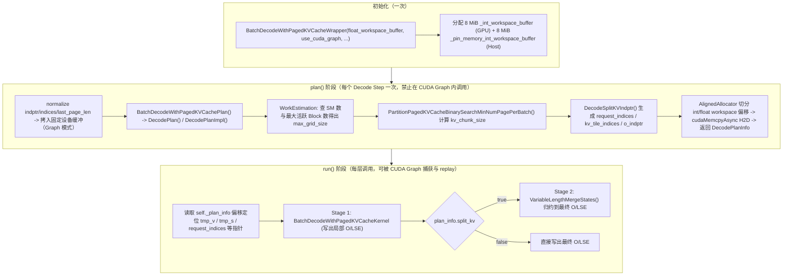

#ai #llm #gpu #flashinfer #cuda #paged-kv #decode

相关笔记：[[gpu-execution-and-memory-model]] | [[flashinfer-learning-roadmap]] | [[flashinfer-architecture-and-jit]] | [[flashinfer-ragged-prefill-and-mla-source]] | [[vllm-and-sglang]] | [[llm-inference-learning-path]]

# FlashInfer Paged KV 与 Decode 内核源码导读

> **源码版本边界**：本文所有文件路径、结构体与函数签名均对照 `FlashInfer v0.7.3 (commit 82caa5668, 审查日期 2026-11-17)` 核验。为避免随提交漂移，文中仅引用稳定符号名，不引用脆弱行号。

## 概述

Decode 阶段每次自回归步只为每个请求生成 1 个（或投机采样时的少量 $q\_len\_per\_req$ 个）Query Token，却必须扫描整段历史 KV Cache，是典型的 **HBM 带宽受限（memory-bound）** 算子。FlashInfer 通过四项核心设计把 Paged KV Decode 做到接近硬件带宽上限：

1. **CSR 分页抽象（`paged_kv_t`）**：用统一且零拷贝的 `indptr` / `indices` / `last_page_len` 表示不连续物理页，兼容 `NHD` 与 `HND` 布局及自定义 stride。
2. **基数为 2 的在线状态（`state_t`）**：把最大值 `m` 与 logits 折算到 $\log_2$ 域，直接复用单周期/低延迟硬件指令 `ptx::exp2`，并定义满足结合律的无 NaN `merge()` 算子。
3. **Plan-Run 生命周期与 CUDA Graph 解耦**：将 SM 占用率估算、二分搜索 Split-KV 切分粒度与偏移表分配全部前置到主机侧 `plan()`，令热路径 `run()` 零分配、零同步、可直接录制进 CUDA Graph。
4. **GQA 组内共享 + Split-KV 两阶段归约**：把共享同一 KV Head 的 `GROUP_SIZE` 个 Query Head 打包进同一个 CTA 共享一次 K/V HBM 读取；当 Batch 较小不足以打满 SM 时，按 KV 长度切分给多个 CTA，再经 `VariableLengthMergeStates` 合并。

可配套运行纯 CPU 机制实验：[Online Softmax 与 Split-KV 实验手册](../experiments/online-softmax-and-split-kv/README.md)。

---

## 核心数据结构：`paged_kv_t` 与 `state_t`

### `paged_kv_t` 的 CSR 分页寻址（`include/flashinfer/page.cuh`）

FlashInfer 本身不负责页表分配与淘汰策略（由 vLLM / SGLang 等上层引擎管理），而是将每个请求占用的页视作 CSR（Compressed Sparse Row）稀疏块索引，在 `include/flashinfer/page.cuh` 中定义了模板结构体 `paged_kv_t<DType, IdType>`：

| 成员 / 方法 | 含义与数学定义 | 关键细节 |
| --- | --- | --- |
| `indptr` | 长度为 `batch_size + 1` 的页前缀偏移 | 请求 `b` 的页切片为 `indices[indptr[b] : indptr[b+1]]`，要求 `int32` |
| `indices` | 物理页编号数组，长度 `indptr[batch_size]` | 指向物理 KV Pool 第 0 维的物理页 ID |
| `last_page_len` | 长度为 `batch_size` 的尾页有效 Token 数 | 满足 $1 \le \text{last\_page\_len}[b] \le \text{page\_size}$ |
| `page_size` | `uint_fastdiv` 类型的页大小 | 用预计算乘法移位替代设备端整型除法 `divmod` |
| `get_length(b)` | 空序列返回 `0`，否则返回 $(\text{indptr}[b+1]-\text{indptr}[b]-1)\cdot P + \text{last\_page\_len}[b]$ | 不依赖额外 `seq_lens` 数组即可推导准确 KV 长度 |
| `stride_page`, `stride_n`, `stride_h` | K 与 V（`v_stride_*`）的步长 | 支持独立 K/V Stride 与非连续切片视图 |

`NHD` 与 `HND` 两种布局仅改变最后三维的 stride 映射（逻辑张量均以 5D `[max_num_pages, 2, ...]` 或 4D `(k_data, v_data)` 元组传入）：

- **`QKVLayout::kNHD`**：逻辑形状 `[max_num_pages, page_size, num_heads, head_dim]`，步长为 `stride_n = num_heads * head_dim`、`stride_h = head_dim`。与线性投影 $xW_k, xW_v$ 输出天然对齐，无需转置。
- **`QKVLayout::kHND`**：逻辑形状 `[max_num_pages, num_heads, page_size, head_dim]`，步长为 `stride_n = head_dim`、`stride_h = page_size * head_dim`。同一 Head 的连续 Token 在显存中紧凑相邻，对 FP8/低比特量化及部分 TMA/Tensor Core 路径更友好。

给定请求 `batch_idx` 的逻辑位置 `t`，Kernel 借助 `uint_fastdiv` 将其映射到物理页地址：



值得注意的工程细节是 **`protective_get_kv_offset()`**：由于异步预取指令 `cp_async::pred_load` 即使在谓词 `pred=false` 时也需要构造合法的地址操作数，若 `page_iter >= last_indptr` 直接访问 `indices[page_iter]` 会触发越界读取；`protective_get_kv_offset()` 在越界时直接返回 `0` 偏移，由 `pred=false` 抑制实际访存。此外，追加新 KV Token 时，`AppendPagedKVCacheDecodeKernel` 与 `AppendPagedKVCacheKernel` 也复用同一套 `paged_kv_t::page_size.divmod` 与 `vec_t<DType, vec_size>::memcpy` 向量化写入。

### `state_t` 与以 2 为底的在线 Softmax（`include/flashinfer/attention/state.cuh`）

`include/flashinfer/attention/state.cuh` 定义了 FlashInfer 所有 Attention Kernel 共享的最小状态结构体 `state_t<vec_size>`：

- `vec_t<float, vec_size> o`：当前窗口内未归一化（或待合并）的值加权向量累加器。
- `float m`：当前窗口内**以 2 为底**（乘以 $\log_2 e$）的最大 logit 值，初始化为 `-math::inf`。
- `float d`：当前窗口内 $\sum \text{exp2}(\text{logit}_j - m)$，初始化为 `1.f`。
- `get_lse()`：返回 base-2 LogSumExp：$m + \text{ptx\_log2}(d)$。

`state_t` 选择 $\log_2$ 作为底数而非自然底数 $e$，原因在于 NVIDIA GPU 的 SFU 原生提供近似单指令 `ex2.approx.f32`（封装为 `math::ptx_exp2`），而自然指数 `expf` 在 PTX 层需先乘以 $\log_2 e$ 再调用 `ex2`。FlashInfer 将 `variant.sm_scale_log2 = params.sm_scale * math::log2e` 在进入循环前一次性合并进缩放系数，使内层每个 Token 省去一次乘法。

状态合并接口 `state_t::merge(other_o, other_m, other_d)` 实现了完整的结合律：

```cpp
float m_prev = m, d_prev = d;
m = max(m_prev, other_m);
float f1 = math::ptx_exp2(max(m_prev - m, -math::inf));
float f2 = math::ptx_exp2(max(other_m - m, -math::inf));
d = d_prev * f1 + other_d * f2;
o[i] = o[i] * f1 + other_o[i] * f2;
```

源码中藏有两个关键边界保护：

1. **全 Mask / 空状态合并 NaN 保护**：当两个均为空的状态合并时（`m_prev == -inf` 且 `other_m == -inf`），`m_prev - m` 会产生 `(-inf) - (-inf) = NaN`。`max(..., -math::inf)` 利用 CUDA 对 NaN 参数的 `max` 抑制语义将其夹回 `-inf`，使 `ptx_exp2(-inf)` 安全得到 `0.f`。
2. **`normalize()` 除零保护**：`float d_rcp = (d > 0.f) ? __fdividef(1.f, d) : 0.f;`，防止全 Mask 序列在 `d == 0` 时出现 `0 / 0 = NaN`。

---

## Plan-Run 生命周期与 CUDA Graph 内存契约

FlashInfer 的批处理 Decode 入口位于 `flashinfer/decode.py` 的 `BatchDecodeWithPagedKVCacheWrapper`，对应 C++ 调度器在 `include/flashinfer/attention/scheduler.cuh` 与 `csrc/batch_decode.cu`。

### 为什么拆分 `plan()` 与 `run()`

推理服务在一个前向 Decode Step 内，所有 Transformer 层共享完全相同的 Batch 构成、序列长度和分页映射。如果每层都重新扫描 `indptr`、查询 GPU SM 数量、二分搜索 KV 切分大小并把调度表拷贝到 GPU，CPU 调度开销与 H2D 同步会远超 Kernel 本身。因此 FlashInfer 将整个过程拆为两阶段：



### `DecodePlanImpl` 的工作切分与 CUDA Graph 生命周期约束

在 `include/flashinfer/attention/scheduler.cuh` 中，`DecodePlanImpl<MATERIALIZE, ...>`（同一套模板以 `MATERIALIZE=false` 复用为 `DecodePlanWorkspaceSize` 计算所需空间）完成以下工作：

1. **占用率上限估算**：`BatchDecodeWithPagedKVCacheWorkEstimationDispatched` 查询设备 `cudaDevAttrMultiProcessorCount` 与 `cudaOccupancyMaxActiveBlocksPerMultiprocessor`，得出能同时驻留的网格上限 `max_grid_size = num_blocks_per_sm * num_sm`，以及 `gdy = num_kv_heads`。
2. **是否触发 Split-KV 的判定**：
   - 若 `batch_size * gdy >= max_grid_size`（请求数已足以占满 SM），置 `split_kv = false`，不拆分 KV，每个 `(batch_idx, kv_head_idx)` 由 1 个 CTA 独立完成。
   - 若请求较少，调用 `PartitionPagedKVCacheBinarySearchMinNumPagePerBatch`，以最小块下界 `max(128 / page_size, 1U)` 二分搜索最小的每块页数 `max_num_pages_per_batch`，使得拆分后总 CTA 数 `new_batch_size * gdy <= max_grid_size`。
   - **CUDA Graph 特例**：当 `batch_size * gdy < max_grid_size` 且 `enable_cuda_graph == true` 时，`DecodePlanImpl` 即使对短序列也会开启 `split_kv = true` 并将发射维度固定为 `padded_batch_size = max_grid_size / gdy`（仅当 `batch_size * gdy >= max_grid_size` 时才保持 `split_kv = false` 与 `padded_batch_size = batch_size`）。因为 CUDA Graph 捕获后 `gridDim` 不可动态改变，后续 Replay 时只需更新 `int_workspace_buffer` 里的 `block_valid_mask`（仅前 `new_batch_size` 个 CTA 为 `true`，其余空转跳过）与 `request_indices` 等元数据即可适应变长 KV。
3. **固定指针与生命周期规则**（结合 `flashinfer/decode.py` 源码及 `CLAUDE.md`）：
   - **不能改变的冻结维度**：在 `use_cuda_graph=True` 模式下，`batch_size`（由构造时传入的 `paged_kv_last_page_len_buffer` 长度决定）、`q_len_per_req` 以及 `backend="auto"` 解析出的具体后端（如 `_cudnn_auto_frozen` / `_xqa_mtp_decode_frozen`）在首次 `plan()` 后即冻结；若形状改变或切换后端，必须另建 Wrapper 并重新捕获 Graph。
   - **`plan()` 必须在 Graph Capture 之外调用**：`plan()` 涉及主机逻辑、H2D 拷贝与可选 `torch` 张量校验，每次 `graph.replay()` 之前先在 Eager 流上调用 `wrapper.plan(...)` 原地刷新 `paged_kv_*_buf` 与 `_int_workspace_buffer`，再执行 `graph.replay()`。
   - **批大小不变性（Batch-Size Invariance）**：当使用 Tensor Core Decode 路径时，可通过 `plan(..., fixed_split_size=..., disable_split_kv=...)` 锁定 KV 切分或关闭 Split-KV，避免不同 Batch Size 下归约树深度变化引起的浮点舍入非确定性。

### CUDA Core Decode 与 Tensor Core Decode 的自动路由

在 `BatchDecodeWithPagedKVCacheWrapper` 中，并非所有 Decode 都走 `include/flashinfer/attention/decode.cuh` 的 CUDA Core Kernel：

- **默认 CUDA Core 路径**（`use_tensor_cores=False` 且 `q_len_per_req=1`）：走 `csrc/batch_decode.cu` -> `BatchDecodeWithPagedKVCacheDispatched`，用向量乘加指令逐个处理 QK 点积，在 `GROUP_SIZE` 较小或 KV 极长时带宽利用率高；但要求 `head_dim_qk == head_dim_vo`。
- **Tensor Core 路径**（`use_tensor_cores=True`、投机解码 `q_len_per_req > 1`、`use_token_head_sf=True` 或特定 FP8/SM120 组合）：`plan()` 直接复用 `get_batch_prefill_module(...)`（调用 `PrefillPlan` 并固定 `uniform_q_len=q_len_per_req, fixed_uniform_q_len=True`），使用 Tensor Core MMA 加速大 GQA Group Size 或多 Token 验证；在 `backend="auto"` 下，SM90/SM100+ 还可进一步路由到 `cudnn`、`trtllm-gen`、`cute-dsl` 或 XQA MTP 等专用后端。

---

## GQA 分组打包、流水线与两阶段 Split-KV 归约（`decode.cuh` & `cascade.cuh`）

### CTA 线程拓扑与 GQA 组打包

观察 `BatchDecodeWithPagedKVCacheDispatched`（`include/flashinfer/attention/decode.cuh`）的核函数几何配置：

- `vec_size = std::max(16UL / sizeof(DTypeKV), HEAD_DIM / 32UL)`：优先 128-bit（16 字节）向量化访存；当 `HEAD_DIM` 较大时自动增大每线程向量元素数以维持 `bdx <= 32`。
- `bdx = HEAD_DIM / vec_size`：一个线程组沿 `head_dim` 维度协同完成单行点积，`compute_qk()` 中用 `math::shfl_xor_sync(s[j], offset)` 在 `bdx` 内完成 Warp 规约，无需经过共享内存。
- `bdy = GROUP_SIZE`（`num_qo_heads / num_kv_heads`）：将同一个 KV Head 服务的 `GROUP_SIZE` 个 Query Head 放在同一个 Block 的 `threadIdx.y` 维度（`qo_head_idx = kv_head_idx * bdy + ty`）。
- `num_threads = std::max(128U, bdx * bdy)`，`bdz = num_threads / (bdx * bdy)`：当 `bdx * bdy < 128` 时，利用 `bdz` 维度在同一个 CTA 内部沿 KV 序列长度进一步分片并行。
- 网格维度：`dim3 nblks(padded_batch_size, num_kv_heads)`。

**GQA 组打包的核心收益**：同一 CTA 内的所有 `ty` 线程共享同一个 `kv_head_idx = blockIdx.y`。Kernel 只需将对应的 K/V Tile 从 HBM 通过 `cp_async::pred_load` 读入共享内存 `k_smem` / `v_smem` **一次**，随后各 `ty` 在各自寄存器中独立保存不同的 Query 向量 `q_vec` 与状态 `state_t<vec_size> st`，使 HBM 访存带宽放大了 `GROUP_SIZE` 倍。

### `cp.async` 多级流水线与 CTA 内 `sync_state`

在 `BatchDecodeWithPagedKVCacheDevice` 内部：

1. **RoPE 在线融合**：若 `POS_ENCODING_MODE == PosEncodingMode::kRoPELlama`，在加载 `q` 与每个 K Tile 时用 `vec_apply_llama_rope` 原地旋转，避免额外启动一次 RoPE Kernel 读写 HBM。
2. **`NUM_STAGES_SMEM` 双/多缓冲流水**：循环前先预发射多组 `cp_async::pred_load`（先加载 K 再加载 V，并通过 `commit_group()` 分组）；循环内 `wait_group<2 * num_stages_smem - 1>()` 等待最老的 K Tile 就绪 -> 执行 `compute_qk` 与在线 Softmax 重缩放 -> 立即发射下一轮 K 预取 -> 等待老的 V Tile 就绪 -> 执行 `update_local_state`（累加 `s[j] * v_vec`）-> 发射下一轮 V 预取。
3. **跨 `bdz` 规约（`sync_state`）**：当 `bdz > 1` 时，CTA 内有多个 `tz` 切片各自维护局部 `(st.o, st.m, st.d)`。为了不额外分配 SMEM，Kernel 直接**复用已消费完毕的 `k_smem`/`v_smem` 区域**作为 `float` 缓冲（且 `smem_kv_region` 显式取 `max(K+V 缓冲, bdz * bdy * head_dim * sizeof(float))` 防止小字节 FP8+GQA 场景下越界覆盖 `smem_md`），再由 `tz` 维度循环调用 `st.merge(oz, mz, dz)` 完成 CTA 内部合并。

### Stage-2：`VariableLengthMergeStates` 与 `MergeStates`（`include/flashinfer/attention/cascade.cuh`）

当启用 Split-KV 时，Stage-1 的每个有效 CTA 将局部归一化结果写出到工作区 `tmp_v` 与 base-2 LSE `tmp_s`，随后 `BatchDecodeWithPagedKVCacheDispatched` 启动 Stage-2 合并 Kernel：

- **批量解码路径**：调用 `VariableLengthMergeStates(...)`（底层为 `PersistentVariableLengthMergeStatesKernel`），根据 `params.o_indptr` 读取每个请求被拆分出的不等长 `num_index_sets = indptr[pos + 1] - indptr[pos]`。它采用 4-stage `cp.async` 流水线把同一请求不同 CTA 的部分输出异步拉入 `v_smem`/`s_smem`，在线程内循环调用 `st.merge(v, s, 1)`，最后通过 `threadblock_sync_state` 与 `st.normalize()` 写出最终 `o` 和 `lse`。
- **单请求解码路径**：`SingleDecodeWithKVCacheDispatched` 调用定长合并 `MergeStates(...)`（当分块数 `num_index_sets >= seq_len` 时切换到带流水线的 `MergeStatesLargeNumIndexSetsKernel`）。
- **SM90+ PDL 支持**：当 `enable_pdl` 开启时，Stage-1 与 Stage-2 均通过 `cudaLaunchAttributeProgrammaticStreamSerialization` 与 `griddepcontrol.launch_dependents` / `griddepcontrol.wait` 实现跨 Kernel 的前导尾波与后继序幕重叠。

---

## 面试要点

### Q：为什么 FlashInfer 使用 `indptr` + `indices` + `last_page_len` 的 CSR 格式表示 Paged KV Cache，而不是直接传二维稠密 `block_tables`？

> [!question]- 参考答案（点击展开）
>
> 在 `include/flashinfer/page.cuh` 的 `paged_kv_t` 中，CSR 格式按实际页数紧凑存储每个请求的物理页列表，无需按批内最长序列对 `block_tables` 做矩形补齐（padding）。同时借助 `last_page_len`（配合 `indptr[b+1] - indptr[b]`），Kernel 可直接通过 `(num_pages - 1) * page_size + last_page_len[b]` 计算真实长度，在混合短请求与超长上下文的 Batch 中消除了大量无效页表槽位和冗余 `seq_lens` 读取。注：部分后端（如 `trtllm-gen` / `cudnn` / `cutile`）底层需要稠密 `block_tables` 时，FlashInfer 会在 `plan()` 阶段将其一次性转换或直接接受调用方传入的固定 `block_tables`。

### Q：为什么 `BatchDecodeWithPagedKVCacheWrapper.plan()` 不能在 CUDA Graph Capture 内部执行，而 `run()` 可以？

> [!question]- 参考答案（点击展开）
>
> `DecodePlanImpl`（`include/flashinfer/attention/scheduler.cuh`）需要在 CPU 上遍历 `indptr_h` 执行二分搜索 `PartitionPagedKVCacheBinarySearchMinNumPagePerBatch`、构造变长偏移数组 `request_indices` / `kv_tile_indices` / `o_indptr`，并执行从主机锁页内存到设备的 `cudaMemcpyAsync`；Python 层的 `plan()` 还会检查设备属性和可选后端路由。这些包含主机控制流和 host-device 数据依赖的操作无法被 CUDA Graph 录制。将它们全部抽离到 `plan()` 后，`run()` 仅根据已固化的 `DecodePlanInfo` 偏移从固定地址的 `_int_workspace_buffer` 与 `_float_workspace_buffer` 取指针并发射固定 Grid（`padded_batch_size`）的 Kernel，因此可安全捕获并在每步 `plan()` 刷新缓冲后重复 `replay()`。

### Q：GQA 在 Decode Kernel 中如何显著降低 HBM 访存压力？

> [!question]- 参考答案（点击展开）
>
> Decode 阶段算术强度极低，瓶颈在于从 HBM 读取历史 KV Cache。`BatchDecodeWithPagedKVCacheDispatched`（`include/flashinfer/attention/decode.cuh`）将线程块维度设为 `nthrs(bdx, bdy, bdz)`，其中 `bdy = GROUP_SIZE = num_qo_heads / num_kv_heads`，Grid 的 `blockIdx.y` 对应 `kv_head_idx`。同一 CTA 内的所有 `ty` 线程共用同一组 K/V，只需将 K/V 从 HBM 加载到 Shared Memory 一次，然后供组内全部 `GROUP_SIZE` 个 Query Head 并行计算点积与状态更新，从而将 K/V 的 HBM 读带宽需求降低为原来的 $1 / \text{GROUP\_SIZE}$。当 `GROUP_SIZE` 很大（如 8 或 16）或 `q_len_per_req > 1` 时，甚至可直接走 `use_tensor_cores=True` 路径利用 Tensor Core MMA 进一步提升计算密度。

### Q：为什么 Split-KV Stage-1 写出的部分结果可以直接丢掉分母 `d`，只传 `(v_partial, lse_log2)` 给 `VariableLengthMergeStates`？

> [!question]- 参考答案（点击展开）
>
> 设第 $i$ 个 KV 分块的未归一化加权和为 $o_i$、局部最大值为 $m_i$、指数和为 $d_i$。Stage-1 在写出前执行 `normalize()` 得到 $v_i = o_i / d_i$，同时通过 `get_lse()` 记录以 2 为底的 $s_i = m_i + \log_2 d_i$（等价于 $2^{s_i} = d_i \cdot 2^{m_i}$）。Stage-2 在 `cascade.cuh` 中调用 `st.merge(v_i, s_i, 1)`，以全局新最大值 $s_{\text{max}}$ 缩放时，乘数因子 $2^{s_i - s_{\text{max}}} \cdot v_i = 2^{-s_{\text{max}}} (d_i \cdot 2^{m_i}) (o_i / d_i) = 2^{m_i - s_{\text{max}}} \cdot o_i$，恰好恢复原始未归一化的 Rescale 权重。这一等价变换把 Stage-1 需要写回的中间元数据从 `(o, m, d)` 精简为 `(v, lse)`，节省了中间内存并统一了 Split-KV 与 Cascade Attention 的合并算子。
