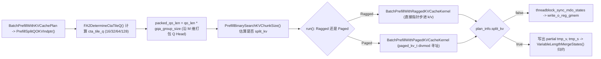
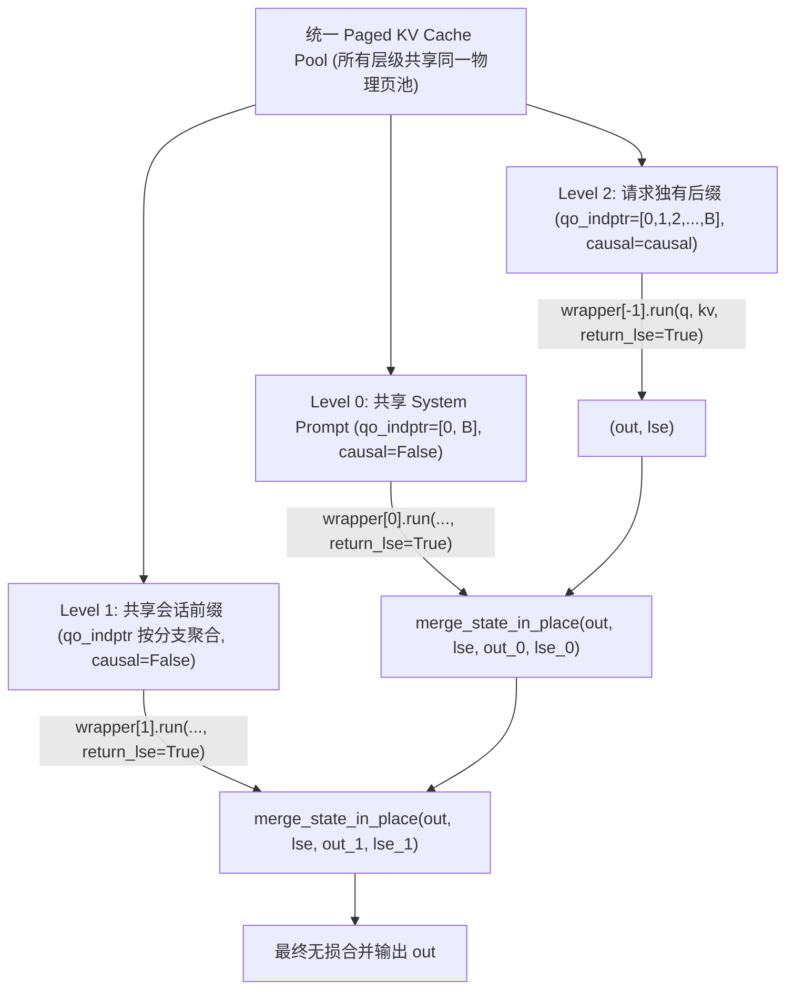
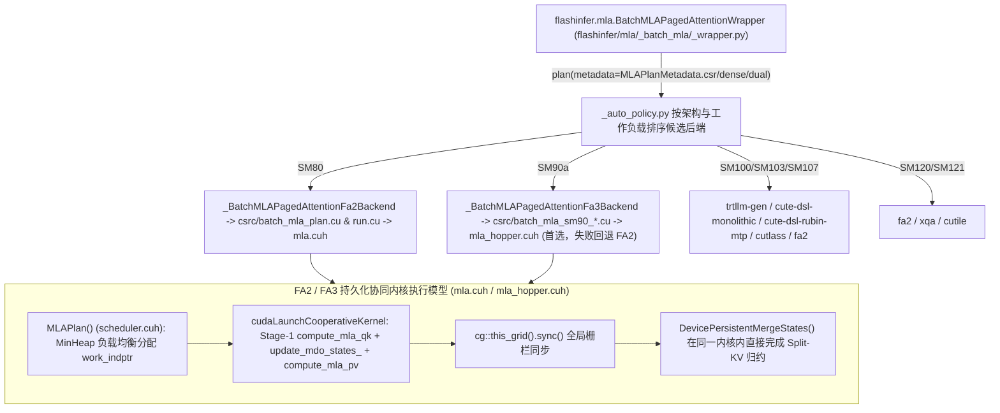

#ai #llm #gpu #flashinfer #cuda #prefill #cascade #mla

相关笔记：[[gpu-execution-and-memory-model]] | [[flashinfer-learning-roadmap]] | [[flashinfer-architecture-and-jit]] | [[flashinfer-paged-kv-and-decode-source]] | [[vllm-and-sglang]] | [[llm-inference-learning-path]]

# FlashInfer Ragged Prefill、Cascade 与 MLA 源码导读

> **源码版本边界**：本文所有文件路径、类与函数签名均对照 `FlashInfer v0.7.3 (commit 82caa5668, 审查日期 2026-11-17)` 核验。为避免随提交漂移，文中仅引用稳定符号名，不引用脆弱行号。

## 概述

如果说单步 Decode 的主题是“压榨 HBM 访存带宽”，那么 Prefill、Chunked Prefill、多级共享前缀（Cascade）以及 DeepSeek MLA 关注的核心则是：**如何在不等长变长批处理下消除 Padding 浪费、把 GQA/多 Token 计算喂饱 Tensor Core、跨请求复用公共前缀而无需物理拷贝 KV，以及在 Latent Space 中完成矩阵吸收**。

本文串联三组关键源码链路：

1. **Ragged / Paged Prefill 与 Chunked Prefill**：`flashinfer/prefill.py`、`csrc/batch_prefill.cu`、`csrc/batch_prefill_paged.cuh`、`include/flashinfer/attention/prefill.cuh`、`mask.cuh` 与 `variants.cuh`。
2. **Cascade Attention**：`flashinfer/cascade.py`、`csrc/cascade.cu` 与 `include/flashinfer/attention/cascade.cuh`。
3. **DeepSeek MLA**：`flashinfer/mla/`（`__init__.py`、`_core.py`、`_batch_mla/_wrapper.py`、`_batch_mla/_auto_policy.py`）、`include/flashinfer/attention/mla.cuh`、`mla_hopper.cuh` 及设计文档 `docs/design_docs/batch_mla_backend_architecture.md`。

---

## Ragged Tensors 与 Batch Prefill / Chunked Prefill

### Ragged Tensor 表示与两个 Wrapper 的分工

在 Continuous Batching 中，同一批请求的 Prompt 长度可能相差几个数量级（如 16 Token vs 32K Token）。若按最长序列补齐（Zero-Padding）成 `[batch, max_len, ...]`，不仅浪费大量显存，还会让 Tensor Core 计算大量无效乘加。FlashInfer 采用 **Ragged Tensor**（参看 `docs/tutorials/kv_layout.rst`）：

- 将批内所有请求的 Token 沿第 0 维紧凑拼接成一个无填充的二维/三维张量（`NHD` 下 `q` 形状为 `[qo_indptr[-1], num_qo_heads, head_dim_qk]`）。
- 使用 `int32` 类型的前缀和数组 `qo_indptr` 与 `kv_indptr`（长度 `batch_size + 1`）切分边界：第 `i` 个请求的 Query 切片为 `q[qo_indptr[i] : qo_indptr[i + 1]]`。

`flashinfer/prefill.py` 为此提供两个核心 Wrapper，二者共享同一套 C++ 调度器 `BatchPrefillWithKVCachePlan` -> `PrefillPlan`（`scheduler.cuh`）：

| Wrapper 类名 | Q 格式 | KV 存储形式 | 典型场景 | 底层入口 |
| --- | --- | --- | --- | --- |
| `BatchPrefillWithRaggedKVCacheWrapper` | Ragged (`qo_indptr`) | Ragged (`k`, `v` + `kv_indptr`) | 纯首轮 Prefill、无持久 Paged KV Pool 的变长自注意力 | `BatchPrefillWithRaggedKVCacheRun` -> `BatchPrefillWithRaggedKVCacheDispatched` |
| `BatchPrefillWithPagedKVCacheWrapper` | Ragged (`qo_indptr`) | Paged (`paged_kv_t`: `paged_kv_indptr`, `paged_kv_indices`, `paged_kv_last_page_len`) | **Chunked Prefill**、Prefix Cache 复用后的增量追加 Prefill、多 Token 投机验证（MTP） | `BatchPrefillWithPagedKVCacheRun` -> `BatchPrefillWithPagedKVCacheDispatched` |

在 **Chunked Prefill** 混批场景中（如 Sarathi / vLLM），调度器往往把长 Prompt 切为固定预算的 Chunk（例如 512 Token）并与正在 Decode 的请求（`qo_len = 1`）混在同一个 Batch 里：

- 历史已缓存前缀与刚追加的当前 Chunk 都位于 `paged_kv_cache` 中，而本轮需要计算 Attention 的新 Query Token 打包进 Ragged `q`（通过 `qo_indptr` 区分每个请求本轮推进多少 Token）。
- 当 `causal=True` 时，FlashInfer 统一采用 **右下角对齐（bottom-right causal alignment）**：Query 行 `q_idx` 允许看到所有满足 `kv_idx <= kv_len - qo_len + q_idx` 的历史与当前 Key。这一公式同时覆盖了完整 Prefill（`qo_len == kv_len`）、Chunked Prefill（`qo_len < kv_len`）以及投机解码验证（`qo_len = q_len_per_req`）。

### `PrefillPlan` 调度、GQA 打包与 Split-KV 数据流

在 `include/flashinfer/attention/scheduler.cuh` 的 `PrefillSplitQOKVIndptr` 中，有一个极其巧妙的 Tensor Core 适配技巧：

- **GQA 按行打包（Packed QO Rows）**：每个请求在同一时刻共有 `qo_len * gqa_group_size` 个共享同一 KV Head 的 Query 向量。调度器将 `packed_qo_len_arr[i] = (qo_indptr_h[i+1] - qo_indptr_h[i]) * gqa_group_size` 作为逻辑行维度 M，`FA2DetermineCtaTileQ`（`include/flashinfer/utils.cuh`）再据此选择 `cta_tile_q`（一般为 `16`、`64`、`128`，当 `head_dim >= 512` 启用 VO-split 时取 `16` 或 `32`）。这样哪怕每个请求只剩 `qo_len = 1` 或 `4`，只要 `gqa_group_size = 8`，`1 * 8` 也能填满 Tensor Core `m16n16k16` 指令的 M 维tile，避免计算单元空转。
- **CUDA Graph 下的弹性容量**：当 `enable_cuda_graph=True` 时，若提供 `uniform_q_len`（例如投机验证的固定 draft 步长），调度器按固定 `uniform_q_len * gqa_group_size` 估算 tile；否则按最坏变长界 `total_num_rows - batch_size + 1` 计算 `cta_tile_q`，并在 `PrefillPlanImpl` 中分配 `block_valid_mask` 与 `total_num_rows` 供 Replay 期间截断有效长度。

### CTA Tile 切分、Tensor Core MMA 与 Mask/Variant 抽象（`prefill.cuh`、`mask.cuh`、`variants.cuh`）

深入 `include/flashinfer/attention/prefill.cuh`，一个 CTA 的网格与线程几何为 `dim3 nblks(padded_batch_size, 1, num_kv_heads)` 与 `dim3 nthrs(32, NUM_WARPS_Q, NUM_WARPS_KV)`：

1. **共享内存双/复用缓冲与 Swizzle**：`SharedStorageQKVO` 在 SMEM 中布局 `q_smem`、`k_smem`、`v_smem` 并使用 `SwizzleMode::k128B` / `k64B` 消除 Bank Conflict。当 `HEAD_DIM_VO > 256`（如 512 维）且 K/V 形状兼容时，激活 `kVShareActive` / `USE_KV_SHARED_SMEM` 让 V 分时复用 `k_smem`，配合 `VOSplitSmem`（`p_smem` + `vosplit_md_smem`）确保在 99 KiB SMEM 的 GPU（如 SM86/89/120）上仍能正常发射。
2. **Tensor Core MMA 计算流**：
   - `load_q_global_smem` 将打包后的 `(qo_idx, qo_head)` 异步加载至 `q_smem`（若开启 `kRoPELlama` 则原地做 RoPE）。
   - `compute_qk`（或 FP8 专用 `compute_qk_fp8`）通过 `ldmatrix_m8n8x4` 从 SMEM 取数至寄存器 Fragment `a_frag` / `b_frag`，调用 `mma::mma_sync_m16n16k16_row_col_f16f16f32`（FP8 下为 `m16n16k32` 或经 `repack_kv_tile_to_16b` 解包回 16-bit MMA）累加注意力分数 `s_frag`。
   - `update_mdo_states` 执行以 2 为底的在线 Softmax 更新并把归一化后的局部概率转换成 16-bit `p_f16`。
   - `compute_sfm_v`（或大维度下的 `vosplit_compute_pv`）通过转置加载指令 `ldmatrix_m8n8x4_trans` 读取 V Tile 并执行 `mma_sync_m16n16k16_row_col_f16f16f32`，同时调用 `mma::m16k16_rowsum_f16f16f32` 累加分母 `d`。
   - 循环结束后，`threadblock_sync_mdo_states` 跨 `NUM_WARPS_KV` 归约最终 $(m, d, o)$，最后由 `write_o_reg_gmem` 写出 `o`（及 base-2 `lse`）。
3. **Mask 跳过与 Attention Variant 编译期注入**：
   - `include/flashinfer/attention/mask.cuh` 定义四种掩码模式：`MaskMode::kNone`、`kCausal`、`kCustom`、`kMultiItemScoring`。在 `prefill.cuh` 主循环中，Kernel 预先算出边界迭代索引 `mask_iteration` 与 `window_iteration`：只有处在因果对角线边界或滑动窗口边缘的迭代（或 `MaskMode::kCustom`）才会调用 `logits_mask`，中间完全可见的 KV Tile 零分支跳过 Mask 判断；`kv_start_idx` 还会直接跳过滑动窗口左边界之外的所有历史页。
   - `include/flashinfer/attention/variants.cuh` 通过继承 `AttentionVariantBase` 的 `DefaultAttention<use_custom_mask, use_sliding_window, use_logits_soft_cap, use_alibi>` 实现可组合的 `REGISTER_LOGITS_TRANSFORM`（ALiBi 斜率、Gemma-2 `tanh` Soft Cap）与 `REGISTER_LOGITS_MASK`（2D Ragged bit-packed `custom_mask`、局部窗口）。调用方还可通过 `jit_args` 注入自定义 Variant 扩展算子而不改动核心 MMA 循环。

---

## Cascade Attention：多层共享前缀的无拷贝合并

在多轮对话、System Prompt 共享、Few-Shot 或 Tree-of-Thoughts 推理中，多个请求共享前缀 KV Cache。如果直接把共享前缀复制给每个请求或在每个请求中重复读一次前缀页，Decode 阶段会把同一批共享页从 HBM 重复搬运 $B$ 次。

### `MergeState` / `MergeStates` 原语（`cascade.cuh` & `flashinfer/cascade.py`）

`include/flashinfer/attention/cascade.cuh` 提供了一组与底数 2 LSE 配套的合并 Kernel（由 `csrc/cascade.cu` 与 `flashinfer/cascade.py` 暴露）：

- `merge_state` -> `MergeStateKernel`：输入两对 `(v_a, s_a)` 与 `(v_b, s_b)`（`s_*` 为 base-2 LSE），利用 `ptx_exp2(max(s_a - s_max, -math::inf))` 计算比例系数 `a_scale`, `b_scale`，输出融合结果 `v_merged` 与 `s_merged = ptx_log2(d_sum) + s_max`。
- `merge_state_in_place` -> `MergeStateInPlaceKernel`：原地将 `(v_other, s_other)` 合并进 `(v, s)`，支持传入逐 Token 布尔 `mask` 跳过不需要合并的样本（CUDA Graph 友好）。
- `merge_states` -> `MergeStatesKernel` / `MergeStatesLargeNumIndexSetsKernel`：一次归约 `num_index_sets` 份部分结果；当集合数大于等于 `seq_len` 时启用 4-stage `cp.async` 流水线与 `threadblock_sync_state`。
- `VariableLengthMergeStates` -> `PersistentVariableLengthMergeStatesKernel`：供 Split-KV Prefill/Decode 与不等长分块归约使用，支持 `indptr` 变长分块数及 SM90+ PDL。

### `MultiLevelCascadeAttentionWrapper` 的分层执行逻辑

阅读 `flashinfer/cascade.py` 中 `MultiLevelCascadeAttentionWrapper` 的 `plan()` 与 `run()` 可以验证两个核心设计要点：

1. **按层聚合 Query 视角**：`MultiLevelCascadeAttentionWrapper` 内部持有一组 `BatchPrefillWithPagedKVCacheWrapper`（每层一个）。底层独有后缀层（`i = num_levels - 1`）保留各自请求的 `qo_indptr`；而上层共享前缀（如 `i = 0`）只需把共享同一前缀的一组请求在 `qo_indptr_arr[0]` 中合并成**一条逻辑请求**（例如 `[0, batch_size]`），使底层 `BatchPrefillWithPagedKVCacheWrapper` 将原本内存带宽受限的 $B$ 次小矩阵读取合并为一次高算术强度的 Tensor Core 矩阵乘法！
2. **因果掩码仅施加在最底层**：`plan()` 中明确将上层共享前缀的因果标记强制设为 `False`（`causal=causal if i == self._num_levels - 1 else False`）。原因在于所有处于子树的 Query Token 在序列位置上都严格位于共享前缀之后，对共享前缀的所有 Token 均完全可见；仅请求自身的独有后缀层内部才需要应用因果遮罩。`run()` 先计算底层得到 `(out, lse)`，再依次运行各上层 Wrapper 并调用 `merge_state_in_place(out, lse, out_i, lse_i)`。

---

## DeepSeek MLA（Multi-head Latent Attention）与矩阵吸收

### `ckv` / `kpe` 分离布局与 `paged_kv_mla_t`（`include/flashinfer/page.cuh`）

传统 MHA/GQA 对每个 Token 存储全尺寸的 `num_kv_heads` 组 K 与 V；而 DeepSeek-V2/V3/R1 的 MLA 将所有 Head 的 Key/Value 压缩为一个跨头共享的低维潜向量 $c_t^{KV} \in \mathbb{R}^{d_c}$（典型 `head_dim_ckv = 512`），再拼接一小段携带 RoPE 位置编码的共享向量 $k_t^R \in \mathbb{R}^{d_r}$（典型 `head_dim_kpe = 64`）。

在 `include/flashinfer/page.cuh` 中，`paged_kv_mla_t<DType, IdType>` 专门描述这种 **单 KV Head（`num_kv_heads = 1`）** 的分页布局：

- 存储由 `ckv_data`（`[max_num_pages, page_size, head_dim_ckv]`）与 `kpe_data`（`[max_num_pages, page_size, head_dim_kpe]`）组成，各自拥有独立步长 `stride_page_ckv` / `stride_n_ckv` 与 `stride_page_kpe` / `stride_n_kpe`。
- 由于没有多 KV Head 维度，MLA Paged KV 不再区分 `NHD` 与 `HND`；调用方既可分配一块连续 `[max_num_pages, page_size, 576]` 的 Packed Buffer 并通过零拷贝切片传给 `ckv` / `kpe`，也可在支持 `split` 合约的后端上传入独立分配的 `(ckv, kpe)` 对。

### Decode 阶段的 Weight Absorption（权重吸收）数学推导

在非吸收模式（常规 Prefill）下，每个 Head $h \in \{1 \dots H\}$（DeepSeek-V3/R1 中 $H=128$）都需要从潜向量升维还原 $K_{\text{nope}}^{(h)} = c_t^{KV} W_h^{UK}$ 与 $V^{(h)} = c_t^{KV} W_h^{UV}$（其中 $d_{\text{nope}} = d_v = 128$）。对于长度达数万 Token 的 Prefill，把升维矩阵乘与标准 Attention 拆开跑标准 Prefill Kernel 更划算；但在 **Decode（或少量 Token 增量验证）** 阶段，如果按 Token 还原出 128 个 Head 的 K 与 V，KV 显存读写量会暴涨约 32 倍。

FlashInfer `BatchMLAPagedAttentionWrapper`（`flashinfer/mla/_batch_mla/_wrapper.py` 文档字符串及 `flashinfer/mla/_utils.py`）针对的是 **Matrix Absorption（权重吸收）** 形式：

1. **QK 注意力打分的吸收**（沿用行向量约定 $q_{\text{nope}}^{(h)} \in \mathbb{R}^{1 \times d_{\text{nope}}}$、$q_{\text{pe}}^{(h)} \in \mathbb{R}^{1 \times d_r}$、$c_t^{KV} \in \mathbb{R}^{1 \times d_c}$、$k_t^R \in \mathbb{R}^{1 \times d_r}$，投影矩阵 $W_h^{UK} \in \mathbb{R}^{d_c \times d_{\text{nope}}}$ 向 Query 侧合并）：
   $$
   \text{score}_t^{(h)} = q_{\text{nope}}^{(h)} \left(c_t^{KV} W_h^{UK}\right)^\top + q_{\text{pe}}^{(h)} \left(k_t^R\right)^\top = \underbrace{\left(q_{\text{nope}}^{(h)} \left(W_h^{UK}\right)^\top\right)}_{\tilde{q}_{\text{nope}}^{(h)} \in \mathbb{R}^{1 \times d_c},\ d_c=512} \left(c_t^{KV}\right)^\top + q_{\text{pe}}^{(h)} \left(k_t^R\right)^\top
   $$
2. **PV 加权求和的吸收**（输出投影矩阵 $W_h^{UV} \in \mathbb{R}^{d_c \times d_v}$ 推迟到 Attention 归约之后）：
   $$
   o_{\text{nope}}^{(h)} = \sum_t p_t^{(h)} \left(c_t^{KV} W_h^{UV}\right) = \underbrace{\left(\sum_t p_t^{(h)} c_t^{KV}\right)}_{\tilde{o}^{(h)} \in \mathbb{R}^{1 \times d_c}} W_h^{UV} = \tilde{o}^{(h)} W_h^{UV}
   $$

经过吸收后，Attention Kernel 只需把输入接收为 `q_nope`（`[..., num_heads, 512]`）、`q_pe`（`[..., num_heads, 64]`）以及只存一份的 `ckv`（`512`）与 `kpe`（`64`），并在内部完成 `512 + 64 = 576` 维 QK 点积与 `512` 维 PV 累加（把 `ckv` 同时当成 K 的一部分和完整的 V！），输出 `out` 形状为 `[N, num_heads, 512]`，随后由外层 GEMM 乘以 $W^{UV}$ 与 $W^O$ 即可还原最终输出。注意 `sm_scale` 在吸收后通常仍沿用非吸收头维度计算，即 $1 / \sqrt{d_{\text{nope}} + d_{\text{rope}}} = 1 / \sqrt{128 + 64}$（参考 `docs/design_docs/batch_mla_backend_architecture.md`）。

### `BatchMLAPagedAttentionWrapper` 架构与 SM80/SM90+ 后端分发

对照 `docs/design_docs/batch_mla_backend_architecture.md`、`flashinfer/mla/_batch_mla/_wrapper.py` 与 `_auto_policy.py`，FlashInfer v0.7.3 的 Batch MLA 架构具有以下清晰分层：

1. **公私边界与状态契约**：公开入口全部收口在 `flashinfer.mla`（`BatchMLAPagedAttentionWrapper` 与 `MLAPlanMetadata`），`_contracts.py` 负责校验 `packed`、`split` 及零拷贝相邻视图重解释，`MLAInputContract` 在 `plan()` 成功发布时冻结运行契约，确保正常 `run()` 路径不发生后端探测、编译或整池拷贝。
2. **SM80 与 SM90a 持久化协同核（FA2 vs FA3）**：
   - **调度层（`MLAPlan` in `scheduler.cuh`）**：根据 `avg_packed_qo_len > 64` 决定 `cluster_size`（1 或 2），用最小堆 `MinHeap` 将各 `(request, qo_tile, kv_chunk)` 任务均衡分配到 `num_clusters = num_sm / cluster_size` 个逻辑簇上，并在一次调用中生成 18 个偏移量组成的 `MLAPlanInfo`。
   - **SM80 FA2（`include/flashinfer/attention/mla.cuh`）**：`BatchMLAPagedAttentionKernel` 使用 256 线程（`dim3(32, 4, 2)`），利用 `cp.async` 多级预取 `ckv_smem` 与 `kpe_p_smem`（其中 `kpe_p_smem` 在 QK 计算阶段存 KPE，在 `QK_SHARD=true` 的 PV 阶段通过 `stmatrix_m8n8x4` 复用作跨 Warpgroup 共享概率矩阵 `P` 缓存！），并用 `mma_sync_m16n16k16` 计算 `compute_mla_qk`（先算 `q_pe · kpe` 再累加 `q_nope · ckv`）和 `compute_mla_pv`（直接复用 `ckv_smem` 作为 V）。此外 `decode_mla_cute_sm80.cuh` 还提供基于 CuTe 布局的 SM80 函数式 Decode Kernel `BatchDecodeWithPagedKVCacheKernelMlaCuteSM80`。
   - **SM90 Hopper FA3（`include/flashinfer/attention/mla_hopper.cuh`）**：`BatchMLAPageAttentionHopperKernel` 利用 Hopper 原生 TMA 与 WGMMA（Warpgroup MMA），配合异步流水线屏障 `NamedBarriers` 实现生产者/消费者 Warpgroup 分工，同时在 FP8 KV 路径中支持将共享内存中的 FP8 `ckv` / `kpe` 经专用 `ckv_bf16` / `kpe_bf16` 缓冲就地反量化后再喂给 BF16xBF16 WGMMA。
   - **单内核两阶段融合**：FA2 与 FA3 均通过 `cudaLaunchCooperativeKernel` 启动持久化网格；Stage-1 写完局部 `partial_o` / `partial_lse` 后，直接在内核末尾调用 `grid.sync()` 并运行 `DevicePersistentMergeStates`，省去第二次 Kernel Launch 调度开销。
3. **Blackwell 及以上后端矩阵**：在 SM100/103/107 与 SM120+ 上，`_auto_policy.py` 根据工作量、CUDA Graph 模式与数据类型自动在 `trtllm-gen`、`cute-dsl-monolithic`、`cute-dsl-modular`、`cute-dsl-rubin-mtp`、`cutlass`、`xqa`、`fa2` 之间路由（或通过 `backend="autotune"` 配合 `AutoTuner` 进行实测择优），同时在 `use_cuda_graph=True` 模式下区分支持原地复用的 FA 预留 CSR 缓冲模型与其余后端的“首次计划固定指针”模型。

---

## 面试要点

### Q：为什么 `BatchPrefillWithPagedKVCacheWrapper` 能同时支撑 Chunked Prefill、Prefix Cache 增量 Prefill 以及多 Token 投机验证（MTP）？

> [!question]- 参考答案（点击展开）
>
> 因为这三种推理模式共享完全相同的张量代数结构：Query 侧是一批变长紧凑拼接的 Ragged Token（由 `qo_indptr` 描述每个请求本轮待推进或验证的 Token 数 `qo_len`），而 KV 侧是存在于分页池中的全部历史与当前 Token（由 `paged_kv_t` 描述，长度 `kv_len >= qo_len`）。`PrefillPlan` 按 `packed_qo_len = qo_len * gqa_group_size` 将 GQA 头打包到 Tensor Core M 维后，Kernel 统一使用 `kv_idx <= kv_len - qo_len + q_idx` 的右下角因果对齐掩码，因此一套 Paged Prefill Kernel 即可无缝覆盖任意组合的 Chunked Prefill、Prefix 续算以及 `q_len_per_req > 1` 的 Tensor Core 投机解码。

### Q：在 `MultiLevelCascadeAttentionWrapper` 中，为什么上层共享前缀要合并 `qo_indptr` 且把 `causal` 设为 `False`？

> [!question]- 参考答案（点击展开）
>
> 当批内多个请求共享同一段公共前缀（如系统提示词）时，对于共享前缀内的任意 Key Token，它在位置上都严格早于所有请求的当前 Query Token，因此每个 Query 对前缀都是全可见的，必须设 `causal=False`（`MultiLevelCascadeAttentionWrapper.plan()` 明确只对最后一层独有后缀保留用户传入的 `causal`）。同时由于这些请求访问完全相同的共享前缀物理页，将它们的 Query 在 `qo_indptr_arr[level]` 中聚合成同一逻辑条目后，底层 Tensor Core Prefill Kernel 就能一次把共享 KV 块加载到 Shared Memory 中同时服务多个请求的 Query 行，把原本重复读 $B$ 次前缀 KV 的内存瓶颈转化为高算术强度的矩阵乘，最后通过 `merge_state_in_place` 无损合回主输出。

### Q：DeepSeek MLA 的 Weight Absorption（权重吸收）数学本质是什么，为什么主要用在 Decode 而不是长序列 Prefill？

> [!question]- 参考答案（点击展开）
>
> 标准 MLA 先把低秩潜向量 $c_t^{KV} \in \mathbb{R}^{512}$ 经 $W^{UK}$、$W^{UV}$ 还原为多头 $K_{\text{nope}}, V \in \mathbb{R}^{128 \times 128}$ 再做 Attention。权重吸收利用矩阵结合律，把 $W_h^{UK}$ 乘到 Query 侧生成 $\tilde{q}_{\text{nope}}^{(h)} \in \mathbb{R}^{512}$，把 $W_h^{UV}$ 移到 Attention 加权求和之后再乘，从而使 Attention Kernel 直接在压缩后的 `ckv (512) + kpe (64)` 上执行（`BatchMLAPagedAttentionWrapper`），避免为历史每个 Token 存储或临时升维 128 个头的 K/V。它在内存带宽受限的 Decode 阶段能把 KV 访存体积降低数十倍；但在超长序列 Prefill 中，$Q$ 长度远大于头投影开销且算力是瓶颈，如果在每个 Query 上先把 $q$ 投影到 512 维再做大矩阵乘反而可能增加 FLOPs（$512$ 维 dot product 远大于 $128$ 维），因此长 Prefill 通常采用非吸收形态走标准 Prefill Kernel。

### Q：`BatchMLAPagedAttentionKernel` 与普通 `BatchDecodeWithPagedKVCacheKernel` 在 Split-KV 归约上的实现架构有什么差异？

> [!question]- 参考答案（点击展开）
>
> 普通的 Paged Decode 与 Prefill 在启用 Split-KV 时，通常先发射一次 Stage-1 Kernel 把分块结果写出到工作区 `tmp_v` / `tmp_s`，然后再单独发射一次 Stage-2 Kernel（`VariableLengthMergeStates`）读取并归约；而 `include/flashinfer/attention/mla.cuh`（FA2）与 `mla_hopper.cuh`（FA3）中的 `BatchMLAPagedAttentionKernel` / `BatchMLAPageAttentionHopperKernel` 采用 `cudaLaunchCooperativeKernel` 发射**持久化协同内核**（数量严格匹配 SM / Cluster 容量），在同一个内核内先循环消费 `MLAPlan` 分配的 `work_indptr` 任务块写出 `partial_o` / `partial_lse`，随后调用 `cg::this_grid().sync()` 全网格同步，紧接着在同一内核尾部直接执行 `DevicePersistentMergeStates` 完成归约并写出 `final_o`，消除了二次 Kernel 启动开销。
