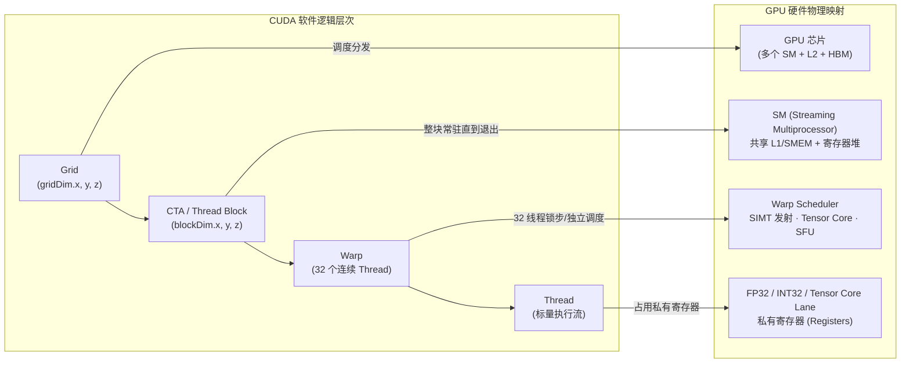
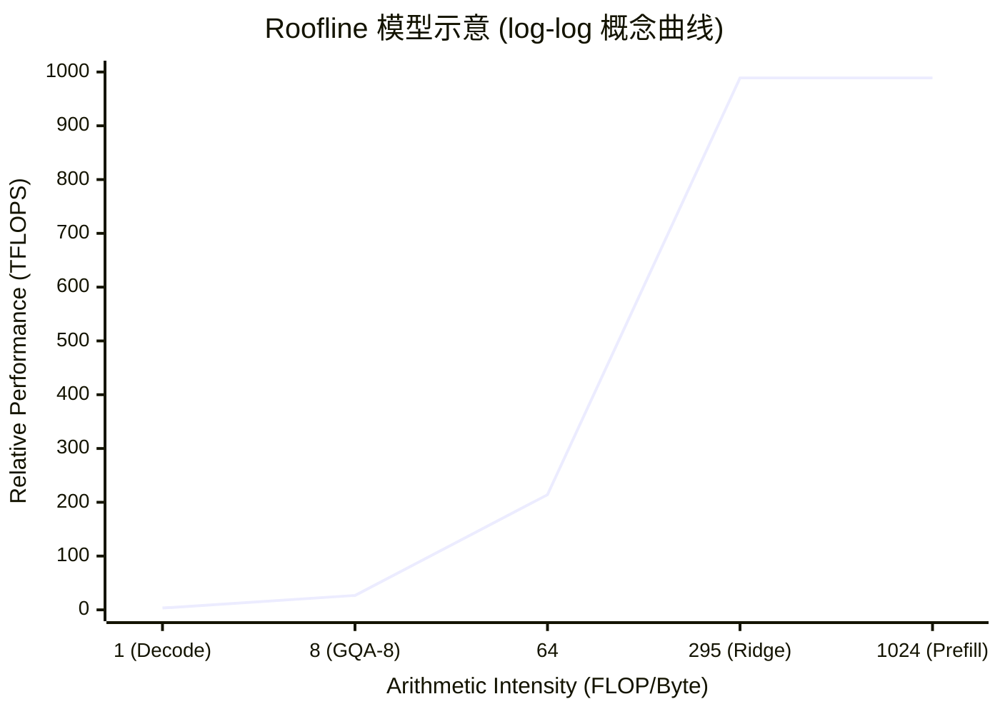

#ai #llm #gpu #cuda #roofline #softmax #flashinfer

相关笔记：[[flashinfer-learning-roadmap]] | [[flashinfer-architecture-and-jit]] | [[flashinfer-paged-kv-and-decode-source]] | [[flashinfer-norm-and-sampling-source]] | [[llm-inference-pipeline]] | [Online Softmax 与 Split-KV 离线实验](online-softmax-and-split-kv/README.md)

# GPU 执行、内存模型与 Online Softmax

## 概述

大模型推理服务的延迟与吞吐最终由 GPU 内核的执行效率决定。理解 FlashInfer 为什么这样切分任务（GQA 打包、Split-KV、Ragged 批处理）、为什么使用 128-bit 向量加载、以及为什么将 Attention 状态定义为 `state_t(m, d, o)`，必须建立在三块基石之上：**CUDA 执行层次与硬件调度**、**存储层次与 Roofline 算术强度分析**，以及 **Online Softmax 与可结合状态归并的数学推导**。

---

## CUDA 执行层次与硬件映射

CUDA 编程模型将并行计算组织为四级逻辑层次，运行时由硬件逐层映射到物理计算单元：



### 四级层次与关键硬件机制

1. **Grid（网格）与 Wave / Tail Effect（波次与尾波效应）**
   - 一个 Kernel 启动一个 Grid，包含若干 CTA（Cooperative Thread Array，即 Thread Block）。
   - 若一台 GPU 有 $N_{\text{SM}}$ 个 SM，每个 SM 最多同时驻留 $K_{\text{active}}$ 个 CTA（受共享内存、寄存器和线程数上限约束），则单波次容量为 $W = N_{\text{SM}} \times K_{\text{active}}$。
   - 如果 Grid 规模略高于 $W$（例如 $W + 1$），最后一个 CTA 会拖出一个仅利用 1 个 SM 的额外波次，即 **Tail Effect（尾波效应）**。FlashInfer 中多处通过 `cudaOccupancyMaxActiveBlocksPerMultiprocessor` 与 `cudaDevAttrMultiProcessorCount` 感知 SM 与驻留槽位（如 `include/flashinfer/norm.cuh` 的 `QKRMSNorm` 与 `include/flashinfer/air_top_p.cuh` 的 `CalcAirTopPBlockNum`）。
2. **CTA（Thread Block）与 Cluster**
   - 同一个 CTA 内的所有线程一定运行在**同一个 SM** 上，可以通过 Shared Memory 交换数据并用 `__syncthreads()` 同步。
   - 从 Hopper（SM90）开始引入 **Thread Block Cluster**，允许同一 Cluster 内的多个 CTA 通过分布式共享内存（Distributed Shared Memory, DSMEM）直接互相读写，而无需绕道 HBM（如 `include/flashinfer/sampling.cuh` 中 SM90 的 `SplitRowRejectionSamplingFromProbKernel`）。
3. **Warp（32 个线程）与 SIMT 执行**
   - 硬件调度最小单位是 **Warp（固定 32 个线程）**。Warp Scheduler 在每个时钟周期从就绪 Warp 中挑选指令发射，利用大量常驻 Warp 的零开销切换来隐藏 HBM 访存延迟（Latency Hiding）。
   - Warp 内线程若走不同 `if/else` 分支会产生 **Warp Divergence（分支发散）**，硬件需串行执行各分支路径并屏蔽非活跃通道。
   - **Occupancy（占用率）与寄存器压力权衡**：每个 SM 的 32-bit 寄存器总量有限（常见架构为 65,536 个）。单线程占用过多寄存器或 `blockDim` 过大时，单个 SM 能同时驻留的 CTA 数下降。内核常通过 `__launch_bounds__(maxThreadsPerBlock)` 提示编译器控制寄存器上限（如 `include/flashinfer/sampling.cuh` 针对 SM107 定义的 `FLASHINFER_SAMPLING_LAUNCH_BOUNDS`）。
4. **Warp Shuffle 原语与两级归约**
   - Warp 内 32 个线程可直接通过寄存器交换数据，完全不经过 Shared Memory。典型做法是 **蝴蝶归约（Butterfly Reduction）**，即 `include/flashinfer/math.cuh` 封装的 `flashinfer::math::shfl_xor_sync`（底层 PTX `shfl.sync.bfly.b32`）：`offset` 依次取 `16, 8, 4, 2, 1`，5 步即可完成 32 线程的求和或求最大值。
   - 跨 Warp 归约的标准范式（见 `include/flashinfer/norm.cuh` 的 `RMSNormKernel`）：先 Warp 内 `shfl_xor_sync` 归约 → 各 Warp 的 `lane 0` 写入 Shared Memory `smem[warp_id]` → `__syncthreads()` → 第 0 个 Warp 读入 `smem` 再做一次 `shfl_xor_sync` 得到全 Block 结果。
5. **计算单元分工：Tensor Core（MMA / WGMMA）与 SFU**
   - **Tensor Core**：专门执行矩阵乘累加（Ampere `mma.sync`、Hopper `wgmma`、Blackwell `tcgen05`），吞吐远高于普通 FP32 CUDA Core，是 Prefill 和 GEMM 的主力算力。
   - **SFU（Special Function Unit）**：硬件超越函数单元，执行 `ex2.approx.ftz.f32`（$2^x$）、`lg2.approx.ftz.f32`（$\log_2 x$）、`rcp.approx.ftz.f32`（$1/x$）、`rsqrt.approx.ftz.f32`（$1/\sqrt{x}$）。FlashInfer 在 `include/flashinfer/math.cuh` 中直接通过内联 PTX 封装这些指令以降低 Softmax 与 Norm 的指数/开方开销。

---

## 存储层次、合并访存与 Bank Conflict

### 四级存储层次对照

| 层级 | 作用域 | 典型容量级（架构相关） | 相对延迟/带宽特征 | FlashInfer 典型用途 |
| --- | --- | --- | --- | --- |
| **Registers（寄存器）** | 线程私有 | 每 SM 约 256 KB（65,536 × 32-bit） | 最高带宽（数十 TB/s 级）、约 1 周期 | 累加器 `state_t`、向量片段 `vec_t`、MMA 矩阵分片 |
| **Shared Memory / L1（SRAM）** | CTA 内共享（SM90+ 可跨 Cluster） | 每 SM 约 100–228 KB 可配置（opt-in） | 数十周期、极高片上带宽 | Tile 缓存 `Q/K/V`、归约暂存 `smem`、CUB `TempStorage` |
| **L2 Cache** | 全芯片所有 SM 共享 | 数十 MB（如 Hopper 50 MB 级） | 几百周期 | KV Cache 热点页复用、跨 CTA 共享权重 |
| **HBM（Global Memory）** | 全 GPU / Host 通信接口 | 数十 GB ~ 上百 GB（如 80–192 GB） | 数百周期、约 2–8 TB/s（主要性能瓶颈） | 模型权重、Paged KV 物理页池、输入输出张量 |

> 注：以上容量与带宽为当代数据中心 GPU（Ampere / Hopper / Blackwell）的数量级特征，不同具体型号以 NVIDIA 官方白皮书与 `cudaDeviceGetAttribute` 实测为准。

### 合并访存与 128-bit 向量化加载

- **合并访存（Memory Coalescing）**：当一个 Warp 内 32 个相邻线程同时访问全局内存中**连续且对齐**的地址区间时，内存控制器会将这 32 次请求合并为最少的 32B/128B 缓存行事务；若步长跨度大或地址随机分散（非连续 stride），每次请求可能退化为独立事务，有效带宽暴跌数倍甚至一个数量级。
- **128-bit 向量化加载（`int4` / `float4`）**：单条 CUDA 全局内存指令最高支持 128-bit（16 字节）传输（对应 SASS `LDG.E.128` / `STG.E.128`）。一次性加载 16 字节可显著减少指令发射数与地址计算开销。
  - 在 `include/flashinfer/vec_dtypes.cuh` 中，`vec_t<half, vec_size>`、`vec_t<nv_bfloat16, vec_size>`（`vec_size` 为 8 的倍数）及 `vec_t<float, vec_size>`（`vec_size` 为 4 的倍数）内部存储即为 `int4 data[...]`。
  - 各算子通过 `const uint32_t vec_size = std::gcd(16 / sizeof(T), d);` 配合 `DISPATCH_ALIGNED_VEC_SIZE` 选出能整除 `d` 的最大向量宽度（例如 FP16/BF16 下 `16 / 2 = 8` 个元素共 16 字节），确保行首和向量块自然对齐。

### Shared Memory Bank Conflict

- Shared Memory 被划分为 **32 个独立的 Bank**，按连续的 4 字节（32-bit word）轮询映射：`bank_id = (byte_addr / 4) % 32`。
- 若同一个 Warp 内多个线程同时访问**同一个 Bank 的不同 32-bit 地址**，硬件必须将访问串行化（N-way Bank Conflict 导致延迟乘以 N）；若多个线程读取**完全相同的地址**，硬件触发广播（Broadcast），无冲突。
- **工程规避手段**：
  - 矩阵 Tile 访问采用 **Swizzle 布局**（通过高位与低位 XOR 打散列索引与 Bank 的映射，常见于 CUTLASS / CuTe）。
  - 为每行填充奇数偏移或调整每线程处理元素数为奇数（如 `include/flashinfer/sampling.cuh` 中 `SplitRowRejectionSamplingFromProbKernel` 强制 `sub += (sub % 2 == 0) ? 1 : 0` 以避免顺序扫描时的 Bank Conflict），以及动态共享内存偏移按 16 字节对齐（如 `include/flashinfer/norm.cuh` 中的 `ceil_div(num_warps, 4) * 4`）。

### 异步拷贝与 PDL 重叠

- **`cp.async`（Ampere+）与 TMA（Hopper/Blackwell）**：传统全局内存到共享内存的路径需经过寄存器中转（`LDG` → 寄存器 → `STS`）；`cp.async` 允许直接将数据从 HBM 异步写入 Shared Memory 而不占用寄存器，TMA（Tensor Memory Accelerator）进一步将多维张量地址计算与边界检查卸载到专用硬件单元，实现多级流水线与计算掩盖访存。
- **PDL（Programmatic Dependent Launch，Hopper SM90+）**：允许同一 Stream 上相邻的两个 Kernel 重叠启动——后继 Kernel 可提前上卡完成参数与不依赖前驱结果的部分初始化，再通过 `asm volatile("griddepcontrol.wait;");` 等待前驱 Kernel 发出 `griddepcontrol.launch_dependents;` 信号后开始读取输出，消除 Kernel Launch Gap。这在 `include/flashinfer/norm.cuh` 和 `include/flashinfer/sampling.cuh` 中有大量原生使用。

---

## Roofline 模型与 Prefill / Decode 算术强度定量分析

**Roofline 模型**通过 **算术强度（Arithmetic Intensity, AI）** 判断算子受限于计算峰值还是显存带宽：

$$\text{AI} = \frac{\text{FLOPs}}{\text{Bytes Moved (HBM)}} \quad (\text{FLOP/Byte})$$

$$\text{Attainable Perf} = \min\Big(\text{Peak Compute},\ \text{AI} \times \text{Peak HBM Bandwidth}\Big)$$

拐点（**Ridge Point**）定义为 $\text{AI}_{\text{ridge}} = \frac{\text{Peak Compute}}{\text{Peak HBM Bandwidth}}$。以一台理论参考规格约 989 TFLOPS（FP16/BF16 Tensor Core 稠密算力）与约 3.35 TB/s HBM3 带宽的 Hopper 级 GPU 为例（仅作数量级教学示例），其拐点约为 $\text{AI}_{\text{ridge}} \approx 989 / 3.35 \approx 295\ \text{FLOP/Byte}$。



### 1. Linear / GEMM 对比：Prefill vs Decode

设批量内总 Token 数为 $M$，矩阵乘为 $[M, K] \times [K, N]$，权重与激活为 FP16/BF16（每元素 2 字节）：

- 计算量：$\text{FLOPs} = 2MKN$
- 最小 HBM 读写量：$\text{Bytes} = 2(MK + KN + MN)$
- 算术强度：

$$\text{AI}_{\text{GEMM}} = \frac{2MKN}{2(MK + KN + MN)} = \frac{1}{\frac{1}{N} + \frac{1}{M} + \frac{1}{K}}$$

- **Prefill 阶段**（例如 $M = 2048$ tokens，$K = N = 4096$）：$\text{AI}_{\text{GEMM}} \approx \frac{1}{\frac{1}{4096} + \frac{1}{2048} + \frac{1}{4096}} = 1024\ \text{FLOP/Byte} \gg 295$，完全处于屋顶平坦区，属于 **Compute-bound**。
- **Decode 阶段**（单请求 $M = 1$ 或小 Batch $M = 8$，$K = N = 4096$）：当 $M=1$ 时，$\text{AI}_{\text{GEMM}} \approx 1\ \text{FLOP/Byte} \ll 295$；即使 $M=8$，也只有约 $8\ \text{FLOP/Byte}$，远低于拐点，属于典型的 **HBM Bandwidth-bound**（绝大部分时间都在从 HBM 搬运模型权重）。

### 2. Attention 对比：Prefill vs Decode（GQA 的算术强度意义）

设上下文 KV 长度为 $S_{kv}$，查询长度为 $S_q$，头维度为 $d$，GQA 组大小（每个 KV Head 对应的 Query Head 数）为 $g = H_q / H_{kv}$，采用 FP16/BF16（2 字节）：

- **Prefill Attention（FlashAttention SRAM 分块）**：若不将 $S_q \times S_{kv}$ 注意力矩阵写回 HBM，只从 HBM 读一次 $Q, K, V$ 并写一次 $O$，则每个 KV Head 组内的 HBM 流量约为 $2(g S_q d + 2 S_{kv} d + g S_q d)$ 字节，计算量约 $4 g S_q S_{kv} d$ FLOPs（$QK^T$ 与 $PV$ 各 $2 g S_q S_{kv} d$）。当 $S_q = S_{kv} = L \gg d$ 时，$\text{AI}_{\text{Prefill-Attn}} \approx \frac{4 g L^2 d}{4(g+1)Ld} = \frac{g}{g+1} L$，随序列长度线性增长，迅速跨过 Ridge Point 进入 **Compute-bound**。
- **Decode Attention（$S_q = 1$）**：每步只需为 1 个新 Query 计算对全部 $S_{kv}$ 个历史 KV 的注意力。每个 KV Head 组内：
  - 计算量：$\text{FLOPs} \approx 4 \cdot g \cdot S_{kv} \cdot d$
  - HBM 搬运量（以读取 $K, V$ 为主导）：$\text{Bytes} \approx 2 \cdot (2 \cdot S_{kv} \cdot d) = 4 \cdot S_{kv} \cdot d$（读 $Q$、写 $O$ 与 $S_{kv}$ 无关，长上下文下可忽略）
  - 算术强度：

$$\text{AI}_{\text{Decode-Attn}} \approx \frac{4 g S_{kv} d}{4 S_{kv} d} = g\ \text{FLOP/Byte}$$

这个简洁的结论直接解释了 FlashInfer 核心设计的四个动机：

1. **MHA（$g=1$）只有 1 FLOP/Byte，GQA（如 $g=8$）可将 AI 提升至约 8 FLOP/Byte** —— 这要求 Kernel 将同一 KV Head 共享的 $g$ 个 Query Head **打包进同一个 CTA / MMA Tile（GQA Group Packing）**，把 KV 从 HBM 只读一次后在片上与多个 Q Head 计算，才能真正兑现这 $g$ 倍 AI 收益。
2. 即使 $g=8$（或 FP8/FP4 KV 量化将 HBM 字节数再砍 2×–4× 后到达 16–32 FLOP/Byte），Decode Attention 依然高度受限于 **HBM 带宽**。
3. **MLA（Multi-Head Latent Attention）** 将 $K, V$ 压缩为单一低秩潜在向量 `ckv` 存入 KV Cache，并在 Decode 阶段通过权重吸收直接用低维 `ckv` 计算注意力，进一步大幅压缩 HBM 搬运字节数。
4. 当 Batch Size 较小（$B \cdot H_{kv} \ll N_{\text{SM}}$）时，仅按 `(batch, kv_head)` 分配 CTA 会导致大量 SM 空闲；必须沿 $S_{kv}$ 维度做 **Split-KV**，让多个 CTA 协同吃满 GPU 的 HBM 内存控制器带宽，再做阶段二归并。

---

## 从 Safe Softmax 到 Online Softmax 与 FlashInfer `state_t` 的完整数学推导

### 1. Naive Softmax 与数值溢出

给定 logit 向量 $x = (x_1, x_2, \dots, x_N)$，标准 Softmax 定义为：

$$y_i = \frac{e^{x_i}}{\sum_{j=1}^{N} e^{x_j}}$$

当 $x_i > 88.7$（FP32）或 $x_i > 11.0$（FP16）时，$e^{x_i}$ 直接上溢为 `inf`，导致 `inf / inf = NaN`。

### 2. 3-Pass Safe Softmax

利用恒等式 $e^{x_i} / \sum_j e^{x_j} = e^{x_i - m} / \sum_j e^{x_j - m}$，取 $m = \max_{j=1}^N x_j$ 后所有指数输入 $\le 0$，彻底消除上溢且至少有一项为 $e^0 = 1$，防止下溢分母为 0：

- **Pass 1（求最大值）**：$m = \max_{j=1}^N x_j$
- **Pass 2（求归一化分母）**：$d = \sum_{j=1}^N e^{x_j - m}$
- **Pass 3（归一化输出）**：$y_i = \frac{e^{x_i - m}}{d}$

在 Attention 中，若令 $s_j = \frac{q \cdot k_j}{\sqrt{d_k}}$ 并计算 $O = \sum_{j=1}^N y_j v_j$，3-Pass 做法要求先把长度 $N$ 的 $s_j$ 写到 HBM，再回读两次计算 $m, d$ 和 $y_j$，长序列下形成 $O(N^2)$ 的 HBM I/O 瓶颈。

### 3. 2-Pass / 1-Pass Online Softmax 递推公式

**Online Softmax**（Milakov & Gimelshein, 2018）观察到在单次扫描序列元素 $x_1, \dots, x_N$ 时，无需预先知道全局最大值 $m_N$，只需在每一步同时维护“到目前为止的最大值 $m_k$”与“基于当前最大值校准过的局部指数和 $d_k$”：

定义截至第 $k$ 个元素时的精确局部状态：

$$m_k = \max_{1 \le j \le k} x_j, \qquad d_k = \sum_{j=1}^{k} e^{x_j - m_k}$$

当新元素 $x_k$ 到达时，令 $m_k = \max(m_{k-1}, x_k)$，将历史指数和从旧基准 $m_{k-1}$ 重新缩放到新基准 $m_k$：

$$d_k = \sum_{j=1}^{k-1} e^{x_j - m_k} + e^{x_k - m_k} = \left(\sum_{j=1}^{k-1} e^{x_j - m_{k-1}}\right) e^{m_{k-1} - m_k} + e^{x_k - m_k} = d_{k-1}\, e^{m_{k-1} - m_k} + e^{x_k - m_k}$$

对于独立 Softmax 算子（如 `include/flashinfer/sampling.cuh` 中的 `OnlineSoftmaxFusedKernel`），只需 **2-Pass**（Pass 1 一次流式求出最终 $(m_N, d_N)$，Pass 2 写回概率 $y_i = e^{x_i - m_N}/d_N$；若序列能缓存在 SMEM，甚至不需二次读全局内存）。

更关键的是，对于 **Attention 输出 $O = \sum_{j=1}^N \frac{e^{s_j - m_N}}{d_N} v_j$**，由于我们只需要加权和 $O$ 而不需要显式保存全部权重 $y_j$，可以在扫描 $K, V$ 块的同时维护未归一化分子向量 $o_k$：

$$o_k = \sum_{j=1}^{k} e^{s_j - m_k} v_j = o_{k-1}\, e^{m_{k-1} - m_k} + e^{s_k - m_k} v_k$$

扫描完整个序列后只需在片上做一次除法 $O = o_N / d_N$，从而实现 **1-Pass 融合 Attention（FlashAttention 核心思想）**：整个过程零中间注意力矩阵落盘 HBM。

### 4. 分块状态重缩放、结合律证明与 FlashInfer `state_t`

将序列任意切分为两个不相交的 KV 分块 $A$ 与 $B$，各自独立完成局部 Online Softmax 扫描，得到局部状态三元组：

$$S_A = (m_A,\, d_A,\, o_A), \qquad S_B = (m_B,\, d_B,\, o_B)$$

其中 $m_A = \max_{j \in A} s_j$，$d_A = \sum_{j \in A} e^{s_j - m_A}$，$o_A = \sum_{j \in A} e^{s_j - m_A} v_j$（$S_B$ 同理）。

现在合并 $A \cup B$，全局最大值必为 $m_{\text{new}} = \max(m_A, m_B)$。分别乘以缩放因子 $\alpha = e^{m_A - m_{\text{new}}}$ 和 $\beta = e^{m_B - m_{\text{new}}}$：

$$d_{\text{new}} = \alpha\, d_A + \beta\, d_B = \sum_{j \in A} e^{s_j - m_{\text{new}}} + \sum_{j \in B} e^{s_j - m_{\text{new}}} = \sum_{j \in A \cup B} e^{s_j - m_{\text{new}}}$$

$$o_{\text{new}} = \alpha\, o_A + \beta\, o_B = \sum_{j \in A} e^{s_j - m_{\text{new}}} v_j + \sum_{j \in B} e^{s_j - m_{\text{new}}} v_j = \sum_{j \in A \cup B} e^{s_j - m_{\text{new}}} v_j$$

#### 结合律与交换律证明

对任意三个不相交块 $A, B, C$，定义合并算子 $S_A \oplus S_B = (m_{\text{new}}, d_{\text{new}}, o_{\text{new}})$。由上式可见，合并结果的精确代数意义只依赖于集合并 $A \cup B$ 的全局最大值与指数加权和：

- **交换律**：$\max(m_A, m_B) = \max(m_B, m_A)$ 且加法可交换，故 $S_A \oplus S_B = S_B \oplus S_A$。
- **结合律**：无论是 $(S_A \oplus S_B) \oplus S_C$ 还是 $S_A \oplus (S_B \oplus S_C)$，最终 $m$ 均为 $\max(m_A, m_B, m_C)$，且每个样本 $j \in A \cup B \cup C$ 的累计缩放因子均为 $e^{s_j - m_{A \cup B}} \cdot e^{m_{A \cup B} - m_{A \cup B \cup C}} = e^{s_j - m_{A \cup B \cup C}}$（另一侧同理），在实数算术下严格相等（有限精度浮点仅存在微小舍入次序差异）。
- **单位元**：空块状态 $S_{\emptyset} = (-\infty,\, 0,\, \mathbf{0})$ 满足 $S_A \oplus S_{\emptyset} = S_A$（工程实现需保护 $(-\infty) - (-\infty)$ 产生 `NaN`）。

#### 与 FlashInfer `state_t` 和 `MergeStates` 的精确对应

查看 `include/flashinfer/attention/state.cuh`，FlashInfer 的核心状态结构体 `state_t<vec_size>` 正是这一公式的硬件友好实现：

```cpp
// 来自 include/flashinfer/attention/state.cuh（FlashInfer v0.7.3）
template <size_t vec_size>
struct state_t {
  vec_t<float, vec_size> o;  // 累加的加权 V（或 merge 前已缩放部分和）
  float m;                   // 以 2 为底的最大 logit（log2 域）
  float d;                   // 归一化分母 sum(2^(s - m))

  __device__ __forceinline__ float get_lse() const { return m + math::ptx_log2(d); }

  __device__ __forceinline__ void merge(const vec_t<float, vec_size>& other_o,
                                        float other_m, float other_d) {
    float m_prev = m, d_prev = d;
    m = max(m_prev, other_m);
    // max(..., -math::inf) 防止两个空状态合并时 (-inf) - (-inf) = NaN
    float f1 = math::ptx_exp2(max(m_prev - m, -math::inf));
    float f2 = math::ptx_exp2(max(other_m - m, -math::inf));
    d = d_prev * f1 + other_d * f2;
    for (size_t i = 0; i < vec_size; ++i) {
      o[i] = o[i] * f1 + other_o[i] * f2;
    }
  }
};
```

源码中有三个极重要的工程细节：

1. **为什么使用以 2 为底（`ptx_exp2` / `ptx_log2`）**：GPU 的 SFU 原生只提供 `ex2.approx.ftz.f32`（$2^x$）和 `lg2.approx.ftz.f32`（$\log_2 x$），标准自然指数 `expf(x)` 内部需要额外乘以 $\log_2 e$。FlashInfer 将常量 $\log_2 e$ 提前融合进注意力缩放系数 `sm_scale_log2 = params.sm_scale * math::log2e`（见 `include/flashinfer/math.cuh` 与 `include/flashinfer/attention/mla.cuh`），从而在注意力内循环中直接执行单指令 `ptx_exp2`。
2. **用 `LSE` 二元组等价表示 `(m, d, o)` 跨 Kernel 归并**：在 Split-KV Decode 或 Cascade Attention 的阶段一结束时，每个 CTA 调用 `normalize()` 得到已归一化局部输出 $\hat{O}_k = o_k / d_k$，只需把 $(\hat{O}_k, \text{LSE}_k)$ 写回中间显存（比传三元组少传一个标量，且 $\hat{O}_k$ 可直接存为 FP16/BF16 省带宽）。由于 $\text{LSE}_k = m_k + \log_2 d_k \implies 2^{\text{LSE}_k} = d_k \cdot 2^{m_k}$，阶段二的 `MergeStateKernel` / `MergeStates`（`include/flashinfer/attention/cascade.cuh`）只需计算：
   $$s_{\max} = \max(\text{LSE}_A, \text{LSE}_B), \quad w_A = 2^{\text{LSE}_A - s_{\max}}, \quad w_B = 2^{\text{LSE}_B - s_{\max}}$$
   $$O_{\text{merged}} = \frac{w_A}{w_A + w_B}\hat{O}_A + \frac{w_B}{w_A + w_B}\hat{O}_B, \quad \text{LSE}_{\text{merged}} = s_{\max} + \log_2(w_A + w_B)$$
   与合并 `(m, d, o)` 在代数上完全等价（当 `d_sum == 0` 时输出保持 0，避免 `0/0 = NaN`）。
3. **空状态防护**：在因果掩码、滑窗或变长空切片下，`m` 可能保持初值 `-math::inf`。`state_t::merge()` 与 `MergeStateKernel` 都通过 `max(m_prev - m, -math::inf)` 确保 `(-inf) - (-inf)` 被钳位为 `-inf` 再取 `ptx_exp2(-inf) = 0`，避免整个输出被 `NaN` 污染。

可在无 GPU 环境下运行 [Online Softmax 与 Split-KV 离线实验](online-softmax-and-split-kv/README.md) 亲自验证 `state_t` base-2 缩放与任意分块合并的数学等价性。

---

## 训练侧练习：区分提交时间与设备时间

GPU 工作通常异步提交。用 CPU 时钟只包住一次 `x @ w`，可能只测到提交时间。下面的例子适用于已安装 CUDA 版 PyTorch 的单卡环境；比较同一 stream 上前向矩阵乘和反向传播的设备耗时。它不含数据加载、主机到设备拷贝或优化器，不代表完整训练吞吐。

```python
import torch

x = torch.randn(1024, 512, device="cuda")
w = torch.randn(512, 512, device="cuda", requires_grad=True)
for _ in range(5):  # 排除首次初始化和预热
    (x @ w).sum().backward()
    w.grad = None
start, forward, backward = [torch.cuda.Event(enable_timing=True) for _ in range(3)]
start.record()
loss = (x @ w).sum()
forward.record()
loss.backward()
backward.record()
backward.synchronize()
print("forward_ms", start.elapsed_time(forward), "backward_ms", forward.elapsed_time(backward))
```

实际训练收集多次稳态 step，而非据一次读数排名。先用时间线对齐输入供给、H2D、各 stream 与 collective，定位占用关键路径的区间，再考虑用 kernel profiler 分析访存或指令。跨 stream 不能直接把各段持续时间相加当作墙钟时间。参见 [PyTorch CUDA 异步执行与计时](https://docs.pytorch.org/docs/stable/notes/cuda.html#asynchronous-execution)。此练习未在本仓库用 CUDA 实测，不预填耗时。

## 自检清单

- [ ] 能画出 Grid / CTA / Warp / Thread 到 GPU / SM / Warp Scheduler / Register / SMEM / HBM 的映射关系。
- [ ] 能写出基于 `shfl_xor_sync` 与 Shared Memory 的两级 Block 归约流程。
- [ ] 能解释 `vec_t` 128-bit 合并访存条件，以及 Shared Memory 32-Bank 冲突的成因与规避方法。
- [ ] 能独立推导出 Decode Attention 的算术强度 $\text{AI} \approx g$，并据此解释 GQA 打包、FP8 KV、MLA 和 Split-KV 的意义。
- [ ] 能手推 Online Softmax 状态转移与 `state_t::merge()` / `MergeStateKernel` 的结合律及 base-2 缩放等价性。

## 面试要点

### Q：为什么 Decode 阶段主要受限于 HBM 带宽，而 Prefill 往往受限于计算吞吐？

> [!question]- 参考答案（点击展开）
>
> 用 Roofline 的算术强度 $\text{AI} = \text{FLOPs} / \text{Bytes}$ 量化：在 Prefill 中，一次处理成百上千个 Token（$M = B \cdot L$），GEMM 与分块 FlashAttention 的计算量随 $M$ 或 $L^2$ 增长，而权重与 KV 只需读取少数次，AI 常达到数百甚至上千 FLOP/Byte，高于当代 GPU 约两三百 FLOP/Byte 的拐点，因此受 Tensor Core 算力限制；而在 Decode 中，每步每条请求只新增 1 个 Query Token，GEMM 退化为小 Batch 矩阵向量乘（$\text{AI} \approx B$），Attention 对每组 $g$ 个 Query Head 读取全部历史 KV 却只做少量点积与加权（$\text{AI} \approx g$，即使 GQA=8 也远低于拐点），因此绝大多数时间都在等待 HBM 搬运权重和 KV Cache。

### Q：如果 Decode Attention 改成 GQA（组大小 $g=8$）并使用 FP8 KV Cache，算术强度会如何变化？

> [!question]- 参考答案（点击展开）
>
> 在按 KV Head 组打包的前提下，一组 $g$ 个 Query Head 共享同一份从 HBM 读出的 $K, V$ 数据：HBM 读取字节数不变，总 FLOPs 变为 MHA 的 $g$ 倍，算术强度从约 1 FLOP/Byte 提升到约 $g$（即 8）FLOP/Byte；若进一步将 KV 存储从 FP16/BF16（2 字节）压缩为 FP8（1 字节），HBM 读取量减半，有效算术强度再翻倍到约 $2g$（即 16）FLOP/Byte。虽然吞吐明显提升，但仍显著低于百级 FLOP/Byte 的 Roofline 拐点，因此 Decode 依旧属于带宽受限阶段。

### Q：FlashInfer 为什么能把一条长序列的 KV 拆到多个 CTA 上并行计算，最后再做结果合并？

> [!question]- 参考答案（点击展开）
>
> 因为 Online Softmax 的状态三元组 $(m, d, o)$（或者等价的归一化输出与对数和 $(\hat{O}, \text{LSE})$）在合并算子 $\oplus$ 下满足**结合律与交换律**。只要各个 Split-KV CTA 分别记录各自切片的局部输出 $\hat{O}_k$ 与局部 $\text{LSE}_k = m_k + \log_2 d_k$，第二阶段的 `MergeStates` 就能按全局最大 $\text{LSE}_{\max}$ 精确重缩放各分片权重，得到与单 CTA 顺序扫描在代数上完全一致的结果，从而在 Batch 较小但序列很长时用更多 CTA 吃满所有 SM 的 HBM 带宽。

### Q：FlashInfer 的 `state_t` 为什么使用以 2 为底的指数（`ptx_exp2` / `ptx_log2`）而不是自然指数 `expf`？合并空状态时有什么边界陷阱？

> [!question]- 参考答案（点击展开）
>
> NVIDIA GPU 的 SFU 硬件指令原生提供 `ex2.approx.ftz.f32`（以 2 为底的指数）和 `lg2.approx.ftz.f32`（以 2 为底的对数），而自然指数 `expf(x)` 需要先做 `x * log2e` 再调用 `ex2`。FlashInfer 将 $\log_2 e$ 提前折叠进静态系数 `sm_scale_log2 = sm_scale * math::log2e`，因此 Attention 内循环和 `state_t::merge()` 都能直接用单指令 `ptx_exp2` 完成重缩放。边界陷阱在于：当两个分块都为空状态（`m = -inf`）时，直接计算 `m_prev - m` 会得到 `(-inf) - (-inf) = NaN`；FlashInfer 通过 `max(m_prev - m, -math::inf)` 将差值钳位，并在 `normalize()` 与 `MergeStateKernel` 中判断 `d > 0` / `d_sum > 0`，防止 `0/0` 污染整行结果。
