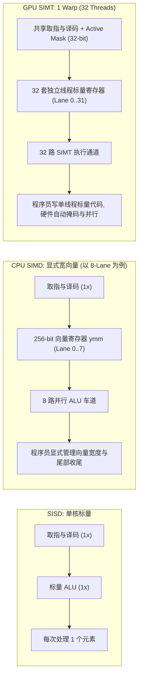
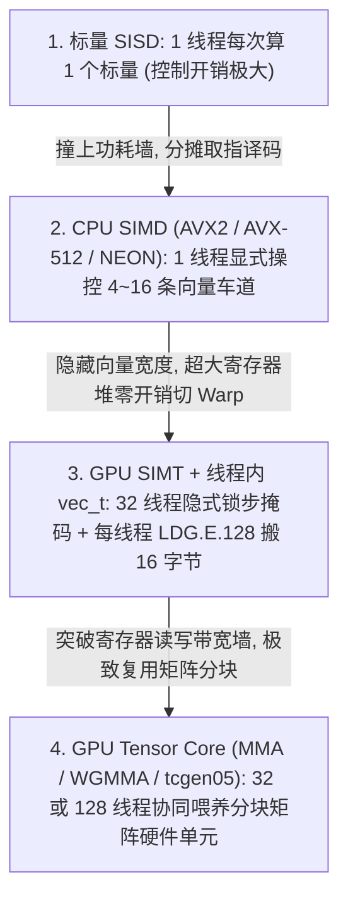

#ai #llm #gpu #cuda #simd #simt #tensor-core

相关笔记：[[linear-algebra-for-llm]] | [[advanced-algebra-for-llm]] | [[gpu-execution-and-memory-model]] | [[cuda-ecosystem-and-career-roadmap]] | [[flashinfer-intuition-and-engine-bridge]] | [[flashinfer-vllm-sglang-learning-path]] | [LLM 数学直觉与 SIMD 并行离线实验](../experiments/llm-math-and-simd-lab/README.md)

# 从 CPU SIMD 到 GPU SIMT：并行计算底层模型与向量化编程直觉

## 概述

几乎所有刚接触 CUDA 的开发者都会产生同一个困惑：**为什么 GPU 上明明有几万个线程并行，写高性能算子时还要讲究连续内存 Stride、还要让每个线程用 `float4` 一次搬 4 个数、还要小心翼翼避开 `if/else` 分支和指针越界**。

答案藏在硬件演进的脉络里：现代 GPU 的 **SIMT（Single Instruction, Multiple Threads）** 并不是凭空发明的魔法，而是从 **CPU SIMD（Single Instruction, Multiple Data）** 向量流水线一步步演化而来的硬件形态；而在 SIMT 之上，大模型时代的主力算力 **Tensor Core（MMA / WGMMA / `tcgen05`）** 又进一步演化成了“整个 Warp 乃至 Warpgroup 协同喂养矩阵乘硬件单元”的集体并行模型。

打通“**标量 SISD → 向量车道 CPU SIMD → 标量皮向量骨 GPU SIMT → 线程协同 GPU Tensor Core**”这条主线，再回头看 [[linear-algebra-for-llm]] 中的张量 `Stride` 布局与 [[gpu-execution-and-memory-model]] 中的合并访存、Warp Shuffle，所有底层规则都会变成顺理成章的物理直觉。

---

## Flynn 分类法与算力演进直觉：功耗墙后的数据并行

### 为什么单核主频停在 4~5 GHz，算力增长全靠数据并行

在 2004 年之前，芯片性能提升主要靠拉高时钟主频 $f$。但 CMOS 电路的动态功耗近似服从：

$$P \propto C \cdot V^2 \cdot f$$

其中 $C$ 是负载电容，$V$ 是工作电压，$f$ 是时钟频率。当晶体管尺寸微缩到纳米级后，漏电功耗急剧上升（Dennard Scaling 失效），为了在更高频率 $f$ 下保持信号稳定，往往还必须同步提高电压 $V$，导致功耗随频率呈近似立方级（$P \propto f^3$）暴涨——这就是著名的**功耗墙（Power Wall）**。与此同时，单线程内部的**指令级并行（ILP，超标量乱序执行）**也撞上了收益递减墙。

既然“让 1 个执行单元每秒挥刀更快”走不通了，芯片架构师转向了更划算的账本：**每执行一条指令，前端的“取指（Fetch）→ 译码（Decode）→ 发射（Issue）”控制电路都要消耗可观的芯片面积和功耗；如果只取指译码 1 次，却同时驱动 8 个甚至 32 个算术逻辑单元（ALU）对一批整齐的数据做相同运算，就能用极小的控制开销换来成倍的算力增长**。这正是大模型矩阵乘、向量点积和归一化天然契合的**数据并行（Data Parallelism）**。

### 厨房切菜比喻：一眼看穿 SISD、SIMD 与 SIMT

结合经典的 **Flynn 分类法**（按指令流 Instruction Stream 与数据流 Data Stream 的单/多组合划分）及 NVIDIA 扩展的 SIMT 模型，我们可以用“厨房切黄瓜”把三者的硬件本质一次性立住：

1. **SISD（Single Instruction, Single Data，传统单核标量执行）**：
   - **画面**：**1 个厨师拿 1 把普通菜刀，看一眼菜谱（取指译码），切 1 段黄瓜**。要切 32 根黄瓜，就得低头看 32 次菜谱、挥 32 次刀，大量精力花在“看菜谱”的控制流程上。
2. **SIMD（Single Instruction, Multiple Data，CPU 向量指令集如 AVX2 / NEON）**：
   - **画面**：**还是这 1 个厨师，但他换了一把绑着 8 片平行刀刃的“排刀”**。看 1 次菜谱，手起刀落，砧板上**并排摆齐的 8 根黄瓜**同时被切断。
   - **关键约束**：厨师自己（也就是写代码的程序员或编译器）必须操心两件事——第一，切之前必须把 8 根黄瓜在砧板上**紧挨着排成一条直线**（连续内存）；第二，如果篮子里总共只有 19 根黄瓜，前两刀切掉 $8 + 8 = 16$ 根后，**剩下 3 根不够排满一把排刀**，厨师必须换回普通单刀一根根收尾（标量尾部循环 Remainder Loop）。
3. **SIMT（Single Instruction, Multiple Threads，GPU Warp 执行模型）**：
   - **画面**：**厨房里站着一排 32 个学徒（1 个 Warp = 32 Threads），面前只有 1 个厨师长拿着大喇叭喊同一声口令：“切！”32 个学徒听到口令后，各自挥刀切自己手头那根黄瓜**。
   - **精妙之处**：从物理厨房成本看，只请了 **1 个喊口令的厨师长**（共享同一套取指/译码前端，底层硬件依然是 32 车道的宽 SIMD 引擎）；但从管理视角看，每个学徒都有自己的工号（`threadIdx.x`）和私人小案板（私有寄存器）。如果只有 19 根黄瓜，厨师长照样对全排喊一声：“工号小于 19 的人，切！”19~31 号学徒听到后自动把刀背过去站着不动（硬件 **Active Mask 活跃掩码**屏蔽），你再也不用在代码里手写繁琐的“排刀切整块 + 单刀收零头”两套逻辑。



| 分类维度 | SISD | CPU SIMD | MIMD（多核 CPU / 多 SM 间） | GPU SIMT（单 Warp 内） |
| --- | --- | --- | --- | --- |
| **指令流 × 数据流** | 单指令 × 单数据 | 单指令 × 多数据（向量车道） | 多指令 × 多数据（独立核心） | 单指令广播 × 多线程状态 |
| **编程视角** | 单线程标量 `float` | 显式向量类型 `__m256`（宽度暴露） | 多线程/多进程独立控制流 | **单线程标量语法**（宽度对代码隐藏） |
| **硬件寄存器组织** | 少量标量寄存器 | 16~32 个宽向量寄存器（128~512-bit） | 每核独立寄存器组 | **每线程独立标量寄存器堆**（硬件打包成宽组） |
| **边界与分支处理** | 硬件分支预测 + 跳转 | 程序员写掩码 `blend` + 标量余数循环 | 各核独立分支跳转 | **硬件 Active Mask 自动屏蔽非活跃车道** |

> 架构定位提示：整块 GPU 从全局看是 **SIMT 与 SPMD/MIMD 的混合体**——同一个 Warp 内的 32 个线程按 SIMT 协同执行；而分布在不同 SM（Streaming Multiprocessor）上的数十上百个 CTA / Warp 拥有各自独立的调度器，彼此之间属于异步并行的 MIMD 形态。

---

## CPU SIMD 核心机制：从向量车道到编译器向量化边界

在深入 GPU 之前，先看清 CPU 是如何压榨单核向量吞吐的。掌握了这里的 **Lane（车道）**、**Stride（步长）**、**FMA**、**Shuffle（洗牌归约）** 与 **Predicate Mask（谓词掩码）**，你就已经握住了 GPU 内核优化一半的钥匙。

### 主流 CPU SIMD 指令集谱系

| 架构阵营 | 指令集代际 | 向量寄存器位宽 | 寄存器命名与数量（64 位模式） | 单寄存器可容纳 `FP32` / `FP16` 元素数 | 关键里程碑特性 |
| --- | --- | --- | --- | --- | --- |
| **x86-64** | SSE ~ SSE4.2 | 128-bit（16B） | `xmm0` ~ `xmm15`（16 个） | 4 个 FP32 / 8 个 FP16 | 基础 128 位浮点向量化 |
| **x86-64** | AVX / **AVX2 + FMA** | 256-bit（32B） | `ymm0` ~ `ymm15`（16 个） | **8 个 FP32** / 16 个 FP16 | 三操作数非破坏性编码、FMA3、256 位整数与 Gather |
| **x86-64** | **AVX-512**（及 AVX10） | 512-bit（64B） | `zmm0` ~ `zmm31`（32 个）+ `k0`~`k7` | **16 个 FP32** / 32 个 FP16/BF16 | 原生 **8 个硬件谓词掩码寄存器 `k0`~`k7`**、VNNI/BF16 点积 |
| **ARM64** | **NEON（ASIMD）** | 128-bit（16B） | `v0` ~ `v31`（32 个） | 4 个 FP32 / 8 个 FP16 | Apple Silicon（M1~M4）与 ARM 服务器标配，32 个寄存器抗溢出强 |
| **ARM64** | **SVE / SVE2** | 128 ~ 2048-bit 可变 | `z0` ~ `z31` + 谓词 `p0`~`p15` | 硬件决定（常见 256/512-bit） | **VLA（向量长度无关编程）**：同一份二进制代码自适应不同硬件位宽，理念最接近 SIMT |

### 向量寄存器与车道（Lane）手算演示

所谓**车道（Lane）**，就是把一个宽向量寄存器等分成若干个定长标量格子。以 x86 **AVX2 的 256-bit 寄存器 `ymm`** 为例：

- 若存放 `float`（FP32，32-bit = 4 字节）：$256 / 32 = 8$ 条车道（`Lane 0` ~ `Lane 7`）。
- 若存放 `half` / `bf16`（16-bit = 2 字节）：$256 / 16 = 16$ 条车道（`Lane 0` ~ `Lane 15`）。
- 若存放 `int8` / `fp8`（8-bit = 1 字节）：$256 / 8 = 32$ 条车道（`Lane 0` ~ `Lane 31`）。

**手算小例子**：计算两个长度为 8 的向量逐元素相乘再相加（FMA：$c_i \leftarrow a_i \times b_i + c_i$）：

```text
内存连续数组 a: [ 1.0,  2.0,  3.0,  4.0,  5.0,  6.0,  7.0,  8.0 ]  --> 1 条 vmovups 装入 ymm0
内存连续数组 b: [10.0, 10.0, 10.0, 10.0, 20.0, 20.0, 20.0, 20.0 ]  --> 1 条 vmovups 装入 ymm1
内存连续数组 c: [ 0.5,  0.5,  0.5,  0.5,  1.0,  1.0,  1.0,  1.0 ]  --> 1 条 vmovups 装入 ymm2
                  │     │     │     │     │     │     │     │
                  ▼     ▼     ▼     ▼     ▼     ▼     ▼     ▼    (1 条 vfmadd231ps 指令，8 车道同步完成)
结果寄存器 ymm2: [10.5, 20.5, 30.5, 40.5, 101., 121., 141., 161. ]  --> 1 条 vmovups 写回内存
```

原本标量循环需要 **8 次加载 `a` + 8 次加载 `b` + 8 次加载 `c` + 8 次乘法 + 8 次加法 + 8 次写回 + 8 次循环计数跳转 = 56 条操作**，向量化后坍缩为 **3 条向量加载 + 1 条向量 FMA + 1 条向量存储 = 5 条指令**！

### 连续访存、对齐（Alignment）与 Memory Stride 陷阱

向量算得再快，前提也是数据能整排喂进向量寄存器：

1. **对齐加载 vs 非对齐加载（Aligned vs Unaligned Load）**：
   - CPU 与各级 Cache 之间按 **64 字节 Cache Line（缓存行）** 搬运数据。如果数组首地址按 32 字节（AVX2）或 64 字节（AVX-512）对齐（如 `posix_memalign` 或 PyTorch 默认 64B 对齐分配器），一条 `_mm256_load_ps`（`vmovaps`）必定落在同一条 Cache Line 内。
   - 若地址未对齐（使用 `_mm256_loadu_ps` / `vmovups`），虽然现代 CPU 硬件支持非对齐读取而不报错，但一旦一次 32 字节读取**横跨两条 64B Cache Line 边界（Cache Line Split）**，加载单元就必须拆成两次缓存访问再拼接，吞吐显著下滑。
2. **Memory Stride（内存步长）陷阱**：
   - 回忆 [[linear-algebra-for-llm]] 中的张量步长定义：假设矩阵 `M` 形状为 `[1024, 1024]`（行主序 Row-major，`stride = (1024, 1)`）。
   - **顺着行读（`M[row, 0..7]`，`stride = 1`）**：8 个 `float`（32 字节）在物理内存中紧挨着，1 条 `vmovups` 满载而归，Cache Line 有效利用率 **100%**。
   - **顺着列读（`M[0..7, col]`，`stride = 1024`）**：相邻两个元素在物理内存中相隔 $1024 \times 4 = 4096$ 字节！无法使用连续向量加载，只能退化为慢速的 `_mm256_i32gather_ps`（`vgatherdps` 散聚指令）或 8 次独立标量加载。更致命的是，每次为了取 **4 字节**元素，硬件都要从内存拉进整条 **64 字节** Cache Line，其余 60 字节全作废，**有效内存带宽直接暴跌 16 倍（仅剩 6.25%）**！这正是无论在 CPU SIMD 还是 GPU `float4` 访存中，“**最内层计算维度必须物理连续（`stride == 1`）**”的根本物理原因。

### FMA（Fused Multiply-Add）：单周期双倍算力与单次舍入精度

大模型里 99% 的算力消耗在点积与矩阵乘法的核心操作 $d = a \times b + c$ 上。现代 CPU（AVX2/AVX-512/NEON）与 GPU 全部内置硬件 **FMA（融合乘加）** 单元，带来双重红利：

1. **算力翻倍**：一条 FMA 指令在单个发射周期内同时完成 **1 次乘法 + 1 次加法**（计为 **2 FLOPs**）。例如一颗拥有 2 个 512-bit FMA 端口的 AVX-512 CPU 核心，单周期即可完成 $2\text{ (端口)} \times 16\text{ (FP32 车道)} \times 2\text{ (乘+加)} = 64\text{ FLOPs}$！
2. **IEEE 754 单次舍入（Single Rounding）更高精度**：若分开执行 `mul` + `add`，乘法结果 $a \times b$ 会先截断舍入一次成 32-bit 浮点，再与 $c$ 相加截断第二次；当 $a \times b$ 与 $-c$ 大小极为接近时（灾难性抵消），第一次截断丢失的尾数将无法挽回。而硬件 FMA 在内部使用**全精度中间乘积**直接与 $c$ 相加，最后**只做唯一一次舍入**，在大维度累加（如 `head_dim = 128` 或 `hidden_size = 4096`）中数值更稳。

### 跨车道洗牌与水平归约（Shuffle & Horizontal Reduction）

SIMD 最喜欢各车道“老死不相往来”的**垂直运算（Vertical Ops）**，如逐元素加、ReLU；但做向量点积 $\sum_{i=0}^{N-1} q_i k_i$ 或 RMSNorm 求平方和 $\sum x_i^2$ 时，最后必须把同一个向量寄存器里 8 条车道的局部和加成一个标量——这叫**水平归约（Horizontal Reduction）**。

千万不要一上来就在循环里对每次乘积做水平归约！正确范式是：**先在循环内用向量寄存器做 $N/8$ 轮垂直 FMA 累加得到 8 个部分和 `acc[0..7]`，等整个循环跑完后，只在收尾做一次树形洗牌折半归约（Tree Reduction）**：

```text
循环结束后的 8-lane 累加器 acc: [ s0, s1, s2, s3 | s4, s5, s6, s7 ]
                                  └──────┬──────┘   └──────┬──────┘
Step 1 (提取高 128-bit 与低 128-bit 相加):
  low128 + high128           -> [ s0+s4, s1+s5, s2+s6, s3+s7 ]  (剩 4 lanes)
Step 2 (跨车道洗牌 permute/movehl 折半相加):
  [s0+s4, s1+s5] + [s2+s6, s3+s7] -> [ s0+s2+s4+s6, s1+s3+s5+s7 ]  (剩 2 lanes)
Step 3 (最后两车道相加提取标量):
  lane0 + lane1              -> s0 + s1 + s2 + s3 + s4 + s5 + s6 + s7 (仅需 log2(8) = 3 步!)
```

你会发现，这套“**跨车道洗牌对折求和（$\log_2 W$ 步）**”的思想，到了 GPU 上就原封不动变成了 **Warp Shuffle 蝴蝶归约（`__shfl_xor_sync`，$\log_2 32 = 5$ 步）**！你可以在本地直接运行 [LLM 数学直觉与 SIMD 并行离线实验](../experiments/llm-math-and-simd-lab/README.md) 观察 8-lane 树形归约的精确执行过程。

### 分支如何用谓词掩码（Predicate Mask / Blend）消除跳转

如果循环里写了 `y[i] = (x[i] > 0.0f) ? x[i] : 0.0f`（ReLU）或因果注意力掩码 `s[j] = (j <= q_idx) ? s[j] : -INFINITY`，8 条车道里有的满足条件、有的不满足，CPU 只有 1 个程序计数器（PC），没法让半把排刀跳走、半把排刀留下。若退回标量 `if/else` 并且数据正负随机分布，CPU 分支预测器频繁猜错（Branch Misprediction），每次冲刷十几级超标量流水线就要白白损失 **15~20 个时钟周期**。

SIMD 的解法是**用数据选择（Blend / Mask）代替控制流跳转**：

```text
输入向量 x         : [ -2.0,  3.5, -0.1,  4.2, ... ]
零向量   zero      : [  0.0,  0.0,  0.0,  0.0, ... ]
1. 向量比较 x > 0  : [ 0x00000000, 0xFFFFFFFF, 0x00000000, 0xFFFFFFFF, ... ] (生成车道掩码 Mask)
2. 按位与 / Blend  : [  0.0,  3.5,  0.0,  4.2, ... ] (全程 0 跳转, 恒定延迟流水线直通!)
```

在 AVX-512 与 ARM SVE 中，这种掩码更是直接升格为硬件一等公民——专用谓词寄存器（如 `k1`）：指令写成 `vaddps zmm0 {k1}, zmm1, zmm2`，表示“只有 `k1` 对应比特为 `1` 的车道才写回结果，`0` 的车道保持不变或填零”。**请死死记住这个 `k1` 掩码寄存器——把它从 16 位扩成 32 位并交给硬件自动管理，就是 GPU Warp 的 Active Mask！**

### 编译器自动向量化失败的三大常见原因与代码实例

现代 C++ 编译器（`gcc -O3 -mavx2 -mfma` / `clang -O3`）自带循环自动向量化器（Auto-Vectorizer），但在实际工程中经常静默退化回慢速标量循环（可通过 `-fopt-info-vec-missed` 或 `-Rpass-missed=loop-vectorize` 检查）。最常见的三大元凶如下：

1. **指针别名（Pointer Aliasing）与缺失 `__restrict__`**：
   ```cpp
   // 编译器不敢自动向量化（或被迫插入运行时重叠检查分支）：
   // 万一调用方传入 c = a + 1，写 c[0] 就会改写即将读取的 a[1]（循环携带依赖）！
   void scale_add_bad(const float* a, const float* b, float* c, int n) {
       for (int i = 0; i < n; ++i) c[i] = a[i] * 2.0f + b[i];
   }

   // 加上 __restrict__：向编译器立下契约“c 指向的内存绝不与 a、b 重叠”，立刻放出满速 AVX2/NEON 指令！
   void scale_add_good(const float* __restrict__ a,
                       const float* __restrict__ b,
                       float* __restrict__ c, int n) {
       for (int i = 0; i < n; ++i) c[i] = a[i] * 2.0f + b[i];
   }
   ```
   > 工程呼应：打开 FlashInfer 的 `include/flashinfer/` 源码，你会看到内核指针参数大量标注了 `__restrict__`，作用同样是帮助 `nvcc`/`cicc` 消除内存别名顾虑，放心重排加载指令并利用只读数据缓存！
2. **非连续间接寻址（Gather / Scatter）**：如 `out[i] = weight[token_ids[i]]`，编译器难以证明每次散聚比标量更快，或受限于硬件 Gather 端口吞吐。
3. **浮点加法不满足严格结合律与循环内早退**：IEEE 754 浮点数因舍入误差不满足 `(a + b) + c == a + (b + c)`。写标量点积 `sum += a[i] * b[i]` 时，若不开启 `-ffast-math` 或显式标注 `#pragma omp simd reduction(+:sum)`，编译器为了严格保持从左到右串行舍入顺序，**不敢拆成 8 条并行 SIMD 车道累加**！此外，包含未内联外部函数调用或数据依赖 `break` 的循环也会阻断自动向量化。

下面是一段标准的手写 AVX2 + FMA 向量点积代码，请留意它的**显式 8 车道管理与尾部收尾代码量**：

```cpp
#include <immintrin.h>

float dot_product_avx2(const float* __restrict__ a, const float* __restrict__ b, int n) {
    __m256 acc = _mm256_setzero_ps();  // 8 条 FP32 车道清零
    int i = 0;
    // 主循环：每次跨 8 个元素，显式绑死 256-bit 宽度
    for (; i + 8 <= n; i += 8) {
        __m256 va = _mm256_loadu_ps(a + i);
        __m256 vb = _mm256_loadu_ps(b + i);
        acc = _mm256_fmadd_ps(va, vb, acc);  // acc = va * vb + acc
    }
    // 树形水平归约：256-bit -> 128-bit -> 标量
    __m128 low  = _mm256_castps256_ps128(acc);
    __m128 high = _mm256_extractf128_ps(acc, 1);
    __m128 sum4 = _mm_add_ps(low, high);
    __m128 shuf = _mm_movehdup_ps(sum4);
    __m128 sum2 = _mm_add_ps(sum4, shuf);
    shuf        = _mm_movehl_ps(shuf, sum2);
    float total = _mm_cvtss_f32(_mm_add_ss(sum2, shuf));

    // 标量收尾循环（Remainder Loop）：处理 n % 8 剩下的零头元素
    for (; i < n; ++i) {
        total += a[i] * b[i];
    }
    return total;
}
```

---

## 从 SIMD 跨向 GPU SIMT 的关键跃迁

看完上面这段 AVX2 代码，CPU SIMD 的三大工程痛点跃然纸上：
1. **指令集宽度强耦合**：从 SSE（4 车道）换到 AVX2（8 车道）再换到 AVX-512（16 车道）或 ARM NEON（4 车道），Intrinsics 代码几乎要重写一遍。
2. **控制流与尾部边界繁琐**：随便加个复杂分支或非整倍数边界，就要手搓一堆掩码 Blend 和收尾循环。
3. **核内向量与核间线程割裂**：在多核 CPU 上跑满算力，外层要用 OpenMP/线程池切分多核（MIMD），内层还要手写 AVX/NEON 切分车道（SIMD），两套并行心智负担叠加。

### 为什么 NVIDIA 把 32 个线程绑成一个 Warp

2006 年 G80（Tesla 架构）推出 CUDA 时，NVIDIA 做出了计算架构史上极具决定性的设计：**把硬件宽 SIMD 向量单元彻底藏到幕后，对外统一暴露“单线程标量编程接口”，在硬件内部将每 32 个连续线程打包为一个最小调度与执行单元——Warp**。

为什么是 **32** 而不是 8 或 128：
- **前端分摊效率**：32 个通道共享一套取指/译码/发射控制逻辑，控制硬件面积开销已被摊薄到不足 5%。
- **访存合并粒度匹配**：32 个线程每个读一个 32-bit（4 字节）标量，合起来恰好是 **$32 \times 4\text{B} = 128\text{ Bytes}$**——完美对齐 GPU 全局内存缓存行（128B Cache Line / 4 个 32B Sector）的单次突发传输宽度！
- **分支发散折中**：若绑成 128 或 256 线程一组，一旦遇到不规则条件判断，陪跑空转的通道比例过高；32 在控制效率、显存事务宽度与分支灵活性之间取得了黄金平衡（注：AMD CDNA GPU 的对应概念 Wavefront 常见为 64 线程，RDNA 支持 Wave32）。

### 点破本质：SIMT = 硬件维护 32 套标量寄存器状态与活跃掩码的宽车道 SIMD

用一句话把 SIMT 的神秘面纱彻底揭开：

> **SIMT 在物理硅片上依然是一台 32 车道的宽 SIMD 执行引擎，但硬件替你做了三件 CPU SIMD 没替你做的事：① 为每条车道分配独立的标量寄存器堆槽位与专属坐标 `threadIdx`；② 硬件原生支持基于每车道寄存器的独立地址偏移寻址（Gather/Scatter 内建，连续时自动合并）；③ 用硬件 32-bit 活跃掩码（Active Mask）自动接管 `if/else`、循环与越界收尾。**

因此，在 CUDA 里写向量乘加，代码退化回小学生都能看懂的标量形式：

```cuda
__global__ void scale_add_simt(const float* __restrict__ a,
                               const float* __restrict__ b,
                               float* __restrict__ c, int n) {
    int idx = blockIdx.x * blockDim.x + threadIdx.x;
    if (idx < n) {  // 假如 n = 100，第 3 个 Warp (idx 96..127) 的 Active Mask 自动变为 0x0000000F！
        c[idx] = a[idx] * 2.0f + b[idx];  // 编译器直接生成单条 FFMA 指令，32 车道齐步发射
    }
}
```

当 `n = 100` 时，启动 4 个 Warp（128 个线程）：前 3 个 Warp（线程 `0..95`）的 Active Mask 为全 `1`（`0xFFFFFFFF`），满负荷执行；第 4 个 Warp（线程 `96..127`）进入 `if (idx < 100)` 时，硬件自动算出谓词掩码 `0x0000000F`，只允许 `Lane 0..3`（对应 `idx 96..99`）访存和写回，`Lane 4..31` 被静默屏蔽——**零标量收尾代码，且未来无论 GPU 换成多少个 SM，同一份代码自动横向扩展**！

### Volta（SM70）分水岭：Independent Thread Scheduling（独立线程调度）

理解 SIMT 必须避开一个经典的时代误区——“同一个 Warp 的 32 个线程永远在所有时刻共享同一个程序计数器（PC）锁步运行”。这只在 **Volta（SM70，2017 年 V100）之前**成立：

| 特性维度 | Pre-Volta（SM60 Pascal 及更早） | Volta（SM70）及现代架构（Ampere / Hopper / Blackwell） |
| --- | --- | --- |
| **程序计数器（PC）与调用栈** | **整 Warp 共享唯一 1 个 PC + 1 个重聚栈** | **每个线程拥有独立的 PC + 独立的调用栈**（共 32 套状态） |
| **分支执行与重聚机制** | 必须跑完整个 `if` 分支全部指令，再到编译器静态重聚点跑 `else`，分支内互等锁必死锁 | 支持细粒度交错调度（分支内抢占防死锁），并由调度优化器动态判定哪些线程仍在同一 PC 打包成 SIMT 发射 |
| **Warp 内同步契约** | 旧代码常投机省略同步，依赖“隐式锁步（Warp-synchronous programming）” | **隐式锁步假设彻底作废**！跨车道通过 Shared Memory 交换数据或需要在分叉后强制重新齐步时，**必须显式调用 `__syncwarp(mask)`**，且所有 Warp 级原语均强制带 `_sync(mask, ...)` 参数 |

> 实战铁律：在现代 CUDA 代码（SM80/SM90/SM100）中，只要两个线程在同一个 Warp 内存在跨车道数据依赖，要么直接使用带掩码同步的硬件原语（如 `__shfl_xor_sync(0xffffffff, val, offset)`、`__ballot_sync`），要么在读写 Shared Memory 之间显式插入 `__syncwarp()`，绝不可假设“它们在一个 Warp 所以上一行一定同时写完了”。

---

## 四大维度硬核对比：CPU SIMD vs GPU SIMT vs GPU Tensor Core

把 CPU 核心、GPU CUDA Core（SIMT）与 GPU Tensor Core 放在同一张架构显微镜下对比，就能彻底明白算子优化的每一条军规从何而来：

| 核心维度 | CPU Core + SIMD（如 AVX-512） | GPU SM + SIMT（CUDA Core） | GPU SM + Tensor Core（MMA / WGMMA / `tcgen05`） |
| --- | --- | --- | --- |
| **设计目标** | **单线程极低延迟**（Latency-oriented） | **海量并行高吞吐**（Throughput-oriented） | **超稠密分块矩阵乘极限算力与能效** |
| **执行粒度** | 1 线程驱动 4~16 车道向量指令 | 1 Warp（32 线程）锁步/掩码发射标量指令 | **1 Warp（32 线程）或 1 Warpgroup（128 线程）协同执行 1 条矩阵指令** |
| **片上寄存器规模** | 极小（每核约 32 × 64B = **2 KB** 架构向量寄存器） | **极其庞大**（每 SM 65,536 × 4B = **256 KB**，整卡达数十 MB！） | 复用 SM 寄存器堆存放 Fragment（Blackwell SM100 新增专用 **TMEM**） |
| **延迟处理方式** | 巨型 L1/L2/L3 Cache + 分支预测 + 乱序执行**规避延迟** | 零开销瞬时切换数十个驻留 Warp **隐藏延迟** | 异步拷贝（`cp.async` / TMA）+ 多级 SMEM 流水线**掩盖延迟** |
| **典型 LLM 算子战场** | Tokenizer、调度器 `plan()`、端侧小 Batch 量化推理 | RMSNorm、RoPE、Elementwise、Sampling、小 Group Paged Decode | GEMM（Linear / MoE）、Prefill FlashAttention、大 Group / MLA Decode |

### 维度 1：延迟容忍哲学——“法拉利跑车” vs “零切换成本重载车队”

为什么 CPU 遇到一次内存 Cache Miss（约 100 ns）就如临大敌，必须拿芯片一半以上的面积去修几十 MB 的 L3 Cache、复杂的分支预测器和几百项窗口的乱序执行缓冲（ROB）；而 GPU 读一次 HBM 全局显存动辄要等 **400 ~ 800 个时钟周期**，却连分支预测和复杂乱序执行都砍掉了？

秘密就在 **256 KB/SM 的超大物理寄存器堆**里：

- **CPU 切换线程为什么慢**：CPU 核心只有一套小巧的寄存器。从线程 A 切到线程 B（Context Switch），必须把 A 的所有寄存器存进内存栈，再把 B 的寄存器从内存读出来，一次切换耗费数千周期。
- **GPU 切换 Warp 为什么是真正的 0 周期开销**：一个 SM 上同时驻留（Resident）着比如 **32 ~ 64 个活跃 Warp（1024 ~ 2048 个线程）**，它们各自的寄存器在 Kernel 启动那一刻就已经**静态切分并常驻在 256 KB 物理寄存器堆的不同编号区间里**！
  - 第 `t` 个周期：Warp 0 发射了一条 HBM 读取指令 `LDG`，需要等 500 周期数据才回来，Warp 0 状态立刻标为 `Stalled（等待数据）`。
  - 第 `t+1` 个周期：硬件 Warp Scheduler 连眼睛都不眨，直接把指针拨向已经就绪的 Warp 1 发射 `FFMA` 指令；Warp 1 卡住就切 Warp 2……等轮了一圈切回 Warp 0 时，500 周期早就过去了，HBM 数据刚好稳稳落进寄存器！

这就是 **Latency Hiding（延迟隐藏）** 与 **Occupancy（占用率）** 的物理本质（Little's Law：填满流水线所需的并发指令/Warp 数 = 内存延迟 $\times$ 每周期发射吞吐）。反过来你也瞬间懂了：如果单线程局部变量开得太多，每线程占了 128 个寄存器，256 KB（65,536 个寄存器）只够驻留 $65536 / 128 = 512$ 个线程（16 个 Warp），万一不够轮换掩盖那 500 周期 HBM 延迟，SM 计算单元就会干等显存——这就是 `ncu` 里最常见的 **`Stall Long Scoreboard`**！

### 维度 2：Warp Divergence（分支发散）的真实硬件代价与规避

虽然 SIMT 允许你在代码里随便写 `if/else`，但物理硬件同一周期只能给一个 Warp 广播同一条指令。假设一个 Warp（32 个线程，`lane_id = 0..31`）遇到如下分支：

```cuda
if (lane_id < 4) {
    do_heavy_path_A();  // 耗时 100 周期
} else {
    do_heavy_path_B();  // 耗时 100 周期
}
```

**真实硬件账单**：
1. 第一趟：硬件挂上掩码 `0x0000000F`，只有 `Lane 0..3` 干活，其余 **28 个通道全程陪跑空转**，耗费 100 周期（有效算力利用率仅 $4/32 = 12.5\%$）。
2. 第二趟：硬件翻转掩码为 `0xFFFFFFF0`，`Lane 4..31` 跑路径 B，`Lane 0..3` 陪跑空转，再耗费 100 周期。
3. **总耗时 = $100 + 100 = 200$ 周期**！

**三大工程规避手法**：
1. **按 Warp 整数倍对齐分支边界**：如果改成 `if ((threadIdx.x / 32) == 0) do_heavy_path_A(); else do_heavy_path_B();`，那么 **Warp 0 的 32 个线程全员走 A（掩码 `0xFFFFFFFF`），Warp 1 的 32 个线程全员走 B（掩码 `0xFFFFFFFF`）**，两个 Warp 并行满载跑完，**零分支发散，耗时立减一半**！
2. **外提确定性整块条件（Tile-level Hoisting）**：在 [[flashinfer-ragged-prefill-and-mla-source]] 解析的 `prefill.cuh` 主循环里，因果掩码 `MaskMode::kCausal` 只对处于对角线边界的那一两个 KV Tile 才存在部分可见、部分屏蔽；对于对角线左下方完全可见的全部历史 KV Tile，FlashInfer 在循环外算好边界迭代号，整块 Tile **直接走无 Mask 快路径**，彻底省掉内层逐元素分支判断。
3. **短小赋值依赖编译器 PTX 谓词执行（`@p`）**：对于只有一两行算术的简单三元运算（如 `val = (idx < n) ? x : 0.0f`），`nvcc` 会像 CPU AVX-512 一样直接编译为带单比特谓词前缀的指令 `@p mov.b32 ...`，仅占 1~2 周期，不会触发重度分支串行跳转开销。

### 维度 3：GPU 里的显式“线程内 SIMD”——为什么 SIMT 线程还要用 `float4` / `vec_t` 与 Warp Shuffle

读 FlashInfer 源码（如 `include/flashinfer/vec_dtypes.cuh` 与 `norm.cuh`）时，几乎所有人都会冒出一个灵魂发问：**“SIMT 不是已经 32 个线程并行了吗，为什么每个线程内部还要定义 `vec_t<half, 8>`（底层用 `int4` / `uint4` 强转，对应 128-bit `LDG.E.128` 指令）一次搬 8 个 FP16 元素，而不是每个线程老老实实搬 1 个 `half`？”**

这里藏着 GPU 榨干 HBM 峰值带宽的三个硬核微观机制：

1. **砍掉 75%~87.5% 的指令发射与地址计算开销**：如果每个线程每次只发一条 `LDG.E.U16`（搬 2 字节 FP16），为了搬完一行 `hidden_size = 4096`（8192 字节），需要发射 **128 条 Warp 加载指令**和 128 套下标乘加计算；改用 `vec_t<half, 8>`（每线程一次 `LDG.E.128` 搬 16 字节，整个 Warp 32 线程单条指令瞬间吞吐 **$32 \times 16\text{B} = 512\text{ Bytes}$** = 整整 4 条 128B 缓存行！），**加载指令发射数暴降为原来的 $1/8$（仅需 16 条）**，彻底解放 Warp Scheduler 发射槽位！
2. **拉高单线程指令级并行（ILP），降低高 Occupancy 依赖**：当一个线程在循环展开（`#pragma unroll`）下连续发出 4 条互不依赖的 `LDG.E.128` 指令时，单线程自己就能在内存控制器队列里挂起 4 笔并发显存请求。这意味着哪怕当前 Kernel 因为寄存器用得多导致驻留 Warp 数偏少（Occupancy 不高），照样能靠单线程高 ILP 把 HBM 带宽管道灌到 **85%~90%+**！
3. **解锁半精度打包向量指令（`half2` / `__nv_bfloat162`）**：在现代 NVIDIA GPU 的 CUDA Core 上，FP16/BF16 标量运算本身也采用了 **2-way 线程内 SIMD**（如 `HFMA2` 指令在一个 32-bit 寄存器里并排装两个 16-bit 浮点数同时做乘加）。用 `vec_t` 偶数倍成对加载，正好无缝喂给 `half2` 向量指令。

与此同时，CPU SIMD 里需要写四五行的跨车道水平归约，在 GPU SIMT 里进化成了极度优雅的 **Warp Shuffle 硬件交叉开关（`__shfl_xor_sync`）**：

```cuda
// FlashInfer include/flashinfer/math.cuh 风格的 5 步蝴蝶归约：
// 零 Shared Memory 占用，零 __syncthreads() 全块阻塞，纯寄存器级跨车道直连！
#pragma unroll
for (int offset = 16; offset > 0; offset >>= 1) {
    val += __shfl_xor_sync(0xffffffff, val, offset);
}
// 循环结束时，Warp 内全部 32 个线程的寄存器里都拿到了相同的全 Warp 总和！
```

### 维度 4：SIMT 之上再进化——Warp / Warpgroup 级协同 Tensor Core（MMA → WGMMA → `tcgen05`）

到了大模型 Prefill 与 Linear 层（算术强度高达数百上千 FLOP/Byte），连“SIMT + `half2`”都摸到了天花板：做矩阵乘 $D_{M \times N} = A_{M \times K} \times B_{K \times N} + C_{M \times N}$ 时，同一个元素要参与几十次乘加；如果还按传统 SIMT 让每个线程自己从寄存器拿数做 FMA，**寄存器堆的读写端口带宽和单条指令译码功耗**就成了新的卡脖子墙。

于是从 Volta 开始，GPU 在 SIMT 之上开辟了第四层终极形态——**线程协同矩阵计算（Cooperative Matrix Multiply-Accumulate，即 Tensor Core）**。它的心智模型发生了根本逆转：

- **以前（SIMT CUDA Core）**：每个线程独善其身，自己管好自己的 1 个（或 `vec_t` 几个）输出元素，线程之间平时互不认识。
- **现在（Tensor Core）**：**1 个 Warp（32 个线程）乃至 1 个 Warpgroup（4 个连续 Warp = 128 个线程）结成一个生命共同体**！一块 $16 \times 8 \times 16$ 或 $64 \times 256 \times 16$ 的小矩阵（Tile）被按特定硬件棋盘规律拆碎，32（或 128）个线程各自在私有寄存器里捧着其中几小块拼图（称为 **Fragment**），喊一声口令，所有线程同时把手里的拼图塞进专用硬件脉动/内积阵列，**1 条指令干完几千甚至几万次浮点乘加**！

三代数据中心架构的 Tensor Core 协同模型演进一目了然：

1. **Ampere（SM80）—— Warp 级同步 `mma.sync`**：
   - **32 个线程（1 Warp）协同**：先用 `ldmatrix.sync.aligned.m8n8.x4` 指令协同从 Shared Memory 把数据搬进各线程寄存器 Fragment，再发射 `mma.sync.aligned.m16n8k16.row.col.f32.f16.f16.f32`，单条指令完成 $2 \times 16 \times 8 \times 16 = 4096$ FLOPs（详见 [[flashinfer-ragged-prefill-and-mla-source]] 中 `prefill.cuh` 的计算主循环）。
2. **Hopper（SM90a）—— Warpgroup 级异步 `wgmma.mma_async`**：
   - **128 个线程（4 Warps = 1 Warpgroup）异步协同**：矩阵分块暴增至如 `m64n256k16`（单指令完成 **524,288 FLOPs**！）。更关键的是，矩阵 $A$ 和 $B$ **甚至不需要先搬进宝贵的线程寄存器**，可以直接指向由硬件 **TMA** 搬进 Shared Memory 的描述符，彻底打破寄存器容量紧箍咒（详见 `mla_hopper.cuh` 的 FA3 内核）。
3. **Blackwell（SM100a）—— 专用张量内存 `TMEM` 与 `tcgen05.mma`**：
   - 连累加器矩阵 $C/D$ 都不再挤占通用线程寄存器，而是住进每 SM 新增的 **256 KB 专用片上张量内存（Tensor Memory, TMEM）**；指令发射甚至解耦到可由单个线程代表整个 CTA（或 2-CTA Pair）异步投递 Tensor Core 任务，其余线程腾出手来全力做 Softmax 指数缩放与数据后处理！



看到这里你也会自然理解：为什么到了 Hopper 和 Blackwell 时代，靠人脑手算“第 17 号线程的寄存器第 3 格到底装矩阵 $(64 \times 256)$ 的哪一行哪一列”已经接近人类心智极限——这正是下一篇 [[cuda-ecosystem-and-career-roadmap]] 中 **CuTe `Layout` 代数与 OpenAI Triton** 登场的历史必然！

---

## 自检问题

### Q1：如果把一个 `[M, K]` 行主序矩阵按列遍历（`for row in 0..M: sum += A[row * K + col]`，其中 `K = 4096`），在 CPU SIMD 和 GPU SIMT 上分别会发生什么硬件级退化？

> [!question]- 参考答案（点击展开）
>
> - **在 CPU SIMD 上**：相邻两次迭代读取的 `A[row * 4096 + col]` 在物理内存中相隔 $4096 \times \text{sizeof(T)}$ 字节（`stride = 4096`），无法使用连续向量加载指令（如 `vmovups`），只能退化为标量加载或慢速 `vgatherdps`。更严重的是，每次为了取 2~4 字节数据都会拉取整条 64 字节 Cache Line，其余 60 字节未使用就被挤出缓存，有效内存带宽利用率跌至不足 $1/16$。
> - **在 GPU SIMT 上**：若同一个 Warp 的 32 个相邻线程分别负责不同的 `row`（即线程 `lane` 访问 `A[lane * 4096 + col]`），32 个线程的地址跨度高达 $4096$ 个元素，完全破坏了 **Memory Coalescing（合并访存）**！内存控制器无法将 32 次请求合并为 1~4 个缓存行事务，而是被迫拆成 **32 笔独立的 32B Sector 显存事务**，有效 HBM 带宽暴跌一个数量级，同时也无法对单线程使用 `LDG.E.128`（`vec_t`）连续向量化加载。

### Q2：为什么说“GPU SIMT 本质上是硬件替你维护标量寄存器状态与活跃掩码的宽车道 SIMD”？相比手写 CPU AVX2 代码，它省掉了程序员哪两块显式工作？

> [!question]- 参考答案（点击展开）
>
> - **硬件本质**：GPU SM 内的每个 Warp 依然共享同一套指令取指与发射前端，在同一个周期向 32 条执行通道广播同一条指令，这在物理执行上与 32 车道宽 SIMD 同源；但 GPU 硬件为全部 32 条车道各自配备了独立的标量寄存器组、独立的 `threadIdx` 身份坐标和（自 Volta SM70 起的）独立程序计数器 PC，并由硬件维护一个 32-bit **Active Mask（活跃掩码）**。
> - **省掉的两块显式工作**：
>   1. **省掉向量宽度硬编码与跨代重写**：程序员只需编写单线程标量算术逻辑，无需把 `4 / 8 / 16` 车道宽度写死在 `__m128 / __m256 / __m512` 类型中。
>   2. **省掉显式谓词 Blend 与尾部余数收尾循环（Remainder Loop）**：遇到数组长度不能被 32 整除（如 `if (idx < N)`）或条件分支时，硬件自动将不满足条件车道的 Active Mask 置 `0` 屏蔽执行与写回，无需手写尾部标量收尾循环。

### Q3：既然一个 Warp 已经有 32 个线程并行访存了，为什么 FlashInfer 的 `RMSNormKernel` 和 `DecodeKernel` 里每个线程还要用 `vec_t`（`int4` / `float4`，即 128-bit `LDG.E.128`）一次加载 4 个 `float` 或 8 个 `half`？

> [!question]- 参考答案（点击展开）
>
> 主要有三重硬件收益：
> 1. **大幅压缩指令条数与地址计算开销**：单条 `LDG.E.128` 搬运 16 字节（全 Warp 一次搬 512 字节），相比每线程搬 2 字节（`LDG.E.U16`）减少了 **87.5%** 的访存指令发射数与下标算术指令，避免发射流水线成为瓶颈。
> 2. **提升单线程指令级并行度（ILP）**：单个线程展开循环连续发出多条 128-bit 加载指令，能在内存中挂起更多在途字节（Bytes in Flight），即便内核因寄存器占用较高导致活跃 Warp 数（Occupancy）较低，依然能够跑满 HBM 带宽。
> 3. **天然契合 `half2` / `bf162` 打包算术指令**：成对对齐加载半精度数据可直接送入 2-way SIMD 半精度乘加指令（如 `HFMA2`）及后续向量类型转换指令（如 `__nv_cvt_float2_to_fp8x2`）。

### Q4：Volta（SM70）引入 Independent Thread Scheduling 后，为什么以前不加同步的“Warp 内隐式锁步”代码在现代 GPU 上可能算错结果？应该如何正确编写？

> [!question]- 参考答案（点击展开）
>
> - **出错原因**：在 Pascal（SM60）及更早架构中，整个 Warp 严格共享唯一一个 PC，同一分支内的 32 个线程必然在同一周期完成上一条指令再进入下一条指令；而从 Volta（SM70）起，每个线程拥有独立 PC，编译器优化或硬件发生缓存缺失/分支部分重聚时，同一 Warp 内的不同子集线程可能处于不同的执行进度，不再保证“线程 0 写完 `smem[0]` 的下一行，线程 1 就一定能读到新值”。
> - **正确写法**：
>   1. 优先使用带显式掩码同步的硬件寄存器交换原语，如 `__shfl_xor_sync(0xffffffff, val, offset)`、`__shfl_down_sync`、`__ballot_sync`；
>   2. 若必须通过 Shared Memory 或全局原子变量在 Warp 内线程间传递数据，必须在写入与读取之间显式调用 **`__syncwarp(mask)`** 确保掩码内线程完成指令对齐与内存可见性。

---

## 面试要点

### Q：请对比 CPU 和 GPU 处理高延迟内存访问的设计哲学差异，并解释为什么 GPU 线程占用过多寄存器反而可能让 Memory-bound 算子变慢？

> [!question]- 参考答案（点击展开）
>
> - **设计哲学差异**：CPU 追求**单线程低延迟（Latency Avoidance）**，将大量芯片面积投入多级大容量缓存（L1/L2/L3）、复杂分支预测器和超标量乱序执行引擎，尽量不让访存停顿发生；GPU 追求**高吞吐（Latency Hiding）**，精简控制逻辑并将芯片面积投入海量计算单元与**每 SM 高达 256 KB 的物理寄存器堆**，让数十个 Warp 的寄存器状态同时常驻片上，一旦当前 Warp 等待数百周期的 HBM 数据，Warp Scheduler 立即在下一周期**零开销切换**到其他就绪 Warp 执行。
> - **寄存器过多拖慢访存算子的原因**：SM 的物理寄存器总数固定（如 65,536 个 32-bit 寄存器）。若单个线程占用了过多寄存器（甚至触发溢出到 HBM 的 Register Spilling），每个 SM 能同时驻留的活跃 Warp 上限（Occupancy）就会急剧下降。根据 Little's Law，当在途并发请求数（活跃 Warp 数 × 单线程独立访存 ILP）不足以覆盖 400~800 周期的 HBM 往返延迟时，内存带宽管道就会出现空泡（`ncu` 表现为 `Stall Long Scoreboard` 高企但 HBM 带宽利用率上不去），导致算子变慢。

### Q：什么是 FMA（融合乘加）？它在大模型算子中相比分开执行乘法和加法有什么性能和数值优势？什么时候反而要刻意禁止编译器自动合成 FMA？

> [!question]- 参考答案（点击展开）
>
> - **性能与精度优势**：FMA 在硬件层面单条指令完成 `a * b + c`（单周期贡献 2 FLOPs，吞吐翻倍），且遵循 IEEE 754 **单次舍入（Single Rounding）**——中间乘积 `a * b` 保持全精度累加 `c` 后再舍入一次，相比先乘舍入、再加舍入的两步法精度更高、能有效缓解相近数相减的精度损失。
> - **需要禁止自动合成 FMA 的典型反例**：当算法对边界单调性或精确舍入极其敏感时，编译器激进的 FMA 收缩（Contraction）可能破坏数学不变量。例如计算内积差 `a * b - a * b` 若一侧合成 `fma(a, b, -c)` 而另一侧未合成可能算出非零微小残差；又如 FlashInfer `include/flashinfer/sampling.cuh` 的 `OnlineSoftmaxFusedKernel` 在做温度缩放 `logit * inv_temp` 时显式使用 `__fmul_rn(...)` 强制独立标准舍入乘法，防止编译器将其与后续运算收缩为 FMA 后在极低 temperature 下令归一化概率和微超 `1.0`。

### Q：从 CUDA Core（SIMT）到 Ampere `mma.sync`、Hopper `wgmma` 再到 Blackwell `tcgen05`，GPU 执行矩阵乘法的线程协作模型经历了怎样的演进？

> [!question]- 参考答案（点击展开）
>
> 演进主线是**协作粒度不断扩大、数据通路不断绕开通用线程寄存器与同步壁垒**：
> 1. **SIMT CUDA Core**：单线程各自独立持有标量或 `half2` 寄存器做 `FFMA`/`HFMA2`，矩阵元素重复读取严重受限于寄存器堆端口带宽。
> 2. **Ampere（SM80）`mma.sync`**：**1 个 Warp（32 线程）同步协同**，通过 `ldmatrix` 将小分块（如 `m16n8k16`）从 Shared Memory 装入 32 个线程各自的私有寄存器 Fragment，同步发射矩阵乘累加。
> 3. **Hopper（SM90a）`wgmma.mma_async`**：扩展为 **1 个 Warpgroup（4 Warps = 128 线程）异步协同**，支持更大矩阵分块（如 `m64n256k16`），且输入矩阵操作数可直接从 TMA 异步填充的 Shared Memory 读取，大幅减轻寄存器压力并允许计算与 SFU/搬运深度重叠。
> 4. **Blackwell（SM100a）`tcgen05.mma`**：引入每 SM 独立的 **TMEM（Tensor Memory）** 专门存放累加器矩阵（彻底解放通用寄存器堆），并支持单线程异步发起 CTA 级甚至 **2-CTA Pair 协同**的第五代 Tensor Core 运算，实现极致的计算-访存-后处理解耦流水线。

### Q：为什么带有 `if/else` 的 CUDA Kernel 不一定会产生严重的 Warp Divergence 性能崩塌？应该如何判断和优化？

> [!question]- 参考答案（点击展开）
>
> - **不一定崩塌的两种情况**：
>   1. **条件在同一 Warp 的 32 个线程内取值完全一致**（例如 `if (blockIdx.x == 0)`、`if (warp_id < 2)` 或整块 Tile 级别开关 `if (use_rope)`）：此时整个 Warp 的 Active Mask 要么全 `1` 要么全 `0`，32 条通道统一走同一分支，**零分支发散**。
>   2. **分支体极短（仅 1~2 条简单赋值或算术）**：`nvcc`/`ptxas` 会将其编译为带谓词前缀的指令（Predicated Execution，如 `@p add.f32 ...`），无需串行跳转与重聚栈管理，开销几乎可忽略。
> - **真正崩塌的场景与优化**：只有当**同一个 Warp 内不同 `lane` 走向不同路径，且两条路径都包含长耗时循环、大量访存或复杂计算**时，耗时才会变成两分支之和。优化手段包括：重排数据或线程映射使同一 Warp 处理同类任务、将逐元素条件外提为 Tile 级分支（如 FlashInfer Prefill 仅在对角线边界 Tile 执行 Causal Mask）、或使用无分支位运算/查表替代复杂分支。

---

## 参考与版本边界

- **硬件与指令集参考**：
  - Intel Intrinsics Guide（SSE / AVX2 / FMA / AVX-512 指令吞吐与延迟表）与 ARM Architecture Reference Manual（NEON / SVE）。
  - NVIDIA CUDA C++ Programming Guide（SIMT Architecture、Independent Thread Scheduling、Memory Coalescing、Warp Shuffle Functions）。
  - NVIDIA PTX ISA Reference（Ampere `mma.sync`、Hopper `wgmma`、Blackwell `tcgen05` 与谓词执行规范）。
- **本仓库源码与实验关联**：
  - 文中涉及的 `vec_t`（128-bit 向量化访存）、`shfl_xor_sync` 蝴蝶归约及 Causal Mask Tile 外提，均对应 **FlashInfer v0.7.3（commit `82caa5668`，审查日期 `2026-11-17`）** 的 `include/flashinfer/vec_dtypes.cuh`、`math.cuh`、`norm.cuh` 与 `attention/prefill.cuh`。
  - 动手验证：可在 Mac/Linux 无 GPU 环境直接运行 [LLM 数学直觉与 SIMD 并行离线实验](../experiments/llm-math-and-simd-lab/README.md) 体验分块矩阵乘与 8-lane SIMD 树形归约。
