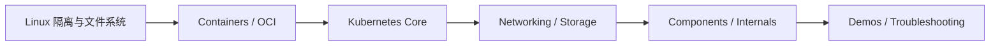

# 云原生学习索引

> ⬆ 返回 [知识库首页](../README.md)

云原生目录分为两部分：`containers/` 负责容器与镜像基础（Docker / OCI / Cgroup / Namespace / 网络），`kubernetes/` 负责 Kubernetes 的核心概念、网络存储、组件拆解、源码导读、路线与可运行 Demo。

## 推荐顺序

做万卡训练平台可从[作业成组准入、拓扑放置与恢复](kubernetes/core/training-job-placement.md)开始，并用[训练侧路线图](../ai/training/README.md)核对进程组和训练进度；初学 Kubernetes 则按下图推进。

## 领域入口

| 方向 | 入口 | 主要内容 |
| --- | --- | --- |
| 容器与镜像 | [Containers / Docker 笔记](containers/README.md) | Cgroup、Namespace、UnionFS、Dockerfile、网络模式与镜像构建 |
| Kubernetes | [Kubernetes 学习索引](kubernetes/README.md) | 核心控制面/调度、网络、存储、组件、源码、路线、Demo 与题库 |

第一次学习 Kubernetes 从 [Kubernetes 基础架构](kubernetes/core/kubernetes-basics.md) 开始；已有使用经验、希望进入源码或平台开发，直接进入 [Kubernetes 开发路线](kubernetes/roadmaps/k8s-development-roadmap.md)。
