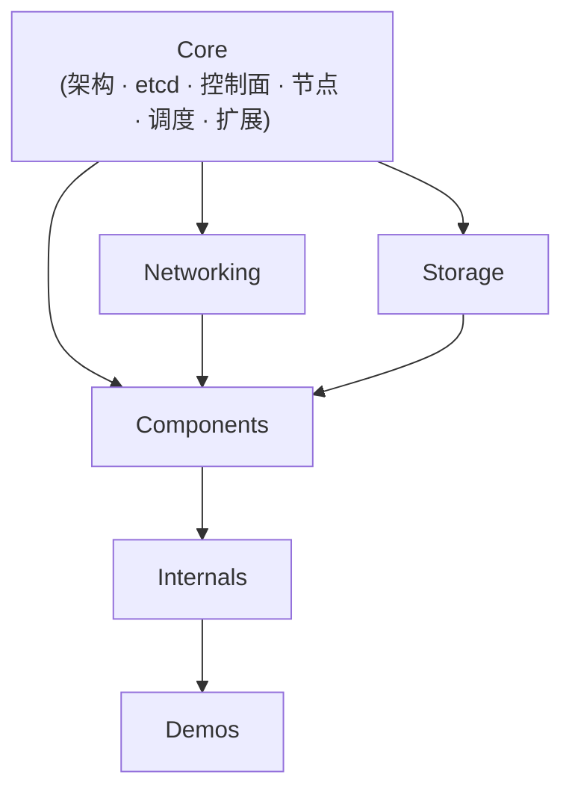

# Kubernetes 学习索引

> 返回 [云原生学习索引](../README.md)

Kubernetes 目录已扁平化收敛：原零散的 1~4 篇小目录统一合并至 `core/`，保留专题规模较大的 `networking/`、`storage/` 与系统深挖视图（`components/`、`internals/`、`roadmaps/`、`demos/`、`interview/`）。

## 主题入口

| 主题 | 入口 | 笔记直达 | 关注点 |
| --- | --- | --- | --- |
| 核心与控制面 | [Core](core/README.md) | [Kubernetes 基础架构](core/kubernetes-basics.md) · [etcd](core/etcd.md) · [API Resource](core/api-resource.md) · [Informer](core/informer.md) · [Kube-Scheduler](core/scheduler-deep-dive.md) · [GPU 调度](core/gpu-scheduling.md) · [Kubebuilder](core/kubebuilder.md) | 架构、etcd、APIServer/RBAC/Informer、Probe/OCI、调度与 Operator（14 篇） |
| 网络 | [Networking](networking/README.md) | 见主题索引 | CNI、Service、kube-proxy、Cilium 与排障 |
| 存储 | [Storage](storage/README.md) | 见主题索引 | CSI、Volume 生命周期、Sidecar 与排障 |

## 深入与实践

| 视图 | 入口 | 职责边界 |
| --- | --- | --- |
| 组件拆解 | [Components](components/README.md) | 职责、输入输出、关键链路和故障证据 |
| 源码导读 | [Internals](internals/README.md) | 固定版本下的真实源码调用链 |
| 学习路线 | [Roadmaps](roadmaps/README.md) | 学习顺序、阶段产出和进度 |
| 可运行示例 | [Demos](demos/README.md) | 代码、运行命令、预期结果与环境边界 |
| 复习题库 | [Interview](interview/README.md) | 问答、追问与系统设计复盘 |

## 内容分层约定

- 主题概念页回答“是什么、为什么、如何选”。
- Component 页回答“谁负责、输入输出是什么、故障证据在哪”。
- Internals 页负责逐函数和逐调用链源码，不在其他层重复维护同一源码细节。
- Demo 以实际可运行和可验证为准；题库不作为 canonical 技术正文。
