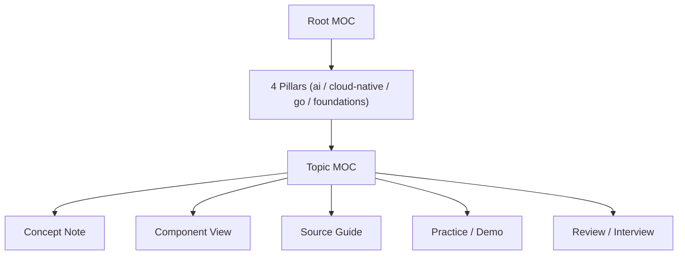

# Learning Notes 信息架构

## 设计目标

仓库只使用一个主分类轴：**知识领域**，顶层收拢为 **AI / Cloud Native / Go / Foundations** 四大支柱。内容的学习形式和深度作为领域内的次级视图，不再与领域目录平级竞争。

## 目录如何服务学习

**归档按系统，入门按任务。** AI 下区分模型基础、训练、GPU 算子、推理服务、后训练和 Agent；Kubernetes 下区分控制面、调度、节点运行时、网络和存储。一个子系统的机制、源码、实验是同一件事的不同深度，不是三个平行体系。Go 的语义与版本化实现保留双视图，工程基础继续按算法、数据、消息与工具查找。

[实战路线](../ai/ai-infra-fieldwork.md)负责连接不同系统，不拥有它们的代码。只有代码/数据/手册必须一起使用时才创建实验目录；单篇原理或一次学习记录不再新建多级分类。[学习方法](learning-by-doing.md)记录研究依据、适用边界和一条写好的复盘。

### 旧入口迁移

| 原先去哪里找 | 现在怎么找 |
| --- | --- |
| AI experiments | 数学实验在模型基础，梯度与恢复在训练，Split-KV 在算子，服务基准在推理，LoRA 与策略梯度在后训练。找任务用[实战路线](../ai/ai-infra-fieldwork.md) |
| Kubernetes core 里的 GPU/调度、容器运行与备份 | 分别进入[调度](../cloud-native/kubernetes/scheduling/README.md)、[节点运行时](../cloud-native/kubernetes/node-runtime/README.md)、[存储](../cloud-native/kubernetes/storage/README.md) |
| Kubernetes components、internals、demos | 正文与完整实验包搬到各子系统；按形式回查仍有[组件地图](../cloud-native/kubernetes/roadmaps/k8s-component-map.md)、[源码地图](../cloud-native/kubernetes/roadmaps/k8s-source-map.md)、[实验环境表](../cloud-native/kubernetes/roadmaps/k8s-lab-environments.md) |

普通笔记保留 basename，Obsidian 可继续按笔记名定位。仓库内相对链接、命令和索引跟随迁移更新；仓库外硬编码的旧路径不会自动转发。找不到旧文件时，先按标题或 basename 搜索。

## Canonical 内容与辅助视图

| 类型 | 回答的问题 | 是否承载 canonical 技术正文 |
| --- | --- | --- |
| 概念页 | 是什么、为什么、如何选择 | 是 |
| Component | 谁负责、输入输出、故障证据 | 是，但不重复逐函数源码 |
| Internals | 固定版本如何实现、调用链是什么 | 是，需注明版本边界 |
| Roadmap | 按什么顺序学、完成标准是什么 | 否，只组织链接与产出 |
| Demo | 如何运行、预期看到什么 | 代码与实验事实是 canonical |
| Interview | 如何复盘和表达 | 否，应链接前三类内容 |

## MOC 层级

- L0：根 `README.md`，只保留一条开场实验命令、四大支柱与文档查询入口。
- L1：支柱 `README.md`，链接内部主题入口。
- L2：主题 MOC，覆盖责任范围内的知识文件。

可达性从手写导航检查；全库生成索引不能替代子系统入口。新增一篇普通笔记通常只更新最近的 L2/L1 MOC，再运行 `python3 scripts/search_notes.py --rebuild-catalog` 同步全局速查索引。

## 快速检索与全局索引（1-hop）

为避免跨领域或跨多层目录点击，仓库提供三套零手工维护统计的检索入口：

- **全局速查索引**：[全库知识速查索引](catalog.md) 按四大支柱与子专题聚合所有文档链接、`[[wikilink]]`、标签与摘要。
- **标签聚合索引**：[全库标签聚合索引](tags.md) 按 `#tag` 聚合跨目录关联笔记。
- **SQLite FTS5 CLI 检索**：`scripts/search_notes.py`（纯 Python 3 标准库）：
  - 秒级检索：`python3 scripts/search_notes.py <keyword> [--domain ai] [--tag flashinfer] [--limit 15]`，利用 `.traces/notes_fts.sqlite3` 持久化 FTS5 索引（结合中文二元组与英文标识符分词）实现 10ms 级响应。
  - 重建索引：`python3 scripts/search_notes.py --rebuild-catalog`，确定性扫描全库并更新 `docs/catalog.md`、`docs/tags.md` 与 FTS5 数据库。

## 全局不变量

1. 除 `README.md` 外，Markdown basename 全局唯一。
2. 图片 basename 全局唯一。
3. 所有 wikilink 和本地 Markdown 链接可唯一解析。
4. 所有知识内容能从根 README 经 MOC 到达。
5. 普通 Markdown 文件名使用英文小写 kebab-case。
6. 不存在空文件和无实质内容的 stub。
7. 每道正式学习题紧跟一个非空、默认折叠的参考答案；任务清单和排障步骤不冒充题目。

这些规则由 `scripts/validate_notes.py` 持续检查。

答案遮盖使用 `> [!question]- 参考答案（点击展开）`。它在 Obsidian 中默认收起，在 GitHub 中降级为可读引用块；仓库优先保证答案中的 Markdown、Wikilink、代码和 Mermaid 不丢失。

## 迁移记录

| 阶段 | 迁移内容 |
| --- | --- |
| 2026-08-13 | 领域化重构：旧跨领域学习目录拆分到 `ai/`、`go/internals/` 与 `cloud-native/kubernetes/{components,internals,roadmaps,demos,interview,networking,storage}/`；Scheduler Assume 笔记合入 `scheduler-deep-dive.md` |
| 2026-11-17 | 四支柱扁平化与 FTS5 重建：新增 `ai/kernels/`；`cloud-native/docker/` 迁至 `cloud-native/containers/`；Kubernetes 6 个微目录合并至 `cloud-native/kubernetes/core/`；`go/*.md` 收敛至 `go/fundamentals/`；`algorithm/`、`database/`、`middleware/`、`misc/` 扁平收拢至 `foundations/` |
| 2026-11-17 | AI 全栈知识树闭环升级：`ai/foundations/` 新增 LLM 专属线代/高代笔记及 `llm-math-and-simd-lab` 离线实验；`ai/kernels/` 新增 SIMD→SIMT、CUDA 全景生态与 FlashInfer 通俗桥梁并重排为三阶梯队；`ai/inference/` 新增三剑客全栈路线、vLLM V1 与 SGLang SRT 深度解析并清理历史非法 Mermaid 语法 |
| 2026-11-21 | 实验、组件和源码按实际子系统归位；课程改为训练正确性、放置、恢复与服务的可验证任务 |
