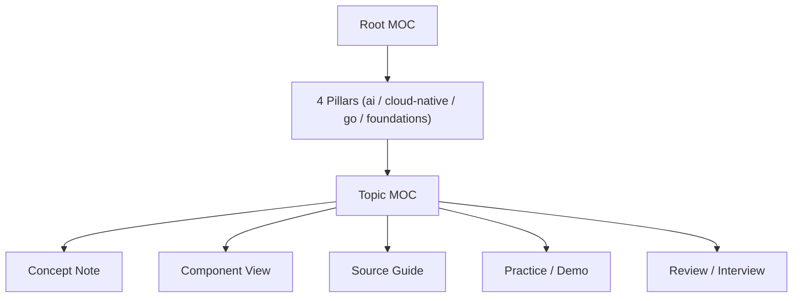

# Learning Notes 信息架构

## 设计目标

仓库只使用一个主分类轴：**知识领域**，顶层收拢为 **AI / Cloud Native / Go / Foundations** 四大支柱。内容的学习形式和深度作为领域内的次级视图，不再与领域目录平级竞争。

## 为什么重构

### 2026-08 领域化重构

旧结构把路线、源码、组件、排障、Demo 和题库集中到一个跨领域目录；同一主题又在领域目录中存在概念页，造成两套导航、职责重复和首页过载，因此拆分为按领域归属的布局。

### 2026-11 四支柱扁平化与 FTS5 检索重建

随着学习重心演进为 **AI Infra & Systems Full-Stack**（新增 `ai/kernels/` 深入 GPU 算子与 FlashInfer 源码），原结构暴露出三类新问题：顶层分散 7 个大小极不均衡的目录、Kubernetes 下 6 个仅含 1~4 篇笔记的微型子目录带来多余点击、根目录残留 333 MB `node_modules/` 拖慢检索。本轮重构完成了：

1. 清理根目录下未使用的 `node_modules/`、`package.json`、`package-lock.json` 及历史一次性迁移脚本。
2. 顶层收拢为四大支柱：`ai/`、`cloud-native/`、`go/`、`foundations/`（合并原 `algorithm/`、`database/`、`middleware/`、`misc/` 并扁平化内部子目录）。
3. `cloud-native/docker/` 规范化为 `cloud-native/containers/`；Kubernetes 下 6 个微型子目录合并为 `cloud-native/kubernetes/core/`；`go/` 下散落笔记统一收敛到 `go/fundamentals/`。
4. 为全部历史内容笔记补齐 `# H1` 一级标题，配合持久化 SQLite FTS5 全文索引（`.traces/notes_fts.sqlite3`）、[全库知识速查索引](catalog.md) 与 [全库标签聚合索引](tags.md) 实现毫秒级检索与 1-hop 跳转。

### 2026-11 AI 全栈知识树升级（数学底座 → CUDA 生态 → FlashInfer → 双推理引擎）

在原有数据流与 FlashInfer 源码导读基础上，进一步消除从“零散概念”跨入“底层算子与现代推理引擎内核”之间的断层，将 `ai/` 体系打通为纵横正交的完整闭环：

1. **补齐大模型专属数学底座（`ai/foundations/`）**：新增面向大模型的线性代数（几何投影、矩阵乘法四视角与 Block GEMM 分块、高维张量 `Shape/Stride` 与向量化访存布局）与高等代数（秩与矩阵结合律 MLA 权重吸收、正交旋转与 RoPE、特征谱与残差/Pre-Norm、SVD 与 LoRA/KV 低秩压缩），配套零依赖离线实验 `ai/experiments/llm-math-and-simd-lab/`，无需盲啃整本数学教材即可掌握底层核心不变量。
2. **铺设并行硬件演进与 CUDA 全景生态阶梯（`ai/kernels/`）**：新增 CPU SIMD → GPU SIMT / Tensor Core 底层并行模型、CUDA 全景软件栈与算子工程师进阶路线（PTX/SASS、CCCL/CUB、CUTLASS/CuTe、Triton、`nsys`/`ncu`）以及 FlashInfer 分页寻址手算与 `Plan-Run` 对接桥梁，将算子专题重组为“硬件与生态筑基 → 通俗桥梁与工作流 → FlashInfer v0.7.3 源码深潜”三层平滑阶梯。
3. **形成“一纵一横”全栈推理架构深潜（`ai/inference/`）**：纵向新增 FlashInfer × vLLM × SGLang 全栈统一学习路线，并分别深入拆解 vLLM V1（统一 Token 预算调度、Hash Block Prefix Cache、Piecewise CUDA Graph）与 SGLang SRT（三进程解耦、RadixCache 压缩前缀树、Zero-Overhead Overlap Scheduler、Compressed FSM / XGrammar 结构化解码）；横向与分布式多级 KV Store、PD 分离及 K8s Inference Router 学习路线互补。

## Canonical 内容与辅助视图

| 类型 | 回答的问题 | 是否承载 canonical 技术正文 |
| --- | --- | --- |
| 概念页 | 是什么、为什么、如何选择 | 是 |
| Component | 谁负责、输入输出、故障证据 | 是，但不重复逐函数源码 |
| Internals | 固定版本如何实现、调用链是什么 | 是，需注明版本边界 |
| Roadmap | 按什么顺序学、完成标准是什么 | 否，只组织链接与产出 |
| Demo | 如何运行、预期看到什么 | 代码与实验事实是 canonical |
| Interview | 如何复盘和表达 | 否，应链接前三类内容 |

## MOC 层级

- L0：根 `README.md`，只链接四大支柱入口与全局快速检索入口。
- L1：支柱 `README.md`，链接内部主题入口。
- L2：主题 MOC，覆盖责任范围内的知识文件。

新增一篇普通笔记通常只更新最近的 L2/L1 MOC，再运行 `python3 scripts/search_notes.py --rebuild-catalog` 同步全局速查索引。

## 快速检索与全局索引（1-hop）

为避免跨领域或跨多层目录点击，仓库提供三套零手工维护统计的检索入口：

- **全局速查索引**：[全库知识速查索引](catalog.md) 按四大支柱与子专题聚合所有文档链接、`[[wikilink]]`、标签与摘要。
- **标签聚合索引**：[全库标签聚合索引](tags.md) 按 `#tag` 聚合跨目录关联笔记。
- **SQLite FTS5 CLI 检索**：`scripts/search_notes.py`（纯 Python 3 标准库）：
  - 秒级检索：`python3 scripts/search_notes.py <keyword> [--domain ai] [--tag flashinfer] [--limit 15]`，利用 `.traces/notes_fts.sqlite3` 持久化 FTS5 索引（结合中文二元组与英文标识符分词）实现 10ms 级响应。
  - 重建索引：`python3 scripts/search_notes.py --rebuild-catalog`，确定性扫描全库并更新 `docs/catalog.md`、`docs/tags.md` 与 FTS5 数据库。

## 全局不变量

1. 除 `README.md` 外，Markdown basename 全局唯一。
2. 图片 basename 全局唯一。
3. 所有 wikilink 和本地 Markdown 链接可唯一解析。
4. 所有知识内容能从根 README 经 MOC 到达。
5. 普通 Markdown 文件名使用英文小写 kebab-case。
6. 不存在空文件和无实质内容的 stub。
7. 每道正式学习题紧跟一个非空、默认折叠的参考答案；任务清单和排障步骤不冒充题目。

这些规则由 `scripts/validate_notes.py` 持续检查。

答案遮盖使用 `> [!question]- 参考答案（点击展开）`。它在 Obsidian 中默认收起，在 GitHub 中降级为可读引用块；仓库优先保证答案中的 Markdown、Wikilink、代码和 Mermaid 不丢失。

## 迁移记录

| 阶段 | 迁移内容 |
| --- | --- |
| 2026-08-13 | 领域化重构：旧跨领域学习目录拆分到 `ai/`、`go/internals/` 与 `cloud-native/kubernetes/{components,internals,roadmaps,demos,interview,networking,storage}/`；Scheduler Assume 笔记合入 `scheduler-deep-dive.md` |
| 2026-11-17 | 四支柱扁平化与 FTS5 重建：新增 `ai/kernels/`；`cloud-native/docker/` 迁至 `cloud-native/containers/`；Kubernetes 6 个微目录合并至 `cloud-native/kubernetes/core/`；`go/*.md` 收敛至 `go/fundamentals/`；`algorithm/`、`database/`、`middleware/`、`misc/` 扁平收拢至 `foundations/` |
| 2026-11-17 | AI 全栈知识树闭环升级：`ai/foundations/` 新增 LLM 专属线代/高代笔记及 `llm-math-and-simd-lab` 离线实验；`ai/kernels/` 新增 SIMD→SIMT、CUDA 全景生态与 FlashInfer 通俗桥梁并重排为三阶梯队；`ai/inference/` 新增三剑客全栈路线、vLLM V1 与 SGLang SRT 深度解析并清理历史非法 Mermaid 语法 |
